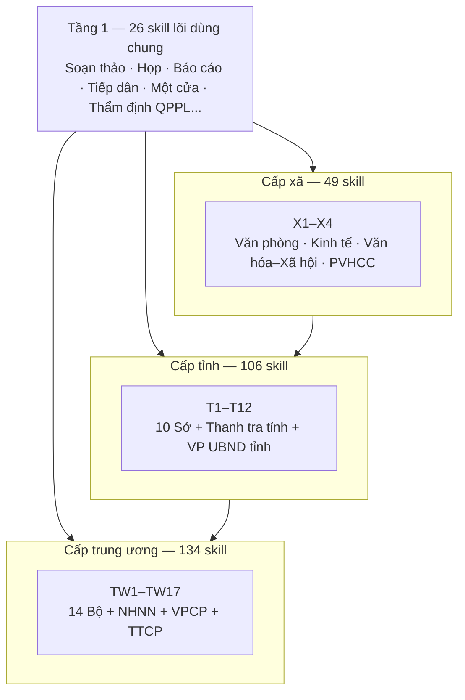
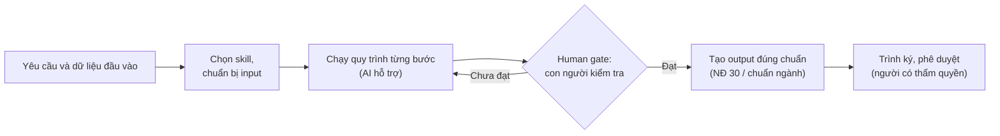

# Gov AI Skills Framework

**Bộ 315 skill AI phục vụ nghiệp vụ khối cơ quan hành chính nhà nước Việt Nam, từ trung ương đến địa phương.**

Chuẩn hóa cách soạn thảo văn bản, tiếp nhận và xử lý hồ sơ, tổng hợp báo cáo, thẩm định, kiểm tra và điều phối công việc hành chính. Mỗi skill xác định dữ liệu đầu vào, quy trình từng bước, sản phẩm đầu ra, chuẩn tài liệu áp dụng và điểm kiểm duyệt của con người.

[](CHANGELOG.md)
[](CHI-MUC-SKILL.md)
[](#quy-mô)

[Danh mục skill](CHI-MUC-SKILL.md) · [Quy cách đầu ra](docs/QUY-CACH-DAU-RA.md) · [Bảng ưu tiên](tai-lieu/uu-tien-nghiep-vu.csv) · [Nhật ký thay đổi](CHANGELOG.md)

| Quy mô | Giá trị |
| --- | ---: |
| Phiên bản nội dung | **1.0** |
| Ngày phát hành | **10/10/2026** |
| Tổng số skill | **315** |
| Tầng 1 — skill lõi dùng chung | **26** |
| Cấp xã (X1–X4) | **49** |
| Cấp tỉnh (T1–T12) | **106** |
| Cấp trung ương (TW1–TW17) | **134** |

## Những điểm chính của phiên bản 1.0

- **Bao phủ 3 cấp chính quyền:** 14 bộ + 3 cơ quan ngang bộ ở trung ương, 10 sở + Thanh tra tỉnh + Văn phòng UBND tỉnh ở cấp tỉnh, 4 đầu mối ở cấp xã, cùng 26 skill lõi dùng chung mọi cấp.
- **Chuẩn cấu trúc 10 mục cho mọi skill:** frontmatter → khi nào dùng → đầu vào → quy trình (mỗi bước: việc làm, input dùng, vai trò + AI hỗ trợ + ⏱ thời gian, lưu ý nghiệp vụ, kết quả) → sơ đồ luồng → đầu ra → checklist → ví dụ mô phỏng → human gate → giới hạn → căn cứ pháp lý.
- **Chuẩn tài liệu đầu ra phân tầng:** ưu tiên chuẩn riêng của ngành/cơ quan chủ quản (mẫu, biểu mẫu chuyên ngành); tài liệu không có quy chuẩn riêng áp dụng thể thức Nghị định 30/2020/NĐ-CP; văn bản quy phạm pháp luật theo Luật Ban hành văn bản QPPL.
- **Human gate bắt buộc:** mọi skill có điểm dừng để con người kiểm tra, phê duyệt; AI không ký, không phát hành văn bản, không tự tạo số liệu hay căn cứ pháp lý.
- **Dữ liệu mô phỏng 100%:** mọi ví dụ trong skill dùng dữ liệu giả lập, không dùng tên địa phương/cá nhân có thật.

## Kiến trúc



Các cấp liên thông với nhau qua chuỗi nghiệp vụ (ví dụ: tiếp nhận hồ sơ tại xã → thẩm định tại sở → tổng hợp báo cáo về bộ). Xem 29 cặp song sinh xã↔tỉnh và 11 chuỗi liên thông 3 cấp trong [chỉ mục](CHI-MUC-SKILL.md).

## Phạm vi nghiệp vụ

| Nhóm công việc | Sản phẩm điển hình | Skill tham khảo |
| --- | --- | --- |
| Soạn thảo văn bản hành chính | Công văn, tờ trình, quyết định, thông báo | [Soạn công văn](skills/soan-cong-van/SKILL.md), [Soạn tờ trình](skills/soan-to-trinh/SKILL.md) |
| Họp và báo cáo | Biên bản họp, báo cáo định kỳ, kế hoạch công tác | [Soạn biên bản họp](skills/soan-bien-ban-hop/SKILL.md), [Tổng hợp báo cáo định kỳ](skills/tong-hop-bao-cao-dinh-ky/SKILL.md) |
| Tiếp dân và xử lý đơn thư | Sổ tiếp dân, phiếu phân loại đơn thư | [Tiếp công dân](skills/tiep-cong-dan/SKILL.md), [Phân loại, xử lý đơn thư](skills/phan-loai-xu-ly-don-thu/SKILL.md) |
| Nghiệp vụ cấp xã | Hồ sơ hộ tịch, kiểm tra ATTP cơ sở | [Đăng ký khai sinh](skills/dang-ky-khai-sinh/SKILL.md), [ATTP cơ sở](skills/attp-co-so/SKILL.md) |
| Nghiệp vụ cấp tỉnh | Thẩm định dự án, quản lý ngành | [Thẩm định dự án đầu tư](skills/tham-dinh-du-an-dau-tu/SKILL.md) |
| Nghiệp vụ trung ương | Xây dựng VBQPPL, báo cáo Chính phủ | [Xây dựng nghị định](skills/tw-xay-dung-nghi-dinh/SKILL.md), [Báo cáo Chính phủ](skills/tw-bao-cao-chinh-phu/SKILL.md) |

Bộ skill gồm hai tầng: **26 skill lõi** hỗ trợ công việc dùng chung mọi cấp và **289 skill nghiệp vụ** gắn với chức năng từng cơ quan, đơn vị. Đơn vị triển khai có thể điều chỉnh đầu mối theo cơ cấu thực tế của địa phương.

## File đầu ra và lựa chọn định dạng

### Định dạng mặc định

| Định dạng | Công dụng |
| --- | --- |
| `.docx` | Văn bản hành chính, báo cáo, tờ trình, biên bản, kế hoạch |
| `.xlsx` | Bảng tổng hợp số liệu, danh sách, bảng theo dõi |
| `.pdf` | Bản ban hành, lưu trữ, công bố |

Đây là mặc định khi người dùng chưa chỉ định định dạng. Mỗi skill có danh sách sản phẩm riêng trong mục "Đầu ra (Output)".

### Các định dạng được lựa chọn theo sản phẩm

| Nhóm | Định dạng | Khi sử dụng |
| --- | --- | --- |
| Văn bản | `.docx`, `.pdf` | Soạn thảo, biên tập; ban hành, lưu trữ hoặc công bố |
| Bảng tính và dữ liệu bảng | `.xlsx`, `.csv` | Tổng hợp số liệu, danh sách, trao đổi dữ liệu |
| Biểu mẫu chuyên ngành | `.docx`, `.pdf` | Giấy phép, giấy chứng nhận, biểu mẫu hộ tịch theo mẫu của bộ/ngành |

**Quy tắc giao file:**

- File phải tồn tại, đọc được và có nội dung đúng định dạng; không đổi đuôi để giả lập kết quả.
- Nội dung trong chat dùng để trao đổi hoặc giải thích; không thay file khi nhiệm vụ yêu cầu tạo sản phẩm.
- Bộ hồ sơ gồm nhiều văn bản phải có đủ file thành phần.
- Chỉ xác nhận các kiểm tra đã thực hiện. Nếu không tạo được định dạng yêu cầu, thông báo giới hạn trong tin nhắn giao kết quả.
- Thông tin chưa có được chừa bằng dòng dấu chấm hoặc ô trống theo mẫu; không tự điền số văn bản, ngày ban hành, chữ ký hoặc con dấu.

## Cách sử dụng

1. **Chọn skill:** tìm trong [danh mục](CHI-MUC-SKILL.md) hoặc mở `tai-lieu/danh-muc-skill-tuong-tac.html` trên trình duyệt để tra cứu theo phòng ban, lọc theo cấp.
2. **Chuẩn bị đầu vào:** thu thập dữ liệu theo bảng "Đầu vào (Input)" của `SKILL.md`. Thông tin chưa có được chừa chỗ đúng mẫu, không tự bịa.
3. **Thực hiện theo quy trình:** làm từng bước, dùng AI hỗ trợ soạn thảo, tổng hợp, đối chiếu; dừng ở **human gate** để kiểm tra.
4. **Hoàn thiện và trình ký:** đối chiếu output với [chuẩn tài liệu đầu ra](docs/QUY-CACH-DAU-RA.md), trình người có thẩm quyền ký, phát hành theo quy trình văn thư của đơn vị.

### Ví dụ yêu cầu

```text
Dùng skill soan-to-trinh để soạn tờ trình xin chủ trương
đầu tư dự án đường giao thông nông thôn của xã.

Cấp trình: Đảng ủy xã.
Căn cứ: Nghị quyết 57/NQ-CP (còn hiệu lực), kế hoạch đầu tư công năm 2026.
Nội dung đề nghị: đầu tư 2,5 km đường bê tông, kinh phí 4,2 tỷ đồng.
Thông tin chưa cung cấp: giữ dấu chấm theo mẫu.
Đầu ra: file Word .docx đúng thể thức NĐ 30/2020/NĐ-CP.
```

Với ví dụ này, AI dự thảo tờ trình đúng bố cục và thể thức; cán bộ kiểm tra nội dung, số liệu tại human gate trước khi trình ký. AI không tự ký, không tự gửi văn bản.

### Tải bộ skill

Chọn **Code → Download ZIP** trên GitHub hoặc tải bằng Git:

```bash
git clone https://github.com/phamtruong91/gov-skills-framework.git
cd gov-skills-framework
```

Khi dùng một skill, đọc toàn bộ file `SKILL.md` của skill đó cùng các tài liệu được liên kết trong mục "Căn cứ & lưu ý".

## Quy trình thực hiện



Việc đối chiếu và kiểm tra diễn ra trong quá trình làm, đặc biệt tại human gate. Nếu nhiệm vụ trực tiếp là kiểm tra hồ sơ hoặc thẩm định, bảng kết quả nghiệp vụ là sản phẩm chính.

## Chuẩn tài liệu đầu ra và phê duyệt

Thứ tự ưu tiên khi xác định chuẩn tài liệu đầu ra (xem [quy cách chi tiết](docs/QUY-CACH-DAU-RA.md)):

1. **Chuẩn riêng của ngành/cơ quan chủ quản** — mẫu, biểu mẫu, quy chuẩn tại văn bản quy phạm chuyên ngành (giấy phép, giấy chứng nhận, biểu mẫu hộ tịch, văn bằng...).
2. **Nghị định 30/2020/NĐ-CP** — thể thức văn bản hành chính cho các tài liệu không có quy chuẩn riêng (9 thành phần: quốc hiệu–tiêu ngữ, tên cơ quan, số ký hiệu, địa danh–thời gian, tên loại–trích yếu, nội dung, chức vụ/chữ ký, dấu & chữ ký số, nơi nhận).
3. **Luật Ban hành văn bản QPPL** — thể thức văn bản quy phạm pháp luật (không áp NĐ 30).

- Chức vụ, họ tên và chữ ký được xử lý theo nguồn và thẩm quyền; không tạo chữ ký, con dấu hay trạng thái đã duyệt.
- Chỉ xử lý dữ liệu cá nhân trong phạm vi được phép và cần thiết cho nghiệp vụ.
- Đơn vị phải đối chiếu quy chế, thẩm quyền và pháp luật tại thời điểm sử dụng; bộ skill không thay thế tư vấn pháp lý chính thức.

## Lộ trình ưu tiên

File [tai-lieu/uu-tien-nghiep-vu.csv](tai-lieu/uu-tien-nghiep-vu.csv) phân loại 315 skill theo mức độ "phải làm thủ công thường xuyên nhưng phần mềm hiện có chưa đáp ứng":

| Mức ưu tiên | Số skill | Đặc điểm |
| --- | ---: | --- |
| **Ưu tiên 1 — Cốt lõi** | 20 | Việc hàng ngày, hoàn toàn thủ công, chưa có phần mềm chuyên dụng → **pilot trước** |
| Ưu tiên 2 — Cao | 126 | Nghiệp vụ chuyên môn theo tuần/tháng/quý, chủ yếu thủ công |
| Ưu tiên 3 — Bổ trợ | 132 | Đã có hệ thống một phần (một cửa, hộ tịch, ĐKKD...) — AI bổ sung |
| Ưu tiên 4 — Chuyên sâu | 37 | Nghiệp vụ vĩ mô/chuyên sâu, tần suất thấp |

## Cấu trúc repository

```text
gov-skills-framework/
├── README.md                  # File này
├── CHANGELOG.md               # Nhật ký thay đổi theo phiên bản
├── VERSION                    # Phiên bản hiện tại
├── CHI-MUC-SKILL.md           # Chỉ mục tra cứu 315 skill + cặp song sinh + chuỗi liên thông
├── skills/
│   └── <ma-skill>/
│       └── SKILL.md           # 315 skill, mỗi skill 1 file chuẩn 10 mục
├── docs/                      # Khung kiến trúc 3 cấp, kho căn cứ pháp lý,
│                              # quy cách đầu ra, quy ước dữ liệu mô phỏng
├── scripts/
│   └── validate_skills.py     # Kiểm tra cấu trúc skill
└── tai-lieu/                  # Word mô tả chi tiết, HTML tra cứu tương tác,
                               # CSV bảng ưu tiên
```

## Kiểm tra và đóng góp

Trước khi gửi thay đổi, kiểm tra cấu trúc skill:

```bash
python3 scripts/validate_skills.py
```

Công cụ kiểm tra frontmatter, tiêu đề, đủ 10 mục chuẩn, bảng đầu vào, đánh số bước quy trình, sơ đồ mermaid và checklist chuẩn đầu ra. Việc xác nhận chất lượng nội dung nghiệp vụ và căn cứ pháp lý vẫn cần thực hiện theo chuyên môn.

Khi có văn bản pháp luật mới: rà soát mục "Căn cứ & lưu ý" của skill liên quan, cập nhật quy trình, giữ nguyên số bước và nội dung nghiệp vụ theo khung khảo sát. Mọi thay đổi phát hành theo tag `vX.Y.Z` kèm ghi chú trong [CHANGELOG](CHANGELOG.md).

## Giấy phép và quản trị

Bản quyền **CES Global, 2026**. Liên hệ để trao đổi về điều khoản sử dụng bộ skill.

Người duy trì: [phamtruong91](https://github.com/phamtruong91). Phiên bản **1.0** là phiên bản nội dung của bộ skill; xem [CHANGELOG](CHANGELOG.md) và lịch sử Git để theo dõi thay đổi.

## Liên hệ

**Phạm Văn Trường** — 0911471191 — truongpv.cesglobal@gmail.com
