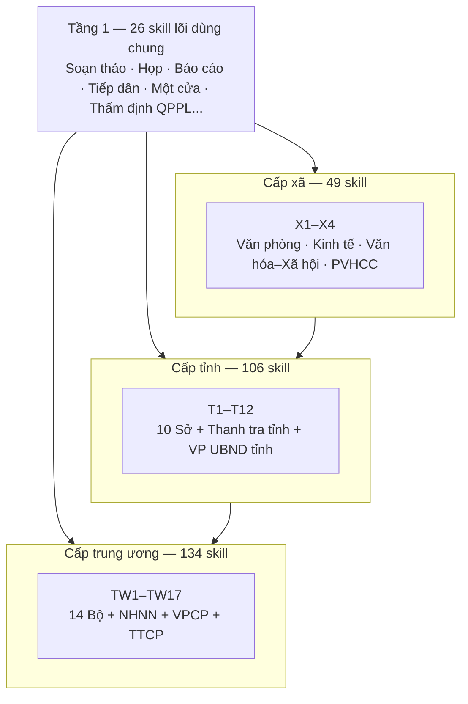
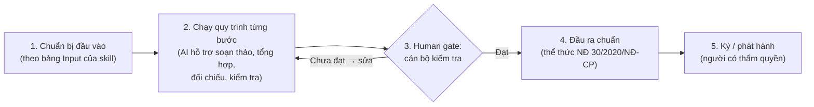
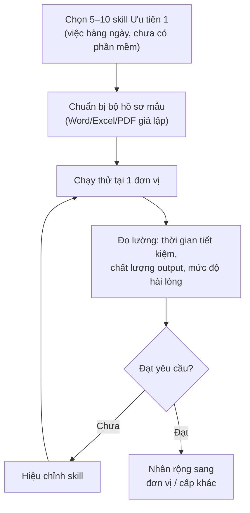
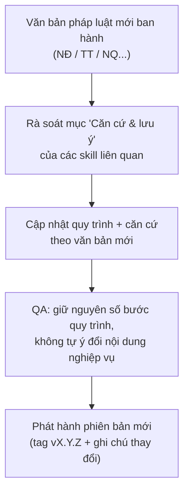

# Bộ Skill AI — Khối cơ quan hành chính nhà nước


Bộ **315 skill AI** mô tả quy trình nghiệp vụ của khối cơ quan hành chính nhà nước Việt Nam
từ trung ương đến địa phương, xây dựng theo văn bản pháp luật mới nhất đến tháng 10/2026.

> AI trong bộ skill này đóng vai trò **trợ lý nghiệp vụ**: hỗ trợ soạn thảo, tổng hợp,
> thẩm định, kiểm tra và chuẩn bị tài liệu — **không** ra quyết định hành chính thay người
> có thẩm quyền, **không** tự ký, **không** tự phát hành văn bản.

## Mục lục

- [Quy mô](#quy-mô)
- [Kiến trúc](#kiến-trúc)
- [Cấu trúc chuẩn của một skill](#cấu-trúc-chuẩn-của-một-skill)
- [Luồng workflow sử dụng skill](#luồng-workflow-sử-dụng-skill)
- [Luồng triển khai pilot](#luồng-triển-khai-pilot)
- [Luồng cập nhật khi có văn bản mới](#luồng-cập-nhật-khi-có-văn-bản-mới)
- [Cấu trúc repository](#cấu-trúc-repository)
- [Hướng dẫn sử dụng](#hướng-dẫn-sử-dụng)
- [Lộ trình ưu tiên](#lộ-trình-ưu-tiên)
- [Nguyên tắc cốt lõi](#nguyên-tắc-cốt-lõi)
- [Đóng góp và cập nhật](#đóng-góp-và-cập-nhật)
- [Lịch sử phiên bản](#lịch-sử-phiên-bản)
- [Liên hệ](#liên-hệ)

## Quy mô

| Phạm vi | Đơn vị | Số skill |
|---|---|---:|
| **Tầng 1** — Skill lõi dùng chung | Toàn hệ thống | 26 |
| **Cấp xã** — X1 Văn phòng, X2 Kinh tế, X3 Văn hóa–Xã hội, X4 PVHCC | 4 phòng | 49 |
| **Cấp tỉnh** — T1–T12 (10 sở, Thanh tra tỉnh, Văn phòng UBND tỉnh) | 12 đơn vị | 106 |
| **Cấp trung ương** — TW1–TW17 (14 bộ + 3 cơ quan ngang bộ) | 17 đơn vị | 134 |
| **Tổng** | **34 đơn vị** | **315** |

Chỉ mục tra cứu đầy đủ nằm ở [`CHI-MUC-SKILL.md`](CHI-MUC-SKILL.md), bao gồm:
29 cặp nghiệp vụ song sinh xã↔tỉnh và 11 chuỗi liên thông ba cấp (xã → tỉnh → trung ương).

## Kiến trúc



- **Tầng 1**: các nghiệp vụ lõi mà cán bộ mọi cấp đều làm hàng ngày (soạn công văn, tờ trình,
  báo cáo, biên bản họp, tổng hợp báo cáo định kỳ, tiếp công dân, phân loại đơn thư...).
- **Cấp xã / tỉnh / trung ương**: nghiệp vụ chuyên môn đặc thù theo chức năng từng đơn vị.
- Các cấp liên thông với nhau qua chuỗi nghiệp vụ (ví dụ: tiếp nhận hồ sơ tại xã →
  thẩm định tại sở → tổng hợp báo cáo về bộ).

## Cấu trúc chuẩn của một skill

Mỗi skill là một file `SKILL.md` gồm **10 mục chuẩn**:

| # | Mục | Nội dung |
|---|---|---|
| 1 | Frontmatter | `name` (mã skill), `description` (1–2 câu) |
| 2 | Khi nào dùng | Điều kiện kích hoạt skill |
| 3 | Đầu vào | Bảng `Trường \| Mô tả \| Bắt buộc` |
| 4 | Quy trình | Từng **Bước N**: việc làm → input dùng → vai trò + AI hỗ trợ + ⏱ thời gian → lưu ý nghiệp vụ → kết quả bước |
| 5 | Sơ đồ luồng | Workflow Mermaid của quy trình |
| 6 | Đầu ra | Danh mục output + cấu trúc output chuẩn (thể thức NĐ 30/2020/NĐ-CP) |
| 7 | Checklist | Tiêu chí nghiệm thu |
| 8 | Ví dụ mô phỏng | Kịch bản giả lập 100% (không dùng dữ liệu thật) |
| 9 | Human gate | Điểm dừng bắt buộc con người kiểm tra/phê duyệt |
| 10 | Giới hạn + Căn cứ | Việc AI không làm + văn bản pháp lý liên quan |

## Luồng workflow sử dụng skill



**Ví dụ thực tế** — skill `soan-cong-van`:
1. Cán bộ nhập: loại công văn, nội dung chính, đơn vị nhận, thời hạn.
2. AI dự thảo công văn đúng thể thức, đề xuất câu chữ, kiểm tra lỗi chính tả.
3. Cán bộ đọc lại, chỉnh sửa, trình lãnh đạo — **AI không tự ký, không tự gửi**.
4. Văn bản hoàn chỉnh được ban hành theo quy trình văn thư hiện hành.

## Luồng triển khai pilot



## Luồng cập nhật khi có văn bản mới



Kho văn bản pháp lý tham chiếu: [`docs/tai-lieu-moi-nhat.md`](docs/tai-lieu-moi-nhat.md).

## Cấu trúc repository

```
.
├── README.md                  # File này
├── VERSION                    # Phiên bản hiện tại
├── CHI-MUC-SKILL.md           # Chỉ mục tra cứu 315 skill + bảng cặp song sinh
│                              # xã↔tỉnh + chuỗi liên thông 3 cấp
├── skills/                    # 315 thư mục skill, mỗi thư mục 1 file SKILL.md
│   └── <ma-skill>/
│       └── SKILL.md
├── docs/                      # Khung kiến trúc 3 cấp, kho căn cứ pháp lý,
│                              # quy ước dữ liệu mô phỏng
└── tai-lieu/                  # Tài liệu mô tả chi tiết (Word),
                               # danh mục tra cứu tương tác (HTML),
                               # bảng ưu tiên nghiệp vụ (CSV)
```

## Hướng dẫn sử dụng

**Cách 1 — Tra cứu nhanh (không cần kỹ thuật):**
mở `tai-lieu/danh-muc-skill-tuong-tac.html` trên trình duyệt → click từng phòng ban
để xem các skill tiêu biểu, lọc theo cấp, tìm kiếm theo tên/mã skill.

**Cách 2 — Đọc tài liệu tổng thể:**
mở `tai-lieu/Bo_skill_AI_co_quan_hanh_chinh_Mo_ta_chi_tiet.docx`
(8 phần: tổng quan, kiến trúc, khung pháp lý, danh mục chi tiết 315 skill,
vai trò theo đơn vị, lộ trình triển khai).

**Cách 3 — Dùng từng skill trong công việc:**
mở `skills/<ma-skill>/SKILL.md` → đọc "Khi nào dùng" → chuẩn bị đầu vào theo
bảng Input → làm theo từng bước quy trình → dừng ở Human gate để kiểm tra →
hoàn thiện đầu ra theo cấu trúc chuẩn.

**Cách 4 — Tích hợp vào hệ thống AI Agent:**
mỗi thư mục `skills/<ma-skill>/` là một đơn vị độc lập — nạp file `SKILL.md`
làm system prompt / playbook cho agent khi xử lý nghiệp vụ tương ứng.

## Lộ trình ưu tiên

File `tai-lieu/uu-tien-nghiep-vu.csv` phân loại toàn bộ 315 skill theo mức độ
"cần làm thủ công thường xuyên nhưng phần mềm hiện có chưa đáp ứng":

| Mức ưu tiên | Số skill | Đặc điểm |
|---|---:|---|
| **Ưu tiên 1 — Cốt lõi** | 20 | Việc hàng ngày, hoàn toàn thủ công trên Word/Excel, chưa có phần mềm chuyên dụng → **pilot trước** |
| Ưu tiên 2 — Cao | 126 | Nghiệp vụ chuyên môn theo tuần/tháng/quý, chủ yếu thủ công |
| Ưu tiên 3 — Bổ trợ | 132 | Đã có hệ thống một phần (một cửa, hộ tịch, ĐKKD...) — AI bổ sung |
| Ưu tiên 4 — Chuyên sâu | 37 | Nghiệp vụ vĩ mô/chuyên sâu, tần suất thấp |

## Nguyên tắc cốt lõi

1. **AI hỗ trợ, con người quyết định** — AI không ra quyết định hành chính thay người
   có thẩm quyền; không tự ký, không tự phát hành văn bản.
2. **Human gate bắt buộc** — mọi skill đều có điểm dừng để con người kiểm tra/phê duyệt.
3. **Không bịa đặt** — số liệu, hồ sơ, căn cứ pháp lý do con người cung cấp và kiểm chứng;
   AI không tự tạo số hiệu văn bản, con số hay hồ sơ.
4. **Đúng thể thức** — văn bản hành chính tuân thủ Nghị định 30/2020/NĐ-CP.
5. **Dữ liệu giả lập** — mọi ví dụ trong skill là mô phỏng 100%, không dùng tên
   địa phương/cá nhân có thật.
6. **Phạm vi công khai** — với lĩnh vực quốc phòng, công an: chỉ nghiệp vụ hành chính
   công khai, không nội dung mật, tác chiến, trinh sát.

## Đóng góp và cập nhật

- Khi có văn bản pháp luật mới: cập nhật skill liên quan theo
  [luồng cập nhật](#luồng-cập-nhật-khi-có-văn-bản-mới), giữ nguyên số bước quy trình
  và nội dung nghiệp vụ theo khung khảo sát.
- Mọi thay đổi phát hành theo tag phiên bản `vX.Y.Z` kèm ghi chú thay đổi.

## Lịch sử phiên bản

| Phiên bản | Ngày | Nội dung |
|---|---|---|
| v1.0 | 10/10/2026 | Phát hành đầu tiên: 315 skill (Tầng 1: 26 · Xã: 49 · Tỉnh: 106 · Trung ương: 134), chuẩn cấu trúc 10 mục, chỉ mục tra cứu, tài liệu Word/HTML/CSV |

## Liên hệ

**Phạm Văn Trường** — 0911471191 — truongpv.cesglobal@gmail.com
