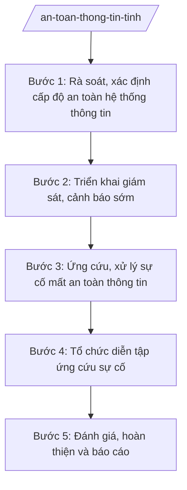

# Skill: Bảo đảm an toàn thông tin mạng

## 2. Khi nào dùng
- Rà soát, phân loại, xác định cấp độ an toàn hệ thống thông tin của các sở, ban, ngành, UBND xã.
- Xây dựng phương án bảo đảm an toàn thông tin mạng cho hệ thống thông tin cấp tỉnh.
- Giám sát, cảnh báo sớm nguy cơ, sự cố mất an toàn thông tin mạng.
- Ứng cứu, xử lý sự cố mất an toàn thông tin mạng.
- Tổ chức diễn tập ứng cứu sự cố an toàn thông tin mạng định kỳ.
- Báo cáo công tác bảo đảm an toàn thông tin mạng gửi Bộ KH&CN và UBND tỉnh.

## 3. Đầu vào (Input)
| Trường | Mô tả | Bắt buộc |
|--------|-------|----------|
| `danh_sach_he_thong` | Danh sách hệ thống thông tin của các sở, ban, ngành, UBND xã (tên, đơn vị vận hành, dữ liệu xử lý) | Có |
| `cap_do_an_toan` | Cấp độ an toàn đã xác định của từng hệ thống (nếu có) | Không |
| `su_co_da_xay_ra` | Thông tin sự cố mất ATTT đã xảy ra (thời gian, hệ thống ảnh hưởng, mức độ) | Không |
| `phuong_an_ung_cuu` | Phương án ứng cứu sự cố hiện có của tỉnh/đơn vị | Không |
| `lich_dien_tap` | Kế hoạch diễn tập ứng cứu sự cố (thời gian, kịch bản, lực lượng tham gia) | Không |
| `nguoi_ky` | Người ký ban hành (Giám đốc Sở đối với phương án; Chủ tịch UBND tỉnh đối với kế hoạch của UBND tỉnh) | Có |

## 4. Quy trình

**Bước 1. Rà soát, xác định cấp độ an toàn hệ thống thông tin**
- Làm gì: Rà soát toàn bộ hệ thống thông tin của cơ quan nhà nước cấp tỉnh, xã; phân loại, đề xuất cấp độ an toàn cho từng hệ thống; trình phê duyệt.
- Dùng input: `danh_sach_he_thong`, `cap_do_an_toan`
- Vai trò: Chuyên viên Phòng Chuyển đổi số (hoặc đơn vị chuyên trách ATTT) rà soát, lập hồ sơ đề xuất cấp độ; Trưởng phòng kiểm tra; Giám đốc Sở phê duyệt; AI hỗ trợ lập bảng rà soát, đối chiếu tiêu chí phân loại ⏱ ~10 ngày làm việc (ước tính)
- Lưu ý nghiệp vụ: Cấp độ an toàn phải tương xứng với tính chất, mức độ quan trọng của hệ thống và dữ liệu; hệ thống chưa xác định cấp độ không được chủ quan bỏ qua.
- → Kết quả bước: Danh sách hệ thống thông tin kèm cấp độ an toàn đã phê duyệt.

**Bước 2. Triển khai giám sát, cảnh báo sớm**
- Làm gì: Triển khai giám sát an toàn thông tin cho các hệ thống trọng yếu; tiếp nhận, phân tích cảnh báo; thông báo nguy cơ đến đơn vị vận hành.
- Dùng input: Danh sách hệ thống ở Bước 1, cảnh báo từ cơ quan chuyên trách
- Vai trò: Đơn vị chuyên trách ATTT (hoặc đơn vị được thuê) giám sát 24/7; chuyên viên Sở tổng hợp, thông báo; AI hỗ trợ tổng hợp log cảnh báo, soạn thông báo nguy cơ ⏱ thường xuyên (ước tính)
- Lưu ý nghiệp vụ: Cảnh báo phải kịp thời đến đúng đầu mối kỹ thuật của đơn vị vận hành; phân loại mức độ nguy cơ để ưu tiên xử lý.
- → Kết quả bước: Báo cáo giám sát ATTT định kỳ + thông báo cảnh báo nguy cơ.

**Bước 3. Ứng cứu, xử lý sự cố mất an toàn thông tin**
- Làm gì: Khi xảy ra sự cố: khoanh vùng, ngăn chặn, khắc phục, khôi phục hệ thống; điều tra nguyên nhân; báo cáo cấp trên theo quy định.
- Dùng input: `su_co_da_xay_ra`, `phuong_an_ung_cuu`, `danh_sach_he_thong`
- Vai trò: Đội ứng cứu sự cố của tỉnh triển khai xử lý; chuyên viên Sở điều phối, tổng hợp báo cáo; Lãnh đạo Sở chỉ đạo; AI hỗ trợ soạn biên bản sự cố, checklist các bước ứng cứu, dự thảo báo cáo ⏱ ngay khi xảy ra sự cố (ước tính)
- Lưu ý nghiệp vụ: Ưu tiên ngăn chặn lan rộng và bảo toàn chứng cứ; sự cố nghiêm trọng phải báo cáo Bộ KH&CN và UBND tỉnh kịp thời; không che giấu sự cố.
- → Kết quả bước: Biên bản xử lý sự cố + báo cáo sự cố mất ATTT.

**Bước 4. Tổ chức diễn tập ứng cứu sự cố**
- Làm gì: Xây dựng kịch bản diễn tập (tấn công mạng, mã độc, rò rỉ dữ liệu...); tổ chức diễn tập cho đội ứng cứu và đơn vị vận hành; đánh giá, rút kinh nghiệm.
- Dùng input: `lich_dien_tap`, `phuong_an_ung_cuu`
- Vai trò: Chuyên viên xây dựng kịch bản; Phó Giám đốc Sở phê duyệt kế hoạch diễn tập; đội ứng cứu và các đơn vị tham gia; AI hỗ trợ soạn kịch bản, bảng đánh giá diễn tập ⏱ ~5 ngày làm việc (chuẩn bị) (ước tính)
- Lưu ý nghiệp vụ: Kịch bản sát thực tế đe dọa của tỉnh; diễn tập phải có đánh giá độc lập, chỉ rõ điểm yếu cần khắc phục.
- → Kết quả bước: Kế hoạch + báo cáo kết quả diễn tập ứng cứu sự cố.

**Bước 5. Đánh giá, hoàn thiện và báo cáo**
- Làm gì: Đánh giá tổng thể công tác bảo đảm ATTT năm; cập nhật phương án; đề xuất đầu tư nâng cấp; báo cáo Bộ KH&CN, UBND tỉnh.
- Dùng input: Kết quả các bước trên, báo cáo của các đơn vị
- Vai trò: Chuyên viên tổng hợp; Trưởng phòng kiểm tra; Giám đốc Sở ký báo cáo; AI hỗ trợ tổng hợp số liệu, soạn báo cáo ⏱ ~3 ngày làm việc (ước tính)
- Lưu ý nghiệp vụ: Đánh giá phải chỉ rõ tồn tại (hệ thống chưa đạt cấp độ, nhân lực thiếu...); đề xuất phải có lộ trình, kinh phí cụ thể.
- → Kết quả bước: Báo cáo công tác bảo đảm an toàn thông tin mạng năm của tỉnh.

## Luồng quy trình (Workflow)

## 5. Đầu ra (Output)
- Phương án bảo đảm an toàn thông tin mạng của tỉnh.
- Báo cáo sự cố mất an toàn thông tin mạng (khi xảy ra).
- Kế hoạch và báo cáo kết quả diễn tập ứng cứu sự cố.
- Báo cáo công tác bảo đảm ATTT năm.

**Cấu trúc output chuẩn:**
Khung Phương án bảo đảm an toàn thông tin mạng (theo NĐ 30/2020/NĐ-CP):
1. Quốc hiệu "CỘNG HÒA XÃ HỘI CHỦ NGHĨA VIỆT NAM", Tiêu ngữ "Độc lập – Tự do – Hạnh phúc".
2. Số, ký hiệu văn bản: số 1234/PA-SKHCN.
3. Địa danh và ngày, tháng, năm: "Tỉnh A, ngày ... tháng ... năm ...".
4. Tên loại và trích yếu: "PHƯƠNG ÁN / Bảo đảm an toàn thông tin mạng tỉnh A năm ...".
5. Căn cứ: TT 10/2025/TT-BKHCN; NĐ 132/2025/NĐ-CP; NĐ 150/2025/NĐ-CP.
6. Nội dung bắt buộc: I. Mục đích, yêu cầu; II. Hiện trạng hệ thống thông tin và cấp độ an toàn; III. Nội dung bảo đảm ATTT (giám sát, phòng ngừa, ứng cứu, diễn tập, đào tạo); IV. Tổ chức ứng cứu sự cố (đội ứng cứu, quy trình, đầu mối); V. Kinh phí; VI. Tổ chức thực hiện.
7. Nơi nhận: UBND tỉnh A; các sở, ban, ngành; UBND các xã; lưu VT.
8. Chữ ký: "GIÁM ĐỐC" + họ tên Vũ Thị T, đóng dấu.

## 6. Checklist nghiệm thu
- [ ] 100% hệ thống thông tin của cơ quan nhà nước được rà soát, xác định cấp độ an toàn.
- [ ] Có cơ chế giám sát, cảnh báo sớm; cảnh báo đến đúng đầu mối kịp thời.
- [ ] Quy trình ứng cứu sự cố rõ ràng: khoanh vùng – ngăn chặn – khắc phục – khôi phục – báo cáo.
- [ ] Sự cố nghiêm trọng được báo cáo Bộ KH&CN, UBND tỉnh kịp thời, không che giấu.
- [ ] Diễn tập định kỳ với kịch bản sát thực tế, có đánh giá và khắc phục điểm yếu.
- [ ] Văn bản đúng thể thức NĐ 30/2020/NĐ-CP; đúng thẩm quyền ký.
- [ ] Không bịa số liệu, không trích dẫn văn bản hết hiệu lực.
- [ ] Đã qua human gate: chuyên viên soạn → Trưởng phòng kiểm tra → Phó Giám đốc/Giám đốc Sở phê duyệt.

## 7. Ví dụ mô phỏng
*Dữ liệu dưới đây là giả lập 100% phục vụ minh họa.*

### Input mẫu
- danh_sach_he_thong: 45 hệ thống thông tin của các sở, ban, ngành và 20 xã tại tỉnh A (cổng thông tin điện tử, phần mềm một cửa, cơ sở dữ liệu chuyên ngành...)
- cap_do_an_toan: 30 hệ thống đã xác định cấp độ, 35 hệ thống chưa xác định
- su_co_da_xay_ra: Tháng 8/2026, cổng thông tin điện tử của một sở bị tấn công thay đổi giao diện (deface), đã khôi phục sau 04 giờ
- lich_dien_tap: Diễn tập ứng cứu mã độc mã hóa dữ liệu (ransomware) quý IV/2026
- nguoi_ky: Bà Vũ Thị T – Giám đốc Sở KH&CN tỉnh A

### Output mẫu
**PHƯƠNG ÁN** số 1234/PA-SKHCN
Bảo đảm an toàn thông tin mạng tỉnh A năm 2027

CỘNG HÒA XÃ HỘI CHỦ NGHĨA VIỆT NAM
Độc lập – Tự do – Hạnh phúc

Tỉnh A, ngày 09 tháng 10 năm 2026

I. MỤC ĐÍCH, YÊU CẦU
Bảo đảm an toàn cho 65 hệ thống thông tin của cơ quan nhà nước; hoàn thành xác định cấp độ an toàn cho 35 hệ thống còn lại; không để xảy ra sự cố nghiêm trọng kéo dài.

II. NỘI DUNG
1. Rà soát, hoàn thành xác định cấp độ an toàn cho 100% hệ thống trong quý I/2027.
2. Duy trì giám sát ATTT 24/7 đối với các hệ thống trọng yếu; cảnh báo sớm nguy cơ.
3. Kiện toàn Đội ứng cứu sự cố của tỉnh; cập nhật quy trình ứng cứu.
4. Tổ chức 02 cuộc diễn tập ứng cứu sự cố (kịch bản ransomware, rò rỉ dữ liệu).
5. Đào tạo nâng cao năng lực ATTT cho cán bộ chuyên trách các sở, xã.

III. TỔ CHỨC THỰC HIỆN
Sở KH&CN thường trực; các sở, ban, ngành, UBND xã chịu trách nhiệm ATTT hệ thống thuộc phạm vi quản lý; báo cáo sự cố về Sở KH&CN ngay khi phát hiện.

Nơi nhận:
- UBND tỉnh A;
- Các sở, ban, ngành; UBND các xã;
- Lưu: VT.

GIÁM ĐỐC
Vũ Thị T

## 8. Human gate
Chuyên viên soạn phương án, báo cáo sự cố → Trưởng phòng kiểm tra → Phó Giám đốc Sở xem xét → Giám đốc Sở phê duyệt, ký ban hành. Quyết định ứng cứu sự cố nghiêm trọng do Lãnh đạo Sở (hoặc UBND tỉnh) chỉ đạo trực tiếp. AI chỉ hỗ trợ tổng hợp, soạn thảo, theo dõi — không thay con người đánh giá mức độ sự cố và quyết định biện pháp ứng cứu.

## 9. Giới hạn
AI tuyệt đối KHÔNG: ra quyết định hành chính thay người có thẩm quyền; tự ký/phát hành văn bản; bịa số liệu, căn cứ pháp lý, trích dẫn; dùng văn bản hết hiệu lực. Đặc biệt: không tự đánh giá cấp độ an toàn hệ thống thay chuyên gia, không che giấu hoặc hạ thấp mức độ sự cố trong báo cáo.

## 10. Căn cứ & lưu ý
- TT 10/2025/TT-BKHCN (27/6/2025; hiệu lực 01/7/2025).
- NĐ 132/2025/NĐ-CP (12/6/2025) — phân định thẩm quyền CQĐP 2 cấp lĩnh vực quản lý nhà nước của Bộ KH&CN.
- NĐ 150/2025/NĐ-CP (12/6/2025; hiệu lực 16/6/2025); sửa đổi bởi NĐ 370/2025/NĐ-CP.
- NĐ 30/2020/NĐ-CP (thể thức văn bản hành chính).
- Luật An toàn thông tin mạng (chỉ nêu tên).
- Lưu ý: sự cố mất ATTT nghiêm trọng phải báo cáo kịp thời theo quy định; công tác ATTT gắn chặt với vận hành hệ thống thông tin phục vụ chính quyền số của tỉnh.
