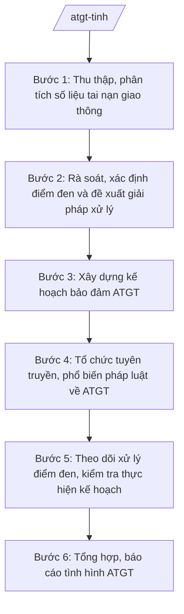

# Skill: Bảo đảm an toàn giao thông

## 2. Khi nào dùng

- Sở Xây dựng tỉnh A (cơ quan thường trực công tác ATGT của tỉnh) xây dựng kế hoạch bảo đảm trật tự, an toàn giao thông hằng năm, các đợt cao điểm (Tết, lễ, mùa mưa bão);
- Cần rà soát, xác định điểm đen, điểm tiềm ẩn tai nạn giao thông trên các tuyến đường thuộc phạm vi quản lý và đề xuất giải pháp xử lý;
- Cần tổ chức tuyên truyền, phổ biến pháp luật về trật tự, an toàn giao thông cho người dân, học sinh, lái xe;
- Cần tổng hợp tình hình tai nạn giao thông, báo cáo UBND tỉnh và cơ quan trung ương theo định kỳ, đột xuất.

## 3. Đầu vào (Input)

| Trường | Mô tả | Bắt buộc |
|--------|-------|----------|
| `so_lieu_tngt` | Số liệu tai nạn giao thông: số vụ, số người chết, bị thương theo tuyến, địa bàn, thời gian | Có |
| `danh_sach_diem_den` | Danh sách điểm đen, điểm tiềm ẩn TNGT đã rà soát (vị trí, tuyến đường, nguyên nhân). Lưu ý: xử lý điểm đen.| Có |
| `ke_hoach_nam_truoc` | Kế hoạch ATGT năm trước và kết quả thực hiện | Không |
| `de_xuat_don_vi` | Đề xuất của UBND xã, đơn vị quản lý đường về xử lý điểm đen, tăng cường ATGT | Không |
| `ke_hoach_tuyen_truyen` | Kế hoạch tuyên truyền ATGT (đối tượng, hình thức, thời gian). Lưu ý: tuyên truyền.| Có |
| `bao_cao_luc_luong` | Báo cáo của lực lượng chức năng về tuần tra, xử lý vi phạm | Không |

## 4. Quy trình

**Bước 1. Thu thập, phân tích số liệu tai nạn giao thông**
- Làm gì: Thu thập số liệu TNGT từ cơ quan công an, đơn vị quản lý đường, UBND xã; phân tích theo tuyến đường, địa bàn, thời gian, nguyên nhân, đối tượng; xác định các tuyến, địa bàn, khung giờ có nguy cơ cao.
- Dùng input: `so_lieu_tngt`, `bao_cao_luc_luong`.
- Vai trò: Chuyên viên phụ trách ATGT thu thập, AI hỗ trợ tổng hợp số liệu thành bảng, biểu đồ, phân tích xu hướng và điểm nóng TNGT; ⏱ ~5–7 ngày làm việc (ước tính).
- Lưu ý nghiệp vụ: Số liệu phải thống nhất nguồn giữa các cơ quan; phân tích nguyên nhân làm cơ sở đề xuất giải pháp đúng trọng tâm.
- → Kết quả bước: Báo cáo phân tích tình hình TNGT (số liệu, xu hướng, điểm nóng, nguyên nhân chủ yếu).

**Bước 2. Rà soát, xác định điểm đen và đề xuất giải pháp xử lý**
- Làm gì: Tổ chức khảo sát thực địa các vị trí xảy ra nhiều vụ TNGT; xác định điểm đen, điểm tiềm ẩn; phân tích nguyên nhân (hạ tầng, tổ chức giao thông, ý thức người tham gia); đề xuất giải pháp (sửa chữa mặt đường, bổ sung biển báo, đèn tín hiệu, gờ giảm tốc, phân luồng...), khái toán kinh phí.
- Dùng input: `danh_sach_diem_den`, `de_xuat_don_vi`, kết quả Bước 1.
- Vai trò: Chuyên viên phụ trách ATGT phối hợp đơn vị quản lý đường khảo sát, AI hỗ trợ lập bảng điểm đen theo mức độ ưu tiên, soạn đề xuất giải pháp và khái toán; ⏱ ~7–10 ngày làm việc (ước tính).
- Lưu ý nghiệp vụ: Ưu tiên xử lý điểm đen có số vụ TNGT cao, nguy cơ tái diễn; giải pháp phải khả thi, có khái toán kinh phí cụ thể để trình cấp có thẩm quyền.
- → Kết quả bước: Danh mục điểm đen + đề xuất giải pháp xử lý theo thứ tự ưu tiên.

**Bước 3. Xây dựng kế hoạch bảo đảm ATGT**
- Làm gì: Trên cơ sở phân tích TNGT và danh mục điểm đen: xây dựng kế hoạch ATGT năm/đợt cao điểm (mục tiêu giảm TNGT, nhiệm vụ của từng cơ quan, kinh phí, tiến độ); lấy ý kiến các cơ quan thành viên; trình UBND tỉnh phê duyệt.
- Dùng input: Kết quả Bước 1–2, `ke_hoach_nam_truoc`.
- Vai trò: Chuyên viên phụ trách ATGT soạn thảo, AI hỗ trợ soạn kế hoạch theo khung chuẩn, lập bảng phân công nhiệm vụ, dự toán kinh phí; ⏱ ~7–10 ngày làm việc (ước tính).
- Lưu ý nghiệp vụ: Mục tiêu giảm TNGT phải cụ thể, đo lường được; phân công nhiệm vụ rõ cơ quan chủ trì, phối hợp, thời hạn.
- → Kết quả bước: Dự thảo kế hoạch ATGT trình UBND tỉnh phê duyệt.

**Bước 4. Tổ chức tuyên truyền, phổ biến pháp luật về ATGT**
- Làm gì: Triển khai tuyên truyền ATGT theo kế hoạch: nội dung trọng tâm (đội mũ bảo hiểm, không lái xe khi uống rượu bia, tốc độ...), đối tượng (học sinh, lái xe, người dân vùng có điểm đen), hình thức (loa phát thanh, pano, mạng xã hội, tọa đàm); phối hợp cơ quan báo chí, nhà trường, đoàn thể.
- Dùng input: `ke_hoach_tuyen_truyen`, kết quả Bước 1.
- Vai trò: Chuyên viên phụ trách ATGT tổ chức, AI hỗ trợ soạn nội dung tuyên truyền, kịch bản tọa đàm, bài phát thanh theo từng đối tượng; ⏱ ~theo kế hoạch tuyên truyền. (ước tính)
- Lưu ý nghiệp vụ: Nội dung tuyên truyền phải thiết thực, dễ hiểu, gắn với điểm nóng TNGT trên địa bàn; đánh giá hiệu quả sau mỗi đợt.
- → Kết quả bước: Chương trình tuyên truyền ATGT đã triển khai + báo cáo kết quả.

**Bước 5. Theo dõi xử lý điểm đen, kiểm tra thực hiện kế hoạch**
- Làm gì: Theo dõi tiến độ xử lý các điểm đen đã được phê duyệt; kiểm tra việc thực hiện kế hoạch ATGT của các cơ quan, UBND xã; đôn đốc, tháo gỡ vướng mắc; kiểm tra lại hiệu quả sau xử lý (số vụ TNGT tại điểm đen).
- Dùng input: Kết quả Bước 2–3.
- Vai trò: Chuyên viên phụ trách ATGT theo dõi, AI hỗ trợ lập bảng theo dõi tiến độ, so sánh số liệu TNGT trước/sau xử lý điểm đen; ⏱ ~3–5 ngày làm việc/đợt (ước tính).
- Lưu ý nghiệp vụ: Điểm đen sau xử lý phải được theo dõi ít nhất một chu kỳ để đánh giá hiệu quả; chưa hiệu quả phải đề xuất giải pháp bổ sung.
- → Kết quả bước: Báo cáo tiến độ xử lý điểm đen và thực hiện kế hoạch ATGT.

**Bước 6. Tổng hợp, báo cáo tình hình ATGT**
- Làm gì: Tổng hợp tình hình TNGT, kết quả xử lý điểm đen, tuyên truyền, thực hiện kế hoạch; báo cáo UBND tỉnh và cơ quan trung ương theo định kỳ, đột xuất; đề xuất nhiệm vụ trọng tâm kỳ tiếp theo.
- Dùng input: Kết quả Bước 1–5.
- Vai trò: Chuyên viên phụ trách ATGT tổng hợp, AI hỗ trợ soạn báo cáo theo khung chuẩn, lập biểu số liệu; ⏱ ~3–5 ngày làm việc (ước tính).
- Lưu ý nghiệp vụ: Báo cáo trung thực, số liệu thống nhất với cơ quan công an; nêu rõ khó khăn và kiến nghị.
- → Kết quả bước: Báo cáo tình hình trật tự, an toàn giao thông của tỉnh (định kỳ, đột xuất).

## Luồng quy trình (Workflow)

## 5. Đầu ra (Output)

- Báo cáo phân tích tình hình tai nạn giao thông;
- Danh mục điểm đen TNGT + đề xuất giải pháp xử lý theo thứ tự ưu tiên;
- Kế hoạch bảo đảm trật tự, an toàn giao thông (UBND tỉnh phê duyệt);
- Chương trình, nội dung tuyên truyền ATGT + báo cáo kết quả;
- Báo cáo tiến độ xử lý điểm đen và thực hiện kế hoạch ATGT;
- Báo cáo tình hình ATGT của tỉnh gửi UBND tỉnh, cơ quan trung ương (định kỳ, đột xuất).

**Cấu trúc output chuẩn (Kế hoạch ATGT — tờ trình kèm theo):**
- Thể thức: tuân thủ Nghị định 30/2020/NĐ-CP về công tác văn thư.

1. Quốc hiệu "CỘNG HÒA XÃ HỘI CHỦ NGHĨA VIỆT NAM", Tiêu ngữ "Độc lập – Tự do – Hạnh phúc";
2. Tên cơ quan: SỞ XÂY DỰNG TỈNH A; số, ký hiệu văn bản; địa danh và ngày, tháng, năm;
3. Tên loại và trích yếu: TỜ TRÌNH — Về việc đề nghị phê duyệt Kế hoạch bảo đảm trật tự, an toàn giao thông tỉnh A năm...;
4. Phần "Kính gửi": Ủy ban nhân dân tỉnh A;
5. Căn cứ (văn bản về phân định thẩm quyền, phân quyền, phân cấp lĩnh vực xây dựng; Thông tư 10/2025/TT-BXD; văn bản chỉ đạo của Trung ương về ATGT; tình hình TNGT trên địa bàn...);
6. Nội dung: đánh giá tình hình TNGT; mục tiêu (giảm số vụ, số người chết, bị thương); nhiệm vụ trọng tâm (xử lý điểm đen, tuần tra kiểm soát, tuyên truyền...); phân công cơ quan thực hiện; kinh phí; tổ chức thực hiện; đề nghị UBND tỉnh xem xét, phê duyệt;
7. Nơi nhận;
8. Thẩm quyền, chức vụ, họ tên người ký: TM. SỞ XÂY DỰNG — GIÁM ĐỐC — (chữ ký, họ tên), dấu của cơ quan.

## 6. Checklist nghiệm thu

- [ ] Số liệu TNGT đầy đủ, thống nhất nguồn giữa các cơ quan;
- [ ] Điểm đen được rà soát thực địa, phân loại theo mức độ ưu tiên, có giải pháp và khái toán cụ thể;
- [ ] Kế hoạch ATGT có mục tiêu đo lường được, phân công rõ cơ quan chủ trì, thời hạn;
- [ ] Tuyên truyền đúng đối tượng, nội dung thiết thực, có đánh giá hiệu quả;
- [ ] Tiến độ xử lý điểm đen được theo dõi, đánh giá hiệu quả sau xử lý;
- [ ] Báo cáo định kỳ, đột xuất đúng hạn, số liệu thống nhất;
- [ ] Kế hoạch ATGT do UBND tỉnh phê duyệt.

## 7. Ví dụ mô phỏng

*Dữ liệu dưới đây là giả lập 100% phục vụ minh họa.*

### Input mẫu

| Trường | Giá trị giả lập |
|--------|-----------------|
| so_lieu_tngt | Năm 2026: 100 vụ, 40 người chết, 80 người bị thương; tuyến Quốc lộ X qua xã A xảy ra 20 vụ |
| danh_sach_diem_den | Ngã ba đường số 1 – đường số 2, xã A: 05 vụ/năm, nguyên nhân: thiếu đèn tín hiệu, tầm nhìn hạn chế |
| ke_hoach_tuyen_truyen | Tuyên truyền tại 20 trường học, 10 xã có điểm đen trong quý II/2027 |

### Output mẫu (Tờ trình kế hoạch ATGT — trích)

> **CỘNG HÒA XÃ HỘI CHỦ NGHĨA VIỆT NAM**
> **Độc lập – Tự do – Hạnh phúc**
>
> Số: 123/TTr-SXD
> *Tỉnh A, ngày 20 tháng 1 năm 2027*
>
> **TỜ TRÌNH**
> **Về việc đề nghị phê duyệt Kế hoạch bảo đảm trật tự, an toàn giao thông tỉnh A năm 2027**
>
> Kính gửi: Ủy ban nhân dân tỉnh A.
>
> Căn cứ văn bản quy định về phân định thẩm quyền chính quyền địa phương 2 cấp, phân quyền, phân cấp trong lĩnh vực quản lý nhà nước của Bộ Xây dựng; Thông tư 10/2025/TT-BXD ngày 14/6/2025 của Bộ Xây dựng; ...
>
> Năm 2026, toàn tỉnh xảy ra 100 vụ TNGT làm 40 người chết, 80 người bị thương. Sở Xây dựng kính trình UBND tỉnh phê duyệt Kế hoạch bảo đảm trật tự, an toàn giao thông năm 2027 với mục tiêu giảm 10% số vụ, số người chết so với năm 2026; nhiệm vụ trọng tâm: xử lý 10 điểm đen (ưu tiên ngã ba đường số 1 – đường số 2, xã A); tăng cường tuần tra dịp cao điểm; tuyên truyền tại 20 trường học...
>
> *Nơi nhận:* ...
>
> **TM. SỞ XÂY DỰNG**
> **GIÁM ĐỐC**
> *(Chữ ký, dấu)*
> **Hoàng Văn S**

## 8. Human gate

- Chuyên viên phụ trách ATGT thu thập số liệu, khảo sát điểm đen, soạn thảo;
- Trưởng phòng chuyên môn kiểm tra nội dung chuyên môn;
- Phó Giám đốc/Giám đốc Sở ký tờ trình, báo cáo;
- Chủ tịch UBND tỉnh A ký quyết định phê duyệt kế hoạch ATGT (AI không thay người ký).

## 9. Giới hạn

- AI KHÔNG quyết định phê duyệt kế hoạch, không ký văn bản thay người có thẩm quyền;
- Không bịa số liệu TNGT, danh mục điểm đen, căn cứ pháp lý; số liệu phải từ cơ quan công an, đơn vị quản lý đường;
- Không dùng văn bản đã hết hiệu lực; chỉ viện dẫn văn bản có thật trong `tai-lieu-moi-nhat.md`;
- Việc xác định điểm đen và giải pháp xử lý do con người khảo sát, quyết định — AI chỉ hỗ trợ tổng hợp, phân tích.

## 10. Căn cứ & lưu ý

- NĐ 140/2025/NĐ-CP ngày 12/6/2025 — phân định thẩm quyền CQĐP 2 cấp trong lĩnh vực quản lý nhà nước của Bộ Xây dựng;
- NĐ 144/2025/NĐ-CP ngày 12/6/2025 — phân quyền, phân cấp trong lĩnh vực quản lý nhà nước của Bộ Xây dựng;
- TT 10/2025/TT-BXD ngày 14/6/2025 — hướng dẫn chức năng, nhiệm vụ, quyền hạn của Sở Xây dựng, Sở Quy hoạch – Kiến trúc và lĩnh vực xây dựng cấp xã;
- NĐ 150/2025/NĐ-CP (hiệu lực 16/6/2025); NĐ 370/2025/NĐ-CP sửa đổi, bổ sung;
- NĐ 30/2020/NĐ-CP — thể thức, kỹ thuật trình bày văn bản hành chính.
