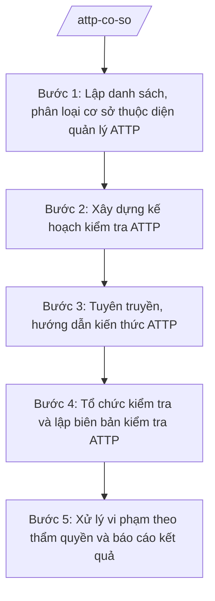

# Skill: Bảo đảm ATTP cơ sở

## 2. Khi nào dùng

- Khi xã cần lập danh sách, phân loại các cơ sở thuộc diện quản lý ATTP trên địa bàn: thức ăn đường phố, bếp ăn tập thể nhỏ (trường học, cơ quan), cơ sở kinh doanh thực phẩm nhỏ lẻ (nhiệm vụ y tế cơ sở theo TT 20/2025/TT-BYT).
- Khi cần xây dựng kế hoạch kiểm tra điều kiện ATTP định kỳ hoặc đột xuất.
- Khi cần tổ chức kiểm tra thực tế tại cơ sở và lập biên bản kiểm tra ATTP.
- Khi cần tuyên truyền, hướng dẫn kiến thức ATTP cho chủ cơ sở và xử lý vi phạm theo thẩm quyền của cấp xã.

## 3. Đầu vào (Input)

| Trường | Mô tả | Bắt buộc |
|--------|-------|----------|
| `danh_sach_co_so` | Danh sách cơ sở trên địa bàn: tên cơ sở, chủ cơ sở, địa chỉ thôn/xóm, loại hình (thức ăn đường phố/bếp ăn tập thể nhỏ/kinh doanh nhỏ lẻ) | Có |
| `tieu_chi_kiem_tra` | Các điều kiện ATTP cần kiểm tra theo loại hình (nguồn nước, dụng cụ, bảo quản, sức khỏe người trực tiếp chế biến...) | Có |
| `dot_kiem_tra` | Đợt kiểm tra (định kỳ quý/năm, đột xuất, cao điểm lễ tết) | Có |
| `doan_kiem_tra` | Thành phần đoàn kiểm tra (Trưởng đoàn, thành viên) | Có |
| `vi_pham_ky_truoc` | Các vi phạm đã phát hiện kỳ trước và tình trạng khắc phục (nếu có) | Không |
| `van_ban_chi_dao` | Văn bản chỉ đạo của cấp trên về ATTP (nếu có) | Không |

## 4. Quy trình

**Bước 1. Lập danh sách, phân loại cơ sở thuộc diện quản lý ATTP**
- Làm gì: Rà soát toàn xã, lập danh sách đầy đủ các cơ sở: thức ăn đường phố; bếp ăn tập thể nhỏ; cơ sở kinh doanh thực phẩm nhỏ lẻ; phân loại theo mức độ rủi ro (cao/trung bình/thấp) để xác định tần suất kiểm tra.
- Dùng input: `danh_sach_co_so`, thon_xom (qua danh sách cơ sở).
- Vai trò: Công chức văn hóa – xã hội phụ trách lĩnh vực y tế/ATTP phối hợp trưởng thôn rà soát; AI hỗ trợ lập bảng danh sách, phân loại rủi ro theo loại hình (~1 ngày).
- Lưu ý nghiệp vụ: Không bỏ sót cơ sở kinh doanh không cố định (hàng rong); cập nhật khi có cơ sở mới mở/ngừng hoạt động; phân loại rủi ro dựa trên loại hình và lịch sử vi phạm.
- → Kết quả bước: Danh sách cơ sở ATTP trên địa bàn đã phân loại rủi ro.

**Bước 2. Xây dựng kế hoạch kiểm tra ATTP**
- Làm gì: Lập kế hoạch kiểm tra: mục tiêu đợt kiểm tra; danh sách cơ sở được kiểm tra (ưu tiên rủi ro cao, cơ sở vi phạm kỳ trước chưa khắc phục); thời gian; thành phần đoàn kiểm tra; nội dung kiểm tra theo tiêu chí; kinh phí.
- Dùng input: Danh sách bước 1, `tieu_chi_kiem_tra`, `dot_kiem_tra`, `doan_kiem_tra`, `vi_pham_ky_truoc`, `van_ban_chi_dao`.
- Vai trò: Công chức văn hóa – xã hội soạn kế hoạch; Trưởng phòng Văn hóa – Xã hội (ông Vũ Văn E) kiểm tra, trình Phó Chủ tịch UBND xã (bà Trần Thị B) phê duyệt; AI hỗ trợ soạn thảo theo thể thức NĐ 30/2020/NĐ-CP (~1 ngày).
- Lưu ý nghiệp vụ: Kiểm tra định kỳ kết hợp đột xuất; nội dung kiểm tra đúng tiêu chí theo loại hình; đoàn kiểm tra có đại diện Trạm Y tế xã về chuyên môn.
- → Kết quả bước: Dự thảo Kế hoạch kiểm tra ATTP (đợt …).

**Bước 3. Tuyên truyền, hướng dẫn kiến thức ATTP**
- Làm gì: Tổ chức tuyên truyền cho chủ cơ sở: điều kiện ATTP theo loại hình; thực hành tốt (vệ sinh cá nhân, bảo quản thực phẩm, nguồn nước sạch); hướng dẫn khắc phục các lỗi thường gặp; phát tờ rơi.
- Dùng input: `tieu_chi_kiem_tra`, danh sách bước 1.
- Vai trò: Công chức văn hóa – xã hội biên tập nội dung; Trạm Y tế xã hỗ trợ chuyên môn; AI hỗ trợ soạn tờ rơi, bài tuyên truyền ngắn gọn (~0,5 ngày, triển khai trước/sau kiểm tra).
- Lưu ý nghiệp vụ: Tuyên truyền trước kiểm tra để cơ sở chủ động khắc phục; nội dung đơn giản, có hình minh họa; lưu danh sách cơ sở đã được tập huấn.
- → Kết quả bước: Tài liệu tuyên truyền + danh sách cơ sở đã được hướng dẫn.

**Bước 4. Tổ chức kiểm tra và lập biên bản kiểm tra ATTP**
- Làm gì: Đoàn kiểm tra đến từng cơ sở theo kế hoạch: kiểm tra thực tế theo tiêu chí; ghi nhận đạt/không đạt từng nội dung; lập biên bản kiểm tra có chữ ký của đoàn và chủ cơ sở; ghi rõ vi phạm (nếu có) và thời hạn khắc phục.
- Dùng input: Kế hoạch bước 2, `tieu_chi_kiem_tra`, `doan_kiem_tra`.
- Vai trò: Đoàn kiểm tra (do Phó Chủ tịch UBND xã hoặc Trưởng phòng VH-XH làm Trưởng đoàn, có cán bộ Trạm Y tế) thực hiện; công chức văn hóa – xã hội ghi biên bản; AI hỗ trợ soạn mẫu biên bản kiểm tra ATTP chuẩn (~0,5 ngày chuẩn bị mẫu).
- Lưu ý nghiệp vụ: Kiểm tra khách quan, đúng nội dung đã công bố; biên bản phải có chữ ký hai bên; vi phạm vượt thẩm quyền xã thì báo cáo cấp trên xử lý; không phạt tùy tiện ngoài quy định.
- → Kết quả bước: Biên bản kiểm tra ATTP từng cơ sở + bảng tổng hợp kết quả đợt kiểm tra.

**Bước 5. Xử lý vi phạm theo thẩm quyền và báo cáo kết quả**
- Làm gì: Tổng hợp vi phạm: nhắc nhở, yêu cầu khắc phục trong thời hạn đối với lỗi nhẹ; lập hồ sơ xử lý theo thẩm quyền của Chủ tịch UBND xã đối với vi phạm thuộc thẩm quyền; theo dõi việc khắc phục; soạn báo cáo kết quả đợt kiểm tra.
- Dùng input: Biên bản bước 4, `vi_pham_ky_truoc`, `dot_kiem_tra`.
- Vai trò: Công chức văn hóa – xã hội tổng hợp, soạn báo cáo; Trưởng phòng Văn hóa – Xã hội (ông Vũ Văn E) kiểm tra; Chủ tịch UBND xã (ông Nguyễn Văn A) quyết định xử lý thuộc thẩm quyền và ký báo cáo; AI hỗ trợ tổng hợp vi phạm, soạn báo cáo theo thể thức NĐ 30/2020/NĐ-CP (~1 ngày).
- Lưu ý nghiệp vụ: Xử lý đúng thẩm quyền, đúng trình tự; vi phạm vượt thẩm quyền phải chuyển cấp có thẩm quyền, không tự xử lý; tái kiểm tra cơ sở chưa khắc phục đúng hạn.
- → Kết quả bước: Báo cáo kết quả kiểm tra ATTP (đợt …) + hồ sơ xử lý vi phạm theo thẩm quyền.

## Luồng quy trình (Workflow)

## 5. Đầu ra (Output)

**Danh sách sản phẩm:**
1. Kế hoạch kiểm tra ATTP (đợt …) (sản phẩm chính 1).
2. Biên bản kiểm tra ATTP (mẫu dùng cho từng cơ sở) (sản phẩm chính 2).
3. Báo cáo kết quả kiểm tra ATTP (đợt …).
4. Danh sách cơ sở ATTP trên địa bàn đã phân loại rủi ro (phụ lục).
5. Bảng tổng hợp kết quả kiểm tra theo cơ sở (phụ lục báo cáo).
6. Tài liệu tuyên truyền ATTP cho chủ cơ sở (tài liệu kèm theo).

**Cấu trúc output chuẩn — Kế hoạch kiểm tra ATTP (đúng thể thức NĐ 30/2020/NĐ-CP):**

1. Quốc hiệu – tiêu ngữ: "CỘNG HÒA XÃ HỘI CHỦ NGHĨA VIỆT NAM / Độc lập – Tự do – Hạnh phúc".
2. Số, ký hiệu văn bản: số/ký hiệu theo quy định (vd: 123/KH-UBND).
3. Địa danh, ngày tháng năm ban hành: "Xã A, ngày … tháng … năm …".
4. Tên loại và trích yếu: "KẾ HOẠCH — Kiểm tra an toàn thực phẩm xã A (đợt … năm …)".
5. Căn cứ: TT 20/2025/TT-BYT; văn bản chỉ đạo của cấp trên về ATTP (nếu có).
6. Nội dung: I. Mục đích, yêu cầu; II. Đối tượng, phạm vi kiểm tra (số cơ sở theo loại hình); III. Nội dung kiểm tra (tiêu chí theo loại hình); IV. Thời gian, tiến độ; V. Thành phần đoàn kiểm tra; VI. Tổ chức thực hiện; VII. Kinh phí; VIII. Chế độ báo cáo.
7. Nơi nhận: lưu VP, Phòng VH-XH, Trạm Y tế xã, các thôn.
8. Chữ ký: Phó Chủ tịch UBND xã (hoặc Chủ tịch) ký, đóng dấu UBND xã.

**Cấu trúc output chuẩn — Biên bản kiểm tra ATTP (đúng thể thức NĐ 30/2020/NĐ-CP):**

1. Quốc hiệu "CỘNG HÒA XÃ HỘI CHỦ NGHĨA VIỆT NAM" – Tiêu ngữ "Độc lập – Tự do – Hạnh phúc".
2. Số biên bản: số/ký hiệu theo quy định (vd: 123/BB-KT).
3. Địa danh, ngày tháng năm lập: "Xã A, ngày … tháng … năm …".
4. Tên loại và trích yếu: "BIÊN BẢN KIỂM TRA — An toàn thực phẩm tại cơ sở …".
5. Căn cứ: Kế hoạch số …/KH-UBND; TT 20/2025/TT-BYT.
6. Nội dung: I. Thành phần đoàn kiểm tra; II. Đại diện cơ sở được kiểm tra (tên cơ sở, chủ cơ sở, địa chỉ); III. Nội dung kiểm tra (bảng tiêu chí: đạt/không đạt/ghi chú); IV. Nhận xét, kết luận; V. Vi phạm phát hiện (nếu có) và yêu cầu khắc phục, thời hạn; VI. Ý kiến của chủ cơ sở.
7. Chữ ký: Trưởng đoàn kiểm tra, các thành viên, đại diện cơ sở (ký, ghi rõ họ tên); đóng dấu (nếu có).

**Cấu trúc output chuẩn — Báo cáo kết quả kiểm tra ATTP (đúng thể thức NĐ 30/2020/NĐ-CP):**

1. Quốc hiệu "CỘNG HÒA XÃ HỘI CHỦ NGHĨA VIỆT NAM" – Tiêu ngữ "Độc lập – Tự do – Hạnh phúc".
2. Số, ký hiệu văn bản: số/ký hiệu theo quy định (vd: 123/BC-UBND).
3. Địa danh, ngày tháng năm ban hành.
4. Tên loại và trích yếu: "BÁO CÁO — Kết quả kiểm tra an toàn thực phẩm xã A (đợt … năm …)".
5. Căn cứ: Kế hoạch số …/KH-UBND; TT 20/2025/TT-BYT.
6. Nội dung: I. Tình hình triển khai; II. Kết quả kiểm tra (bảng tổng hợp theo cơ sở); III. Vi phạm phát hiện và xử lý; IV. Đánh giá chung; V. Khó khăn, vướng mắc; VI. Đề xuất, kiến nghị.
7. Nơi nhận: UBND tỉnh A (Sở Y tế), lưu VP, Phòng VH-XH, Trạm Y tế xã.
8. Chữ ký: Chủ tịch UBND xã ký, đóng dấu.

## 6. Checklist nghiệm thu

- [ ] Danh sách cơ sở đầy đủ 3 loại hình (thức ăn đường phố, bếp ăn tập thể nhỏ, kinh doanh nhỏ lẻ), đã phân loại rủi ro.
- [ ] Kế hoạch kiểm tra nêu rõ đối tượng, tiêu chí theo loại hình, thời gian, thành phần đoàn kiểm tra.
- [ ] Biên bản kiểm tra đúng cấu trúc chuẩn, có bảng tiêu chí đạt/không đạt, có chữ ký đoàn kiểm tra và chủ cơ sở.
- [ ] Vi phạm được ghi rõ, có yêu cầu khắc phục và thời hạn; xử lý đúng thẩm quyền, vi phạm vượt thẩm quyền được chuyển cấp trên.
- [ ] Báo cáo có bảng tổng hợp kết quả theo cơ sở, khớp với các biên bản kiểm tra.
- [ ] Văn bản đúng thể thức NĐ 30/2020/NĐ-CP (quốc hiệu, số/ký hiệu, nơi nhận, chữ ký, con dấu).
- [ ] Số liệu, tên cơ sở, tên chủ cơ sở trong văn bản khớp đúng Input; không bịa số liệu kiểm tra.
- [ ] Đã qua human gate: Trưởng phòng kiểm tra, lãnh đạo UBND xã phê duyệt/ký.

## 7. Ví dụ mô phỏng

*Dữ liệu dưới đây là giả lập 100% phục vụ minh họa.*

**Input mẫu:**
- danh_sach_co_so: 20 cơ sở — 8 hàng thức ăn đường phố (chợ xã), 4 bếp ăn tập thể nhỏ (3 trường học, 1 cơ quan), 8 cửa hàng thực phẩm nhỏ lẻ; phân loại: 6 rủi ro cao, 8 trung bình, 6 thấp
- tieu_chi_kiem_tra: nguồn nước sạch; dụng cụ chế biến riêng sống/chín; bảo quản thực phẩm; vệ sinh cá nhân người trực tiếp chế biến; giấy khám sức khỏe
- dot_kiem_tra: đợt cao điểm Tết Nguyên đán 2027 (tháng 1/2027)
- doan_kiem_tra: bà Trần Thị B (Trưởng đoàn), ông Nguyễn Văn G (Phòng VH-XH), cán bộ Trạm Y tế xã
- vi_pham_ky_truoc: 2 cơ sở chưa khắc phục lỗi bảo quản thực phẩm

**Output mẫu — Biên bản kiểm tra ATTP:**

> CỘNG HÒA XÃ HỘI CHỦ NGHĨA VIỆT NAM
> Độc lập – Tự do – Hạnh phúc
>
> Số: 123/BB-KT
>
> Xã A, ngày 15 tháng 01 năm 2027
>
> **BIÊN BẢN KIỂM TRA**
> **An toàn thực phẩm tại cơ sở: Quán ăn của bà Trần Thị Dân — chợ xã A, Thôn 1**
>
> Căn cứ Kế hoạch số 123/KH-UBND ngày 09/01/2027 của UBND xã A;
> Căn cứ Thông tư số 20/2025/TT-BYT ngày 23/6/2025 của Bộ Y tế;
>
> **I. THÀNH PHẦN ĐOÀN KIỂM TRA**
> 1. Bà Trần Thị B — Phó Chủ tịch UBND xã, Trưởng đoàn;
> 2. Ông Nguyễn Văn G — công chức Phòng Văn hóa – Xã hội, thành viên;
> 3. Cán bộ Trạm Y tế xã A, thành viên.
>
> **II. ĐẠI DIỆN CƠ SỞ ĐƯỢC KIỂM TRA**
> - Tên cơ sở: Quán ăn của bà Trần Thị Dân; địa chỉ: chợ xã A, Thôn 1, xã A.
> - Loại hình: thức ăn đường phố.
>
> **III. NỘI DUNG KIỂM TRA**
>
> | TT | Tiêu chí | Đạt | Không đạt | Ghi chú |
> |----|----------|-----|-----------|---------|
> | 1 | Nguồn nước sạch | x | | |
> | 2 | Dụng cụ chế biến riêng sống/chín | | x | Dùng chung thớt |
> | 3 | Bảo quản thực phẩm | x | | |
> | 4 | Vệ sinh cá nhân người trực tiếp chế biến | x | | |
> | 5 | Giấy khám sức khỏe | x | | |
>
> **IV. NHẬN XÉT, KẾT LUẬN:** Cơ sở cơ bản bảo đảm điều kiện ATTP; còn 01 nội dung chưa đạt (dùng chung thớt sống/chín).
>
> **V. YÊU CẦU KHẮC PHỤC:** Trang bị thớt, dao riêng cho thực phẩm sống và chín; thời hạn khắc phục: trước ngày 22/01/2027.
>
> **VI. Ý KIẾN CỦA CHỦ CƠ SỞ:** Nhất trí, cam kết khắc phục đúng hạn.
>
> **ĐẠI DIỆN CƠ SỞ**          **TRƯỞNG ĐOÀN KIỂM TRA**
> *(Ký, ghi rõ họ tên)*        *(Ký, ghi rõ họ tên)*
> Trần Thị Dân                  Trần Thị B
>
> *Các thành viên đoàn kiểm tra cùng ký.*

## 8. Human gate (người kiểm duyệt)

- Công chức văn hóa – xã hội phụ trách lĩnh vực ATTP soạn kế hoạch, báo cáo, mẫu biên bản; tổng hợp kết quả.
- Trưởng phòng Văn hóa – Xã hội (ông Vũ Văn E) kiểm tra nội dung, số liệu, thể thức.
- Phó Chủ tịch UBND xã (bà Trần Thị B) phê duyệt Kế hoạch kiểm tra ATTP; làm Trưởng đoàn kiểm tra.
- Chủ tịch UBND xã (ông Nguyễn Văn A) quyết định xử lý vi phạm thuộc thẩm quyền và ký báo cáo kết quả.
- Nội dung chuyên môn kiểm tra có sự tham gia của cán bộ Trạm Y tế xã.

## 9. Giới hạn (guardrails)

- AI KHÔNG ra quyết định hành chính thay người có thẩm quyền; không tự phê duyệt kế hoạch, không tự quyết định xử phạt.
- AI KHÔNG tự ký, đóng dấu hoặc phát hành văn bản dưới danh nghĩa UBND xã hay cá nhân lãnh đạo.
- AI KHÔNG bịa số liệu kiểm tra, danh sách cơ sở, số hiệu văn bản, căn cứ pháp lý.
- AI KHÔNG hướng dẫn cách lách kiểm tra hoặc che giấu vi phạm ATTP.
- AI KHÔNG dùng văn bản đã hết hiệu lực; chỉ trích dẫn văn bản có trong tai-lieu-moi-nhat.md.

## 10. Căn cứ & lưu ý

- Thông tư số 20/2025/TT-BYT ngày 23/6/2025 của Bộ Y tế: hướng dẫn chức năng, nhiệm vụ, quyền hạn của cơ quan chuyên môn về y tế thuộc UBND cấp xã (Phòng Văn hóa – Xã hội tham mưu lĩnh vực y tế cơ sở, trong đó có ATTP).
- Nghị định số 147/2025/NĐ-CP ngày 12/6/2025: phân định thẩm quyền CQĐP 2 cấp trong lĩnh vực quản lý nhà nước của Bộ Y tế.
- Nghị định số 148/2025/NĐ-CP ngày 12/6/2025: phân quyền, phân cấp trong lĩnh vực y tế.
- Nghị định số 150/2025/NĐ-CP ngày 12/6/2025: tổ chức Phòng Văn hóa – Xã hội cấp xã; sửa đổi bởi NĐ 370/2025/NĐ-CP.
- Nghị định số 30/2020/NĐ-CP của Chính phủ: thể thức văn bản hành chính.
- Lưu ý: cấp xã quản lý các cơ sở quy mô nhỏ (thức ăn đường phố, bếp ăn tập thể nhỏ, kinh doanh nhỏ lẻ); cơ sở vượt quy mô/thẩm quyền phải báo cáo, chuyển cấp có thẩm quyền xử lý.
