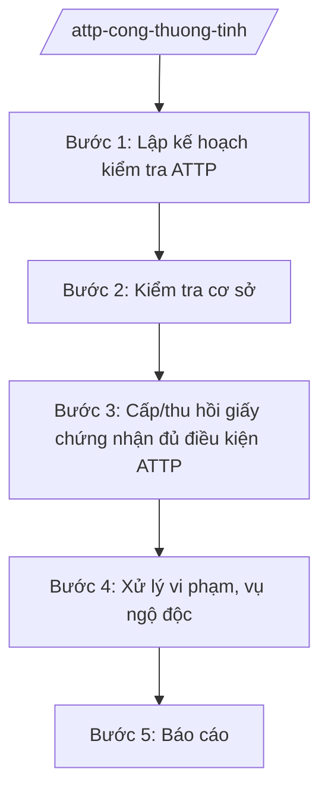

# Skill: ATTP lĩnh vực công thương

## 2. Khi nào dùng

- Khi kiểm tra ATTP đối với cơ sở sản xuất, kinh doanh thực phẩm thuộc phạm vi quản lý của ngành công thương (rượu, bia, nước giải khát, bánh kẹo, dầu ăn, chợ, siêu thị...).
- Khi cấp, thu hồi giấy chứng nhận cơ sở đủ điều kiện ATTP (theo phân cấp).
- Khi xử lý vụ ngộ độc thực phẩm liên quan cơ sở thuộc phạm vi ngành.
- Khi triển khai Tháng hành động vì ATTP trên địa bàn.

## 3. Đầu vào (Input)

| Trường | Mô tả | Bắt buộc |
|--------|-------|----------|
| `loai_viec` | kiểm tra / cấp giấy chứng nhận / xử lý vụ việc / cao điểm / báo cáo | Có |
| `co_so` | Tên cơ sở sản xuất, kinh doanh | Không |
| `dia_diem` | Địa chỉ cơ sở | Không |
| `noi_dung` | Mô tả vụ việc/yêu cầu | Không |

## 4. Quy trình

**Bước 1. Lập kế hoạch kiểm tra ATTP**
- Làm gì: Lập danh sách cơ sở thuộc phạm vi quản lý; xây dựng kế hoạch kiểm tra định kỳ, đột xuất, cao điểm.
- Dùng input: `loai_viec`.
- Vai trò: Chuyên viên Phòng Quản lý thương mại/Chi cục QLTT lập; AI hỗ trợ phân loại cơ sở theo nguy cơ — ⏱ 5 ngày.
- Lưu ý nghiệp vụ: Phân định rõ với Sở Y tế, Sở NN&MT theo chuỗi quản lý ATTP (tránh kiểm tra trùng); cơ sở nguy cơ cao kiểm tra nhiều hơn.
- → Kết quả bước: Kế hoạch kiểm tra ATTP được phê duyệt.

**Bước 2. Kiểm tra cơ sở**
- Làm gì: Kiểm tra điều kiện ATTP: giấy chứng nhận đủ điều kiện, nguồn gốc nguyên liệu, nhãn mác, hạn sử dụng, điều kiện vệ sinh, nhân viên (giấy khám sức khỏe, tập huấn ATTP).
- Dùng input: `co_so`, `dia_diem`.
- Vai trò: Đoàn kiểm tra liên ngành; AI hỗ trợ lập biên bản theo mẫu — ⏱ theo kế hoạch.
- Lưu ý nghiệp vụ: Lấy mẫu kiểm nghiệm khi nghi ngờ; niêm phong, tạm dừng lưu thông lô hàng vi phạm.
- → Kết quả bước: Biên bản kiểm tra + kết quả kiểm nghiệm (nếu có).

**Bước 3. Cấp/thu hồi giấy chứng nhận đủ điều kiện ATTP**
- Làm gì: Tiếp nhận hồ sơ; thẩm định điều kiện thực tế; cấp giấy chứng nhận; thu hồi khi cơ sở không còn đủ điều kiện hoặc vi phạm nghiêm trọng.
- Dùng input: `co_so`, `loai_viec`.
- Vai trò: Chuyên viên thẩm định; AI hỗ trợ checklist hồ sơ — ⏱ theo thời hạn TTHC.
- Lưu ý nghiệp vụ: Kiểm tra thực tế bắt buộc trước khi cấp lần đầu; giấy chứng nhận có thời hạn — theo dõi, nhắc gia hạn.
- → Kết quả bước: Giấy chứng nhận đủ điều kiện ATTP / quyết định thu hồi.

**Bước 4. Xử lý vi phạm, vụ ngộ độc**
- Làm gì: Xử phạt VPHC đối với cơ sở vi phạm; phối hợp điều tra nguyên nhân ngộ độc; yêu cầu thu hồi, tiêu hủy thực phẩm không an toàn.
- Dùng input: `noi_dung`.
- Vai trò: Người có thẩm quyền xử phạt; AI hỗ trợ tra cứu khung phạt — ⏱ khẩn trương.
- Lưu ý nghiệp vụ: Vụ ngộ độc: phong tỏa cơ sở, lấy mẫu, báo cáo Ban chỉ đạo ATTP tỉnh ngay; công khai cơ sở vi phạm nghiêm trọng.
- → Kết quả bước: Quyết định xử phạt; báo cáo vụ ngộ độc.

**Bước 5. Báo cáo**
- Làm gì: Tổng hợp kết quả kiểm tra, xử lý; báo cáo Ban chỉ đạo ATTP tỉnh, Bộ Công Thương.
- Dùng input: `loai_viec` (báo cáo).
- Vai trò: Chuyên viên tổng hợp; AI hỗ trợ lập bảng số liệu — ⏱ 3 ngày.
- Lưu ý nghiệp vụ: Số liệu phân theo nhóm cơ sở, loại vi phạm.
- → Kết quả bước: Báo cáo công tác ATTP lĩnh vực công thương.

## Luồng quy trình (Workflow)

## 5. Đầu ra (Output)

- Kế hoạch kiểm tra ATTP.
- Biên bản kiểm tra; giấy chứng nhận đủ điều kiện ATTP / quyết định thu hồi.
- Quyết định xử phạt VPHC; báo cáo vụ ngộ độc.
- Báo cáo công tác ATTP định kỳ.

**Cấu trúc output chuẩn (Giấy chứng nhận cơ sở đủ điều kiện ATTP):**
- Thể thức: tuân thủ Nghị định 30/2020/NĐ-CP về công tác văn thư.

1. Quốc hiệu "CỘNG HÒA XÃ HỘI CHỦ NGHĨA VIỆT NAM", Tiêu ngữ "Độc lập – Tự do – Hạnh phúc"; tên cơ quan cấp (Sở Công Thương tỉnh A); số, ký hiệu.
2. Tên loại: **GIẤY CHỨNG NHẬN** — cơ sở đủ điều kiện an toàn thực phẩm.
3. Tên, địa chỉ cơ sở; người đại diện; loại hình sản xuất, kinh doanh.
4. Chứng nhận đủ điều kiện ATTP theo quy định; thời hạn hiệu lực.
5. Trách nhiệm của cơ sở; quyền kiểm tra của cơ quan quản lý.
6. Nơi nhận; chữ ký, đóng dấu cơ quan cấp.

> **Chuẩn tài liệu đầu ra** (thứ tự ưu tiên):
> 1. Chuẩn riêng của ngành/cơ quan chủ quản — mẫu, biểu mẫu, quy chuẩn tại văn bản quy phạm chuyên ngành (xem mục "Căn cứ & lưu ý").
> 2. Tài liệu không có quy chuẩn riêng — thể thức NĐ 30/2020/NĐ-CP: Quốc hiệu và Tiêu ngữ; tên cơ quan ban hành; số, ký hiệu; địa danh và thời gian; tên loại và trích yếu; nội dung; chức vụ, họ tên, chữ ký người có thẩm quyền; dấu, chữ ký số; nơi nhận (kèm Phụ lục nếu có).

## 6. Checklist nghiệm thu

- [ ] Phân định rõ phạm vi với Sở Y tế, Sở NN&MT, không kiểm tra trùng.
- [ ] Kiểm tra thực tế bắt buộc trước khi cấp giấy chứng nhận lần đầu.
- [ ] Lấy mẫu kiểm nghiệm khi nghi ngờ; xử lý lô hàng vi phạm kịp thời.
- [ ] Vụ ngộ độc được báo cáo Ban chỉ đạo tỉnh ngay, điều tra nguyên nhân.
- [ ] Xử phạt đúng thẩm quyền, khung phạt.
- [ ] Văn bản đúng thể thức NĐ 30/2020/NĐ-CP.

## 7. Ví dụ mô phỏng

*Dữ liệu dưới đây là giả lập 100% phục vụ minh họa.*

**Input mẫu:** loai_viec = "cấp giấy chứng nhận"; co_so = "Cơ sở sản xuất bánh kẹo AB"; dia_diem = "Xã A, tỉnh A".

**Output mẫu (trích Giấy chứng nhận):**

> **SỞ CÔNG THƯƠNG TỈNH A**
> Số: 1234/GCN-SCT
>
> **GIẤY CHỨNG NHẬN**
> Cơ sở đủ điều kiện an toàn thực phẩm
>
> Chứng nhận: Cơ sở sản xuất bánh kẹo AB, địa chỉ: xã A, tỉnh A; người đại diện: ông Nguyễn Văn G.
> Đủ điều kiện an toàn thực phẩm để sản xuất bánh kẹo theo quy định.
> Thời hạn hiệu lực: 03 năm kể từ ngày ký.
> Cơ sở chịu trách nhiệm duy trì điều kiện ATTP; chịu sự kiểm tra của cơ quan có thẩm quyền./.
>
> *Nơi nhận:* ... — **GIÁM ĐỐC** *(ký, đóng dấu)* — Hoàng Văn S

## 8. Human gate

- Chuyên viên thẩm định → Trưởng phòng kiểm tra → Phó Giám đốc Sở duyệt → Giám đốc Sở ký (giấy chứng nhận, quyết định thu hồi).
- Vụ ngộ độc: báo cáo Giám đốc Sở → Ban chỉ đạo ATTP tỉnh ngay.

## 9. Giới hạn

- AI không tự kết luận cơ sở đủ/không đủ điều kiện ATTP khi chưa có kiểm tra thực tế.
- Không bịa kết quả kiểm nghiệm, biên bản kiểm tra.
- Không dùng văn bản hết hiệu lực làm căn cứ.

## 10. Căn cứ & lưu ý

- Thông tư 37/2025/TT-BCT của Bộ Công Thương hướng dẫn chức năng, nhiệm vụ của cơ quan chuyên môn về công thương (lĩnh vực ATTP thuộc phạm vi ngành).
- Luật An toàn thực phẩm và các văn bản hướng dẫn (dẫn tên, áp dụng bản hiện hành).
- Nghị định 150/2025/NĐ-CP về tổ chức cơ quan chuyên môn thuộc UBND cấp tỉnh.
- Nghị định 30/2020/NĐ-CP về công tác văn thư (thể thức văn bản).
- Lưu ý: phối hợp liên ngành ATTP (Y tế, NN&MT, Công an, QLTT) theo phân công của Ban chỉ đạo ATTP tỉnh.
