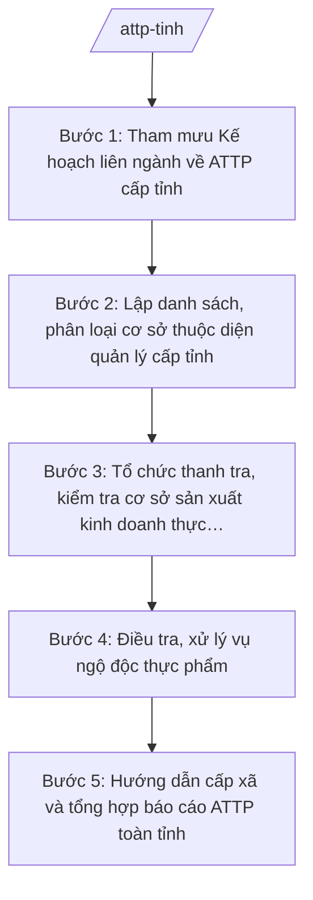

# Skill: ATTP cấp tỉnh (liên ngành)

## 2. Khi nào dùng

- Khi cần tham mưu, xây dựng Kế hoạch liên ngành về bảo đảm ATTP cấp tỉnh (Sở Y tế chủ trì, phối hợp Sở Công Thương, Sở Nông nghiệp và Môi trường và các ngành).
- Khi cần lập danh sách, phân loại cơ sở sản xuất, kinh doanh thực phẩm thuộc diện quản lý của cấp tỉnh (cơ sở quy mô lớn, vượt thẩm quyền cấp xã).
- Khi cần tổ chức thanh tra, kiểm tra điều kiện ATTP tại cơ sở sản xuất, kinh doanh thực phẩm, bếp ăn tập thể lớn, cơ sở kinh doanh dịch vụ ăn uống lớn.
- Khi xảy ra vụ ngộ độc thực phẩm và cần điều tra nguyên nhân, tổ chức cấp cứu, khắc phục, báo cáo.
- Khi cần hướng dẫn nghiệp vụ ATTP cho Phòng Văn hóa – Xã hội cấp xã và tổng hợp báo cáo ATTP toàn tỉnh gửi Bộ Y tế, UBND tỉnh.

## 3. Đầu vào (Input)

| Trường | Mô tả | Bắt buộc |
|--------|-------|----------|
| `danh_sach_co_so_tinh` | Danh sách cơ sở SXKD thực phẩm thuộc diện quản lý cấp tỉnh: tên, địa chỉ, loại hình, quy mô, giấy chứng nhận đủ điều kiện ATTP | Có |
| `ke_hoach_lien_nganh` | Định hướng kế hoạch liên ngành năm: mục tiêu, nhiệm vụ của từng ngành | Có |
| `dot_thanh_kiem_tra` | Đợt thanh tra, kiểm tra (định kỳ, cao điểm lễ tết, đột xuất theo phản ánh) | Có |
| `vu_ngo_doc` | Thông tin vụ ngộ độc thực phẩm (nếu có): địa điểm, số người mắc, triệu chứng, cơ sở nghi ngờ | Không |
| `ket_qua_ky_truoc` | Kết quả thanh kiểm tra kỳ trước; cơ sở vi phạm chưa khắc phục | Không |
| `van_ban_chi_dao` | Văn bản chỉ đạo của Bộ Y tế, UBND tỉnh về ATTP (nếu có) | Không |

## 4. Quy trình

**Bước 1. Tham mưu Kế hoạch liên ngành về ATTP cấp tỉnh**
- Làm gì: Tổng hợp đề xuất của các ngành (Y tế, Công Thương, Nông nghiệp và Môi trường); soạn thảo Kế hoạch liên ngành về ATTP: mục tiêu; nhiệm vụ của từng ngành theo lĩnh vực được phân công; cơ chế phối hợp thanh kiểm tra; kinh phí; chế độ báo cáo; trình UBND tỉnh phê duyệt.
- Dùng input: `ke_hoach_lien_nganh`, `danh_sach_co_so_tinh`, `van_ban_chi_dao`.
- Vai trò: Chuyên viên phụ trách ATTP thuộc Sở Y tế soạn dự thảo, lấy ý kiến các sở/ngành; Trưởng phòng kiểm tra; Giám đốc Sở (ông Hoàng Văn S) trình Chủ tịch UBND tỉnh (ông Phạm Văn P) phê duyệt (kế hoạch liên ngành thuộc thẩm quyền UBND tỉnh); AI hỗ trợ soạn thảo theo thể thức NĐ 30/2020/NĐ-CP ⏱ ~3 ngày (ước tính).
- Lưu ý nghiệp vụ: Phân công rõ trách nhiệm từng ngành, tránh chồng chéo, bỏ sót (Sở Y tế: cơ sở thuộc lĩnh vực y tế; phối hợp với Công Thương, NN&MT theo phân công); kế hoạch phải khả thi về lực lượng, kinh phí.
- → Kết quả bước: Dự thảo Kế hoạch liên ngành về ATTP tỉnh (trình UBND tỉnh phê duyệt).

**Bước 2. Lập danh sách, phân loại cơ sở thuộc diện quản lý cấp tỉnh**
- Làm gì: Rà soát, lập danh sách cơ sở sản xuất, kinh doanh thực phẩm thuộc thẩm quyền quản lý của cấp tỉnh (cơ sở quy mô lớn, cơ sở thuộc lĩnh vực y tế quản lý); phân loại theo mức độ rủi ro; xác định cơ sở thuộc diện thanh kiểm tra ưu tiên; đối chiếu, tránh trùng với danh sách quản lý của cấp xã.
- Dùng input: `danh_sach_co_so_tinh`, `ket_qua_ky_truoc`.
- Vai trò: Chuyên viên phụ trách ATTP rà soát, phân loại; Chi cục An toàn vệ sinh thực phẩm (nếu có) phối hợp; AI hỗ trợ lập bảng danh sách, phân loại rủi ro ⏱ ~2 ngày (ước tính).
- Lưu ý nghiệp vụ: Phân định rõ cơ sở do cấp tỉnh quản lý và cơ sở do cấp xã quản lý (cơ sở nhỏ lẻ: thức ăn đường phố, bếp ăn tập thể nhỏ do xã quản lý theo skill attp-co-so); cập nhật khi có cơ sở mới/chấm dứt hoạt động.
- → Kết quả bước: Danh sách cơ sở ATTP thuộc diện quản lý cấp tỉnh đã phân loại rủi ro.

**Bước 3. Tổ chức thanh tra, kiểm tra cơ sở sản xuất kinh doanh thực phẩm**
- Làm gì: Lập kế hoạch thanh tra, kiểm tra: đối tượng (ưu tiên rủi ro cao, cơ sở vi phạm chưa khắc phục); nội dung (điều kiện cơ sở, nguồn gốc nguyên liệu, quy trình sản xuất, ghi nhãn, kiểm nghiệm); thành phần đoàn liên ngành; tổ chức kiểm tra, lập biên bản; xử lý vi phạm theo thẩm quyền hoặc kiến nghị xử lý.
- Dùng input: Danh sách bước 2, `dot_thanh_kiem_tra`, `ket_qua_ky_truoc`.
- Vai trò: Chuyên viên soạn kế hoạch; đoàn thanh tra/kiểm tra liên ngành do Phó Giám đốc Sở (ông Đỗ Văn U) hoặc lãnh đạo Chi cục làm Trưởng đoàn; AI hỗ trợ soạn kế hoạch, mẫu biên bản, bảng tổng hợp ⏱ ~2 ngày chuẩn bị (ước tính).
- Lưu ý nghiệp vụ: Thanh kiểm tra đúng thẩm quyền, đúng trình tự; phối hợp liên ngành tránh thanh kiểm tra trùng lặp một cơ sở trong cùng đợt; vi phạm vượt thẩm quyền phải chuyển cấp có thẩm quyền, không tự xử lý.
- → Kết quả bước: Kế hoạch thanh kiểm tra + biên bản kiểm tra từng cơ sở + bảng tổng hợp vi phạm.

**Bước 4. Điều tra, xử lý vụ ngộ độc thực phẩm**
- Làm gì: Khi có vụ ngộ độc: khẩn trương nắm thông tin (số người mắc, triệu chứng, địa điểm, thực phẩm nghi ngờ); phối hợp cơ sở y tế cấp cứu người bệnh; tổ chức điều tra dịch tễ, lấy mẫu thực phẩm kiểm nghiệm; xác định nguyên nhân; đình chỉ hoạt động cơ sở vi phạm (theo thẩm quyền); báo cáo nhanh UBND tỉnh, Bộ Y tế.
- Dùng input: `vu_ngo_doc`, `danh_sach_co_so_tinh`.
- Vai trò: Chuyên viên phụ trách ATTP phối hợp Trung tâm Kiểm soát bệnh tật tỉnh điều tra; Giám đốc Sở (ông Hoàng Văn S) chỉ đạo, báo cáo nhanh Chủ tịch UBND tỉnh (ông Phạm Văn P); AI hỗ trợ soạn báo cáo nhanh, biểu mẫu điều tra ⏱ ~0,5 ngày (ước tính).
- Lưu ý nghiệp vụ: Ưu tiên cứu chữa người bệnh trước; điều tra khách quan, bảo quản mẫu đúng quy trình; thông tin cho báo chí phải qua người phát ngôn, tránh gây hoang mang; báo cáo nhanh trong 24 giờ.
- → Kết quả bước: Báo cáo nhanh vụ ngộ độc + biên bản điều tra + quyết định xử lý cơ sở vi phạm (theo thẩm quyền).

**Bước 5. Hướng dẫn cấp xã và tổng hợp báo cáo ATTP toàn tỉnh**
- Làm gì: Soạn văn bản hướng dẫn nghiệp vụ ATTP cho Phòng Văn hóa – Xã hội cấp xã (nội dung quản lý cơ sở nhỏ lẻ, phối hợp xử lý vụ việc); tổng hợp kết quả thanh kiểm tra, xử lý ngộ độc của toàn tỉnh; soạn báo cáo gửi Bộ Y tế và UBND tỉnh.
- Dùng input: Kết quả các bước 1–4, `van_ban_chi_dao`.
- Vai trò: Chuyên viên soạn hướng dẫn, tổng hợp báo cáo; Trưởng phòng kiểm tra; Giám đốc Sở (ông Hoàng Văn S) ký; AI hỗ trợ soạn thảo theo thể thức NĐ 30/2020/NĐ-CP ⏱ ~2 ngày (ước tính).
- Lưu ý nghiệp vụ: Hướng dẫn cho xã phải cụ thể, đúng phạm vi quản lý của xã; báo cáo toàn tỉnh tổng hợp cả kết quả của cấp xã (qua báo cáo của xã); số liệu khớp giữa các bảng.
- → Kết quả bước: Văn bản hướng dẫn nghiệp vụ ATTP cho cấp xã + Báo cáo công tác ATTP tỉnh (kỳ …).

## Luồng quy trình (Workflow)

## 5. Đầu ra (Output)

**Danh sách sản phẩm:**
1. Kế hoạch liên ngành về bảo đảm ATTP tỉnh (sản phẩm chính 1).
2. Báo cáo công tác ATTP tỉnh (sản phẩm chính 2).
3. Kế hoạch thanh tra, kiểm tra ATTP + biên bản kiểm tra cơ sở.
4. Báo cáo nhanh/báo cáo điều tra vụ ngộ độc thực phẩm (khi xảy ra).
5. Văn bản hướng dẫn nghiệp vụ ATTP cho cấp xã.
6. Danh sách cơ sở ATTP thuộc diện quản lý cấp tỉnh đã phân loại rủi ro (phụ lục).

**Cấu trúc output chuẩn — Kế hoạch liên ngành về ATTP:**
- Thể thức: tuân thủ Nghị định 30/2020/NĐ-CP về công tác văn thư.

1. Quốc hiệu "CỘNG HÒA XÃ HỘI CHỦ NGHĨA VIỆT NAM", Tiêu ngữ "Độc lập – Tự do – Hạnh phúc".
2. Số, ký hiệu văn bản: số/ký hiệu theo quy định (vd: 1234/KH-UBND).
3. Địa danh, ngày tháng năm ban hành: "Tỉnh A, ngày … tháng … năm …".
4. Tên loại và trích yếu: "KẾ HOẠCH — Liên ngành bảo đảm an toàn thực phẩm tỉnh A (năm …)".
5. Căn cứ: TT 20/2025/TT-BYT; văn bản chỉ đạo của Bộ Y tế, UBND tỉnh (nếu có).
6. Nội dung: I. Mục đích, yêu cầu; II. Nhiệm vụ của từng ngành (Y tế; Công Thương; Nông nghiệp và Môi trường; các ngành liên quan); III. Cơ chế phối hợp thanh tra, kiểm tra; IV. Xử lý ngộ độc thực phẩm; V. Kinh phí; VI. Chế độ báo cáo; VII. Tổ chức thực hiện.
7. Nơi nhận: Bộ Y tế, các sở/ngành, UBND cấp xã, lưu VP UBND tỉnh.
8. Chữ ký: Chủ tịch UBND tỉnh ký (kế hoạch liên ngành thuộc thẩm quyền UBND tỉnh), đóng dấu.

**Cấu trúc output chuẩn — Báo cáo công tác ATTP:**

1. Quốc hiệu "CỘNG HÒA XÃ HỘI CHỦ NGHĨA VIỆT NAM", Tiêu ngữ "Độc lập – Tự do – Hạnh phúc".
2. Số, ký hiệu văn bản: số/ký hiệu theo quy định (vd: 1234/BC-SYT).
3. Địa danh, ngày tháng năm ban hành.
4. Tên loại và trích yếu: "BÁO CÁO — Công tác bảo đảm an toàn thực phẩm tỉnh A (kỳ …)".
5. Căn cứ: Kế hoạch liên ngành số …/KH-UBND; TT 20/2025/TT-BYT.
6. Nội dung: I. Tình hình triển khai kế hoạch liên ngành; II. Kết quả thanh tra, kiểm tra (bảng tổng hợp); III. Xử lý vi phạm; IV. Tình hình ngộ độc thực phẩm và xử lý; V. Khó khăn, vướng mắc; VI. Kiến nghị.
7. Nơi nhận: Bộ Y tế, UBND tỉnh, các sở/ngành liên quan, lưu VP Sở.
8. Chữ ký: Giám đốc Sở Y tế ký, đóng dấu.

**Cấu trúc output chuẩn — Báo cáo nhanh vụ ngộ độc thực phẩm:**

1. Quốc hiệu "CỘNG HÒA XÃ HỘI CHỦ NGHĨA VIỆT NAM", Tiêu ngữ "Độc lập – Tự do – Hạnh phúc".
2. Số, ký hiệu văn bản: số/ký hiệu theo quy định (vd: 1234/BC-SYT).
3. Địa danh, ngày tháng năm ban hành.
4. Tên loại và trích yếu: "BÁO CÁO NHANH — Vụ ngộ độc thực phẩm tại …".
5. Nội dung: I. Thông tin ban đầu (thời gian, địa điểm, số người mắc/nhập viện/tử vong, triệu chứng, thực phẩm nghi ngờ); II. Công tác cấp cứu, điều trị; III. Điều tra, lấy mẫu (sơ bộ); IV. Biện pháp đã triển khai; V. Đề xuất.
6. Nơi nhận: UBND tỉnh (báo cáo nhanh), Bộ Y tế, lưu VP Sở.
7. Chữ ký: Giám đốc Sở Y tế ký, đóng dấu.

## 6. Checklist nghiệm thu

- [ ] Kế hoạch liên ngành phân công rõ nhiệm vụ từng ngành, cơ chế phối hợp, tránh chồng chéo/bỏ sót; trình UBND tỉnh phê duyệt đúng thẩm quyền.
- [ ] Danh sách cơ sở thuộc diện quản lý cấp tỉnh đầy đủ, phân loại rủi ro; phân định rõ với cơ sở do cấp xã quản lý, không trùng lặp.
- [ ] Kế hoạch thanh kiểm tra có đối tượng ưu tiên, nội dung, thành phần đoàn liên ngành; biên bản kiểm tra ghi rõ vi phạm và xử lý.
- [ ] Vụ ngộ độc được xử lý khẩn trương: ưu tiên cấp cứu, điều tra đúng quy trình, báo cáo nhanh trong 24 giờ.
- [ ] Vi phạm vượt thẩm quyền được chuyển cấp có thẩm quyền; không tự xử lý ngoài thẩm quyền.
- [ ] Văn bản hướng dẫn cho cấp xã cụ thể, đúng phạm vi quản lý của xã.
- [ ] Tên cơ sở, số liệu trong văn bản khớp đúng Input; không bịa kết quả kiểm tra, số hiệu văn bản, căn cứ pháp lý.
- [ ] Đã qua human gate: Trưởng phòng kiểm tra, Giám đốc Sở/Chủ tịch UBND tỉnh ký duyệt theo thẩm quyền.

## 7. Ví dụ mô phỏng

*Dữ liệu dưới đây là giả lập 100% phục vụ minh họa.*

**Input mẫu:**
- danh_sach_co_so_tinh: 30 cơ sở thuộc diện quản lý cấp tỉnh — 10 cơ sở sản xuất thực phẩm quy mô lớn, 12 bếp ăn tập thể lớn (khu công nghiệp, bệnh viện), 8 cơ sở kinh doanh dịch vụ ăn uống lớn; phân loại: 8 rủi ro cao, 12 trung bình, 10 thấp
- ke_hoach_lien_nganh: năm 2027 — Sở Y tế chủ trì; Sở Công Thương, Sở NN&MT phối hợp; 2 đợt kiểm tra cao điểm (Tết, Trung thu)
- dot_thanh_kiem_tra: đợt cao điểm Tết Nguyên đán 2027
- vu_ngo_doc: 20 công nhân Công ty TNHH Thực phẩm An Toàn (khu công nghiệp xã A) nhập viện với triệu chứng nôn, đau bụng sau bữa ăn trưa 10/01/2027
- ket_qua_ky_truoc: 2 cơ sở chưa khắc phục vi phạm về điều kiện vệ sinh

**Output mẫu — Báo cáo nhanh vụ ngộ độc thực phẩm:**

> CỘNG HÒA XÃ HỘI CHỦ NGHĨA VIỆT NAM
> Độc lập – Tự do – Hạnh phúc
>
> Số: 1234/BC-SYT
>
> Tỉnh A, ngày 11 tháng 01 năm 2027
>
> **BÁO CÁO NHANH**
> **Vụ ngộ độc thực phẩm tại Công ty TNHH Thực phẩm An Toàn, khu công nghiệp xã A**
>
> Kính gửi: Ủy ban nhân dân tỉnh A; Bộ Y tế.
>
> **I. THÔNG TIN BAN ĐẦU**
> 1. Thời gian: khoảng 13h00 ngày 10/01/2027, sau bữa ăn trưa tại bếp ăn tập thể của Công ty TNHH Thực phẩm An Toàn (khu công nghiệp xã A, tỉnh A).
> 2. Số người mắc: 20 công nhân nhập viện với triệu chứng nôn, đau bụng, tiêu chảy; chưa ghi nhận tử vong.
> 3. Thực phẩm nghi ngờ: món canh nấu từ nguyên liệu nhập trong ngày.
>
> **II. CÔNG TÁC CẤP CỨU, ĐIỀU TRỊ**
> 1. 20 bệnh nhân được cấp cứu tại Bệnh viện Đa khoa tỉnh A; đến 08h00 ngày 11/01/2027, 15 người ổn định, 05 người tiếp tục theo dõi.
> 2. Sở Y tế đã chỉ đạo bệnh viện bố trí đủ nhân lực, thuốc, dịch truyền.
>
> **III. ĐIỀU TRA, LẤY MẪU (SƠ BỘ)**
> 1. Đoàn điều tra của Sở Y tế phối hợp Trung tâm Kiểm soát bệnh tật tỉnh đã lấy 05 mẫu thực phẩm, 03 mẫu nước gửi kiểm nghiệm.
> 2. Tạm đình chỉ hoạt động bếp ăn tập thể của công ty để điều tra.
>
> **IV. BIỆN PHÁP ĐÃ TRIỂN KHAI**
> 1. Cấp cứu, điều trị người bệnh; điều tra dịch tễ; lấy mẫu kiểm nghiệm.
> 2. Yêu cầu công ty rà soát toàn bộ quy trình chế biến, nguồn gốc nguyên liệu.
>
> **V. ĐỀ XUẤT:** tiếp tục điều tra, khi có kết quả kiểm nghiệm sẽ báo cáo bổ sung và xử lý cơ sở vi phạm theo quy định.
>
> **Nơi nhận:** như trên; lưu VP Sở.
>
> **GIÁM ĐỐC**
> *(Ký, đóng dấu)*
> Hoàng Văn S

## 8. Human gate (người kiểm duyệt)

- Chuyên viên phụ trách ATTP thuộc Sở Y tế soạn thảo kế hoạch, văn bản hướng dẫn, báo cáo; phối hợp điều tra vụ ngộ độc.
- Trưởng phòng phụ trách ATTP kiểm tra nội dung chuyên môn, số liệu, thể thức.
- Phó Giám đốc Sở (ông Đỗ Văn U) chỉ đạo hoàn thiện; làm Trưởng đoàn thanh kiểm tra liên ngành.
- Giám đốc Sở (ông Hoàng Văn S) ký báo cáo, văn bản hướng dẫn; chỉ đạo xử lý vụ ngộ độc, báo cáo nhanh UBND tỉnh.
- Chủ tịch UBND tỉnh (ông Phạm Văn P) phê duyệt Kế hoạch liên ngành về ATTP; quyết định các biện pháp vượt thẩm quyền Sở (kế hoạch liên ngành thuộc thẩm quyền UBND tỉnh).

## 9. Giới hạn (guardrails)

- AI KHÔNG ra quyết định hành chính thay người có thẩm quyền; không tự phê duyệt kế hoạch, không tự quyết định đình chỉ cơ sở hay xử phạt.
- AI KHÔNG tự ký, đóng dấu hoặc phát hành văn bản dưới danh nghĩa Sở Y tế, UBND tỉnh hay lãnh đạo.
- AI KHÔNG bịa số liệu kiểm tra, thông tin vụ ngộ độc, tên cơ sở, số hiệu văn bản, căn cứ pháp lý.
- AI KHÔNG hướng dẫn che giấu vi phạm ATTP hoặc lách kiểm tra.
- AI KHÔNG dùng văn bản đã hết hiệu lực; chỉ trích dẫn văn bản có trong tai-lieu-moi-nhat.md.

## 10. Căn cứ & lưu ý

- Thông tư số 20/2025/TT-BYT ngày 23/6/2025 của Bộ Y tế: hướng dẫn chức năng, nhiệm vụ, quyền hạn của Sở Y tế thuộc UBND cấp tỉnh (trong đó có nhiệm vụ bảo đảm ATTP thuộc lĩnh vực y tế).
- Nghị định số 147/2025/NĐ-CP ngày 12/6/2025: phân định thẩm quyền CQĐP 2 cấp trong lĩnh vực quản lý nhà nước của Bộ Y tế.
- Nghị định số 148/2025/NĐ-CP ngày 12/6/2025: phân quyền, phân cấp trong lĩnh vực y tế.
- Nghị định số 150/2025/NĐ-CP ngày 12/6/2025: tổ chức Sở Y tế thuộc UBND cấp tỉnh; sửa đổi bởi NĐ 370/2025/NĐ-CP.
- Nghị định số 30/2020/NĐ-CP của Chính phủ: thể thức văn bản hành chính.
- Lưu ý: cấp tỉnh thực hiện ATTP theo cơ chế liên ngành (Sở Y tế chủ trì, phối hợp Sở Công Thương, Sở NN&MT), quản lý cơ sở quy mô lớn và xử lý ngộ độc thực phẩm; cấp xã quản lý cơ sở nhỏ lẻ (thức ăn đường phố, bếp ăn tập thể nhỏ) theo skill attp-co-so — không trùng lặp.
