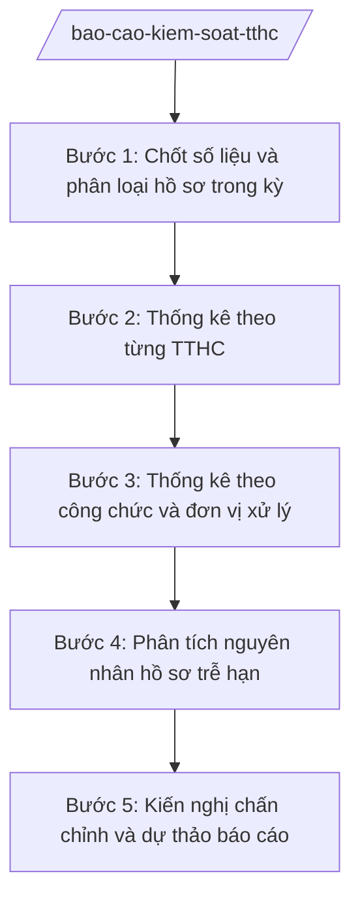

# Skill: Báo cáo kiểm soát TTHC, thống kê hồ sơ trễ hạn

## Khi nào dùng

- Khi đến kỳ báo cáo kiểm soát TTHC (tháng/quý/năm) theo yêu cầu của UBND xã hoặc cơ quan cấp trên.
- Khi cần thống kê tình hình tiếp nhận, giải quyết hồ sơ TTHC: số hồ sơ tiếp nhận, đang xử lý, trả đúng hạn, trễ hạn theo từng TTHC.
- Khi cần đánh giá trách nhiệm của từng công chức, từng phòng chuyên môn (X1, X2, X3) trong việc giải quyết hồ sơ đúng hạn.
- Khi phát sinh nhiều hồ sơ trễ hạn cần phân tích nguyên nhân và đề xuất biện pháp chấn chỉnh, xử lý trách nhiệm.
- Khi lãnh đạo UBND xã yêu cầu báo cáo đột xuất về tình hình giải quyết TTHC phục vụ kiểm tra của cấp trên.

## Đầu vào (Input)

| Trường | Mô tả | Bắt buộc |
|--------|-------|----------|
| `ky_bao_cao` | Kỳ báo cáo (tháng/quý/năm) và mốc thời gian chốt số liệu | Có |
| `so_theo_doi` | Sổ theo dõi luân chuyển hồ sơ tại Trung tâm PVHCC (mã hồ sơ, TTHC, đầu mối xử lý, ngày tiếp nhận, ngày hẹn, ngày trả, trạng thái) | Có |
| `danh_muc_tthc` | Danh sách TTHC thuộc thẩm quyền cấp xã với thời hạn giải quyết của từng TTHC | Có |
| `danh_sach_cong_chuc` | Danh sách công chức, đơn vị trực tiếp xử lý hồ sơ trong kỳ | Có |
| `ho_so_tre_han_chi_tiet` | Danh sách chi tiết hồ sơ trễ hạn (mã hồ sơ, TTHC, số ngày trễ, nguyên nhân sơ bộ) | Không |
| `bao_cao_ky_truoc` | Báo cáo kiểm soát TTHC kỳ trước để so sánh, đánh giá xu hướng | Không |
| `yeu_cau_bao_cao` | Yêu cầu cụ thể của lãnh đạo hoặc văn bản chỉ đạo của cấp trên về nội dung báo cáo | Không |

## Quy trình

**Bước 1. Chốt số liệu và phân loại hồ sơ trong kỳ**

- Làm gì: Chốt sổ theo dõi tại mốc thời gian báo cáo; phân loại toàn bộ hồ sơ thành các nhóm: đã giải quyết đúng hạn, đã giải quyết trễ hạn, đang xử lý trong hạn, đang xử lý quá hạn; đối chiếu ngày trả thực tế với ngày hẹn trên phiếu hẹn.
- Dùng input: `ky_bao_cao`, `so_theo_doi`, `danh_muc_tthc`
- Vai trò: Công chức Trung tâm PVHCC thực hiện chốt số liệu. AI hỗ trợ: tự động phân loại hồ sơ theo trạng thái, tính số ngày trễ, cảnh báo khi ngày trả không khớp ngày hẹn. Thời gian ước tính: 0,5–1 ngày làm việc.
- Lưu ý nghiệp vụ: Hồ sơ được tính "trễ hạn" khi ngày trả kết quả thực tế sau ngày hẹn ghi trên phiếu hẹn, kể cả trễ 01 ngày; hồ sơ đang xử lý quá ngày hẹn cũng phải thống kê riêng.
- → Kết quả bước: Bảng phân loại hồ sơ trong kỳ theo trạng thái (đúng hạn/trễ hạn/đang xử lý).

**Bước 2. Thống kê theo từng TTHC**

- Làm gì: Lập bảng thống kê cho từng TTHC: số hồ sơ tiếp nhận, số đã giải quyết (đúng hạn, trễ hạn), số đang xử lý (trong hạn, quá hạn), tỷ lệ giải quyết đúng hạn; xác định các TTHC có tỷ lệ trễ hạn cao.
- Dùng input: `so_theo_doi`, `danh_muc_tthc`, `bao_cao_ky_truoc`
- Vai trò: Công chức Trung tâm PVHCC tổng hợp. AI hỗ trợ: lập bảng thống kê tự động, xếp hạng TTHC theo tỷ lệ trễ hạn, so sánh với kỳ trước. Thời gian ước tính: 0,5 ngày làm việc.
- Lưu ý nghiệp vụ: TTHC có từ 03 hồ sơ trễ hạn trở lên hoặc tỷ lệ đúng hạn dưới 90% phải được phân tích nguyên nhân riêng ở bước tiếp theo.
- → Kết quả bước: Bảng thống kê hồ sơ theo từng TTHC trong kỳ.

**Bước 3. Thống kê theo công chức và đơn vị xử lý**

- Làm gì: Thống kê số hồ sơ do từng công chức, từng phòng chuyên môn (X1, X2, X3) trực tiếp xử lý: tiếp nhận, đúng hạn, trễ hạn, tỷ lệ đúng hạn; liệt kê danh sách hồ sơ trễ hạn gắn với công chức, đơn vị chịu trách nhiệm.
- Dùng input: `so_theo_doi`, `danh_sach_cong_chuc`
- Vai trò: Công chức Trung tâm PVHCC tổng hợp. AI hỗ trợ: tổng hợp theo công chức/đơn vị, đánh dấu các trường hợp trễ hạn lặp lại. Thời gian ước tính: 0,5 ngày làm việc.
- Lưu ý nghiệp vụ: Việc gắn trách nhiệm phải căn cứ sổ theo dõi và phiếu chuyển giao có ký nhận; trường hợp trễ hạn do phối hợp liên thông thì ghi rõ trách nhiệm từng khâu.
- → Kết quả bước: Bảng thống kê theo công chức, đơn vị xử lý kèm danh sách hồ sơ trễ hạn.

**Bước 4. Phân tích nguyên nhân hồ sơ trễ hạn**

- Làm gì: Đối với từng hồ sơ (hoặc nhóm hồ sơ) trễ hạn, xác định nguyên nhân thuộc nhóm: chủ quan (công chức chậm xử lý, thiếu phối hợp, không đôn đốc) hay khách quan (hồ sơ phức tạp, chờ ý kiến cấp trên, hệ thống lỗi...); tổng hợp nguyên nhân phổ biến nhất.
- Dùng input: `ho_so_tre_han_chi_tiet`, `so_theo_doi`
- Vai trò: Công chức Trung tâm PVHCC phân tích sơ bộ; công chức đầu mối các phòng giải trình nguyên nhân. AI hỗ trợ: nhóm nguyên nhân theo loại, thống kê tần suất, gợi ý nguyên nhân căn cơ. Thời gian ước tính: 1 ngày làm việc (bao gồm thời gian giải trình).
- Lưu ý nghiệp vụ: Không kết luận nguyên nhân khi chưa có giải trình của đơn vị, cá nhân liên quan; phân biệt rõ trách nhiệm của Trung tâm PVHCC, phòng chuyên môn và yếu tố khách quan.
- → Kết quả bước: Bảng phân tích nguyên nhân hồ sơ trễ hạn theo nhóm nguyên nhân.

**Bước 5. Kiến nghị chấn chỉnh và dự thảo báo cáo**

- Làm gì: Đề xuất các biện pháp chấn chỉnh cụ thể: nhắc nhở, phê bình, xem xét trách nhiệm đối với tập thể, cá nhân để xảy ra trễ hạn; kiến nghị bổ sung nhân sự, trang thiết bị, hoàn thiện quy trình phối hợp; dự thảo báo cáo kiểm soát TTHC trình lãnh đạo.
- Dùng input: `so_theo_doi`, `bao_cao_ky_truoc`, `yeu_cau_bao_cao`
- Vai trò: Công chức Trung tâm PVHCC dự thảo; Phó Chủ tịch UBND xã phụ trách kiểm tra; Chủ tịch UBND xã (Ông Nguyễn Văn A) phê duyệt báo cáo và quyết định biện pháp chấn chỉnh. AI hỗ trợ: dự thảo báo cáo theo cấu trúc chuẩn, gợi ý kiến nghị phù hợp với nguyên nhân đã phân tích. Thời gian ước tính: 1–2 ngày làm việc.
- Lưu ý nghiệp vụ: Kiến nghị xử lý trách nhiệm phải đúng thẩm quyền, đúng quy định; báo cáo gửi cấp trên (nếu có yêu cầu) phải sau khi Chủ tịch UBND xã ký duyệt.
- → Kết quả bước: Báo cáo kiểm soát TTHC kỳ báo cáo đã hoàn thiện, kèm kiến nghị chấn chỉnh.

## Luồng quy trình (Workflow)

## Đầu ra (Output)

- Bảng phân loại hồ sơ trong kỳ theo trạng thái.
- Bảng thống kê hồ sơ theo từng TTHC.
- Bảng thống kê hồ sơ theo công chức, đơn vị xử lý.
- Bảng phân tích nguyên nhân hồ sơ trễ hạn.
- Báo cáo kiểm soát TTHC định kỳ (có kiến nghị chấn chỉnh).

### Cấu trúc output chuẩn

Sản phẩm chính: **Báo cáo kiểm soát thủ tục hành chính**, thể thức theo NĐ 30/2020/NĐ-CP:

1. Quốc hiệu "CỘNG HÒA XÃ HỘI CHỦ NGHĨA VIỆT NAM" – Tiêu ngữ "Độc lập – Tự do – Hạnh phúc"; tên cơ quan ban hành (ỦY BAN NHÂN DÂN XÃ A — TRUNG TÂM PHỤC VỤ HÀNH CHÍNH CÔNG).
2. Số, ký hiệu văn bản (…/BC-TTPVHCC); địa danh và ngày, tháng, năm ban hành.
3. Tên loại và trích yếu: "BÁO CÁO kiểm soát thủ tục hành chính tháng (quý, năm) ... xã A".
4. Phần I — Tình hình chung: tổng số hồ sơ tiếp nhận trong kỳ; số đã giải quyết (đúng hạn, trễ hạn, tỷ lệ đúng hạn chung); số đang xử lý (trong hạn, quá hạn).
5. Phần II — Thống kê chi tiết: bảng thống kê theo từng TTHC (tiếp nhận, đúng hạn, trễ hạn, tỷ lệ); bảng thống kê theo công chức, đơn vị xử lý.
6. Phần III — Hồ sơ trễ hạn và nguyên nhân: liệt kê từng hồ sơ trễ hạn (mã hồ sơ, TTHC, công chức/đơn vị xử lý, số ngày trễ); phân tích nguyên nhân theo nhóm (chủ quan, khách quan).
7. Phần IV — Đánh giá, kiến nghị: nhận xét ưu điểm, tồn tại; kiến nghị chấn chỉnh (nhắc nhở, phê bình, xem xét trách nhiệm; kiến nghị về nhân sự, quy trình, trang thiết bị).
8. Chữ ký người có thẩm quyền (ký, ghi rõ họ tên, đóng dấu).
9. Nơi nhận: UBND xã (để báo cáo), cơ quan cấp trên (nếu có yêu cầu), các phòng chuyên môn liên quan; lưu: VT, TTPVHCC.

## Checklist nghiệm thu

1. Số liệu chốt đúng mốc thời gian kỳ báo cáo; tổng số hồ sơ khớp giữa các bảng thống kê.
2. Phân loại hồ sơ đúng quy tắc: trễ hạn tính từ ngày sau ngày hẹn trên phiếu hẹn, kể cả trễ 01 ngày.
3. Bảng thống kê theo TTHC đầy đủ các cột: tiếp nhận, đúng hạn, trễ hạn, đang xử lý, tỷ lệ đúng hạn.
4. Bảng thống kê theo công chức, đơn vị xử lý gắn đúng trách nhiệm theo sổ theo dõi và phiếu chuyển giao có ký nhận.
5. 100% hồ sơ trễ hạn được liệt kê chi tiết (mã hồ sơ, TTHC, số ngày trễ) và có phân tích nguyên nhân.
6. Nguyên nhân trễ hạn có căn cứ giải trình của đơn vị, cá nhân liên quan; phân biệt rõ chủ quan/khách quan.
7. Kiến nghị chấn chỉnh cụ thể, đúng thẩm quyền; có nội dung so sánh với kỳ trước (nếu có báo cáo kỳ trước).
8. Báo cáo đủ 4 phần theo cấu trúc chuẩn, thể thức đúng NĐ 30/2020/NĐ-CP.
9. Báo cáo đã qua human gate: Phó Chủ tịch phụ trách kiểm tra, Chủ tịch UBND xã ký duyệt trước khi gửi cấp trên.

## Ví dụ mô phỏng
*Dữ liệu dưới đây là giả lập 100% phục vụ minh họa.*

**Input mẫu:**

- Kỳ báo cáo: tháng 10 năm 2026; chốt số liệu ngày 31/10/2026.
- Sổ theo dõi: tiếp nhận 100 hồ sơ; đã giải quyết 95 (90 đúng hạn, 5 trễ hạn); đang xử lý 5 (4 trong hạn, 1 quá hạn).
- TTHC: "Chứng thực bản sao" (60 hồ sơ: 57 đúng hạn, 3 trễ hạn); "Đăng ký khai sinh" (25 hồ sơ: 24 đúng hạn, 1 trễ hạn); "Đăng ký kết hôn" (15 hồ sơ: 14 đúng hạn, 1 trễ hạn).
- Công chức xử lý: Bà Trần Thị H (X1) — 60 hồ sơ, 3 trễ hạn; Ông Nguyễn Văn G (X1) — 40 hồ sơ, 2 trễ hạn.
- Hồ sơ trễ hạn: trễ 01–03 ngày; nguyên nhân: công chức đi công tác đột xuất chưa bàn giao (3 hồ sơ), chờ xác minh thông tin hộ tịch (2 hồ sơ).

**Output mẫu:**

CỘNG HÒA XÃ HỘI CHỦ NGHĨA VIỆT NAM
Độc lập – Tự do – Hạnh phúc

ỦY BAN NHÂN DÂN XÃ A
TRUNG TÂM PHỤC VỤ HÀNH CHÍNH CÔNG

Số: 12/BC-TTPVHCC
Xã A, ngày 05 tháng 11 năm 2026

**BÁO CÁO
Kiểm soát thủ tục hành chính tháng 10 năm 2026 xã A**

Kính gửi: Ủy ban nhân dân xã A

**I. TÌNH HÌNH CHUNG**

Tháng 10/2026, Trung tâm PVHCC xã A tiếp nhận 100 hồ sơ; đã giải quyết 95 hồ sơ (90 đúng hạn, 05 trễ hạn), tỷ lệ giải quyết đúng hạn đạt 95%; đang xử lý 05 hồ sơ (04 trong hạn, 01 quá hạn).

**II. THỐNG KÊ CHI TIẾT**

1. Theo từng TTHC:

| STT | Tên TTHC | Tiếp nhận | Đúng hạn | Trễ hạn | Đang xử lý | Tỷ lệ đúng hạn |
|-----|----------|-----------|----------|---------|------------|----------------|
| 1 | Chứng thực bản sao | 60 | 57 | 3 | 0 | 95% |
| 2 | Đăng ký khai sinh | 25 | 24 | 1 | 0 | 96% |
| 3 | Đăng ký kết hôn | 15 | 14 | 1 | 5 | 93% |

2. Theo công chức, đơn vị xử lý (Văn phòng HĐND và UBND xã A):

| STT | Công chức xử lý | Tiếp nhận | Đúng hạn | Trễ hạn | Tỷ lệ đúng hạn |
|-----|-----------------|-----------|----------|---------|----------------|
| 1 | Bà Trần Thị H | 60 | 57 | 3 | 95% |
| 2 | Ông Nguyễn Văn G | 40 | 38 | 2 | 95% |

**III. HỒ SƠ TRỄ HẠN VÀ NGUYÊN NHÂN**

05 hồ sơ trễ hạn 01–03 ngày (mã hồ sơ giả lập: HS-001 đến HS-005). Nguyên nhân: chủ quan — công chức đi công tác đột xuất chưa kịp bàn giao công việc (03 hồ sơ); khách quan — chờ xác minh thông tin hộ tịch (02 hồ sơ).

**IV. ĐÁNH GIÁ, KIẾN NGHỊ**

Ưu điểm: tỷ lệ giải quyết đúng hạn đạt 95%, tăng 02 điểm phần trăm so với tháng 9/2026. Tồn tại: còn 05 hồ sơ trễ hạn, 01 hồ sơ đang xử lý quá hạn.

Kiến nghị:

1. Yêu cầu Văn phòng HĐND và UBND xã A chấn chỉnh, không để tái diễn tình trạng trễ hạn do chưa bàn giao công việc khi đi công tác.
2. Bố trí công chức dự phòng xử lý hồ sơ hộ tịch khi công chức chính vắng mặt.
3. Rà soát, xử lý dứt điểm 01 hồ sơ đang quá hạn trước ngày 10/11/2026.

Nơi nhận:
- UBND xã (để báo cáo);
- Văn phòng HĐND và UBND xã;
- Lưu: VT, TTPVHCC.

**TM. TRUNG TÂM PHỤC VỤ HÀNH CHÍNH CÔNG**
**PHÓ CHỦ TỊCH UBND XÃ PHỤ TRÁCH**
*(Ký, ghi rõ họ tên, đóng dấu)*
Trần Thị B

*(Dữ liệu trên là giả lập 100% phục vụ minh họa.)*

## Human gate

- Công chức Trung tâm PVHCC chốt số liệu, dự thảo báo cáo → Phó Chủ tịch UBND xã phụ trách (Bà Trần Thị B) kiểm tra, đối chiếu số liệu với sổ theo dõi gốc → Chủ tịch UBND xã (Ông Nguyễn Văn A) ký duyệt báo cáo trước khi gửi cấp trên hoặc lưu hành.
- Kiến nghị xử lý trách nhiệm tập thể, cá nhân phải được Chủ tịch UBND xã xem xét, quyết định theo thẩm quyền; AI và công chức tổng hợp không tự kết luận trách nhiệm.

## Giới hạn

- AI KHÔNG ra quyết định hành chính thay người có thẩm quyền (không kết luận trách nhiệm, không quyết định hình thức xử lý đối với tập thể, cá nhân).
- AI không tự ký, tự phát hành báo cáo; báo cáo gửi cấp trên phải do Chủ tịch UBND xã ký duyệt.
- AI không bịa số liệu, không làm đẹp số liệu; mọi con số phải khớp với sổ theo dõi gốc.
- AI không bịa căn cứ pháp lý, không dùng văn bản đã hết hiệu lực.
- AI không công khai danh sách công chức trễ hạn ra ngoài phạm vi báo cáo nội bộ khi chưa có ý kiến của người có thẩm quyền.

## Căn cứ & lưu ý

- Nghị định 118/2025/NĐ-CP ngày 09/6/2025 của Chính phủ về cơ chế một cửa, một cửa liên thông trong giải quyết thủ tục hành chính (quy định về kiểm soát TTHC, theo dõi, đôn đốc, xử lý hồ sơ trễ hạn).
- Văn bản 7216/VPCP-KSTT ngày 04/8/2025 của Văn phòng Chính phủ hướng dẫn tổ chức, hoạt động của Trung tâm Phục vụ hành chính công trong mô hình chính quyền địa phương 2 cấp.
- Nghị định 150/2025/NĐ-CP ngày 12/6/2025 của Chính phủ (quy định về Trung tâm Phục vụ hành chính công thuộc UBND cấp xã).
- Nghị định 30/2020/NĐ-CP của Chính phủ về công tác văn thư (thể thức văn bản hành chính).
- Lưu ý: báo cáo kiểm soát TTHC là căn cứ đánh giá mức độ hoàn thành nhiệm vụ của công chức, đơn vị; số liệu phải trung thực, khách quan, có đối chiếu với sổ theo dõi gốc.
