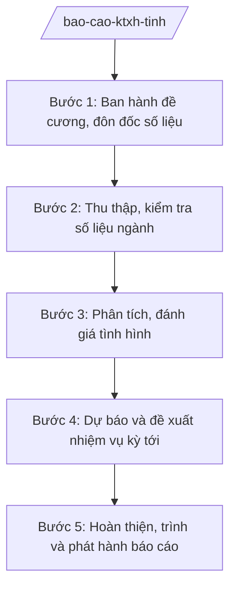

# Skill: Báo cáo KT-XH tỉnh định kỳ

> **Ghi chú áp dụng đa cấp:** Skill dùng chung cho mọi cấp hành chính. Các chức danh, đơn vị nêu trong quy trình (ví dụ: "Chủ tịch UBND xã", "Chánh Văn phòng", "Sở Tài chính") được viết theo mẫu minh họa — khi áp dụng ở cấp khác, thay bằng chức danh/đơn vị tương ứng của cấp đó (cấp tỉnh: Chủ tịch UBND tỉnh, Giám đốc Sở; cấp trung ương: Bộ trưởng, Vụ trưởng/Cục trưởng).

## 2. Khi nào dùng
- Tổng hợp báo cáo KT-XH tháng, quý, 6 tháng, năm của tỉnh trình UBND tỉnh, HĐND tỉnh.
- Chuẩn bị báo cáo phục vụ kỳ họp HĐND tỉnh, hội nghị của Tỉnh ủy.
- Báo cáo đột xuất về tình hình KT-XH theo yêu cầu của Chính phủ, bộ ngành.

## 3. Đầu vào (Input)
| Trường | Mô tả | Bắt buộc |
|--------|-------|----------|
| `ky_bao_cao` | Kỳ báo cáo (tháng/quý/6 tháng/năm + mốc thời gian) | Có |
| `de_cuong` | Đề cương báo cáo (đơn vị chủ trì xây dựng tại Bước 1; trường hợp cấp trên đã ban hành thì dùng đề cương có sẵn) | Có |
| `so_lieu_cac_so` | Số liệu báo cáo của các sở, ngành theo đề cương | Có |
| `so_lieu_thong_ke` | Số liệu của cơ quan thống kê | Có |
| `nhiem_vu_trong_tam_ky_truoc` | Nhiệm vụ, chỉ tiêu kỳ trước để đối chiếu | Không |
| `thoi_han_nop` | Thời hạn hoàn thành báo cáo | Có |

## 4. Quy trình

**Bước 1. Ban hành đề cương, đôn đốc số liệu**
- Làm gì: Xây dựng đề cương báo cáo; gửi văn bản đề nghị các sở, ngành báo cáo số liệu theo đề cương, đúng thời hạn.
- Dùng input: `ky_bao_cao`, `thoi_han_nop` (đề cương được xây dựng tại bước này; nếu cấp trên đã ban hành đề cương thì dùng trực tiếp).
- Vai trò: Chuyên viên Phòng Tổng hợp (Sở Tài chính tỉnh A hoặc Văn phòng UBND tỉnh A) soạn; AI hỗ trợ soạn đề cương, công văn đôn đốc ⏱ 1 ngày (ước tính) làm việc
- Lưu ý nghiệp vụ: Đề cương phải bao quát các ngành, lĩnh vực; thời hạn gửi số liệu phải trừ hao thời gian tổng hợp.
- → Kết quả bước: Đề cương + công văn đề nghị báo cáo đã gửi các sở, ngành.

**Bước 2. Thu thập, kiểm tra số liệu ngành**
- Làm gì: Thu thập báo cáo của các sở, ngành; kiểm tra tính đầy đủ, logic, nhất quán của số liệu; yêu cầu giải trình, bổ sung khi số liệu bất thường.
- Dùng input: `de_cuong` (đề cương từ Bước 1), `so_lieu_cac_so`, `so_lieu_thong_ke`.
- Vai trò: Chuyên viên tổng hợp; AI hỗ trợ đối chiếu chéo số liệu giữa các nguồn, phát hiện số liệu bất thường ⏱ 3 ngày (ước tính) làm việc
- Lưu ý nghiệp vụ: Không tự ý điều chỉnh số liệu ngành; số liệu vênh nhau phải yêu cầu đơn vị báo cáo giải trình bằng văn bản.
- → Kết quả bước: Bộ số liệu đã kiểm tra, có giải trình các điểm vênh.

**Bước 3. Phân tích, đánh giá tình hình**
- Làm gì: Phân tích kết quả đạt được, tồn tại, nguyên nhân theo từng lĩnh vực; so sánh với cùng kỳ, với kế hoạch; đánh giá khả năng hoàn thành chỉ tiêu năm.
- Dùng input: Bộ số liệu Bước 2, `nhiem_vu_trong_tam_ky_truoc`.
- Vai trò: Chuyên viên phân tích; Trưởng phòng Tổng hợp rà soát; AI hỗ trợ tính toán tốc độ tăng trưởng, vẽ biểu đồ, soạn nhận định ⏱ 2 ngày (ước tính) làm việc
- Lưu ý nghiệp vụ: Phân tích phải gắn số liệu với nguyên nhân; nêu rõ tồn tại thuộc trách nhiệm chủ quan, khách quan.
- → Kết quả bước: Bản phân tích, đánh giá tình hình KT-XH kỳ báo cáo.

**Bước 4. Dự báo và đề xuất nhiệm vụ kỳ tới**
- Làm gì: Dự báo xu hướng kỳ tới; đề xuất nhiệm vụ, giải pháp trọng tâm; tổng hợp kiến nghị của các sở, ngành.
- Dùng input: Bản phân tích Bước 3.
- Vai trò: Lãnh đạo Sở Tài chính / Văn phòng UBND tỉnh cho ý kiến định hướng; AI hỗ trợ soạn phần nhiệm vụ, giải pháp ⏱ 1 ngày (ước tính) làm việc
- Lưu ý nghiệp vụ: Nhiệm vụ phải cụ thể, có chỉ tiêu, có đầu mối; kiến nghị với Trung ương phải đúng thẩm quyền.
- → Kết quả bước: Phần dự báo, nhiệm vụ, kiến nghị.

**Bước 5. Hoàn thiện, trình và phát hành báo cáo**
- Làm gì: Tổng hợp thành báo cáo hoàn chỉnh; trình lãnh đạo ký; gửi HĐND tỉnh, các cơ quan theo quy định.
- Dùng input: Toàn bộ kết quả các bước.
- Vai trò: Giám đốc Sở / Chánh Văn phòng UBND tỉnh kiểm tra; Chủ tịch UBND tỉnh ký (báo cáo quan trọng); AI hỗ trợ rà soát thể thức, số liệu lần cuối ⏱ 1 ngày (ước tính) làm việc
- Lưu ý nghiệp vụ: Số liệu trong báo cáo phải khớp với số liệu ngành đã kiểm tra; đúng thời hạn gửi.
- → Kết quả bước: Báo cáo KT-XH kỳ đã ký, đã gửi.

## Luồng quy trình (Workflow)

## 5. Đầu ra (Output)
- Báo cáo tình hình kinh tế – xã hội kỳ (tháng/quý/6 tháng/năm).
- Phụ lục số liệu chi tiết theo ngành, lĩnh vực.
- Bảng theo dõi chỉ tiêu kế hoạch năm.

### Cấu trúc output chuẩn
Khung báo cáo KT-XH tỉnh, đúng thể thức NĐ 30/2020/NĐ-CP:
1. Quốc hiệu "CỘNG HÒA XÃ HỘI CHỦ NGHĨA VIỆT NAM" – Tiêu ngữ "Độc lập – Tự do – Hạnh phúc"; số, ký hiệu; địa danh, ngày tháng năm.
2. Tên: "BÁO CÁO tình hình kinh tế – xã hội ...".
3. Phần I: Kết quả thực hiện (theo từng lĩnh vực: công nghiệp, nông nghiệp, thương mại – dịch vụ, tài chính – ngân sách, đầu tư, văn hóa – xã hội...).
4. Phần II: Đánh giá chung (kết quả nổi bật, tồn tại, nguyên nhân).
5. Phần III: Nhiệm vụ, giải pháp kỳ tới.
6. Phần IV: Kiến nghị (với HĐND tỉnh, Chính phủ, bộ ngành — nếu có).
7. Phụ lục số liệu.
8. Chữ ký người có thẩm quyền.
9. Nơi nhận: Thường trực HĐND tỉnh; các Ban HĐND tỉnh; UBND tỉnh; các sở, ban, ngành; UBND cấp xã (theo danh sách gửi); Lưu: VT, đơn vị soạn thảo.

> **Checklist thể thức văn bản theo NĐ 30/2020/NĐ-CP** — đối chiếu trước khi trình ký:
> 1. Quốc hiệu và Tiêu ngữ.
> 2. Tên cơ quan, tổ chức ban hành văn bản.
> 3. Số, ký hiệu của văn bản.
> 4. Địa danh và thời gian ban hành văn bản.
> 5. Tên loại và trích yếu nội dung văn bản.
> 6. Nội dung văn bản.
> 7. Chức vụ, họ tên và chữ ký của người có thẩm quyền.
> 8. Dấu, chữ ký số của cơ quan, tổ chức.
> 9. Nơi nhận (kèm Phụ lục nếu có).

## 6. Checklist nghiệm thu
- [ ] Đủ số liệu các sở, ngành theo đề cương; số liệu vênh đã được giải trình.
- [ ] Phân tích gắn số liệu với nguyên nhân, so sánh cùng kỳ và kế hoạch.
- [ ] Tồn tại được nêu thẳng thắn, phân rõ chủ quan/khách quan.
- [ ] Nhiệm vụ kỳ tới cụ thể, có chỉ tiêu, có đầu mối.
- [ ] Số liệu trong báo cáo khớp với số liệu ngành.
- [ ] Đúng thể thức văn bản theo NĐ 30/2020/NĐ-CP.
- [ ] Đã qua kiểm tra của lãnh đạo Sở/Văn phòng UBND tỉnh và ký duyệt.
- [ ] Gửi đúng thời hạn, đúng nơi nhận.

## 7. Ví dụ mô phỏng
*Dữ liệu dưới đây là giả lập 100% phục vụ minh họa.*

**Input mẫu:**
- ky_bao_cao: Quý I năm 2026, tỉnh A
- de_cuong: Đề cương báo cáo KT-XH quý I/2026 của UBND tỉnh A
- so_lieu_cac_so: Báo cáo của 12 sở, ngành (giả lập)
- so_lieu_thong_ke: Số liệu Cục Thống kê tỉnh A (giả lập)

**Output mẫu (trích):**
> **BÁO CÁO**
> **Tình hình kinh tế – xã hội quý I năm 2026 tỉnh A**
>
> I. Kết quả thực hiện:
> - Công nghiệp: giá trị sản xuất tăng 8,5% so với cùng kỳ (giả lập)...
> - Nông nghiệp: ...
> - Thu ngân sách: đạt 22% dự toán (giả lập)...
> II. Đánh giá chung: ...
> III. Nhiệm vụ quý II: ...
> IV. Kiến nghị: ...

## 8. Human gate
- Trưởng phòng Tổng hợp (Sở Tài chính / Văn phòng UBND tỉnh): kiểm tra số liệu và phân tích (Bước 2–3).
- Giám đốc Sở / Chánh Văn phòng UBND tỉnh: kiểm tra toàn văn (Bước 5).
- Chủ tịch UBND tỉnh: ký báo cáo quan trọng (báo cáo năm, báo cáo trình HĐND).

## 9. Giới hạn
- AI không tự ý điều chỉnh số liệu do sở, ngành báo cáo.
- Không bịa số liệu tăng trưởng, thu ngân sách; mọi con số phải có nguồn.
- Không đưa nhận định chính trị, không kiến nghị vượt thẩm quyền của tỉnh.
- Không dùng số liệu kỳ trước thay số liệu kỳ báo cáo.

## 10. Căn cứ & lưu ý
- TT 57/2025/TT-BTC (Sở Tài chính: kế hoạch, thống kê, tổng hợp).
- NĐ 150/2025/NĐ-CP (chức năng tham mưu, tổng hợp của sở).
- NĐ 30/2020/NĐ-CP về công tác văn thư (thể thức).
