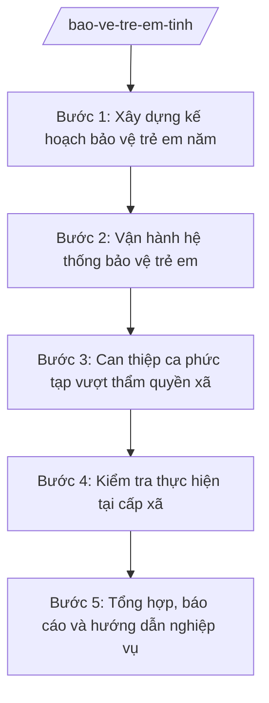

# Skill: Bảo vệ trẻ em cấp tỉnh

## 2. Khi nào dùng
- Xây dựng kế hoạch bảo vệ, chăm sóc trẻ em hằng năm của tỉnh.
- Vận hành hệ thống bảo vệ trẻ em (đường dây tư vấn, cơ sở trợ giúp, đội ngũ cộng tác viên).
- Can thiệp, hỗ trợ các ca trẻ em bị xâm hại, bỏ rơi, có hoàn cảnh đặc biệt phức tạp vượt thẩm quyền cấp xã.
- Kiểm tra việc thực hiện chính sách bảo vệ trẻ em tại cấp xã.
- Tổng hợp, báo cáo tình hình trẻ em toàn tỉnh gửi UBND tỉnh, Bộ Nội vụ.

## 3. Đầu vào (Input)
| Trường | Mô tả | Bắt buộc |
|--------|-------|----------|
| `nam_ke_hoach` | Năm kế hoạch | Có |
| `so_lieu_tre_em` | Số liệu trẻ em có hoàn cảnh đặc biệt, trẻ em có nguy cơ (theo xã) | Có |
| `ca_can_thiep` | Các ca cần can thiệp vượt thẩm quyền xã (mô tả, mức độ) | Không |
| `bao_cao_xa` | Báo cáo công tác bảo vệ trẻ em của các xã | Có |
| `van_ban_chi_dao` | Văn bản chỉ đạo của Trung ương, UBND tỉnh về bảo vệ trẻ em | Không |

## 4. Quy trình

**Bước 1. Xây dựng kế hoạch bảo vệ trẻ em năm**
- Làm gì: Tổng hợp số liệu trẻ em có hoàn cảnh đặc biệt; soạn kế hoạch năm (mục tiêu, nhiệm vụ phòng ngừa – can thiệp – hỗ trợ, kinh phí, phân công).
- Dùng input: `nam_ke_hoach`, `so_lieu_tre_em`, `van_ban_chi_dao`.
- Vai trò: Chuyên viên Phòng Bảo trợ xã hội (Sở Nội vụ tỉnh A) soạn; AI hỗ trợ tổng hợp số liệu, soạn dự thảo ⏱ ~3–5 ngày làm việc (ước tính).
- Lưu ý nghiệp vụ: Kế hoạch phải bao trùm 3 cấp độ bảo vệ (phòng ngừa, can thiệp, hỗ trợ tái hòa nhập); gắn với chương trình giảm nghèo, trợ giúp xã hội.
- → Kết quả bước: Dự thảo kế hoạch bảo vệ trẻ em năm của tỉnh.

**Bước 2. Vận hành hệ thống bảo vệ trẻ em**
- Làm gì: Duy trì đường dây tư vấn, cơ sở trợ giúp trẻ em; quản lý đội ngũ cộng tác viên bảo vệ trẻ em; tiếp nhận thông tin, phân loại và chuyển ca về xã hoặc xử lý cấp tỉnh.
- Dùng input: `so_lieu_tre_em`, `ca_can_thiep`.
- Vai trò: Phòng Bảo trợ xã hội chủ trì, phối hợp cơ sở trợ giúp; AI hỗ trợ lập sổ theo dõi ca, nhắc hạn xử lý ⏱ thường xuyên trong năm (ước tính).
- Lưu ý nghiệp vụ: Mọi thông tin về trẻ em bị xâm hại phải được bảo mật tuyệt đối; phân loại ca theo mức độ khẩn cấp để ưu tiên can thiệp.
- → Kết quả bước: Hệ thống tiếp nhận – phân loại – chuyển xử lý ca được vận hành.

**Bước 3. Can thiệp ca phức tạp vượt thẩm quyền xã**
- Làm gì: Tiếp nhận ca do xã chuyển lên (xâm hại nghiêm trọng, trẻ mồ côi không nơi nương tựa, tranh chấp phức tạp); cử cán bộ can thiệp; phối hợp Công an, Y tế, Tòa án; lập hồ sơ can thiệp.
- Dùng input: `ca_can_thiep`.
- Vai trò: Chuyên viên Phòng Bảo trợ xã hội trực tiếp can thiệp, Trưởng phòng chỉ đạo; AI hỗ trợ soạn kế hoạch can thiệp, biên bản làm việc ⏱ ~3–7 ngày/ca tùy mức độ (ước tính).
- Lưu ý nghiệp vụ: Đặt lợi ích tốt nhất của trẻ em lên trên hết; phối hợp liên ngành chặt chẽ; không để ca tồn đọng quá hạn xử lý.
- → Kết quả bước: Hồ sơ can thiệp, biên bản phối hợp liên ngành.

**Bước 4. Kiểm tra thực hiện tại cấp xã**
- Làm gì: Kiểm tra việc quản lý trẻ em có hoàn cảnh đặc biệt, chi trả chính sách, hoạt động của cộng tác viên tại xã; kết luận, kiến nghị.
- Dùng input: `bao_cao_xa`.
- Vai trò: Đoàn kiểm tra Sở Nội vụ thực hiện; AI hỗ trợ soạn đề cương, tổng hợp kết quả ⏱ ~1–2 ngày/xã (ước tính).
- Lưu ý nghiệp vụ: Chú trọng xã có số ca cao, xã vùng khó khăn; kiến nghị xử lý rõ trách nhiệm khi phát hiện bỏ sót ca.
- → Kết quả bước: Biên bản, kết luận kiểm tra.

**Bước 5. Tổng hợp, báo cáo và hướng dẫn nghiệp vụ**
- Làm gì: Tổng hợp số liệu trẻ em, kết quả can thiệp; soạn báo cáo định kỳ; ban hành văn bản hướng dẫn, tập huấn cho công chức xã.
- Dùng input: `bao_cao_xa`, kết quả các bước 2–4.
- Vai trò: Chuyên viên Phòng Bảo trợ xã hội tổng hợp; AI hỗ trợ soạn báo cáo, tài liệu tập huấn ⏱ ~3–5 ngày làm việc/đợt (ước tính).
- Lưu ý nghiệp vụ: Số liệu phải nhất quán giữa các kỳ; hướng dẫn cập nhật khi có chính sách mới.
- → Kết quả bước: Báo cáo định kỳ + văn bản hướng dẫn/tài liệu tập huấn.

## Luồng quy trình (Workflow)

## 5. Đầu ra (Output)

**Danh sách sản phẩm:**
1. Kế hoạch bảo vệ trẻ em năm của tỉnh (trình Chủ tịch UBND tỉnh phê duyệt).
2. Hồ sơ can thiệp ca phức tạp (kế hoạch can thiệp, biên bản liên ngành).
3. Biên bản, kết luận kiểm tra tại xã.
4. Báo cáo tình hình trẻ em định kỳ.
5. Văn bản hướng dẫn nghiệp vụ cho cấp xã.

**Cấu trúc output chuẩn** (Kế hoạch — thể thức văn bản hành chính theo NĐ 30/2020/NĐ-CP):
1. Quốc hiệu "CỘNG HÒA XÃ HỘI CHỦ NGHĨA VIỆT NAM", Tiêu ngữ "Độc lập – Tự do – Hạnh phúc".
2. Tên cơ quan: ỦY BAN NHÂN DÂN TỈNH A; số, ký hiệu; địa danh, ngày tháng năm.
3. Tên loại và trích yếu: "KẾ HOẠCH Bảo vệ, chăm sóc trẻ em năm ... trên địa bàn tỉnh A".
4. Căn cứ ban hành.
5. Nội dung: mục tiêu; nhiệm vụ phòng ngừa – can thiệp – hỗ trợ; kinh phí; phân công trách nhiệm (Sở Nội vụ, Công an tỉnh, Sở Y tế, Sở GD&ĐT, UBND cấp xã...); tổ chức thực hiện.
6. Nơi nhận; chữ ký người có thẩm quyền.

## 6. Checklist nghiệm thu

- [ ] Kế hoạch bao trùm 3 cấp độ bảo vệ trẻ em, gắn với chính sách liên quan
- [ ] Hệ thống tiếp nhận ca vận hành liên tục, 100% ca được phân loại, chuyển xử lý đúng hạn
- [ ] Ca phức tạp được can thiệp kịp thời, có hồ sơ và biên bản phối hợp liên ngành
- [ ] Thông tin trẻ em bị xâm hại được bảo mật tuyệt đối
- [ ] Kiểm tra có kết luận rõ ràng, kiến nghị xử lý cụ thể (nếu có sai phạm)
- [ ] Báo cáo số liệu nhất quán giữa các kỳ, khớp với số liệu xã
- [ ] Đủ thành phần thể thức văn bản hành chính theo NĐ 30/2020/NĐ-CP
- [ ] Căn cứ pháp lý đúng, còn hiệu lực, không bịa số hiệu văn bản
- [ ] Đã qua human gate: Trưởng phòng kiểm tra → Giám đốc Sở → Chủ tịch UBND tỉnh (với kế hoạch)
- [ ] Dữ liệu ví dụ (nếu có) 100% hư cấu theo quy ước

## 7. Ví dụ mô phỏng

*Dữ liệu dưới đây là giả lập 100% phục vụ minh họa.*

**Input mẫu:**
- `nam_ke_hoach`: 2026
- `so_lieu_tre_em`: 350 trẻ em có hoàn cảnh đặc biệt toàn tỉnh A (số liệu giả lập)
- `ca_can_thiep`: 02 ca xã chuyển lên (01 ca trẻ bị bạo hành cần can thiệp khẩn, 01 ca trẻ mồ côi cần bố trí chăm sóc thay thế)
- `bao_cao_xa`: 20/20 xã đã gửi báo cáo năm 2025
- `van_ban_chi_dao`: không có văn bản mới

**Output mẫu (trích Kế hoạch):**

CỘNG HÒA XÃ HỘI CHỦ NGHĨA VIỆT NAM
Độc lập – Tự do – Hạnh phúc

ỦY BAN NHÂN DÂN TỈNH A
Số: 1235/QĐ-UBND
Tỉnh A, ngày 20 tháng 01 năm 2026

**KẾ HOẠCH**
**Bảo vệ, chăm sóc trẻ em năm 2026 trên địa bàn tỉnh A**

**I. Mục tiêu:** 100% trẻ em có hoàn cảnh đặc biệt được quản lý, can thiệp kịp thời; giảm số ca trẻ em bị xâm hại.

**II. Nhiệm vụ:**
1. Phòng ngừa: truyền thông tại 20/20 xã; tập huấn 40 cộng tác viên (số liệu giả lập).
2. Can thiệp: xử lý 100% ca do xã chuyển lên trong 7 ngày làm việc; phối hợp Công an, Y tế với ca xâm hại.
3. Hỗ trợ: bố trí chăm sóc thay thế cho trẻ mồ côi không nơi nương tựa; hỗ trợ học nghề cho trẻ hết tuổi được chăm sóc.

**III. Kinh phí:** ngân sách tỉnh + lồng ghép chương trình mục tiêu quốc gia.

**IV. Tổ chức thực hiện:** Sở Nội vụ chủ trì; Công an tỉnh, Sở Y tế, Sở GD&ĐT, UBND cấp xã phối hợp.

*Nơi nhận:* ... **CHỦ TỊCH** (ký tên, đóng dấu — phần ký do người có thẩm quyền thực hiện)

## 8. Human gate (người kiểm duyệt)

- Chuyên viên Phòng Bảo trợ xã hội soạn thảo → Trưởng phòng (bà Đặng Thị Y) kiểm tra → Phó Giám đốc Sở (ông Đỗ Văn U) cho ý kiến → Giám đốc Sở Nội vụ (ông Hoàng Văn S) ký văn bản thuộc thẩm quyền Sở.
- Kế hoạch năm: Giám đốc Sở trình → Chủ tịch UBND tỉnh (ông Phạm Văn P) phê duyệt.
- Ca can thiệp khẩn: Trưởng phòng quyết định phương án can thiệp ngay, báo cáo Giám đốc Sở trong 24 giờ.

## 9. Giới hạn (guardrails)

- AI KHÔNG quyết định phương án can thiệp ca trẻ em bị xâm hại thay cán bộ chuyên môn.
- AI KHÔNG tự ký, đóng dấu, phát hành văn bản hành chính.
- KHÔNG bịa số liệu trẻ em, ca can thiệp, kinh phí, số hiệu văn bản, căn cứ pháp lý.
- TUYỆT ĐỐI bảo mật thông tin cá nhân trẻ em bị xâm hại; không đưa tên, địa chỉ thật của trẻ vào bất kỳ output nào.
- KHÔNG dùng văn bản đã hết hiệu lực; phân định rõ cấp tỉnh (chính sách, can thiệp ca phức tạp) với cấp xã (quản lý, can thiệp ban đầu) — xem skill `bao-ve-tre-em`.

## 10. Căn cứ & lưu ý

- Thông tư 10/2025/TT-BNV ngày 19/6/2025; sửa đổi, bổ sung bởi TT 06/2026/TT-BNV: chức năng, nhiệm vụ của Sở Nội vụ (đầu mối lĩnh vực lao động – thương binh và xã hội ở địa phương).
- Thông tư 14/2025/TT-BYT: phân định thẩm quyền CQĐP 2 cấp trong lĩnh vực bảo trợ xã hội (thuộc chùm TT 14–19/2025/TT-BYT).
- Nghị định 150/2025/NĐ-CP; Nghị định 370/2025/NĐ-CP: tổ chức Sở Nội vụ.
- Nghị định 30/2020/NĐ-CP: thể thức văn bản hành chính.
- Lưu ý: cấp xã quản lý, can thiệp ban đầu các ca trên địa bàn; ca phức tạp vượt thẩm quyền chuyển lên Sở Nội vụ can thiệp, phối hợp liên ngành.
