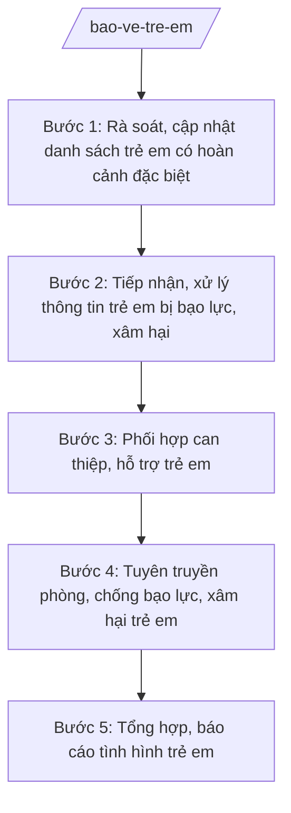

# Skill: Bảo vệ, chăm sóc trẻ em cơ sở

## 2. Khi nào dùng

- Rà soát, lập và cập nhật danh sách trẻ em có hoàn cảnh đặc biệt trên địa bàn xã (trẻ em mồ côi, bị bỏ rơi, khuyết tật, nhiễm HIV, vi phạm pháp luật, lang thang...).
- Tiếp nhận thông tin, tố giác về trẻ em bị bạo lực, xâm hại, bóc lột, bỏ rơi.
- Phối hợp can thiệp, hỗ trợ khẩn cấp và dài hạn cho trẻ em bị bạo lực, xâm hại.
- Tổ chức tuyên truyền phòng, chống bạo lực, xâm hại trẻ em trong cộng đồng, trường học.
- Tổng hợp, báo cáo tình hình trẻ em trên địa bàn định kỳ hoặc đột xuất.

## 3. Đầu vào (Input)

| Trường | Mô tả | Bắt buộc |
|--------|-------|----------|
| `ky_bao_cao` | Kỳ kế hoạch/báo cáo (năm hoặc đợt) | Có |
| `danh_sach_tre_db` | Danh sách trẻ em có hoàn cảnh đặc biệt hiện quản lý (họ tên, năm sinh, hoàn cảnh, thôn, tình trạng hỗ trợ) | Có |
| `thong_tin_vu_viec` | Thông tin vụ việc trẻ em bị bạo lực/xâm hại cần xử lý (nguồn tin, nội dung, mức độ) | Không |
| `ke_hoach_tuyen_truyen` | Nhu cầu tuyên truyền phòng, chống xâm hại trẻ em (đối tượng, hình thức, thời gian) | Không |
| `so_lieu_ho_tro` | Số liệu can thiệp, hỗ trợ trẻ em trong kỳ (số trường hợp, hình thức hỗ trợ) | Không |

## 4. Quy trình

**Bước 1. Rà soát, cập nhật danh sách trẻ em có hoàn cảnh đặc biệt**

- Làm gì: Tổng hợp danh sách trẻ em có hoàn cảnh đặc biệt đang quản lý; rà soát biến động (phát sinh mới, đã ổn định, chuyển đi); phân loại theo nhóm hoàn cảnh và thôn; cập nhật tình trạng hỗ trợ của từng trường hợp.
- Dùng input: `danh_sach_tre_db`, `ky_bao_cao`.
- Vai trò: Công chức văn hóa – xã hội phụ trách lĩnh vực trẻ em thực hiện, phối hợp cộng tác viên dân số – trẻ em thôn; AI hỗ trợ tổng hợp, đối chiếu biến động, lập bảng theo dõi ⏱ ~2–3 giờ (ước tính). Trưởng phòng Văn hóa – Xã hội kiểm tra.
- Lưu ý nghiệp vụ: Thông tin trẻ em là thông tin nhạy cảm, phải bảo mật, không phát tán; chỉ cập nhật khi có xác minh thực tế, không ghi nhận theo tin đồn.
- → Kết quả bước: Danh sách trẻ em có hoàn cảnh đặc biệt đã cập nhật, phân loại theo thôn.

**Bước 2. Tiếp nhận, xử lý thông tin trẻ em bị bạo lực, xâm hại**

- Làm gì: Tiếp nhận thông tin qua các kênh (trực tiếp, điện thoại, nhà trường, người dân); ghi nhận đầy đủ nội dung; đánh giá mức độ khẩn cấp; chuyển ngay cho người có thẩm quyền xử lý theo quy định; theo dõi đến khi vụ việc được xử lý dứt điểm.
- Dùng input: `thong_tin_vu_viec`.
- Vai trò: Công chức văn hóa – xã hội tiếp nhận, tham mưu xử lý; AI hỗ trợ soạn phiếu tiếp nhận thông tin, dự thảo văn bản chuyển xử lý ⏱ ~1–2 giờ, riêng trường hợp khẩn cấp xử lý ngay (ước tính). Trưởng phòng Văn hóa – Xã hội và lãnh đạo UBND xã chỉ đạo kịp thời.
- Lưu ý nghiệp vụ: Trường hợp khẩn cấp (trẻ bị xâm hại, nguy hiểm tính mạng) phải can thiệp, bảo vệ trẻ ngay, không chờ đủ thủ tục; tuyệt đối bảo mật danh tính trẻ em và người tố giác.
- → Kết quả bước: Phiếu tiếp nhận thông tin + văn bản chuyển xử lý/kế hoạch can thiệp khẩn cấp.

**Bước 3. Phối hợp can thiệp, hỗ trợ trẻ em**

- Làm gì: Phối hợp các lực lượng (công an xã, y tế, nhà trường, đoàn thể, gia đình) can thiệp, hỗ trợ trẻ em bị bạo lực, xâm hại và trẻ em có hoàn cảnh đặc biệt: chăm sóc y tế, hỗ trợ tâm lý, hỗ trợ học tập, kết nối chính sách trợ giúp.
- Dùng input: `danh_sach_tre_db` (đã cập nhật), `thong_tin_vu_viec`, `so_lieu_ho_tro`.
- Vai trò: Công chức văn hóa – xã hội đầu mối phối hợp; AI hỗ trợ lập kế hoạch can thiệp, hỗ trợ từng trường hợp và bảng theo dõi tiến độ ⏱ ~2–3 giờ (ước tính).
- Lưu ý nghiệp vụ: Mọi can thiệp phải đặt lợi ích tốt nhất của trẻ em lên trên hết; phối hợp chặt chẽ, tránh để trẻ em bị tổn thương thêm trong quá trình xử lý.
- → Kết quả bước: Kế hoạch can thiệp, hỗ trợ từng trường hợp + bảng theo dõi kết quả.

**Bước 4. Tuyên truyền phòng, chống bạo lực, xâm hại trẻ em**

- Làm gì: Xây dựng nội dung, tổ chức tuyên truyền phòng, chống bạo lực, xâm hại trẻ em cho phụ huynh, giáo viên, học sinh và cộng đồng (hội nghị, truyền thanh, tờ rơi, sinh hoạt thôn); lồng ghép trong các buổi họp dân, sinh hoạt trường học.
- Dùng input: `ke_hoach_tuyen_truyen`, `ky_bao_cao`.
- Vai trò: Công chức văn hóa – xã hội chủ trì, phối hợp Đoàn Thanh niên, Hội Phụ nữ, nhà trường; AI hỗ trợ soạn đề cương, nội dung tuyên truyền phù hợp từng đối tượng ⏱ ~2–3 giờ (ước tính).
- Lưu ý nghiệp vụ: Nội dung phải phù hợp lứa tuổi, văn hóa địa phương; không dùng hình ảnh, chi tiết gây tổn thương lại cho nạn nhân khi minh họa.
- → Kết quả bước: Kế hoạch và nội dung tuyên truyền + báo cáo kết quả thực hiện.

**Bước 5. Tổng hợp, báo cáo tình hình trẻ em**

- Làm gì: Tổng hợp số liệu trẻ em có hoàn cảnh đặc biệt, vụ việc bạo lực/xâm hại, kết quả can thiệp, hỗ trợ và tuyên truyền trong kỳ; soạn báo cáo tình hình trẻ em gửi cấp có thẩm quyền.
- Dùng input: `ky_bao_cao`, `danh_sach_tre_db`, `so_lieu_ho_tro`, kết quả các bước trên.
- Vai trò: Công chức văn hóa – xã hội soạn thảo; AI hỗ trợ tổng hợp số liệu, soạn báo cáo đúng thể thức NĐ 30/2020/NĐ-CP ⏱ ~2–3 giờ (ước tính). Trưởng phòng Văn hóa – Xã hội kiểm tra trước khi trình ký.
- Lưu ý nghiệp vụ: Số liệu báo cáo phải khớp với danh sách quản lý và hồ sơ vụ việc; không nêu tên, thông tin nhận dạng cụ thể của trẻ em bị xâm hại trong báo cáo.
- → Kết quả bước: Báo cáo tình hình trẻ em kỳ báo cáo.

## Luồng quy trình (Workflow)

## 5. Đầu ra (Output)

**Danh sách sản phẩm:**
1. Kế hoạch bảo vệ, chăm sóc trẻ em năm ...
2. Báo cáo tình hình trẻ em kỳ báo cáo (kèm danh sách trẻ em có hoàn cảnh đặc biệt — lưu hành nội bộ).
3. Phiếu tiếp nhận, kế hoạch can thiệp, hỗ trợ từng vụ việc (khi phát sinh).

**Cấu trúc output chuẩn** (Kế hoạch bảo vệ, chăm sóc trẻ em — thể thức văn bản hành chính theo NĐ 30/2020/NĐ-CP):
1. Quốc hiệu – Tiêu ngữ: "CỘNG HÒA XÃ HỘI CHỦ NGHĨA VIỆT NAM / Độc lập – Tự do – Hạnh phúc".
2. Tên cơ quan ban hành: ỦY BAN NHÂN DÂN XÃ A.
3. Số, ký hiệu văn bản.
4. Địa danh và ngày, tháng, năm ban hành.
5. Tên loại và trích yếu nội dung: "KẾ HOẠCH bảo vệ, chăm sóc trẻ em năm ... trên địa bàn xã A".
6. Căn cứ ban hành (văn bản pháp lý liên quan).
7. Nội dung: mục đích, yêu cầu; tình hình chung; nhiệm vụ (quản lý trẻ em có hoàn cảnh đặc biệt; phòng, chống bạo lực, xâm hại; can thiệp, hỗ trợ; tuyên truyền); tổ chức thực hiện (phân công nhiệm vụ); kinh phí.
8. Nơi nhận.
9. Chữ ký: chức danh, họ tên người ký (Chủ tịch UBND xã).

**Cấu trúc báo cáo tình hình trẻ em** (theo NĐ 30/2020/NĐ-CP): quốc hiệu – tiêu ngữ; tên cơ quan; số, ký hiệu; địa danh, ngày tháng năm; tên loại và trích yếu ("BÁO CÁO tình hình trẻ em ..."); căn cứ; nội dung (tình hình chung; kết quả quản lý trẻ em có hoàn cảnh đặc biệt; tình hình bạo lực, xâm hại và kết quả xử lý; công tác tuyên truyền; tồn tại, kiến nghị); nơi nhận; chữ ký.

## 6. Checklist nghiệm thu

- [ ] Danh sách trẻ em có hoàn cảnh đặc biệt được cập nhật đầy đủ, phân loại đúng nhóm hoàn cảnh
- [ ] Mọi thông tin vụ việc bạo lực/xâm hại đều có phiếu tiếp nhận và được chuyển xử lý, theo dõi đến cùng
- [ ] Kế hoạch can thiệp đặt lợi ích tốt nhất của trẻ em lên trên hết, có phân công phối hợp cụ thể
- [ ] Nội dung tuyên truyền phù hợp lứa tuổi, không gây tổn thương lại cho nạn nhân
- [ ] Báo cáo không nêu tên, thông tin nhận dạng cụ thể của trẻ em bị xâm hại; số liệu khớp với hồ sơ quản lý
- [ ] Thông tin trẻ em được bảo mật trong toàn bộ quá trình
- [ ] Đủ thành phần thể thức văn bản hành chính theo NĐ 30/2020/NĐ-CP
- [ ] Căn cứ pháp lý đúng, còn hiệu lực, không bịa số hiệu văn bản
- [ ] Đã qua human gate: Trưởng phòng kiểm tra, Chủ tịch UBND xã phê duyệt/ký
- [ ] Dữ liệu ví dụ (nếu có) 100% hư cấu theo quy ước

## 7. Ví dụ mô phỏng

*Dữ liệu dưới đây là giả lập 100% phục vụ minh họa.*

**Input mẫu:**
- `ky_bao_cao`: "Năm 2026"
- `danh_sach_tre_db`: 15 trẻ em có hoàn cảnh đặc biệt (05 mồ côi, 06 khuyết tật, 04 có hoàn cảnh khó khăn đặc biệt), phân bổ 5 thôn
- `thong_tin_vu_viec`: 01 thông tin trẻ em bị bạo hành gia đình tại thôn 2 (đã can thiệp khẩn cấp, chuyển công an xã xác minh)
- `ke_hoach_tuyen_truyen`: tuyên truyền phòng, chống xâm hại trẻ em cho 500 học sinh tiểu học, THCS trong quý IV

**Output mẫu:**

CỘNG HÒA XÃ HỘI CHỦ NGHĨA VIỆT NAM
Độc lập – Tự do – Hạnh phúc

ỦY BAN NHÂN DÂN XÃ A

Số: 30/KH-UBND

Xã A, ngày 08 tháng 01 năm 2026

**KẾ HOẠCH**
**Bảo vệ, chăm sóc trẻ em năm 2026 trên địa bàn xã A**

*Căn cứ* Thông tư 10/2025/TT-BNV ngày 19/6/2025 của Bộ Nội vụ,

Ủy ban nhân dân xã A xây dựng Kế hoạch bảo vệ, chăm sóc trẻ em năm 2026 như sau:

**I. MỤC ĐÍCH, YÊU CẦU**
1. Quản lý chặt chẽ trẻ em có hoàn cảnh đặc biệt; kịp thời phát hiện, can thiệp, hỗ trợ trẻ em bị bạo lực, xâm hại.
2. Nâng cao nhận thức của gia đình, nhà trường và cộng đồng về bảo vệ, chăm sóc trẻ em.

**II. TÌNH HÌNH CHUNG**
Toàn xã hiện quản lý 15 trẻ em có hoàn cảnh đặc biệt tại 5 thôn; năm 2025 đã can thiệp, hỗ trợ dứt điểm 01 vụ việc trẻ em bị bạo hành gia đình.

**III. NHIỆM VỤ**
1. Rà soát, cập nhật danh sách trẻ em có hoàn cảnh đặc biệt theo quý; bảo mật thông tin trẻ em.
2. Duy trì kênh tiếp nhận thông tin trẻ em bị bạo lực, xâm hại; can thiệp khẩn cấp khi cần thiết, phối hợp công an xã, y tế, nhà trường xử lý dứt điểm.
3. Hỗ trợ trẻ em có hoàn cảnh đặc biệt tiếp cận chính sách trợ giúp, học tập và chăm sóc y tế.
4. Tổ chức tuyên truyền phòng, chống bạo lực, xâm hại trẻ em cho học sinh, phụ huynh và cộng đồng.

**IV. TỔ CHỨC THỰC HIỆN**
1. Phòng Văn hóa – Xã hội chủ trì; công chức phụ trách lĩnh vực trẻ em là đầu mối thực hiện.
2. Công an xã, Trạm Y tế, các trường học, Đoàn Thanh niên, Hội Phụ nữ và trưởng các thôn phối hợp thực hiện.
3. Kinh phí thực hiện theo dự toán được duyệt.

**Nơi nhận:**
- Phòng Văn hóa – Xã hội (thực hiện);
- Các đơn vị phối hợp;
- Lưu: VT.

**TM. ỦY BAN NHÂN DÂN**
**CHỦ TỊCH**
Nguyễn Văn A

## 8. Human gate (người kiểm duyệt)

- Công chức văn hóa – xã hội soạn thảo → Trưởng phòng Văn hóa – Xã hội (ông Vũ Văn E) kiểm tra nội dung, số liệu, thể thức → Chủ tịch UBND xã (ông Nguyễn Văn A) phê duyệt kế hoạch, ký báo cáo.
- Vụ việc trẻ em bị bạo lực, xâm hại: công chức tiếp nhận báo cáo ngay Trưởng phòng và lãnh đạo UBND xã để chỉ đạo can thiệp kịp thời; không chờ đủ thủ tục văn bản khi trẻ em đang gặp nguy hiểm.

## 9. Giới hạn (guardrails)

- AI KHÔNG quyết định biện pháp can thiệp, xử lý vụ việc thay người có thẩm quyền và cơ quan chức năng.
- AI KHÔNG tự ký, đóng dấu, phát hành văn bản hành chính.
- KHÔNG bịa số liệu trẻ em, nội dung vụ việc, số hiệu văn bản, căn cứ pháp lý.
- KHÔNG tiết lộ, phát tán thông tin nhận dạng trẻ em bị bạo lực, xâm hại dưới mọi hình thức.
- KHÔNG dùng văn bản đã hết hiệu lực; khi trích dẫn TT 10/2025/TT-BNV phải đối chiếu nội dung đã được TT 06/2026/TT-BNV sửa đổi, bổ sung.

## 10. Căn cứ & lưu ý

- Thông tư 10/2025/TT-BNV ngày 19/6/2025 của Bộ Nội vụ: hướng dẫn chức năng, nhiệm vụ, quyền hạn của Sở Nội vụ và lĩnh vực nội vụ của phòng chuyên môn thuộc UBND cấp xã.
- Thông tư 06/2026/TT-BNV ngày 29/4/2026 (hiệu lực 15/6/2026): sửa đổi, bổ sung TT 10/2025/TT-BNV.
- Nghị định 150/2025/NĐ-CP: Phòng Văn hóa – Xã hội cấp xã tham mưu lĩnh vực nội vụ (trong đó có công tác bảo vệ, chăm sóc trẻ em).
- Nghị định 370/2025/NĐ-CP: khung tổ chức phòng chuyên môn cấp xã.
- Nghị định 30/2020/NĐ-CP: thể thức văn bản hành chính.
- Lưu ý: thông tin về trẻ em, nhất là trẻ em bị bạo lực, xâm hại, phải được bảo mật tuyệt đối trong toàn bộ quá trình tiếp nhận, xử lý và báo cáo; việc xử lý vụ việc vi phạm thuộc thẩm quyền của cơ quan chức năng theo quy định pháp luật.
