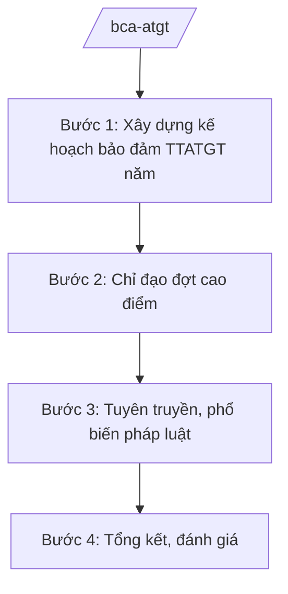

# Skill: Bảo đảm trật tự, an toàn giao thông (cấp bộ)

## 2. Khi nào dùng
- Hằng năm xây dựng kế hoạch bảo đảm TTATGT: tuần tra kiểm soát, xử lý vi phạm, tuyên truyền.
- Chỉ đạo đợt cao điểm bảo đảm TTATGT dịp lễ, Tết, khai giảng năm học.
- Sơ kết, tổng kết công tác bảo đảm TTATGT toàn quốc.

## 3. Đầu vào (Input)

| Trường | Mô tả | Bắt buộc |
|--------|-------|----------|
| `nam_ke_hoach` | Năm kế hoạch | Có |
| `noi_dung_trong_tam` | Nội dung trọng tâm (cao điểm, chuyên đề...) | Có |
| `so_lieu_tai_nan` | Số liệu tai nạn giao thông (thống kê công khai) | Không |
| `bao_cao_dia_phuong` | Báo cáo của công an địa phương | Không |

## 4. Quy trình

**Bước 1. Xây dựng kế hoạch bảo đảm TTATGT năm**
- Làm gì: Phân tích tình hình TTATGT năm trước (mức thống kê công khai); xác định nhiệm vụ trọng tâm: tuần tra kiểm soát, xử lý vi phạm, tuyên truyền, ứng dụng công nghệ.
- Dùng input: `nam_ke_hoach`, `so_lieu_tai_nan`, `bao_cao_dia_phuong`.
- Vai trò: Chuyên viên Cục CSGT xây dựng (AI hỗ trợ tổng hợp số liệu, phân tích xu hướng từ thống kê công khai — 2 ngày) → Cục trưởng kiểm tra → Thứ trưởng phê duyệt.
- Lưu ý nghiệp vụ: Mục tiêu giảm tai nạn giao thông cả 3 tiêu chí (số vụ, số người chết, số người bị thương); trọng tâm là vi phạm nồng độ cồn, tốc độ, quá tải.
- → Kết quả bước: Kế hoạch bảo đảm TTATGT năm được phê duyệt.

**Bước 2. Chỉ đạo đợt cao điểm**
- Làm gì: Ban hành kế hoạch đợt cao điểm: tăng cường tuần tra kiểm soát, xử lý nghiêm vi phạm; phân công lực lượng; phối hợp địa phương.
- Dùng input: `noi_dung_trong_tam`, `nam_ke_hoach`.
- Vai trò: Cục CSGT chủ trì (AI hỗ trợ lập kế hoạch, lịch trực, mẫu báo cáo nhanh — 1 ngày) → Cục trưởng trình Thứ trưởng.
- Lưu ý nghiệp vụ: Nội dung chỉ đạo ở mức hành chính (lực lượng, thời gian, địa bàn trọng điểm); không chi tiết phương án nghiệp vụ mật.
- → Kết quả bước: Kế hoạch cao điểm được ban hành, triển khai toàn quốc.

**Bước 3. Tuyên truyền, phổ biến pháp luật**
- Làm gì: Xây dựng kế hoạch, tài liệu tuyên truyền TTATGT: phối hợp báo chí, mạng xã hội, nhà trường, doanh nghiệp vận tải.
- Dùng input: `noi_dung_trong_tam`.
- Vai trò: Chuyên viên tuyên truyền thực hiện (AI hỗ trợ soạn tài liệu, thông điệp truyền thông — 1 ngày) → Cục trưởng duyệt.
- Lưu ý nghiệp vụ: Thông điệp ngắn gọn, dễ nhớ, hướng vào nhóm vi phạm phổ biến.
- → Kết quả bước: Kế hoạch và bộ tài liệu tuyên truyền.

**Bước 4. Tổng kết, đánh giá**
- Làm gì: Tổng hợp kết quả toàn quốc: số liệu xử lý vi phạm, tai nạn giao thông (công khai); đánh giá, đề xuất.
- Dùng input: Báo cáo của địa phương.
- Vai trò: Chuyên viên tổng hợp (AI hỗ trợ tổng hợp số liệu, so sánh chỉ tiêu, dự thảo báo cáo — 2 ngày) → Cục trưởng thẩm định → Thứ trưởng trình Bộ trưởng.
- Lưu ý nghiệp vụ: Số liệu trung thực, có đối chiếu; đánh giá gắn trách nhiệm đơn vị, địa phương.
- → Kết quả bước: Báo cáo tổng kết công tác bảo đảm TTATGT.

## Luồng quy trình (Workflow)

## 5. Đầu ra (Output)

- Kế hoạch bảo đảm TTATGT năm; kế hoạch đợt cao điểm.
- Kế hoạch, tài liệu tuyên truyền.
- Báo cáo tổng kết.

### Cấu trúc output chuẩn
1. Quốc hiệu "CỘNG HÒA XÃ HỘI CHỦ NGHĨA VIỆT NAM", Tiêu ngữ "Độc lập – Tự do – Hạnh phúc"; tên cơ quan ban hành.
2. Số, ký hiệu, địa danh, ngày tháng năm ban hành; trích yếu (thể thức NĐ 30/2020/NĐ-CP).
3. Căn cứ ban hành.
4. Nội dung: mục tiêu, nhiệm vụ, lực lượng, thời gian, địa bàn trọng điểm, tổ chức thực hiện.
5. Nơi nhận (kết thúc "- Lưu: VT, [mã đơn vị]."), chữ ký (ghi rõ chức danh, họ tên người ký; ký hiệu "KT."/"TL." khi ký thay) người có thẩm quyền.

> **Chuẩn tài liệu đầu ra** (thứ tự ưu tiên):
> 1. Chuẩn riêng của ngành/cơ quan chủ quản — mẫu, biểu mẫu, quy chuẩn tại văn bản quy phạm chuyên ngành (xem mục "Căn cứ & lưu ý").
> 2. Tài liệu không có quy chuẩn riêng — thể thức NĐ 30/2020/NĐ-CP: Quốc hiệu và Tiêu ngữ; tên cơ quan ban hành; số, ký hiệu; địa danh và thời gian; tên loại và trích yếu; nội dung; chức vụ, họ tên, chữ ký người có thẩm quyền; dấu, chữ ký số; nơi nhận (kèm Phụ lục nếu có).

## 6. Checklist nghiệm thu
- [ ] Kế hoạch có mục tiêu giảm tai nạn cụ thể cả 3 tiêu chí.
- [ ] Đợt cao điểm có trọng tâm vi phạm, địa bàn, thời gian rõ ràng.
- [ ] Tuyên truyền phù hợp từng nhóm đối tượng.
- [ ] Số liệu báo cáo trung thực, có đối chiếu, ở mức công khai.
- [ ] Thể thức đúng NĐ 30/2020/NĐ-CP; đã qua human gate.

## 7. Ví dụ mô phỏng

*Dữ liệu dưới đây là giả lập 100% phục vụ minh họa.*

**Input mẫu:**
- nam_ke_hoach: 2026
- noi_dung_trong_tam: Đợt cao điểm bảo đảm TTATGT dịp Tết Nguyên đán; xử lý vi phạm nồng độ cồn, tốc độ
- so_lieu_tai_nan: Thống kê tai nạn giao thông năm 2025 (giả lập, số liệu công khai tổng hợp)

**Output mẫu (trích Kế hoạch cao điểm):**

> **BỘ CÔNG AN — CỤC CẢNH SÁT GIAO THÔNG (giả lập)**
> **Kế hoạch số 1234/KH-CSGT ngày 05/01/2026 về đợt cao điểm bảo đảm TTATGT dịp Tết Nguyên đán 2026**
>
> **I. Mục tiêu:** Kéo giảm tai nạn giao thông; không để ùn tắc kéo dài tại các tuyến trọng điểm, khu vực lễ hội.
>
> **II. Nhiệm vụ trọng tâm:** (1) Tăng cường tuần tra kiểm soát, xử lý nghiêm vi phạm nồng độ cồn, tốc độ, quá tải, không đội mũ bảo hiểm; (2) Phân luồng, chống ùn tắc tại cửa ngõ đô thị, bến xe; (3) Đẩy mạnh tuyên truyền "Đã uống rượu bia — không lái xe".
>
> **III. Thời gian:** Từ 15/01 đến 28/02/2026 (giả lập).
>
> *Nơi nhận: ... — KT. BỘ TRƯỞNG / THỨ TRƯỞNG (bà Phạm Thị DD)*

## 8. Human gate
- Cục trưởng Cục CSGT: duyệt kế hoạch, kế hoạch cao điểm, báo cáo tổng kết.
- Thứ trưởng phụ trách: phê duyệt kế hoạch năm, đợt cao điểm.
- Bộ trưởng (ông Lê Văn CC): quyết định chủ trương lớn về bảo đảm TTATGT.

## 9. Giới hạn
- AI không quyết định xử phạt cá nhân, không thay lực lượng tuần tra kết luận vi phạm.
- Không bịa số hiệu văn bản, số liệu tai nạn; không viện dẫn văn bản hết hiệu lực.
- Nội dung nghiệp vụ tuần tra chi tiết do cơ quan chuyên môn quyết định.

## 10. Căn cứ & lưu ý
- Nghị định số 02/2025/NĐ-CP ngày 18/02/2025 của Chính phủ quy định chức năng, nhiệm vụ, quyền hạn và cơ cấu tổ chức của Bộ Công an.
- Nghị quyết số 176/2025/QH15 của Quốc hội về cơ cấu tổ chức của Chính phủ.
- Luật Trật tự, an toàn giao thông đường bộ (dẫn tên, không ghi số hiệu).
- Nghị định số 30/2020/NĐ-CP về công tác văn thư (thể thức văn bản).
