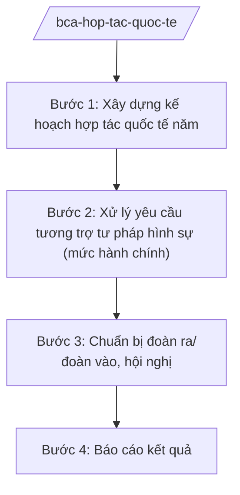

# Skill: Hợp tác quốc tế về an ninh, trật tự

## 2. Khi nào dùng
- Hằng năm xây dựng kế hoạch hợp tác quốc tế về an ninh, trật tự: đoàn ra, đoàn vào, hội nghị.
- Xử lý yêu cầu tương trợ tư pháp về hình sự ở mức hành chính (tiếp nhận, thẩm định hồ sơ, chuyển cơ quan có thẩm quyền).
- Chuẩn bị đoàn đi dự hội nghị quốc tế, đón đoàn khách quốc tế về an ninh, trật tự.

## 3. Đầu vào (Input)

| Trường | Mô tả | Bắt buộc |
|--------|-------|----------|
| `nam_ke_hoach` | Năm kế hoạch | Có |
| `doi_tac` | Đối tác (nước/tổ chức quốc tế, mức công khai) | Có |
| `hinh_thuc` | Đoàn ra / đoàn vào / hội nghị / tương trợ tư pháp | Có |
| `chu_truong` | Chủ trương, văn bản giao nhiệm vụ | Có |
| `ho_so_yeu_cau` | Hồ sơ yêu cầu tương trợ (nếu có) | Không |

## 4. Quy trình

**Bước 1. Xây dựng kế hoạch hợp tác quốc tế năm**
- Làm gì: Tổng hợp đề xuất các đơn vị; xây dựng kế hoạch đoàn ra, đoàn vào, hội nghị quốc tế về an ninh, trật tự; dự kiến kinh phí.
- Dùng input: `nam_ke_hoach`, `doi_tac`, `hinh_thuc`, `chu_truong`.
- Vai trò: Chuyên viên cơ quan đối ngoại xây dựng (AI hỗ trợ tổng hợp đề xuất, lập bảng kế hoạch — 2 ngày) → Cục trưởng kiểm tra → Thứ trưởng phê duyệt.
- Lưu ý nghiệp vụ: Chỉ nội dung hợp tác công khai (đào tạo, hội nghị, chia sẻ kinh nghiệm phòng ngừa); nội dung hợp tác nghiệp vụ chuyên sâu do cấp có thẩm quyền quyết định riêng.
- → Kết quả bước: Kế hoạch hợp tác quốc tế năm được phê duyệt.

**Bước 2. Xử lý yêu cầu tương trợ tư pháp hình sự (mức hành chính)**
- Làm gì: Tiếp nhận yêu cầu tương trợ tư pháp về hình sự; kiểm tra tính đầy đủ, hợp lệ của hồ sơ; tham mưu chuyển cơ quan có thẩm quyền thực hiện theo quy định.
- Dùng input: `ho_so_yeu_cau`, `doi_tac`.
- Vai trò: Chuyên viên xử lý hồ sơ (AI hỗ trợ kiểm tra checklist hồ sơ, soạn văn bản chuyển — 1 ngày) → Cục trưởng ký văn bản chuyển.
- Lưu ý nghiệp vụ: Chỉ xử lý khâu hành chính (tiếp nhận, kiểm tra hồ sơ, chuyển); nội dung điều tra, xác minh do cơ quan tố tụng thực hiện, AI không tham gia.
- → Kết quả bước: Hồ sơ được chuyển cơ quan có thẩm quyền đúng thời hạn.

**Bước 3. Chuẩn bị đoàn ra/đoàn vào, hội nghị**
- Làm gì: Lập đề án đoàn ra, chương trình đón đoàn vào, kế hoạch tổ chức hội nghị quốc tế tại Việt Nam; chuẩn bị tài liệu.
- Dùng input: `doi_tac`, `hinh_thuc`, `chu_truong`.
- Vai trò: Chuyên viên chuẩn bị (AI hỗ trợ soạn đề án, chương trình, tài liệu — 2 ngày) → Cục trưởng thẩm định → Thứ trưởng quyết định.
- Lưu ý nghiệp vụ: Tuân thủ nghi thức lễ tân; tài liệu trong phạm vi được phép công khai.
- → Kết quả bước: Đề án/chương trình được phê duyệt; đoàn được tổ chức.

**Bước 4. Báo cáo kết quả**
- Làm gì: Tổng hợp kết quả hoạt động hợp tác; báo cáo cấp trên; theo dõi thực hiện thỏa thuận đã ký.
- Dùng input: Kết quả hoạt động thực tế.
- Vai trò: Chuyên viên tổng hợp (AI hỗ trợ soạn báo cáo — 1 ngày) → Cục trưởng thẩm định → Thứ trưởng trình Bộ trưởng.
- Lưu ý nghiệp vụ: Phân loại mật đúng quy định; bản hành chính chỉ nêu nội dung công khai.
- → Kết quả bước: Báo cáo kết quả hoạt động hợp tác quốc tế.

## Luồng quy trình (Workflow)

## 5. Đầu ra (Output)

- Kế hoạch hợp tác quốc tế năm.
- Văn bản xử lý yêu cầu tương trợ tư pháp (mức hành chính).
- Đề án đoàn ra, chương trình đoàn vào, kế hoạch hội nghị.
- Báo cáo kết quả.

### Cấu trúc output chuẩn
1. Quốc hiệu "CỘNG HÒA XÃ HỘI CHỦ NGHĨA VIỆT NAM", Tiêu ngữ "Độc lập – Tự do – Hạnh phúc"; tên cơ quan ban hành.
2. Số, ký hiệu, địa danh, ngày tháng năm ban hành; trích yếu (thể thức NĐ 30/2020/NĐ-CP).
3. Căn cứ ban hành.
4. Nội dung: đối tác, hình thức, thời gian, thành phần, nội dung, kinh phí, tổ chức thực hiện.
5. Nơi nhận (kết thúc "- Lưu: VT, [mã đơn vị]."), chữ ký (ghi rõ chức danh, họ tên người ký; ký hiệu "KT."/"TL." khi ký thay) người có thẩm quyền.

> **Chuẩn tài liệu đầu ra** (thứ tự ưu tiên):
> 1. Chuẩn riêng của ngành/cơ quan chủ quản — mẫu, biểu mẫu, quy chuẩn tại văn bản quy phạm chuyên ngành (xem mục "Căn cứ & lưu ý").
> 2. Tài liệu không có quy chuẩn riêng — thể thức NĐ 30/2020/NĐ-CP: Quốc hiệu và Tiêu ngữ; tên cơ quan ban hành; số, ký hiệu; địa danh và thời gian; tên loại và trích yếu; nội dung; chức vụ, họ tên, chữ ký người có thẩm quyền; dấu, chữ ký số; nơi nhận (kèm Phụ lục nếu có).

## 6. Checklist nghiệm thu
- [ ] Kế hoạch có chủ trương, bao quát đoàn ra/đoàn vào/hội nghị.
- [ ] Hồ sơ tương trợ được kiểm tra đầy đủ, chuyển đúng thẩm quyền, đúng hạn.
- [ ] Đề án, chương trình đúng nghi thức, trong phạm vi được giao.
- [ ] Báo cáo phân loại mật đúng quy định.
- [ ] Thể thức đúng NĐ 30/2020/NĐ-CP; đã qua human gate.

## 7. Ví dụ mô phỏng

*Dữ liệu dưới đây là giả lập 100% phục vụ minh họa.*

**Input mẫu:**
- nam_ke_hoach: 2026
- doi_tac: Cơ quan thực thi pháp luật nước B (giả lập)
- hinh_thuc: Hội nghị song phương về hợp tác phòng, chống tội phạm mua bán người (mức công khai)

**Output mẫu (trích Kế hoạch hội nghị):**

> **BỘ CÔNG AN — CƠ QUAN ĐỐI NGOẠI (giả lập)**
> **Kế hoạch số 1234/KH-HTQT ngày 20/4/2026 về hội nghị song phương với cơ quan thực thi pháp luật nước B**
>
> **I. Mục đích:** Trao đổi kinh nghiệm phòng ngừa, chia sẻ thông tin cảnh báo (mức công khai) về tội phạm mua bán người; thống nhất cơ chế phối hợp hành chính.
>
> **II. Thời gian, địa điểm:** 02 ngày, tháng 9/2026 tại Thủ đô (giả lập, không nêu địa danh cụ thể).
>
> **III. Thành phần:** Đoàn Việt Nam do Thứ trưởng (bà Phạm Thị DD) làm trưởng đoàn; đoàn nước B 05 thành viên (giả lập).
>
> *Phê duyệt: Thứ trưởng (bà Phạm Thị DD)*

## 8. Human gate
- Cục trưởng cơ quan đối ngoại: duyệt kế hoạch, đề án, văn bản xử lý tương trợ.
- Thứ trưởng phụ trách: phê duyệt kế hoạch năm, quyết định đoàn ra/đoàn vào.
- Bộ trưởng (ông Lê Văn CC): quyết định chủ trương hợp tác quan trọng.

## 9. Giới hạn
- AI không tham gia điều tra, xác minh; chỉ xử lý khâu hành chính của tương trợ tư pháp.
- Mọi nội dung ở mức hành chính công khai; nội dung mật xử lý theo quy định riêng.
- Không bịa tên đối tác, số hiệu văn bản; không viện dẫn văn bản hết hiệu lực.

## 10. Căn cứ & lưu ý
- Nghị định số 02/2025/NĐ-CP ngày 18/02/2025 của Chính phủ quy định chức năng, nhiệm vụ, quyền hạn và cơ cấu tổ chức của Bộ Công an.
- Nghị quyết số 176/2025/QH15 của Quốc hội về cơ cấu tổ chức của Chính phủ.
- Luật Tương trợ tư pháp (dẫn tên, không ghi số hiệu).
- Nghị định số 30/2020/NĐ-CP về công tác văn thư (thể thức văn bản).
