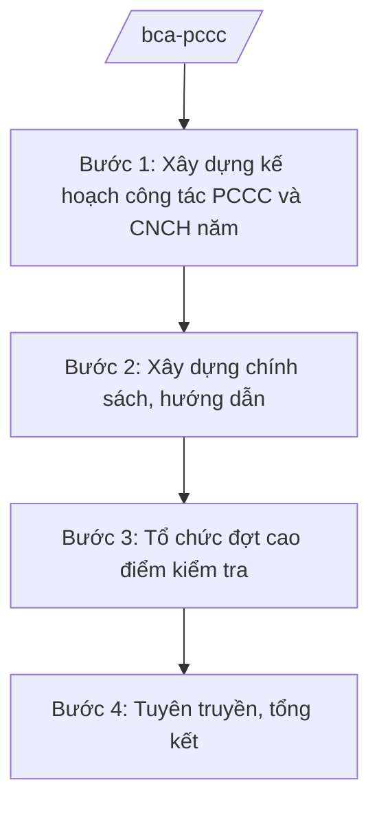

# Skill: PCCC và cứu nạn, cứu hộ

## 2. Khi nào dùng
- Hằng năm xây dựng kế hoạch công tác PCCC và CNCH toàn quốc.
- Xây dựng chính sách, hướng dẫn về điều kiện an toàn PCCC đối với cơ sở, công trình.
- Tổ chức đợt cao điểm kiểm tra an toàn PCCC; tuyên truyền, huấn luyện nghiệp vụ PCCC cơ sở.
- Tổng kết, đánh giá công tác PCCC và CNCH.

## 3. Đầu vào (Input)

| Trường | Mô tả | Bắt buộc |
|--------|-------|----------|
| `nam_ke_hoach` | Năm kế hoạch | Có |
| `noi_dung_trong_tam` | Nội dung trọng tâm (kiểm tra, tuyên truyền, chính sách...) | Có |
| `bao_cao_dia_phuong` | Báo cáo công tác PCCC của công an địa phương | Không |
| `van_ban_hien_hanh` | Văn bản pháp luật hiện hành về PCCC | Không |

## 4. Quy trình

**Bước 1. Xây dựng kế hoạch công tác PCCC và CNCH năm**
- Làm gì: Xác định nhiệm vụ trọng tâm: kiểm tra an toàn PCCC, tuyên truyền, huấn luyện, đầu tư phương tiện; phân công đơn vị thực hiện.
- Dùng input: `nam_ke_hoach`, `noi_dung_trong_tam`, `bao_cao_dia_phuong`.
- Vai trò: Chuyên viên Cục PCCC xây dựng (AI hỗ trợ tổng hợp báo cáo, phân tích tình hình cháy nổ năm trước ở mức thống kê công khai — 2 ngày) → Cục trưởng kiểm tra → Thứ trưởng phê duyệt.
- Lưu ý nghiệp vụ: Ưu tiên cơ sở có nguy cơ cháy nổ cao (chợ, chung cư, karaoke, kho xưởng); kế hoạch khả thi.
- → Kết quả bước: Kế hoạch công tác PCCC và CNCH năm được phê duyệt.

**Bước 2. Xây dựng chính sách, hướng dẫn**
- Làm gì: Soạn thảo văn bản hướng dẫn: điều kiện an toàn PCCC, thẩm duyệt thiết kế, nghiệm thu về PCCC, kiểm tra định kỳ.
- Dùng input: `van_ban_hien_hanh`, `noi_dung_trong_tam`.
- Vai trò: Chuyên viên soạn thảo (AI hỗ trợ rà soát văn bản hiện hành, chuẩn hóa — 2 ngày) → Cục trưởng ký ban hành.
- Lưu ý nghiệp vụ: Quy định rõ, tránh chồng chéo với quản lý xây dựng; công khai tiêu chuẩn, quy chuẩn áp dụng.
- → Kết quả bước: Văn bản hướng dẫn được ban hành.

**Bước 3. Tổ chức đợt cao điểm kiểm tra**
- Làm gì: Ban hành kế hoạch đợt cao điểm kiểm tra an toàn PCCC (dịp lễ, Tết, mùa khô); hướng dẫn địa phương thực hiện; tổng hợp vi phạm, xử lý.
- Dùng input: `nam_ke_hoach`, `bao_cao_dia_phuong`.
- Vai trò: Cục PCCC chủ trì (AI hỗ trợ lập kế hoạch, mẫu biên bản kiểm tra, bảng tổng hợp — 2 ngày) → Cục trưởng trình Thứ trưởng.
- Lưu ý nghiệp vụ: Kiểm tra có trọng tâm, trọng điểm; xử lý nghiêm vi phạm, kiên quyết tạm đình chỉ cơ sở không bảo đảm an toàn.
- → Kết quả bước: Kế hoạch cao điểm và kết quả kiểm tra toàn quốc.

**Bước 4. Tuyên truyền, tổng kết**
- Làm gì: Xây dựng kế hoạch tuyên truyền, huấn luyện kỹ năng PCCC cho người dân, cơ sở; tổng kết, đánh giá toàn quốc.
- Dùng input: Báo cáo kết quả của địa phương.
- Vai trò: Chuyên viên thực hiện (AI hỗ trợ soạn tài liệu tuyên truyền, dự thảo báo cáo tổng kết — 2 ngày) → Cục trưởng thẩm định → Thứ trưởng trình Bộ trưởng.
- Lưu ý nghiệp vụ: Nội dung tuyên truyền dễ hiểu, phù hợp từng nhóm đối tượng.
- → Kết quả bước: Kế hoạch tuyên truyền; báo cáo tổng kết công tác PCCC và CNCH.

## Luồng quy trình (Workflow)

## 5. Đầu ra (Output)

- Kế hoạch công tác PCCC và CNCH năm; văn bản hướng dẫn.
- Kế hoạch đợt cao điểm kiểm tra; kết quả kiểm tra toàn quốc.
- Kế hoạch tuyên truyền; báo cáo tổng kết.

### Cấu trúc output chuẩn
1. Quốc hiệu "CỘNG HÒA XÃ HỘI CHỦ NGHĨA VIỆT NAM", Tiêu ngữ "Độc lập – Tự do – Hạnh phúc"; tên cơ quan ban hành.
2. Số, ký hiệu, địa danh, ngày tháng năm ban hành; trích yếu (thể thức NĐ 30/2020/NĐ-CP).
3. Căn cứ ban hành.
4. Nội dung: nhiệm vụ, đối tượng kiểm tra, thời gian, tổ chức thực hiện, kinh phí.
5. Nơi nhận (kết thúc "- Lưu: VT, [mã đơn vị]."), chữ ký (ghi rõ chức danh, họ tên người ký; ký hiệu "KT."/"TL." khi ký thay) người có thẩm quyền.
## 6. Checklist nghiệm thu
- [ ] Kế hoạch bao quát kiểm tra, tuyên truyền, huấn luyện, đầu tư phương tiện.
- [ ] Hướng dẫn đúng văn bản hiện hành, công khai tiêu chuẩn áp dụng.
- [ ] Đợt cao điểm có trọng tâm, xử lý nghiêm vi phạm.
- [ ] Tuyên truyền phù hợp từng nhóm đối tượng.
- [ ] Báo cáo tổng kết có số liệu, đánh giá, đề xuất cụ thể.
- [ ] Thể thức đúng NĐ 30/2020/NĐ-CP; đã qua human gate.

## 7. Ví dụ mô phỏng

*Dữ liệu dưới đây là giả lập 100% phục vụ minh họa.*

**Input mẫu:**
- nam_ke_hoach: 2026
- noi_dung_trong_tam: Đợt cao điểm kiểm tra an toàn PCCC dịp Tết Nguyên đán; tuyên truyền kỹ năng thoát nạn
- bao_cao_dia_phuong: Báo cáo tình hình cháy nổ năm 2025 (giả lập, số liệu thống kê công khai)

**Output mẫu (trích Kế hoạch cao điểm):**

> **BỘ CÔNG AN — CỤC CẢNH SÁT PCCC VÀ CNCH (giả lập)**
> **Kế hoạch số 1234/KH-PCCC ngày 20/12/2025 về đợt cao điểm kiểm tra an toàn PCCC dịp Tết Nguyên đán 2026**
>
> **I. Đối tượng kiểm tra:** Chợ, trung tâm thương mại, chung cư, cơ sở karaoke, kho xưởng trên toàn quốc (giả lập).
>
> **II. Thời gian:** Từ 05/01 đến 15/02/2026 (giả lập).
>
> **III. Yêu cầu:** 100% cơ sở thuộc diện quản lý được kiểm tra; kiên quyết tạm đình chỉ, đình chỉ hoạt động cơ sở vi phạm nghiêm trọng; đẩy mạnh tuyên truyền kỹ năng thoát nạn cho người dân.
>
> *Nơi nhận: ... — KT. BỘ TRƯỞNG / THỨ TRƯỞNG (bà Phạm Thị DD)*

## 8. Human gate
- Cục trưởng Cục Cảnh sát PCCC và CNCH: duyệt kế hoạch, hướng dẫn, kết quả kiểm tra.
- Thứ trưởng phụ trách: phê duyệt kế hoạch năm, đợt cao điểm.
- Bộ trưởng (ông Lê Văn CC): quyết định chủ trương lớn về công tác PCCC.

## 9. Giới hạn
- AI không quyết định xử phạt, đình chỉ cơ sở; không thay đoàn kiểm tra kết luận vi phạm.
- Không bịa số hiệu văn bản, số liệu cháy nổ; không viện dẫn văn bản hết hiệu lực.
- Nội dung kỹ thuật chữa cháy chuyên sâu do cơ quan chuyên môn biên soạn.

## 10. Căn cứ & lưu ý
- Nghị định số 02/2025/NĐ-CP ngày 18/02/2025 của Chính phủ quy định chức năng, nhiệm vụ, quyền hạn và cơ cấu tổ chức của Bộ Công an.
- Nghị quyết số 176/2025/QH15 của Quốc hội về cơ cấu tổ chức của Chính phủ.
- Luật Phòng cháy, chữa cháy và cứu nạn, cứu hộ (dẫn tên, không ghi số hiệu).
- Nghị định số 30/2020/NĐ-CP về công tác văn thư (thể thức văn bản).
