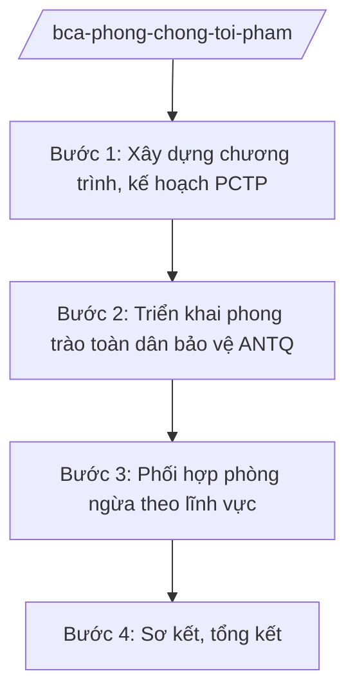

# Skill: Phòng, chống tội phạm

## 2. Khi nào dùng
- Xây dựng chương trình, kế hoạch phòng, chống tội phạm giai đoạn/hằng năm (phòng ngừa là chính, mức công khai).
- Triển khai phong trào toàn dân bảo vệ an ninh Tổ quốc gắn với PCTP.
- Sơ kết, tổng kết chương trình PCTP; đánh giá, đề xuất chính sách phòng ngừa.

## 3. Đầu vào (Input)

| Trường | Mô tả | Bắt buộc |
|--------|-------|----------|
| `giai_doan` | Giai đoạn/năm của chương trình, kế hoạch | Có |
| `linh_vuc_trong_tam` | Lĩnh vực trọng tâm (ma túy, công nghệ cao, kinh tế...) — mức công khai | Có |
| `so_lieu_cong_khai` | Số liệu tình hình tội phạm đã công bố | Không |
| `bao_cao_dia_phuong` | Báo cáo của công an địa phương | Không |

## 4. Quy trình

**Bước 1. Xây dựng chương trình, kế hoạch PCTP**
- Làm gì: Phân tích tình hình tội phạm từ số liệu công khai; xác định mục tiêu, nhiệm vụ, giải pháp phòng ngừa; phân công trách nhiệm.
- Dùng input: `giai_doan`, `linh_vuc_trong_tam`, `so_lieu_cong_khai`.
- Vai trò: Chuyên viên cơ quan tham mưu xây dựng (AI hỗ trợ tổng hợp số liệu công khai, lập khung chương trình — 3 ngày) → Cục trưởng kiểm tra → Thứ trưởng phê duyệt.
- Lưu ý nghiệp vụ: Lấy phòng ngừa làm chính; nội dung ở mức chương trình, kế hoạch hành chính; tuyệt đối không đưa biện pháp nghiệp vụ đấu tranh cụ thể vào văn bản.
- → Kết quả bước: Chương trình/kế hoạch PCTP được phê duyệt.

**Bước 2. Triển khai phong trào toàn dân bảo vệ ANTQ**
- Làm gì: Hướng dẫn địa phương phát động phong trào toàn dân bảo vệ an ninh Tổ quốc: mô hình tự quản, tổ an ninh nhân dân, tuyên truyền phòng ngừa tội phạm trong nhân dân.
- Dùng input: `linh_vuc_trong_tam`, `giai_doan`.
- Vai trò: Chuyên viên xây dựng phong trào soạn hướng dẫn (AI hỗ trợ soạn tài liệu tuyên truyền, mô hình mẫu — 2 ngày) → Cục trưởng ký ban hành.
- Lưu ý nghiệp vụ: Nội dung tuyên truyền phù hợp từng địa bàn, nhóm đối tượng; huy động sức dân phòng ngừa tội phạm.
- → Kết quả bước: Văn bản hướng dẫn phong trào; tài liệu tuyên truyền.

**Bước 3. Phối hợp phòng ngừa theo lĩnh vực**
- Làm gì: Phối hợp bộ ngành, đoàn thể triển khai biện pháp phòng ngừa: giáo dục thanh thiếu niên, quản lý địa bàn, phòng ngừa tội phạm công nghệ cao ở mức tuyên truyền, cảnh báo.
- Dùng input: `linh_vuc_trong_tam`, `bao_cao_dia_phuong`.
- Vai trò: Cơ quan tham mưu chủ trì phối hợp (AI hỗ trợ lập kế hoạch phối hợp, danh mục cảnh báo thủ đoạn mới ở mức công khai — 2 ngày) → Cục trưởng trình Thứ trưởng.
- Lưu ý nghiệp vụ: Cảnh báo thủ đoạn ở mức thông tin công khai giúp người dân phòng tránh; không mô tả chi tiết kỹ thuật phạm tội.
- → Kết quả bước: Kế hoạch phối hợp; bản tin cảnh báo phòng ngừa tội phạm.

**Bước 4. Sơ kết, tổng kết**
- Làm gì: Tổng hợp kết quả toàn quốc (số liệu công khai); đánh giá hiệu quả phòng ngừa; đề xuất chính sách.
- Dùng input: Báo cáo của địa phương, đơn vị.
- Vai trò: Chuyên viên tổng hợp (AI hỗ trợ tổng hợp số liệu, dự thảo báo cáo — 2 ngày) → Cục trưởng thẩm định → Thứ trưởng trình Bộ trưởng.
- Lưu ý nghiệp vụ: Đánh giá thực chất, gắn trách nhiệm; số liệu ở mức đã công bố.
- → Kết quả bước: Báo cáo sơ kết/tổng kết chương trình PCTP.

## Luồng quy trình (Workflow)

## 5. Đầu ra (Output)

- Chương trình/kế hoạch PCTP giai đoạn/năm.
- Văn bản hướng dẫn phong trào toàn dân bảo vệ ANTQ; tài liệu tuyên truyền.
- Bản tin cảnh báo phòng ngừa; báo cáo sơ kết/tổng kết.

### Cấu trúc output chuẩn
1. Quốc hiệu "CỘNG HÒA XÃ HỘI CHỦ NGHĨA VIỆT NAM", Tiêu ngữ "Độc lập – Tự do – Hạnh phúc"; tên cơ quan ban hành.
2. Số, ký hiệu, địa danh, ngày tháng năm ban hành; trích yếu (thể thức NĐ 30/2020/NĐ-CP).
3. Căn cứ ban hành.
4. Nội dung: mục tiêu, nhiệm vụ, giải pháp phòng ngừa, phân công, thời gian, kinh phí.
5. Nơi nhận (kết thúc "- Lưu: VT, [mã đơn vị]."), chữ ký (ghi rõ chức danh, họ tên người ký; ký hiệu "KT."/"TL." khi ký thay) người có thẩm quyền.
## 6. Checklist nghiệm thu
- [ ] Chương trình lấy phòng ngừa làm chính, có mục tiêu, giải pháp cụ thể.
- [ ] Phong trào toàn dân có mô hình, tài liệu hướng dẫn rõ ràng.
- [ ] Cảnh báo thủ đoạn ở mức công khai, giúp dân phòng tránh.
- [ ] Không có biện pháp nghiệp vụ đấu tranh cụ thể, nội dung mật trong văn bản.
- [ ] Báo cáo có số liệu công khai, đánh giá thực chất.
- [ ] Thể thức đúng NĐ 30/2020/NĐ-CP; đã qua human gate.

## 7. Ví dụ mô phỏng

*Dữ liệu dưới đây là giả lập 100% phục vụ minh họa.*

**Input mẫu:**
- giai_doan: Năm 2026
- linh_vuc_trong_tam: Phòng ngừa tội phạm lừa đảo qua mạng, tín dụng đen (mức công khai)
- so_lieu_cong_khai: Số liệu tình hình tội phạm đã công bố năm 2025 (giả lập)

**Output mẫu (trích Kế hoạch):**

> **BỘ CÔNG AN — CƠ QUAN THAM MƯU (giả lập)**
> **Kế hoạch số 1234/KH-PCTP ngày 10/01/2026 về phòng, chống tội phạm năm 2026**
>
> **I. Mục tiêu:** Kéo giảm tội phạm về trật tự xã hội; nâng cao nhận thức phòng ngừa của người dân.
>
> **II. Nhiệm vụ trọng tâm:** (1) Đẩy mạnh tuyên truyền, cảnh báo thủ đoạn lừa đảo qua mạng, tín dụng đen trên các phương tiện truyền thông; (2) Phát động phong trào toàn dân bảo vệ ANTQ gắn với PCTP tại 100% xã, phường (giả lập); (3) Phối hợp nhà trường giáo dục kỹ năng phòng tránh cho học sinh, sinh viên.
>
> *Nơi nhận: ... — KT. BỘ TRƯỞNG / THỨ TRƯỞNG (bà Phạm Thị DD)*

## 8. Human gate
- Cục trưởng: duyệt chương trình, kế hoạch, tài liệu tuyên truyền.
- Thứ trưởng phụ trách: phê duyệt chương trình/kế hoạch PCTP.
- Bộ trưởng (ông Lê Văn CC): quyết định chủ trương lớn về PCTP.

## 9. Giới hạn
- AI không tham gia hoạt động điều tra, không đề xuất biện pháp nghiệp vụ đấu tranh cụ thể.
- Mọi nội dung ở mức chương trình, kế hoạch, tuyên truyền công khai; nội dung mật xử lý theo quy định riêng.
- Không mô tả chi tiết kỹ thuật, thủ đoạn phạm tội; không bịa số liệu, số hiệu văn bản.

## 10. Căn cứ & lưu ý
- Nghị định số 02/2025/NĐ-CP ngày 18/02/2025 của Chính phủ quy định chức năng, nhiệm vụ, quyền hạn và cơ cấu tổ chức của Bộ Công an.
- Nghị quyết số 176/2025/QH15 của Quốc hội về cơ cấu tổ chức của Chính phủ.
- Bộ luật Hình sự; Bộ luật Tố tụng hình sự (dẫn tên, không ghi số hiệu).
- Nghị định số 30/2020/NĐ-CP về công tác văn thư (thể thức văn bản).
