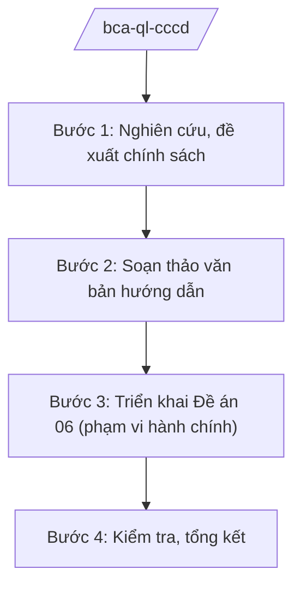

# Skill: Quản lý CCCD, dữ liệu dân cư (Đề án 06)

## 2. Khi nào dùng
- Xây dựng chính sách, hướng dẫn về cấp, đổi, cấp lại thẻ căn cước.
- Triển khai nhiệm vụ của Đề án 06: kết nối, chia sẻ dữ liệu dân cư phục vụ dịch vụ công, cải cách hành chính.
- Hướng dẫn công an địa phương thực hiện; sơ kết, tổng kết.

## 3. Đầu vào (Input)

| Trường | Mô tả | Bắt buộc |
|--------|-------|----------|
| `noi_dung_nhiem_vu` | Nhiệm vụ cụ thể (chính sách/hướng dẫn/tổng kết) | Có |
| `van_ban_hien_hanh` | Văn bản pháp luật hiện hành liên quan | Không |
| `bao_cao_dia_phuong` | Báo cáo của công an địa phương | Không |
| `tien_do_de_an_06` | Tiến độ triển khai Đề án 06 (nếu liên quan) | Không |

## 4. Quy trình

**Bước 1. Nghiên cứu, đề xuất chính sách**
- Làm gì: Rà soát vướng mắc trong cấp căn cước, khai thác dữ liệu dân cư; đề xuất hoàn thiện chính sách, đơn giản hóa thủ tục.
- Dùng input: `noi_dung_nhiem_vu`, `van_ban_hien_hanh`, `bao_cao_dia_phuong`.
- Vai trò: Chuyên viên nghiên cứu (AI hỗ trợ tổng hợp vướng mắc, rà soát văn bản — 2 ngày) → Cục trưởng xem xét.
- Lưu ý nghiệp vụ: Mọi nội dung ở mức chính sách, thủ tục hành chính; tuyệt đối không truy xuất, không mô phỏng dữ liệu cá nhân cụ thể.
- → Kết quả bước: Báo cáo đề xuất chính sách.

**Bước 2. Soạn thảo văn bản hướng dẫn**
- Làm gì: Soạn hướng dẫn: thủ tục cấp/đổi/cấp lại thẻ căn cước; quy trình kết nối, chia sẻ dữ liệu dân cư phục vụ dịch vụ công (theo Đề án 06).
- Dùng input: `van_ban_hien_hanh`, `noi_dung_nhiem_vu`.
- Vai trò: Chuyên viên soạn thảo (AI hỗ trợ chuẩn hóa văn bản, lập sơ đồ quy trình — 2 ngày) → Cục trưởng ký ban hành.
- Lưu ý nghiệp vụ: Quy định rõ trách nhiệm bảo vệ dữ liệu cá nhân; việc khai thác dữ liệu phải đúng mục đích, đúng thẩm quyền.
- → Kết quả bước: Văn bản hướng dẫn được ban hành.

**Bước 3. Triển khai Đề án 06 (phạm vi hành chính)**
- Làm gì: Xây dựng kế hoạch triển khai nhiệm vụ Đề án 06 được giao: số hóa hồ sơ, kết nối dịch vụ công, tuyên truyền sử dụng VNeID ở mức hành chính.
- Dùng input: `tien_do_de_an_06`, `noi_dung_nhiem_vu`.
- Vai trò: Tổ công tác Đề án 06 của Bộ chủ trì (AI hỗ trợ lập kế hoạch, theo dõi tiến độ, mẫu báo cáo — 2 ngày) → Cục trưởng trình Thứ trưởng.
- Lưu ý nghiệp vụ: Chỉ triển khai nội dung hành chính công khai; kỹ thuật, an ninh hệ thống do cơ quan chuyên môn đảm nhiệm, AI không can thiệp.
- → Kết quả bước: Kế hoạch triển khai và báo cáo tiến độ Đề án 06.

**Bước 4. Kiểm tra, tổng kết**
- Làm gì: Kiểm tra việc cấp căn cước, thực hiện Đề án 06 tại địa phương; tổng hợp, đánh giá toàn quốc.
- Dùng input: Báo cáo của địa phương.
- Vai trò: Đoàn kiểm tra thực hiện (AI hỗ trợ tổng hợp số liệu, dự thảo báo cáo — 2 ngày) → Cục trưởng thẩm định → Thứ trưởng trình Bộ trưởng.
- Lưu ý nghiệp vụ: Số liệu ở mức tổng hợp công khai; không đưa dữ liệu cá nhân vào báo cáo.
- → Kết quả bước: Báo cáo tổng kết.

## Luồng quy trình (Workflow)

## 5. Đầu ra (Output)

- Báo cáo đề xuất chính sách; văn bản hướng dẫn thủ tục.
- Kế hoạch, báo cáo tiến độ Đề án 06 (phạm vi hành chính).
- Báo cáo kiểm tra, tổng kết.

### Cấu trúc output chuẩn
1. Quốc hiệu "CỘNG HÒA XÃ HỘI CHỦ NGHĨA VIỆT NAM", Tiêu ngữ "Độc lập – Tự do – Hạnh phúc"; tên cơ quan ban hành.
2. Số, ký hiệu, địa danh, ngày tháng năm ban hành; trích yếu (thể thức NĐ 30/2020/NĐ-CP).
3. Căn cứ ban hành.
4. Nội dung: thủ tục, trách nhiệm, thời gian, bảo vệ dữ liệu cá nhân, tổ chức thực hiện.
5. Nơi nhận (kết thúc "- Lưu: VT, [mã đơn vị]."), chữ ký (ghi rõ chức danh, họ tên người ký; ký hiệu "KT."/"TL." khi ký thay) người có thẩm quyền.
## 6. Checklist nghiệm thu
- [ ] Chính sách, thủ tục đúng văn bản hiện hành, công khai.
- [ ] Quy định rõ trách nhiệm bảo vệ dữ liệu cá nhân.
- [ ] Kế hoạch Đề án 06 khả thi, có tiến độ, đầu mối rõ ràng.
- [ ] Không truy xuất, không mô phỏng dữ liệu cá nhân cụ thể trong mọi sản phẩm.
- [ ] Thể thức đúng NĐ 30/2020/NĐ-CP; đã qua human gate.

## 7. Ví dụ mô phỏng

*Dữ liệu dưới đây là giả lập 100% phục vụ minh họa.*

**Input mẫu:**
- noi_dung_nhiem_vu: Hướng dẫn công an địa phương đẩy nhanh tiến độ cấp đổi thẻ căn cước năm 2026
- bao_cao_dia_phuong: Báo cáo tiến độ cấp căn cước của công an các tỉnh (giả lập, số liệu tổng hợp)

**Output mẫu (trích Công văn hướng dẫn):**

> **BỘ CÔNG AN — CỤC CẢNH SÁT QUẢN LÝ HÀNH CHÍNH VỀ TRẬT TỰ XÃ HỘI (giả lập)**
> **Công văn số 1234/QLHC-HT ngày 15/6/2026 về đẩy nhanh tiến độ cấp đổi thẻ căn cước**
>
> **1.** Công an các tỉnh, thành phố rà soát số công dân đến hạn đổi thẻ, lập danh sách theo đợt, thông báo đến từng khu dân cư (không nêu thông tin cá nhân cụ thể trong văn bản chỉ đạo).
>
> **2.** Tổ chức cấp lưu động tại các điểm tập trung; thời gian làm việc kéo dài ngoài giờ hành chính trong đợt cao điểm tháng 7–9/2026 (giả lập).
>
> **3.** Bảo đảm tuyệt đối an toàn, bảo mật dữ liệu cá nhân trong quá trình thu nhận, truyền dữ liệu.
>
> *Nơi nhận: ... — KT. CỤC TRƯỞNG / PHÓ CỤC TRƯỞNG (bà Vũ Thị FF)*

## 8. Human gate
- Cục trưởng: duyệt đề xuất chính sách, ký văn bản hướng dẫn, kế hoạch Đề án 06.
- Thứ trưởng phụ trách: quyết định vấn đề lớn về chính sách căn cước, dữ liệu dân cư.
- Bộ trưởng (ông Lê Văn CC): quyết định chủ trương quan trọng.

## 9. Giới hạn
- AI tuyệt đối không truy xuất, lưu trữ, mô phỏng dữ liệu CCCD/dữ liệu cá nhân của bất kỳ ai.
- AI không quyết định chính sách, không can thiệp kỹ thuật, an ninh hệ thống dữ liệu.
- Không bịa số hiệu văn bản, số liệu; không viện dẫn văn bản hết hiệu lực.

## 10. Căn cứ & lưu ý
- Nghị định số 02/2025/NĐ-CP ngày 18/02/2025 của Chính phủ quy định chức năng, nhiệm vụ, quyền hạn và cơ cấu tổ chức của Bộ Công an.
- Nghị quyết số 176/2025/QH15 của Quốc hội về cơ cấu tổ chức của Chính phủ.
- Luật Căn cước (dẫn tên, không ghi số hiệu); Đề án phát triển ứng dụng dữ liệu về dân cư, định danh và xác thực điện tử (Đề án 06).
- Luật Bảo vệ dữ liệu cá nhân (dẫn tên, không ghi số hiệu).
- Nghị định số 30/2020/NĐ-CP về công tác văn thư (thể thức văn bản).
