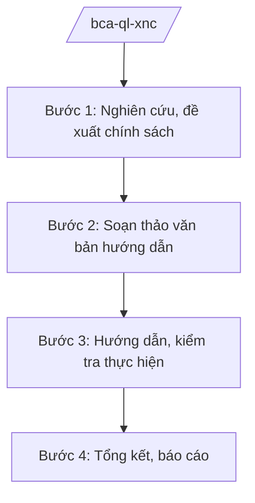

# Skill: Quản lý xuất nhập cảnh

## 2. Khi nào dùng
- Xây dựng chính sách, văn bản hướng dẫn về cấp hộ chiếu, thị thực, quản lý cư trú của người nước ngoài.
- Hướng dẫn công an địa phương, đơn vị cửa khẩu thực hiện thủ tục xuất nhập cảnh.
- Sơ kết, tổng kết công tác quản lý xuất nhập cảnh; xử lý vướng mắc về thủ tục.

## 3. Đầu vào (Input)

| Trường | Mô tả | Bắt buộc |
|--------|-------|----------|
| `noi_dung_nhiem_vu` | Nhiệm vụ cụ thể (chính sách/hướng dẫn/tổng kết) | Có |
| `van_ban_hien_hanh` | Văn bản pháp luật hiện hành liên quan | Không |
| `bao_cao_dia_phuong` | Báo cáo của công an địa phương, đơn vị cửa khẩu | Không |
| `doi_tac_quoc_te` | Đối tác hợp tác quốc tế (nếu có, mức công khai) | Không |

## 4. Quy trình

**Bước 1. Nghiên cứu, đề xuất chính sách**
- Làm gì: Rà soát văn bản hiện hành, vướng mắc thực tiễn; đề xuất sửa đổi chính sách, đơn giản hóa thủ tục xuất nhập cảnh.
- Dùng input: `noi_dung_nhiem_vu`, `van_ban_hien_hanh`, `bao_cao_dia_phuong`.
- Vai trò: Chuyên viên cục quản lý xuất nhập cảnh nghiên cứu (AI hỗ trợ tổng hợp vướng mắc từ báo cáo địa phương, rà soát văn bản — 2 ngày) → Cục trưởng xem xét.
- Lưu ý nghiệp vụ: Mọi đề xuất ở mức chính sách, thủ tục hành chính công khai; không đề cập biện pháp kiểm soát nghiệp vụ mật.
- → Kết quả bước: Báo cáo đề xuất chính sách.

**Bước 2. Soạn thảo văn bản hướng dẫn**
- Làm gì: Soạn thảo văn bản hướng dẫn thực hiện thủ tục: cấp hộ chiếu, cấp thị thực, đăng ký tạm trú người nước ngoài, kiểm soát cửa khẩu.
- Dùng input: `van_ban_hien_hanh`, `noi_dung_nhiem_vu`.
- Vai trò: Chuyên viên soạn thảo (AI hỗ trợ chuẩn hóa văn bản, lập sơ đồ quy trình thủ tục — 2 ngày) → Cục trưởng ký ban hành (văn bản hành chính) hoặc trình cấp có thẩm quyền (VBQPPL).
- Lưu ý nghiệp vụ: Thủ tục phải công khai, minh bạch, đúng thời hạn giải quyết theo quy định.
- → Kết quả bước: Văn bản hướng dẫn được ban hành.

**Bước 3. Hướng dẫn, kiểm tra thực hiện**
- Làm gì: Tập huấn, hướng dẫn công an địa phương, đơn vị cửa khẩu; kiểm tra việc thực hiện thủ tục, chấn chỉnh vi phạm hành chính.
- Dùng input: `bao_cao_dia_phuong`.
- Vai trò: Đoàn công tác của Cục thực hiện (AI hỗ trợ lập kế hoạch kiểm tra, mẫu biên bản — 1 ngày) → Cục trưởng kết luận.
- Lưu ý nghiệp vụ: Kiểm tra tập trung việc chấp hành thủ tục hành chính, thái độ phục vụ; không kiểm tra nghiệp vụ mật trong khuôn khổ skill này.
- → Kết quả bước: Kết luận kiểm tra, văn bản chấn chỉnh (nếu có).

**Bước 4. Tổng kết, báo cáo**
- Làm gì: Tổng hợp số liệu xuất nhập cảnh toàn quốc (mức công khai); đánh giá, đề xuất.
- Dùng input: Báo cáo của địa phương, đơn vị.
- Vai trò: Chuyên viên tổng hợp (AI hỗ trợ tổng hợp số liệu, dự thảo báo cáo — 2 ngày) → Cục trưởng thẩm định → Thứ trưởng trình Bộ trưởng.
- Lưu ý nghiệp vụ: Số liệu công bố ở mức tổng hợp công khai; số liệu chi tiết phục vụ công tác nghiệp vụ không đưa vào báo cáo phổ biến rộng.
- → Kết quả bước: Báo cáo tổng kết công tác quản lý xuất nhập cảnh.

## Luồng quy trình (Workflow)

## 5. Đầu ra (Output)

- Báo cáo đề xuất chính sách; văn bản hướng dẫn thủ tục.
- Kết luận kiểm tra.
- Báo cáo tổng kết công tác quản lý xuất nhập cảnh.

### Cấu trúc output chuẩn
1. Quốc hiệu "CỘNG HÒA XÃ HỘI CHỦ NGHĨA VIỆT NAM", Tiêu ngữ "Độc lập – Tự do – Hạnh phúc"; tên cơ quan ban hành.
2. Số, ký hiệu, địa danh, ngày tháng năm ban hành; trích yếu (thể thức NĐ 30/2020/NĐ-CP).
3. Căn cứ ban hành.
4. Nội dung: thủ tục, hồ sơ, thời hạn, lệ phí, tổ chức thực hiện.
5. Nơi nhận (kết thúc "- Lưu: VT, [mã đơn vị]."), chữ ký (ghi rõ chức danh, họ tên người ký; ký hiệu "KT."/"TL." khi ký thay) người có thẩm quyền.

> **Chuẩn tài liệu đầu ra** (thứ tự ưu tiên):
> 1. Chuẩn riêng của ngành/cơ quan chủ quản — mẫu, biểu mẫu, quy chuẩn tại văn bản quy phạm chuyên ngành (xem mục "Căn cứ & lưu ý").
> 2. Tài liệu không có quy chuẩn riêng — thể thức NĐ 30/2020/NĐ-CP: Quốc hiệu và Tiêu ngữ; tên cơ quan ban hành; số, ký hiệu; địa danh và thời gian; tên loại và trích yếu; nội dung; chức vụ, họ tên, chữ ký người có thẩm quyền; dấu, chữ ký số; nơi nhận (kèm Phụ lục nếu có).

## 6. Checklist nghiệm thu
- [ ] Chính sách, thủ tục đúng văn bản hiện hành, công khai, minh bạch.
- [ ] Hướng dẫn cụ thể, địa phương, đơn vị thực hiện được ngay.
- [ ] Kiểm tra có kết luận, chấn chỉnh kịp thời vi phạm hành chính.
- [ ] Số liệu báo cáo ở mức công khai, không lộ thông tin nghiệp vụ.
- [ ] Thể thức đúng NĐ 30/2020/NĐ-CP; đã qua human gate.

## 7. Ví dụ mô phỏng

*Dữ liệu dưới đây là giả lập 100% phục vụ minh họa.*

**Input mẫu:**
- noi_dung_nhiem_vu: Hướng dẫn thực hiện thủ tục cấp hộ chiếu phổ thông qua dịch vụ công trực tuyến
- van_ban_hien_hanh: Các văn bản hiện hành về xuất cảnh, nhập cảnh (giả lập)

**Output mẫu (trích Văn bản hướng dẫn):**

> **BỘ CÔNG AN — CỤC QUẢN LÝ XUẤT NHẬP CẢNH (giả lập)**
> **Công văn số 1234/XNC-HT ngày 10/5/2026 về hướng dẫn cấp hộ chiếu phổ thông qua dịch vụ công trực tuyến**
>
> **1. Hồ sơ:** Tờ khai điện tử, ảnh chân dung, CCCD; trường hợp cấp lại do mất/hỏng bổ sung đơn trình báo.
>
> **2. Thời hạn giải quyết:** Không quá 08 ngày làm việc kể từ ngày nhận đủ hồ sơ hợp lệ (số liệu giả lập theo quy định hiện hành).
>
> **3. Lệ phí:** Thu theo quy định hiện hành; nộp trực tuyến qua cổng dịch vụ công.
>
> *Nơi nhận: ... — KT. CỤC TRƯỞNG / PHÓ CỤC TRƯỞNG (bà Vũ Thị FF)*

## 8. Human gate
- Cục trưởng Cục Quản lý xuất nhập cảnh: duyệt đề xuất chính sách, ký văn bản hướng dẫn, kết luận kiểm tra.
- Thứ trưởng phụ trách: quyết định vấn đề lớn về chính sách xuất nhập cảnh.
- Bộ trưởng (ông Lê Văn CC): quyết định chủ trương quan trọng.

## 9. Giới hạn
- AI không quyết định chính sách, không cấp hộ chiếu/thị thực thay cơ quan có thẩm quyền.
- Không xử lý, không suy đoán nội dung nghiệp vụ kiểm soát mật.
- Không bịa số hiệu văn bản, số liệu; không viện dẫn văn bản hết hiệu lực.

## 10. Căn cứ & lưu ý
- Nghị định số 02/2025/NĐ-CP ngày 18/02/2025 của Chính phủ quy định chức năng, nhiệm vụ, quyền hạn và cơ cấu tổ chức của Bộ Công an.
- Nghị quyết số 176/2025/QH15 của Quốc hội về cơ cấu tổ chức của Chính phủ.
- Luật Xuất cảnh, nhập cảnh của công dân Việt Nam; Luật Nhập cảnh, xuất cảnh, quá cảnh, cư trú của người nước ngoài tại Việt Nam (dẫn tên, không ghi số hiệu).
- Nghị định số 30/2020/NĐ-CP về công tác văn thư (thể thức văn bản).
