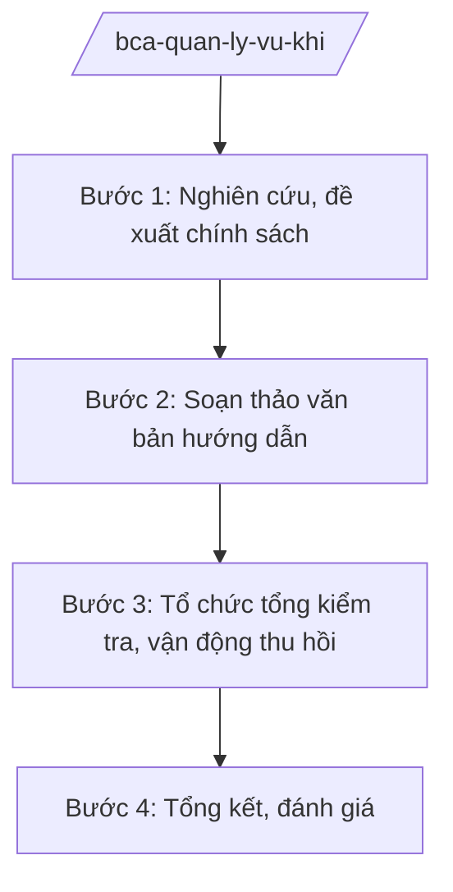

# Skill: Quản lý vũ khí, vật liệu nổ, công cụ hỗ trợ

## 2. Khi nào dùng
- Xây dựng chính sách, hướng dẫn về cấp giấy phép sử dụng vũ khí, vật liệu nổ, công cụ hỗ trợ.
- Hướng dẫn công an địa phương thực hiện đăng ký, quản lý, thu hồi vũ khí, vật liệu nổ, công cụ hỗ trợ.
- Tổng kiểm tra, vận động thu hồi vũ khí, vật liệu nổ trong nhân dân.
- Sơ kết, tổng kết công tác quản lý.

## 3. Đầu vào (Input)

| Trường | Mô tả | Bắt buộc |
|--------|-------|----------|
| `noi_dung_nhiem_vu` | Nhiệm vụ cụ thể (chính sách/hướng dẫn/tổng kiểm tra) | Có |
| `van_ban_hien_hanh` | Văn bản pháp luật hiện hành liên quan | Không |
| `bao_cao_dia_phuong` | Báo cáo của công an địa phương | Không |
| `doi_tuong_quan_ly` | Nhóm đối tượng được phép sử dụng (cơ quan, tổ chức) | Không |

## 4. Quy trình

**Bước 1. Nghiên cứu, đề xuất chính sách**
- Làm gì: Rà soát vướng mắc trong cấp phép, quản lý, thu hồi; đề xuất hoàn thiện chính sách, siết chặt quản lý.
- Dùng input: `noi_dung_nhiem_vu`, `van_ban_hien_hanh`, `bao_cao_dia_phuong`.
- Vai trò: Chuyên viên nghiên cứu (AI hỗ trợ tổng hợp vướng mắc, rà soát văn bản — 2 ngày) → Cục trưởng xem xét.
- Lưu ý nghiệp vụ: Mọi nội dung ở mức chính sách, thủ tục hành chính; tuyệt đối không mô tả chi tiết kỹ thuật, tính năng vũ khí.
- → Kết quả bước: Báo cáo đề xuất chính sách.

**Bước 2. Soạn thảo văn bản hướng dẫn**
- Làm gì: Soạn hướng dẫn: điều kiện, hồ sơ, trình tự cấp giấy phép sử dụng; đăng ký, quản lý, bảo quản; thu hồi, tiêu hủy.
- Dùng input: `van_ban_hien_hanh`, `doi_tuong_quan_ly`.
- Vai trò: Chuyên viên soạn thảo (AI hỗ trợ chuẩn hóa văn bản, lập sơ đồ quy trình thủ tục — 2 ngày) → Cục trưởng ký ban hành.
- Lưu ý nghiệp vụ: Quy định rõ trách nhiệm người đứng đầu cơ quan, tổ chức được trang bị; bảo đảm an toàn tuyệt đối trong quản lý, bảo quản.
- → Kết quả bước: Văn bản hướng dẫn được ban hành.

**Bước 3. Tổ chức tổng kiểm tra, vận động thu hồi**
- Làm gì: Ban hành kế hoạch tổng kiểm tra, vận động toàn dân giao nộp vũ khí, vật liệu nổ, công cụ hỗ trợ; hướng dẫn địa phương thực hiện; tổng hợp kết quả.
- Dùng input: `noi_dung_nhiem_vu`, `bao_cao_dia_phuong`.
- Vai trò: Cục chủ trì (AI hỗ trợ lập kế hoạch, mẫu báo cáo, bảng tổng hợp — 2 ngày) → Cục trưởng trình Thứ trưởng.
- Lưu ý nghiệp vụ: Kết hợp tuyên truyền, vận động với kiểm tra, xử lý; bảo đảm an toàn khi tiếp nhận, tiêu hủy.
- → Kết quả bước: Kế hoạch tổng kiểm tra và kết quả toàn quốc (mức thống kê công khai).

**Bước 4. Tổng kết, đánh giá**
- Làm gì: Tổng hợp kết quả quản lý, cấp phép, thu hồi toàn quốc (mức thống kê công khai); đánh giá, đề xuất.
- Dùng input: Báo cáo của địa phương.
- Vai trò: Chuyên viên tổng hợp (AI hỗ trợ tổng hợp số liệu, dự thảo báo cáo — 2 ngày) → Cục trưởng thẩm định → Thứ trưởng trình Bộ trưởng.
- Lưu ý nghiệp vụ: Số liệu ở mức thống kê công khai; không nêu chi tiết chủng loại, số lượng cụ thể của từng đơn vị, địa phương.
- → Kết quả bước: Báo cáo tổng kết công tác quản lý.

## Luồng quy trình (Workflow)

## 5. Đầu ra (Output)

- Báo cáo đề xuất chính sách; văn bản hướng dẫn thủ tục.
- Kế hoạch tổng kiểm tra, vận động thu hồi; kết quả toàn quốc.
- Báo cáo tổng kết.

### Cấu trúc output chuẩn
1. Quốc hiệu "CỘNG HÒA XÃ HỘI CHỦ NGHĨA VIỆT NAM", Tiêu ngữ "Độc lập – Tự do – Hạnh phúc"; tên cơ quan ban hành.
2. Số, ký hiệu, địa danh, ngày tháng năm ban hành; trích yếu (thể thức NĐ 30/2020/NĐ-CP).
3. Căn cứ ban hành.
4. Nội dung: điều kiện, hồ sơ, trình tự, trách nhiệm, thời gian, tổ chức thực hiện.
5. Nơi nhận (kết thúc "- Lưu: VT, [mã đơn vị]."), chữ ký (ghi rõ chức danh, họ tên người ký; ký hiệu "KT."/"TL." khi ký thay) người có thẩm quyền.

> **Checklist thể thức văn bản theo NĐ 30/2020/NĐ-CP** — đối chiếu trước khi trình ký:
> 1. Quốc hiệu và Tiêu ngữ.
> 2. Tên cơ quan, tổ chức ban hành văn bản.
> 3. Số, ký hiệu của văn bản.
> 4. Địa danh và thời gian ban hành văn bản.
> 5. Tên loại và trích yếu nội dung văn bản.
> 6. Nội dung văn bản.
> 7. Chức vụ, họ tên và chữ ký của người có thẩm quyền.
> 8. Dấu, chữ ký số của cơ quan, tổ chức.
> 9. Nơi nhận (kèm Phụ lục nếu có).

## 6. Checklist nghiệm thu
- [ ] Chính sách, thủ tục đúng văn bản hiện hành, siết chặt quản lý.
- [ ] Trách nhiệm người đứng đầu cơ quan, tổ chức được quy định rõ.
- [ ] Tổng kiểm tra có kế hoạch, kết quả thống kê công khai.
- [ ] Không mô tả chi tiết kỹ thuật, tính năng vũ khí trong mọi văn bản.
- [ ] Số liệu báo cáo ở mức tổng hợp, không chi tiết từng đơn vị.
- [ ] Thể thức đúng NĐ 30/2020/NĐ-CP; đã qua human gate.

## 7. Ví dụ mô phỏng

*Dữ liệu dưới đây là giả lập 100% phục vụ minh họa.*

**Input mẫu:**
- noi_dung_nhiem_vu: Kế hoạch tổng kiểm tra, vận động toàn dân giao nộp vũ khí, vật liệu nổ năm 2026
- bao_cao_dia_phuong: Báo cáo công tác quản lý vũ khí của công an địa phương (giả lập, số liệu tổng hợp)

**Output mẫu (trích Kế hoạch):**

> **BỘ CÔNG AN — CỤC CẢNH SÁT QUẢN LÝ HÀNH CHÍNH VỀ TRẬT TỰ XÃ HỘI (giả lập)**
> **Kế hoạch số 1234/KH-VK ngày 01/3/2026 về tổng kiểm tra, vận động giao nộp vũ khí, vật liệu nổ, công cụ hỗ trợ**
>
> **I. Mục tiêu:** Vận động 100% người dân tự giác giao nộp vũ khí, vật liệu nổ còn cất giữ trái phép; không để xảy ra tai nạn do vũ khí, vật liệu nổ (giả lập).
>
> **II. Nội dung:** (1) Tuyên truyền, vận động sâu rộng trong nhân dân; (2) Tổng kiểm tra việc chấp hành quy định về quản lý, sử dụng tại các cơ quan, tổ chức được trang bị; (3) Tiếp nhận, phân loại, bảo quản an toàn và tổ chức tiêu hủy theo quy định.
>
> **III. Thời gian:** Đợt cao điểm từ 15/3 đến 30/6/2026 (giả lập).
>
> *Nơi nhận: ... — KT. BỘ TRƯỞNG / THỨ TRƯỞNG (bà Phạm Thị DD)*

## 8. Human gate
- Cục trưởng: duyệt đề xuất chính sách, ký văn bản hướng dẫn, kế hoạch tổng kiểm tra.
- Thứ trưởng phụ trách: phê duyệt kế hoạch, quyết định vấn đề lớn.
- Bộ trưởng (ông Lê Văn CC): quyết định chủ trương quan trọng.

## 9. Giới hạn
- AI không quyết định cấp phép, thu hồi đối với trường hợp cụ thể.
- Tuyệt đối không mô tả chi tiết kỹ thuật, tính năng, cách chế tạo/sử dụng vũ khí, vật liệu nổ.
- Không bịa số hiệu văn bản, số liệu; không viện dẫn văn bản hết hiệu lực.

## 10. Căn cứ & lưu ý
- Nghị định số 02/2025/NĐ-CP ngày 18/02/2025 của Chính phủ quy định chức năng, nhiệm vụ, quyền hạn và cơ cấu tổ chức của Bộ Công an.
- Nghị quyết số 176/2025/QH15 của Quốc hội về cơ cấu tổ chức của Chính phủ.
- Luật Quản lý, sử dụng vũ khí, vật liệu nổ và công cụ hỗ trợ (dẫn tên, không ghi số hiệu).
- Nghị định số 30/2020/NĐ-CP về công tác văn thư (thể thức văn bản).
