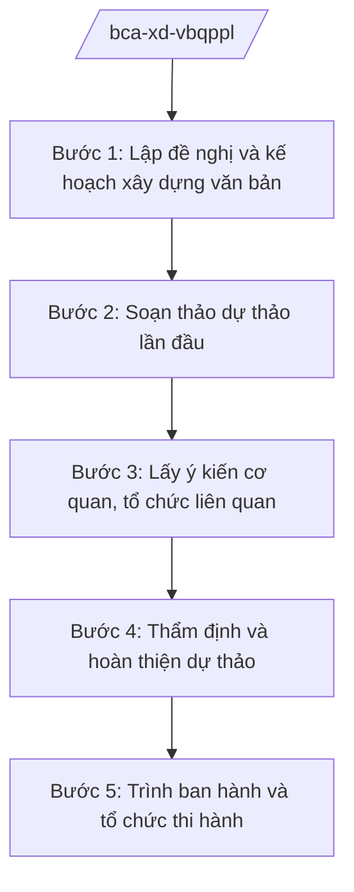

# Skill: Xây dựng VBQPPL lĩnh vực an ninh, trật tự

## 2. Khi nào dùng
- Bộ Công an được giao chủ trì soạn thảo thông tư của Bộ trưởng, dự thảo nghị định của Chính phủ hoặc đề xuất xây dựng luật, pháp lệnh thuộc lĩnh vực an ninh, trật tự.
- Cần sửa đổi, bổ sung hoặc thay thế văn bản QPPL hiện hành cho phù hợp tổ chức bộ máy mới và yêu cầu nhiệm vụ.
- Rà soát, hệ thống hóa văn bản QPPL lĩnh vực an ninh, trật tự theo kế hoạch hằng năm.

## 3. Đầu vào (Input)

| Trường | Mô tả | Bắt buộc |
|--------|-------|----------|
| `ten_van_ban` | Tên dự thảo văn bản (thông tư/nghị định/đề xuất luật) | Có |
| `loai_van_ban` | Thông tư / Nghị định / Đề nghị xây dựng luật, pháp lệnh | Có |
| `can_cu_chu_truong` | Văn bản giao nhiệm vụ, chương trình xây dựng pháp luật | Có |
| `co_quan_chu_tri` | Vụ/cục chủ trì soạn thảo | Có |
| `pham_vi_dieu_chinh` | Phạm vi, đối tượng điều chỉnh của văn bản | Có |
| `du_thao_hien_tai` | Dự thảo (nếu đã có) | Không |
| `danh_sach_lay_y_kien` | Các cơ quan, đơn vị, địa phương lấy ý kiến | Không |

## 4. Quy trình

**Bước 1. Lập đề nghị và kế hoạch xây dựng văn bản**
- Làm gì: Căn cứ chương trình xây dựng pháp luật và văn bản giao nhiệm vụ, lập đề nghị xây dựng văn bản: sự cần thiết, phạm vi, nội dung chính, lộ trình.
- Dùng input: `ten_van_ban`, `loai_van_ban`, `can_cu_chu_truong`, `co_quan_chu_tri`.
- Vai trò: Chuyên viên Vụ Pháp chế lập đề nghị (AI hỗ trợ rà soát văn bản giao nhiệm vụ, trích xuất yêu cầu, gợi ý khung đề cương ⏱ 1 ngày (ước tính)) → Vụ trưởng Vụ Pháp chế kiểm tra → Thứ trưởng phụ trách phê duyệt.
- Lưu ý nghiệp vụ: Chỉ xây dựng nội dung hành chính, chính sách công khai; không đưa biện pháp nghiệp vụ trinh sát, nội dung mật vào văn bản QPPL.
- → Kết quả bước: Đề nghị xây dựng văn bản được phê duyệt, kèm kế hoạch và phân công.

**Bước 2. Soạn thảo dự thảo lần đầu**
- Làm gì: Tổ chức nghiên cứu, soạn thảo dự thảo theo đề cương đã duyệt; đối chiếu văn bản hiện hành và văn bản liên quan.
- Dùng input: `du_thao_hien_tai`, `pham_vi_dieu_chinh`.
- Vai trò: Tổ soạn thảo (chuyên viên cục chủ trì + Vụ Pháp chế) thực hiện (AI hỗ trợ tra cứu văn bản liên quan, kiểm tra trùng lặp, chuẩn hóa kỹ thuật soạn thảo ⏱ 3–5 ngày (ước tính)) → Cục trưởng cơ quan chủ trì rà soát.
- Lưu ý nghiệp vụ: Tuân thủ kỹ thuật trình bày văn bản QPPL; mọi nội dung phải có căn cứ pháp lý rõ ràng.
- → Kết quả bước: Dự thảo lần 1 kèm thuyết minh.

**Bước 3. Lấy ý kiến cơ quan, tổ chức liên quan**
- Làm gì: Gửi dự thảo lấy ý kiến các cơ quan, đơn vị trong Bộ, bộ ngành liên quan và công an địa phương; tổng hợp, tiếp thu/giải trình.
- Dùng input: `danh_sach_lay_y_kien`, `du_thao_hien_tai`.
- Vai trò: Chuyên viên cục chủ trì tổng hợp (AI hỗ trợ phân loại ý kiến theo điều khoản, lập bảng tổng hợp tiếp thu/giải trình ⏱ 2–3 ngày (ước tính)) → Cục trưởng ký văn bản xin ý kiến.
- Lưu ý nghiệp vụ: Ý kiến không tiếp thu phải giải trình bằng văn bản; bảo đảm thời hạn lấy ý kiến theo quy định.
- → Kết quả bước: Bảng tổng hợp ý kiến và dự thảo lần 2 đã tiếp thu.

**Bước 4. Thẩm định và hoàn thiện dự thảo**
- Làm gì: Vụ Pháp chế thẩm định dự thảo (tính hợp hiến, hợp pháp, thống nhất, khả thi, kỹ thuật soạn thảo); chỉnh sửa theo ý kiến thẩm định.
- Dùng input: Toàn bộ hồ sơ các bước trước.
- Vai trò: Vụ Pháp chế thẩm định (AI hỗ trợ đối chiếu tính thống nhất với hệ thống văn bản hiện hành ⏱ 2 ngày (ước tính)) → Tổ soạn thảo hoàn thiện → Vụ trưởng ký báo cáo thẩm định.
- Lưu ý nghiệp vụ: Không trình ban hành khi còn ý kiến thẩm định chưa được tiếp thu/giải trình thỏa đáng.
- → Kết quả bước: Báo cáo thẩm định và dự thảo hoàn thiện.

**Bước 5. Trình ban hành và tổ chức thi hành**
- Làm gì: Lập tờ trình, hoàn thiện hồ sơ trình Bộ trưởng ký ban hành (thông tư) hoặc trình Chính phủ (nghị định, đề nghị xây dựng luật); sau ban hành thì đăng công báo, phổ biến văn bản.
- Dùng input: Toàn bộ hồ sơ.
- Vai trò: Cục trưởng ký tờ trình (AI hỗ trợ rà soát thể thức lần cuối theo NĐ 30/2020/NĐ-CP ⏱ 0,5 ngày (ước tính)) → Thứ trưởng kiểm tra → Bộ trưởng ký ban hành.
- Lưu ý nghiệp vụ: Hồ sơ trình đầy đủ: tờ trình, dự thảo, thuyết minh, báo cáo thẩm định, bảng tổng hợp ý kiến.
- → Kết quả bước: Văn bản được ký ban hành; kế hoạch phổ biến, triển khai.

## Luồng quy trình (Workflow)

## 5. Đầu ra (Output)

- Tờ trình ban hành văn bản.
- Dự thảo văn bản QPPL hoàn thiện (kèm thuyết minh).
- Báo cáo thẩm định; bảng tổng hợp tiếp thu ý kiến.

### Cấu trúc output chuẩn
1. Quốc hiệu "CỘNG HÒA XÃ HỘI CHỦ NGHĨA VIỆT NAM", Tiêu ngữ "Độc lập – Tự do – Hạnh phúc"
2. Tên loại và trích yếu nội dung văn bản.
3. Căn cứ ban hành (văn bản có thật, còn hiệu lực).
4. Nội dung văn bản theo chương/mục/điều.
5. Điều khoản thi hành, hiệu lực.
6. Nơi nhận (kết thúc "- Lưu: VT, [mã đơn vị]."), chữ ký (ghi rõ chức danh, họ tên người ký; ký hiệu "KT."/"TL." khi ký thay) người có thẩm quyền (đúng thể thức NĐ 30/2020/NĐ-CP).
## 6. Checklist nghiệm thu
- [ ] Đúng loại văn bản theo thẩm quyền (thông tư Bộ trưởng / nghị định / đề nghị xây dựng luật).
- [ ] Có văn bản giao nhiệm vụ, đề nghị xây dựng được phê duyệt.
- [ ] Đã lấy ý kiến đầy đủ đối tượng theo quy định; bảng tiếp thu/giải trình đầy đủ.
- [ ] Có báo cáo thẩm định của Vụ Pháp chế; ý kiến thẩm định đã được xử lý.
- [ ] Không có biện pháp nghiệp vụ trinh sát, nội dung mật trong văn bản.
- [ ] Căn cứ pháp lý viện dẫn có thật, còn hiệu lực.
- [ ] Thể thức đúng NĐ 30/2020/NĐ-CP; đã qua human gate các nấc.

## 7. Ví dụ mô phỏng

*Dữ liệu dưới đây là giả lập 100% phục vụ minh họa.*

**Input mẫu:**
- ten_van_ban: "Dự thảo Thông tư quy định công tác bảo đảm trật tự, an toàn giao thông của lực lượng Công an nhân dân"
- loai_van_ban: Thông tư
- can_cu_chu_truong: Chương trình xây dựng VBQPPL năm 2026 của Bộ Công an (giả lập)
- co_quan_chu_tri: Cục Cảnh sát giao thông – Bộ Công an (giả lập)
- pham_vi_dieu_chinh: Công tác tuần tra, kiểm soát, xử lý vi phạm TTATGT

**Output mẫu (trích Tờ trình):**

> **BỘ CÔNG AN — CỤC CẢNH SÁT GIAO THÔNG (giả lập)**
> **Tờ trình số 1234/TTr-CSGT ngày 20/3/2026 về việc ban hành Thông tư quy định công tác bảo đảm trật tự, an toàn giao thông**
>
> Kính gửi: Đồng chí Bộ trưởng Bộ Công an (ông Lê Văn CC)
>
> Căn cứ Nghị định số 02/2025/NĐ-CP ngày 18/02/2025 của Chính phủ quy định chức năng, nhiệm vụ, quyền hạn và cơ cấu tổ chức của Bộ Công an; căn cứ Chương trình xây dựng văn bản quy phạm pháp luật năm 2026 của Bộ Công an, Cục Cảnh sát giao thông kính trình Đồng chí Bộ trưởng xem xét, ký ban hành Thông tư với các nội dung chính: (1) nguyên tắc, yêu cầu công tác bảo đảm TTATGT; (2) tuần tra, kiểm soát; (3) xử lý vi phạm hành chính; (4) điều khoản thi hành.
>
> Hồ sơ kèm theo: dự thảo Thông tư, bản thuyết minh, báo cáo thẩm định, bảng tổng hợp ý kiến.
>
> *Nơi nhận: ... — KT. CỤC TRƯỞNG / PHÓ CỤC TRƯỞNG (bà Vũ Thị FF ký nháy)*

## 8. Human gate
- Vụ trưởng Vụ Pháp chế: duyệt đề nghị xây dựng, báo cáo thẩm định.
- Thứ trưởng phụ trách: kiểm tra hồ sơ trước khi trình Bộ trưởng.
- Bộ trưởng (ông Lê Văn CC): ký ban hành thông tư; quyết định trình Chính phủ đối với nghị định/đề nghị xây dựng luật.

## 9. Giới hạn
- AI không soạn thảo thay toàn bộ văn bản QPPL; chỉ hỗ trợ tra cứu, rà soát, chuẩn hóa kỹ thuật.
- AI không quyết định nội dung chính sách, không tự trình ký hoặc phát hành văn bản.
- Tuyệt đối không đưa biện pháp nghiệp vụ trinh sát, nội dung mật vào văn bản hoặc ví dụ.
- Không bịa số hiệu, ngày ban hành văn bản; không viện dẫn văn bản hết hiệu lực.

## 10. Căn cứ & lưu ý
- Nghị định số 02/2025/NĐ-CP ngày 18/02/2025 của Chính phủ quy định chức năng, nhiệm vụ, quyền hạn và cơ cấu tổ chức của Bộ Công an.
- Nghị quyết số 176/2025/QH15 của Quốc hội về cơ cấu tổ chức của Chính phủ.
- Nghị định số 30/2020/NĐ-CP về công tác văn thư (thể thức văn bản).
- Luật Ban hành văn bản quy phạm pháp luật (dẫn tên, không ghi số hiệu).
- Lưu ý: NĐ 303/2025/NĐ-CP (khung chung bộ, cơ quan ngang bộ) không áp dụng đối với Bộ Công an.
