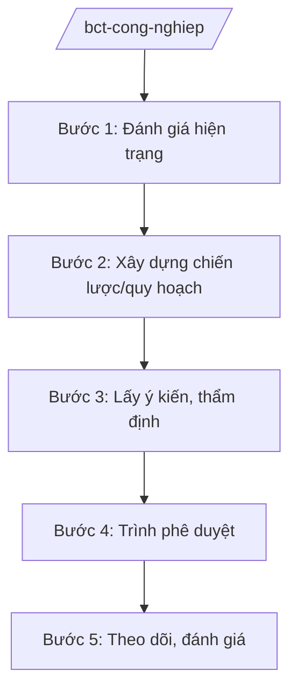

# Skill: Phát triển công nghiệp (chiến lược, quy hoạch ngành)

## 2. Khi nào dùng

- Khi xây dựng chiến lược phát triển công nghiệp Việt Nam thời kỳ mới.
- Khi xây dựng quy hoạch, đề án phát triển ngành công nghiệp cụ thể (cơ khí, ô tô, dệt may, da giày, điện tử...).
- Khi xây dựng chính sách ưu đãi, hỗ trợ công nghiệp hỗ trợ, công nghiệp công nghệ cao.
- Khi theo dõi, đánh giá thực hiện chiến lược, điều chỉnh chính sách.

## 3. Đầu vào (Input)

| Trường | Mô tả | Bắt buộc |
|--------|-------|----------|
| `loai_viec` | chiến lược / quy hoạch ngành / chính sách / đánh giá | Có |
| `nganh_cu_the` | Ngành công nghiệp cụ thể (nếu có) | Không |
| `thoi_ky` | Thời kỳ chiến lược/quy hoạch | Có |
| `so_lieu_hien_trang` | Hiện trạng phát triển ngành | Có |

## 4. Quy trình

**Bước 1. Đánh giá hiện trạng**
- Làm gì: Thu thập, phân tích số liệu sản xuất công nghiệp: giá trị sản xuất, xuất khẩu, lao động, công nghệ, tỷ lệ nội địa hóa; đánh giá điểm mạnh, yếu.
- Dùng input: `so_lieu_hien_trang`, `nganh_cu_the`.
- Vai trò: Chuyên viên Vụ Công nghiệp dự thảo; AI hỗ trợ phân tích số liệu, vẽ biểu đồ — ⏱ 20 ngày.
- Lưu ý nghiệp vụ: Số liệu từ Tổng cục Thống kê, các hiệp hội ngành hàng; so sánh với khu vực, thế giới.
- → Kết quả bước: Báo cáo đánh giá hiện trạng ngành.

**Bước 2. Xây dựng chiến lược/quy hoạch**
- Làm gì: Đề xuất quan điểm, mục tiêu, định hướng phát triển; lựa chọn ngành ưu tiên; đề xuất giải pháp về vốn, công nghệ, nhân lực, thị trường.
- Dùng input: `thoi_ky`, `nganh_cu_the`.
- Vai trò: Vụ trưởng Vụ Công nghiệp chỉ đạo; đơn vị tư vấn phối hợp; AI hỗ trợ soạn thảo, so sánh kinh nghiệm quốc tế — ⏱ 45 ngày.
- Lưu ý nghiệp vụ: Phù hợp chiến lược phát triển KT-XH, quy hoạch tổng thể quốc gia; ưu tiên công nghiệp công nghệ cao, xanh, công nghiệp hỗ trợ.
- → Kết quả bước: Dự thảo chiến lược/quy hoạch.

**Bước 3. Lấy ý kiến, thẩm định**
- Làm gì: Lấy ý kiến bộ, ngành, địa phương, hiệp hội, doanh nghiệp; Hội đồng thẩm định thẩm định (đối với quy hoạch).
- Dùng input: Dự thảo chiến lược/quy hoạch.
- Vai trò: Chuyên viên tổng hợp ý kiến; AI hỗ trợ phân loại, lập bảng tiếp thu — ⏱ 25 ngày.
- Lưu ý nghiệp vụ: Lắng nghe ý kiến doanh nghiệp, hiệp hội — đối tượng chịu tác động trực tiếp.
- → Kết quả bước: Dự thảo hoàn thiện + báo cáo thẩm định.

**Bước 4. Trình phê duyệt**
- Làm gì: Hoàn thiện hồ sơ trình Thủ tướng Chính phủ phê duyệt chiến lược/quy hoạch (tờ trình Bộ trưởng, dự thảo quyết định).
- Dùng input: Hồ sơ hoàn chỉnh.
- Vai trò: Thứ trưởng ký tờ trình; Bộ trưởng trình Thủ tướng; AI hỗ trợ kiểm tra hồ sơ — ⏱ 15 ngày.
- Lưu ý nghiệp vụ: Chiến lược phát triển công nghiệp quốc gia do Thủ tướng phê duyệt.
- → Kết quả bước: Quyết định phê duyệt của Thủ tướng Chính phủ.

**Bước 5. Theo dõi, đánh giá**
- Làm gì: Theo dõi chỉ tiêu chiến lược hằng năm; sơ kết, tổng kết; đề xuất điều chỉnh chính sách.
- Dùng input: `loai_viec` (đánh giá).
- Vai trò: Chuyên viên theo dõi; AI hỗ trợ lập bảng theo dõi chỉ tiêu — ⏱ định kỳ.
- Lưu ý nghiệp vụ: Đánh giá dựa trên số liệu thực tế, không hình thức.
- → Kết quả bước: Báo cáo sơ kết/tổng kết; kiến nghị điều chỉnh.

## Luồng quy trình (Workflow)

## 5. Đầu ra (Output)

- Báo cáo đánh giá hiện trạng ngành công nghiệp.
- Dự thảo chiến lược/quy hoạch phát triển công nghiệp.
- Quyết định phê duyệt của Thủ tướng Chính phủ.
- Báo cáo sơ kết, tổng kết thực hiện.

### Cấu trúc output chuẩn (thể thức NĐ 30/2020/NĐ-CP)

**Khung thể thức chung (NĐ 30/2020/NĐ-CP):** mọi văn bản trong output đều trình bày đầy đủ: Quốc hiệu "CỘNG HÒA XÃ HỘI CHỦ NGHĨA VIỆT NAM", Tiêu ngữ "Độc lập – Tự do – Hạnh phúc"; tên cơ quan ban hành; số, ký hiệu văn bản; địa danh, ngày tháng năm ban hành; tên loại văn bản; nội dung theo các mục dưới đây; nơi nhận (kết thúc "- Lưu: VT, [mã đơn vị]."); khối chữ ký (chức danh, họ tên người ký; ký hiệu "KT."/"TL." khi ký thay).

**Chiến lược phát triển công nghiệp gồm:**
1. Bối cảnh, đánh giá hiện trạng.
2. Quan điểm phát triển.
3. Mục tiêu đến năm 2030, tầm nhìn 2045 (giả lập theo thời kỳ).
4. Định hướng phát triển các ngành ưu tiên.
5. Giải pháp (thể chế, vốn, công nghệ, nhân lực, thị trường).
6. Tổ chức thực hiện.

> **Checklist thể thức văn bản theo NĐ 30/2020/NĐ-CP** — đối chiếu trước khi trình ký:
> 1. Quốc hiệu và Tiêu ngữ.
> 2. Tên cơ quan, tổ chức ban hành văn bản.
> 3. Số, ký hiệu của văn bản.
> 4. Địa danh và thời gian ban hành văn bản.
> 5. Tên loại và trích yếu nội dung văn bản.
> 6. Nội dung văn bản.
> 7. Chức vụ, họ tên và chữ ký của người có thẩm quyền.
> 8. Dấu, chữ ký số của cơ quan, tổ chức.
> 9. Nơi nhận (kèm Phụ lục nếu có).

## 6. Checklist nghiệm thu

- [ ] Đánh giá hiện trạng có số liệu đầy đủ, tin cậy.
- [ ] Mục tiêu cụ thể, đo lường được.
- [ ] Phù hợp chiến lược KT-XH và quy hoạch tổng thể quốc gia.
- [ ] Đã lấy ý kiến doanh nghiệp, hiệp hội, địa phương.
- [ ] Có báo cáo thẩm định (đối với quy hoạch).
- [ ] Đúng thẩm quyền phê duyệt.

## 7. Ví dụ mô phỏng

*Dữ liệu dưới đây là giả lập 100% phục vụ minh họa.*

**Input mẫu:** loai_viec = "chiến lược"; nganh_cu_the = "Công nghiệp hỗ trợ"; thoi_ky = "2026–2035 (giả lập)"; so_lieu_hien_trang = "Tỷ lệ nội địa hóa bình quân 35% (giả lập); 5.000 DN công nghiệp hỗ trợ (giả lập)".

**Output mẫu (trích Chiến lược):**

1. **Bối cảnh:** tỷ lệ nội địa hóa thấp, phụ thuộc linh kiện nhập khẩu (giả lập).
2. **Quan điểm:** phát triển công nghiệp hỗ trợ làm nền tảng cho công nghiệp chế biến, chế tạo.
3. **Mục tiêu:** tỷ lệ nội địa hóa đạt 50% năm 2035 (giả lập); 10.000 DN (giả lập).
4. **Định hướng:** ưu tiên linh kiện điện tử, cơ khí chính xác, nhựa kỹ thuật (giả lập).
5. **Giải pháp:** quỹ hỗ trợ DN nhỏ; đào tạo 50.000 kỹ thuật viên (giả lập); ưu đãi thuế.
6. **Tổ chức thực hiện:** Bộ Công Thương chủ trì; các bộ, UBND tỉnh phối hợp.

## 8. Human gate (người kiểm duyệt)

- Chuyên viên → Vụ trưởng Vụ Công nghiệp duyệt dự thảo.
- Thứ trưởng ký tờ trình → Bộ trưởng trình → Thủ tướng Chính phủ phê duyệt.

## 9. Giới hạn (guardrails)

- AI không quyết định định hướng, mục tiêu chiến lược thay Bộ.
- Không bịa số liệu ngành; số liệu phải có nguồn.
- Không viện dẫn văn bản hết hiệu lực.

## 10. Căn cứ & lưu ý

- NĐ 40/2025/NĐ-CP ngày 26/02/2025 — chức năng, nhiệm vụ, quyền hạn của Bộ Công Thương (quản lý nhà nước về công nghiệp).
- NQ 176/2025/QH15 — cơ cấu tổ chức của Chính phủ.
- Pháp luật về quy hoạch (đối với quy hoạch ngành).
- NĐ 30/2020/NĐ-CP — thể thức văn bản hành chính.
