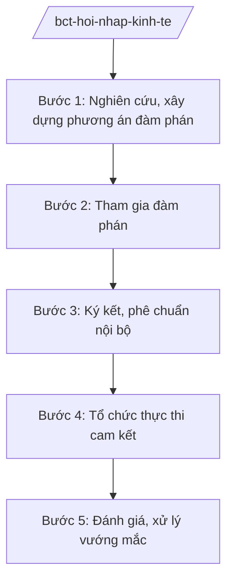

# Skill: Hội nhập kinh tế quốc tế (FTA)

## 2. Khi nào dùng

- Khi chuẩn bị đàm phán, tham gia vòng đàm phán hiệp định thương mại tự do (FTA) song phương, đa phương.
- Khi xây dựng phương án, đề xuất của Việt Nam trong đàm phán về mở cửa thị trường, quy tắc xuất xứ, thuận lợi hóa thương mại.
- Khi tổ chức thực thi cam kết FTA đã ký: lộ trình cắt giảm thuế, phổ biến cho doanh nghiệp.
- Khi rà soát, đánh giá tác động thực thi FTA; xử lý vướng mắc của doanh nghiệp khi tận dụng ưu đãi.

## 3. Đầu vào (Input)

| Trường | Mô tả | Bắt buộc |
|--------|-------|----------|
| `ten_fta` | Tên hiệp định / vòng đàm phán | Có |
| `loai_viec` | chuẩn bị đàm phán / đàm phán / thực thi / đánh giá | Có |
| `linh_vuc` | Mở cửa thị trường / quy tắc xuất xứ / SPS, TBT / dịch vụ... | Có |
| `doi_tac` | Nước/khối đối tác đàm phán | Không |

## 4. Quy trình

**Bước 1. Nghiên cứu, xây dựng phương án đàm phán**
- Làm gì: Nghiên cứu đề xuất của đối tác; xây dựng phương án, chào mời (offer) của Việt Nam về thuế quan, dịch vụ, đầu tư; đánh giá tác động.
- Dùng input: `ten_fta`, `linh_vuc`, `doi_tac`.
- Vai trò: Chuyên viên Vụ Chính sách thương mại đa biên dự thảo; AI hỗ trợ tổng hợp cam kết FTA hiện hành, so sánh biểu thuế — ⏱ 20 ngày.
- Lưu ý nghiệp vụ: Phương án đàm phán phải được cấp có thẩm quyền phê duyệt; bảo lưu lợi ích ngành hàng nhạy cảm trong nước.
- → Kết quả bước: Phương án đàm phán được phê duyệt.

**Bước 2. Tham gia đàm phán**
- Làm gì: Đoàn đàm phán Việt Nam (Bộ Công Thương chủ trì, phối hợp các bộ) tham gia các phiên; báo cáo xin ý kiến chỉ đạo khi có vấn đề vượt khung.
- Dùng input: Phương án đàm phán.
- Vai trò: Trưởng đoàn đàm phán (Thứ trưởng/Bộ trưởng) chỉ đạo; AI hỗ trợ chuẩn bị tài liệu phiên họp, ghi chép — ⏱ theo lịch đàm phán.
- Lưu ý nghiệp vụ: Mọi nhượng bộ vượt phương án phải báo cáo xin ý kiến; giữ bí mật nội dung đàm phán.
- → Kết quả bước: Biên bản phiên đàm phán; văn kiện thống nhất từng phần.

**Bước 3. Ký kết, phê chuẩn nội bộ**
- Làm gì: Hoàn tất rà soát pháp lý văn kiện; trình cấp có thẩm quyền quyết định ký; sau ký kết, trình phê chuẩn/phê duyệt theo quy định về điều ước quốc tế.
- Dùng input: `ten_fta`.
- Vai trò: Vụ trưởng Vụ Chính sách thương mại đa biên chủ trì hồ sơ; AI hỗ trợ rà soát kỹ thuật văn kiện — ⏱ 30 ngày.
- Lưu ý nghiệp vụ: FTA phải được phê chuẩn theo trình tự điều ước quốc tế; nội luật hóa các cam kết.
- → Kết quả bước: Hiệp định được ký kết và phê chuẩn.

**Bước 4. Tổ chức thực thi cam kết**
- Làm gì: Xây dựng kế hoạch thực hiện FTA: lộ trình cắt giảm thuế quan; hướng dẫn cấp C/O ưu đãi; phổ biến, tập huấn cho doanh nghiệp, hải quan, địa phương.
- Dùng input: `loai_viec` (thực thi).
- Vai trò: Các vụ/cục thuộc Bộ phối hợp; AI hỗ trợ biên soạn tài liệu phổ biến, cẩm nang tận dụng FTA — ⏱ 60 ngày.
- Lưu ý nghiệp vụ: Phối hợp Bộ Tài chính (thuế), Bộ Ngoại giao; cập nhật biểu thuế ưu đãi đặc biệt kịp thời.
- → Kết quả bước: Kế hoạch thực hiện FTA + tài liệu hướng dẫn doanh nghiệp.

**Bước 5. Đánh giá, xử lý vướng mắc**
- Làm gì: Định kỳ đánh giá tận dụng ưu đãi (tỷ lệ C/O, kim ngạch); tiếp nhận, xử lý vướng mắc của doanh nghiệp; đề xuất đàm phán nâng cấp FTA.
- Dùng input: `loai_viec` (đánh giá).
- Vai trò: Chuyên viên theo dõi; AI hỗ trợ phân tích số liệu xuất nhập khẩu, lập báo cáo — ⏱ định kỳ hằng năm.
- Lưu ý nghiệp vụ: Số liệu từ Tổng cục Hải quan, Tổng cục Thống kê; kiến nghị xử lý rào cản từ phía đối tác qua kênh Ủy ban liên hợp.
- → Kết quả bước: Báo cáo đánh giá thực thi FTA.

## Luồng quy trình (Workflow)

## 5. Đầu ra (Output)

- Phương án đàm phán được phê duyệt.
- Hồ sơ ký kết, phê chuẩn FTA.
- Kế hoạch thực hiện FTA + cẩm nang cho doanh nghiệp.
- Báo cáo đánh giá thực thi định kỳ.

### Cấu trúc output chuẩn (thể thức NĐ 30/2020/NĐ-CP)

**Khung thể thức chung (NĐ 30/2020/NĐ-CP):** mọi văn bản trong output đều trình bày đầy đủ: Quốc hiệu "CỘNG HÒA XÃ HỘI CHỦ NGHĨA VIỆT NAM", Tiêu ngữ "Độc lập – Tự do – Hạnh phúc"; tên cơ quan ban hành; số, ký hiệu văn bản; địa danh, ngày tháng năm ban hành; tên loại văn bản; nội dung theo các mục dưới đây; nơi nhận (kết thúc "- Lưu: VT, [mã đơn vị]."); khối chữ ký (chức danh, họ tên người ký; ký hiệu "KT."/"TL." khi ký thay).

**Kế hoạch thực hiện FTA gồm:**
1. Mục tiêu, yêu cầu.
2. Lộ trình cắt giảm thuế quan theo cam kết.
3. Nhiệm vụ nội luật hóa (sửa văn bản QPPL liên quan).
4. Hướng dẫn cấp Giấy chứng nhận xuất xứ (C/O) ưu đãi.
5. Phổ biến, tập huấn cho doanh nghiệp và cơ quan thực thi.
6. Cơ chế xử lý vướng mắc; đầu mối liên hệ.
7. Tổ chức thực hiện, chế độ báo cáo.
## 6. Checklist nghiệm thu

- [ ] Phương án đàm phán được cấp có thẩm quyền phê duyệt trước khi đàm phán.
- [ ] Văn kiện FTA rà soát pháp lý kỹ, không trái Hiến pháp, pháp luật.
- [ ] Trình tự ký kết, phê chuẩn đúng quy định về điều ước quốc tế.
- [ ] Lộ trình thuế quan, quy tắc xuất xứ hướng dẫn rõ cho doanh nghiệp.
- [ ] Có kế hoạch phổ biến đến hiệp hội, doanh nghiệp, địa phương.
- [ ] Cơ chế tiếp nhận vướng mắc khi thực thi được thiết lập.

## 7. Ví dụ mô phỏng

*Dữ liệu dưới đây là giả lập 100% phục vụ minh họa.*

**Input mẫu:** ten_fta = "FTA song phương Việt Nam – Nước AA (giả lập)"; loai_viec = "thực thi"; linh_vuc = "Mở cửa thị trường hàng hóa, quy tắc xuất xứ"; doi_tac = "Nước AA (giả lập)".

**Output mẫu (trích Kế hoạch thực hiện FTA):**

1. **Mục tiêu:** 90% doanh nghiệp xuất khẩu sang Nước AA nắm được ưu đãi thuế quan trong năm đầu (giả lập).
2. **Lộ trình thuế:** xóa bỏ thuế quan cho 95% dòng thuế trong 10 năm (giả lập); danh mục nhạy cảm giữ lộ trình 15 năm (giả lập).
3. **Nội luật hóa:** sửa biểu thuế xuất nhập khẩu ưu đãi đặc biệt; ban hành thông tư hướng dẫn C/O mẫu AA (giả lập).
4. **Cấp C/O:** Cục Xuất nhập khẩu hướng dẫn quy tắc xuất xứ; cấp C/O điện tử.
5. **Phổ biến:** 10 hội thảo tại các vùng kinh tế trọng điểm (giả lập); cẩm nang song ngữ.
6. **Xử lý vướng mắc:** đường dây nóng tại Vụ Chính sách thương mại đa biên; họp Ủy ban liên hợp 2 năm/lần (giả lập).
7. **Tổ chức thực hiện:** Bộ Công Thương chủ trì; Bộ Tài chính, Bộ Ngoại giao phối hợp; báo cáo Thủ tướng hằng năm.

## 8. Human gate (người kiểm duyệt)

- Chuyên viên → Vụ trưởng Vụ Chính sách thương mại đa biên duyệt phương án.
- Thứ trưởng/Bộ trưởng phê duyệt phương án đàm phán; Trưởng đoàn đàm phán báo cáo xin ý kiến khi vượt khung.
- Cấp có thẩm quyền quyết định ký kết, phê chuẩn FTA theo quy định.

## 9. Giới hạn (guardrails)

- AI không quyết định nhượng bộ đàm phán thay đoàn đàm phán; không tự ký văn kiện.
- Không tiết lộ nội dung đàm phán chưa công bố.
- Không bịa cam kết, số liệu thuế quan; mọi con số phải từ văn kiện chính thức.

## 10. Căn cứ & lưu ý

- NĐ 40/2025/NĐ-CP ngày 26/02/2025 — chức năng, nhiệm vụ, quyền hạn của Bộ Công Thương (hội nhập kinh tế quốc tế).
- NQ 176/2025/QH15 — cơ cấu tổ chức của Chính phủ.
- Pháp luật về điều ước quốc tế (đàm phán, ký kết, phê chuẩn FTA).
- NĐ 30/2020/NĐ-CP — thể thức văn bản hành chính.
- Lưu ý: phương án đàm phán và quyết định ký kết FTA thuộc thẩm quyền cấp cao; Bộ Công Thương là đầu mối chủ trì về nội dung thương mại.
