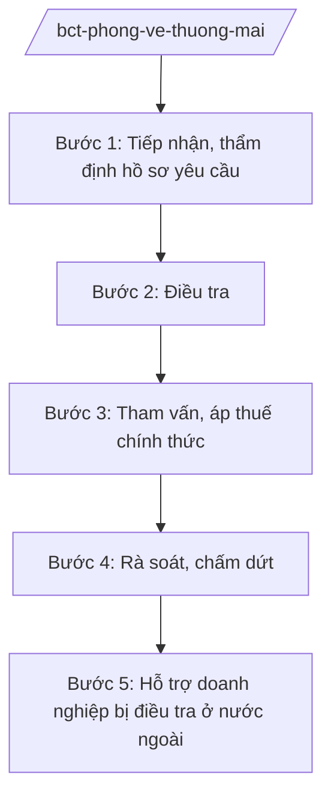

# Skill: Phòng vệ thương mại

## 2. Khi nào dùng

- Khi hiệp hội/doanh nghiệp trong nước nộp hồ sơ yêu cầu điều tra chống bán phá giá, chống trợ cấp, áp dụng biện pháp tự vệ.
- Khi Cục Phòng vệ thương mại khởi xướng điều tra vụ việc phòng vệ thương mại.
- Khi rà soát cuối kỳ, rà soát nhà xuất khẩu mới trong vụ việc đang áp thuế.
- Khi doanh nghiệp Việt Nam bị nước ngoài điều tra phòng vệ thương mại — hỗ trợ ứng phó.

## 3. Đầu vào (Input)

| Trường | Mô tả | Bắt buộc |
|--------|-------|----------|
| `loai_vu_viec` | chống bán phá giá / chống trợ cấp / tự vệ / rà soát | Có |
| `san_pham` | Hàng hóa bị điều tra | Có |
| `nuoc_xuat_khau` | Nước xuất khẩu hàng hóa liên quan | Có |
| `ho_so_yeu_cau` | Hồ sơ yêu cầu điều tra của nguyên đơn. Lưu ý: trừ vụ tự khởi xướng.| Có |
| `loai_viec` | điều tra trong nước / hỗ trợ DN bị điều tra ở nước ngoài | Có |

## 4. Quy trình

**Bước 1. Tiếp nhận, thẩm định hồ sơ yêu cầu**
- Làm gì: Kiểm tra tính đầy đủ, hợp lệ của hồ sơ yêu cầu điều tra: tư cách nguyên đơn (đại diện ngành sản xuất trong nước), bằng chứng bán phá giá/trợ cấp và thiệt hại.
- Dùng input: `ho_so_yeu_cau`, `san_pham`, `nuoc_xuat_khau`.
- Vai trò: Chuyên viên Cục Phòng vệ thương mại thẩm định; AI hỗ trợ kiểm tra checklist hồ sơ, tra cứu số liệu nhập khẩu — ⏱ 15 ngày.
- Lưu ý nghiệp vụ: Nguyên đơn phải đại diện cho tỷ lệ sản lượng theo quy định; hồ sơ mật phải được bảo mật.
- → Kết quả bước: Quyết định khởi xướng (hoặc từ chối kèm lý do) điều tra.

**Bước 2. Điều tra**
- Làm gì: Gửi bản câu hỏi cho nhà sản xuất/xuất khẩu nước ngoài, nhà nhập khẩu; xác minh tại chỗ (trong nước và nước ngoài); đánh giá biên độ bán phá giá/mức trợ cấp và thiệt hại của ngành trong nước.
- Dùng input: `loai_vu_viec`, `san_pham`.
- Vai trò: Điều tra viên Cục Phòng vệ thương mại thực hiện; AI hỗ trợ tổng hợp số liệu, soạn báo cáo điều tra — ⏱ 12 tháng (có thể gia hạn).
- Lưu ý nghiệp vụ: Bảo đảm quyền bào chữa của các bên; thông tin mật chỉ dùng cho mục đích điều tra; có thể áp thuế tạm thời khi đủ điều kiện.
- → Kết quả bước: Kết luận điều tra sơ bộ/cuối cùng.

**Bước 3. Tham vấn, áp thuế chính thức**
- Làm gì: Tổ chức tham vấn công khai các bên liên quan; Hội đồng xử lý vụ việc phòng vệ thương mại xem xét; Bộ trưởng quyết định áp thuế chống bán phá giá/chống trợ cấp hoặc biện pháp tự vệ.
- Dùng input: Kết luận điều tra.
- Vai trò: Cục trưởng Cục Phòng vệ thương mại trình; Bộ trưởng Bộ Công Thương quyết định; AI hỗ trợ soạn quyết định, tính mức thuế — ⏱ 30 ngày.
- Lưu ý nghiệp vụ: Mức thuế không vượt biên độ bán phá giá/mức trợ cấp; thời hạn áp thuế theo quy định; công bố công khai quyết định.
- → Kết quả bước: Quyết định áp thuế phòng vệ thương mại.

**Bước 4. Rà soát, chấm dứt**
- Làm gì: Rà soát cuối kỳ trước khi hết hạn áp thuế; rà soát nhà xuất khẩu mới; chấm dứt biện pháp khi không còn cần thiết.
- Dùng input: `loai_vu_viec` (rà soát).
- Vai trò: Chuyên viên Cục thực hiện; AI hỗ trợ theo dõi thời hạn các vụ việc — ⏱ theo vụ việc.
- Lưu ý nghiệp vụ: Rà soát cuối kỳ phải khởi xướng trước khi biện pháp hết hiệu lực.
- → Kết quả bước: Quyết định gia hạn/sửa đổi/chấm dứt biện pháp.

**Bước 5. Hỗ trợ doanh nghiệp bị điều tra ở nước ngoài**
- Làm gì: Cảnh báo sớm nguy cơ bị điều tra; hướng dẫn doanh nghiệp trả lời bản câu hỏi, tham gia phiên điều trần; can thiệp chính phủ khi cần.
- Dùng input: `loai_viec` (hỗ trợ DN).
- Vai trò: Cục Phòng vệ thương mại đầu mối; AI hỗ trợ soạn tài liệu hướng dẫn, tổng hợp kinh nghiệm vụ việc tương tự — ⏱ theo vụ việc.
- Lưu ý nghiệp vụ: Phối hợp Bộ Ngoại giao, Thương vụ Việt Nam ở nước ngoài.
- → Kết quả bước: Doanh nghiệp được hỗ trợ ứng phó vụ kiện.

## Luồng quy trình (Workflow)

*Ghi chú: các bước là luồng công việc độc lập, lựa chọn theo loại việc (`loai_viec`); không nhất thiết thực hiện nối tiếp.*

## 5. Đầu ra (Output)

- Quyết định khởi xướng điều tra.
- Kết luận điều tra; quyết định áp thuế tạm thời/chính thức.
- Quyết định rà soát, gia hạn, chấm dứt biện pháp.
- Báo cáo hỗ trợ doanh nghiệp ứng phó vụ kiện ở nước ngoài.

### Cấu trúc output chuẩn (thể thức NĐ 30/2020/NĐ-CP)

**Khung thể thức chung (NĐ 30/2020/NĐ-CP):** mọi văn bản trong output đều trình bày đầy đủ: Quốc hiệu "CỘNG HÒA XÃ HỘI CHỦ NGHĨA VIỆT NAM", Tiêu ngữ "Độc lập – Tự do – Hạnh phúc"; tên cơ quan ban hành; số, ký hiệu văn bản; địa danh, ngày tháng năm ban hành; tên loại văn bản; nội dung theo các mục dưới đây; nơi nhận (kết thúc "- Lưu: VT, [mã đơn vị]."); khối chữ ký (chức danh, họ tên người ký; ký hiệu "KT."/"TL." khi ký thay).

**Quyết định áp thuế chống bán phá giá gồm:**
1. Căn cứ pháp lý.
2. Mô tả hàng hóa bị điều tra, nước xuất khẩu.
3. Kết quả điều tra (biên độ bán phá giá, thiệt hại).
4. Mức thuế, thời hạn áp thuế, đối tượng chịu thuế.
5. Hiệu lực thi hành; quyền khiếu nại.
6. Tổ chức thực hiện (Hải quan thu thuế).

> **Checklist thể thức văn bản theo NĐ 30/2020/NĐ-CP** — đối chiếu trước khi trình ký:
> 1. Quốc hiệu và Tiêu ngữ.
> 2. Tên cơ quan, tổ chức ban hành văn bản.
> 3. Số, ký hiệu của văn bản.
> 4. Địa danh và thời gian ban hành văn bản.
> 5. Tên loại và trích yếu nội dung văn bản.
> 6. Nội dung văn bản.
> 7. Chức vụ, họ tên và chữ ký của người có thẩm quyền.
> 8. Dấu, chữ ký số của cơ quan, tổ chức.
> 9. Nơi nhận (kèm Phụ lục nếu có).

## 6. Checklist nghiệm thu

- [ ] Hồ sơ yêu cầu đủ điều kiện khởi xướng (tư cách nguyên đơn, bằng chứng).
- [ ] Trình tự điều tra đúng thời hạn, bảo đảm quyền các bên.
- [ ] Kết luận điều tra có cơ sở số liệu rõ ràng.
- [ ] Mức thuế trong giới hạn cho phép; quyết định công bố công khai.
- [ ] Đúng thẩm quyền (Bộ trưởng Bộ Công Thương quyết định).
- [ ] Thông tin mật được bảo vệ trong toàn bộ quá trình.

## 7. Ví dụ mô phỏng

*Dữ liệu dưới đây là giả lập 100% phục vụ minh họa.*

**Input mẫu:** loai_vu_viec = "chống bán phá giá"; san_pham = "Thép cuộn cán nóng (giả lập)"; nuoc_xuat_khau = "Nước BB (giả lập)"; ho_so_yeu_cau = "Hồ sơ của Hiệp hội Thép AA (giả lập)"; loai_viec = "điều tra trong nước".

**Output mẫu (trích Quyết định áp thuế):**

1. **Căn cứ:** NĐ 40/2025/NĐ-CP; pháp luật về quản lý ngoại thương (phòng vệ thương mại).
2. **Hàng hóa:** thép cuộn cán nóng nhập khẩu từ Nước BB (giả lập).
3. **Kết quả điều tra:** biên độ bán phá giá bình quân 12,5% (giả lập); ngành sản xuất trong nước bị thiệt hại đáng kể (giả lập).
4. **Mức thuế:** áp thuế chống bán phá giá 12,5% (giả lập), thời hạn 5 năm (giả lập).
5. **Hiệu lực:** sau 15 ngày kể từ ngày ký (giả lập); các bên có quyền khiếu nại.
6. **Tổ chức thực hiện:** Tổng cục Hải quan thu thuế; Cục Phòng vệ thương mại theo dõi.

## 8. Human gate (người kiểm duyệt)

- Chuyên viên điều tra → Cục trưởng Cục Phòng vệ thương mại duyệt kết luận điều tra.
- Hội đồng xử lý vụ việc phòng vệ thương mại xem xét.
- Bộ trưởng Bộ Công Thương quyết định khởi xướng/áp thuế/chấm dứt.

## 9. Giới hạn (guardrails)

- AI không quyết định khởi xướng, mức thuế hay kết luận điều tra thay cơ quan có thẩm quyền.
- Không tiết lộ thông tin mật của các bên trong vụ việc.
- Không bịa số liệu điều tra, biên độ bán phá giá.

## 10. Căn cứ & lưu ý

- NĐ 40/2025/NĐ-CP ngày 26/02/2025 — chức năng, nhiệm vụ, quyền hạn của Bộ Công Thương (phòng vệ thương mại).
- NQ 176/2025/QH15 — cơ cấu tổ chức của Chính phủ.
- Pháp luật về quản lý ngoại thương (các biện pháp phòng vệ thương mại).
- NĐ 30/2020/NĐ-CP — thể thức văn bản hành chính.
- Lưu ý: quyết định áp thuế phòng vệ thương mại do Bộ trưởng Bộ Công Thương ban hành.
