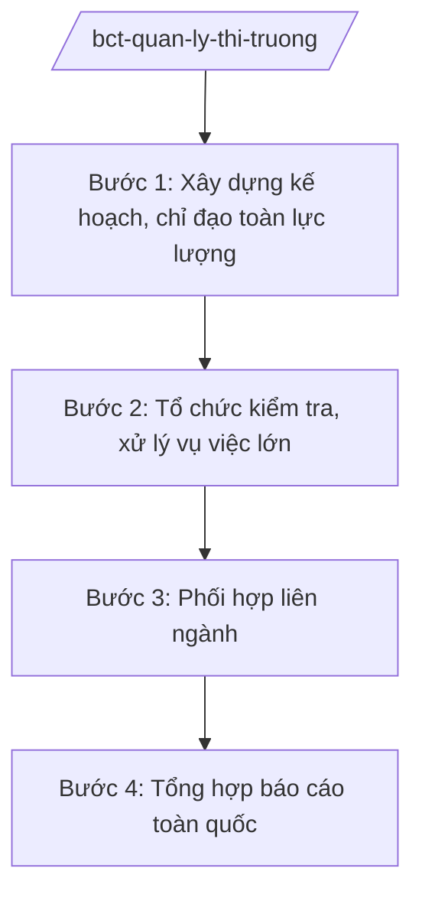

# Skill: Quản lý thị trường (chỉ đạo lực lượng QLTT)

## 2. Khi nào dùng

- Khi Bộ Công Thương chỉ đạo lực lượng Quản lý thị trường toàn quốc: kế hoạch kiểm tra năm, đợt cao điểm.
- Khi xử lý các vụ buôn lậu, gian lận thương mại, hàng giả có tính chất liên tỉnh, quy mô lớn.
- Khi phối hợp liên ngành (Công an, Hải quan, Thuế, Y tế...) đấu tranh chống buôn lậu, hàng giả.
- Khi tổng hợp báo cáo công tác quản lý thị trường toàn quốc trình Chính phủ.

## 3. Đầu vào (Input)

| Trường | Mô tả | Bắt buộc |
|--------|-------|----------|
| `loai_viec` | kế hoạch năm / đợt cao điểm / xử lý vụ lớn / báo cáo | Có |
| `linh_vuc_trong_diem` | Buôn lậu / hàng giả / ATTP / TMĐT / xăng dầu... | Không |
| `dia_ban` | Phạm vi địa bàn (toàn quốc / vùng / tuyến biên giới) | Không |
| `thoi_gian` | Thời gian thực hiện | Không |

## 4. Quy trình

**Bước 1. Xây dựng kế hoạch, chỉ đạo toàn lực lượng**
- Làm gì: Ban hành kế hoạch kiểm tra thị trường năm của lực lượng QLTT; chỉ thị đợt cao điểm (Tết, Tháng hành động ATTP, chống hàng giả trên TMĐT...).
- Dùng input: `loai_viec`, `linh_vuc_trong_diem`, `thoi_gian`.
- Vai trò: Tổng cục trưởng Tổng cục QLTT (Cục QLTT) tham mưu; Bộ trưởng ký chỉ thị; AI hỗ trợ phân tích vi phạm năm trước, gợi ý trọng điểm — ⏱ 15 ngày.
- Lưu ý nghiệp vụ: Kế hoạch toàn quốc phải thống nhất, tránh trùng với thanh tra chuyên ngành khác; phân công rõ Cục QLTT các tỉnh.
- → Kết quả bước: Kế hoạch/chỉ thị được ban hành.

**Bước 2. Tổ chức kiểm tra, xử lý vụ việc lớn**
- Làm gì: Chỉ đạo kiểm tra các vụ buôn lậu, sản xuất hàng giả quy mô lớn, liên tỉnh; thành lập đoàn kiểm tra liên ngành khi cần.
- Dùng input: `linh_vuc_trong_diem`, `dia_ban`.
- Vai trò: Lãnh đạo Tổng cục QLTT chỉ huy; AI hỗ trợ soạn quyết định kiểm tra, theo dõi tiến độ — ⏱ theo vụ việc.
- Lưu ý nghiệp vụ: Vụ việc có dấu hiệu tội phạm chuyển cơ quan điều tra; phối hợp chặt với Công an, Hải quan.
- → Kết quả bước: Kết quả kiểm tra, xử lý vụ việc.

**Bước 3. Phối hợp liên ngành**
- Làm gì: Ký kết, triển khai quy chế phối hợp với Bộ Công an, Tổng cục Hải quan, Tổng cục Thuế, Bộ Y tế...; tổ chức các đợt ra quân liên ngành.
- Dùng input: `loai_viec` (đợt cao điểm).
- Vai trò: Thứ trưởng phụ trách chỉ đạo; AI hỗ trợ lập kế hoạch phối hợp, tổng hợp kết quả — ⏱ theo đợt.
- Lưu ý nghiệp vụ: Có văn bản phân công đầu mối từng bộ, ngành; chia sẻ thông tin, cơ sở dữ liệu vi phạm.
- → Kết quả bước: Quy chế phối hợp + báo cáo đợt cao điểm.

**Bước 4. Tổng hợp báo cáo toàn quốc**
- Làm gì: Tổng hợp số vụ kiểm tra, xử phạt, tiền phạt, hàng tịch thu/tiêu hủy toàn quốc; báo cáo Bộ, Chính phủ định kỳ và đột xuất.
- Dùng input: `loai_viec` (báo cáo).
- Vai trò: Chuyên viên Tổng cục QLTT tổng hợp; AI hỗ trợ lập bảng biểu, dự thảo báo cáo — ⏱ 7 ngày.
- Lưu ý nghiệp vụ: Số liệu khớp giữa các Cục QLTT địa phương; phân tích xu hướng vi phạm mới (hàng giả trên TMĐT...).
- → Kết quả bước: Báo cáo công tác quản lý thị trường toàn quốc.

## Luồng quy trình (Workflow)

## 5. Đầu ra (Output)

- Kế hoạch kiểm tra năm / chỉ thị đợt cao điểm của Bộ.
- Kết quả xử lý vụ việc lớn, liên tỉnh.
- Quy chế phối hợp liên ngành.
- Báo cáo toàn quốc định kỳ, đột xuất.

### Cấu trúc output chuẩn (thể thức NĐ 30/2020/NĐ-CP)

**Khung thể thức chung (NĐ 30/2020/NĐ-CP):** mọi văn bản trong output đều trình bày đầy đủ: Quốc hiệu "CỘNG HÒA XÃ HỘI CHỦ NGHĨA VIỆT NAM", Tiêu ngữ "Độc lập – Tự do – Hạnh phúc"; tên cơ quan ban hành; số, ký hiệu văn bản; địa danh, ngày tháng năm ban hành; tên loại văn bản; nội dung theo các mục dưới đây; nơi nhận (kết thúc "- Lưu: VT, [mã đơn vị]."); khối chữ ký (chức danh, họ tên người ký; ký hiệu "KT."/"TL." khi ký thay).

**Báo cáo công tác quản lý thị trường toàn quốc gồm:**
1. Tình hình thị trường, diễn biến vi phạm nổi bật.
2. Kết quả kiểm tra, xử lý (số vụ, tiền phạt, hàng tịch thu/tiêu hủy).
3. Các đợt cao điểm, vụ việc lớn điển hình.
4. Phối hợp liên ngành.
5. Tồn tại, hạn chế.
6. Phương hướng, nhiệm vụ thời gian tới.
## 6. Checklist nghiệm thu

- [ ] Kế hoạch toàn quốc ban hành kịp thời, phân công rõ địa bàn.
- [ ] Vụ việc lớn được chỉ đạo xử lý dứt điểm, đúng thẩm quyền.
- [ ] Phối hợp liên ngành có văn bản, đầu mối rõ ràng.
- [ ] Số liệu báo cáo khớp, có phân tích xu hướng.
- [ ] Vụ có dấu hiệu tội phạm được chuyển cơ quan điều tra.
- [ ] Đúng thẩm quyền ký (Bộ trưởng ký chỉ thị toàn quốc).

## 7. Ví dụ mô phỏng

*Dữ liệu dưới đây là giả lập 100% phục vụ minh họa.*

**Input mẫu:** loai_viec = "đợt cao điểm"; linh_vuc_trong_diem = "Hàng giả, hàng kém chất lượng trên thương mại điện tử"; dia_ban = "Toàn quốc"; thoi_gian = "Quý IV/2026 (giả lập)".

**Output mẫu (trích Chỉ thị đợt cao điểm):**

**Chỉ thị của Bộ trưởng Bộ Công Thương** (số 1234/CT-BCT, giả lập) về tăng cường kiểm tra, xử lý hàng giả trên TMĐT Quý IV/2026:
1. Tổng cục QLTT chủ trì, chỉ đạo Cục QLTT các tỉnh đồng loạt ra quân.
2. Phối hợp Bộ Công an, Tổng cục Thuế xác minh gian hàng vi phạm.
3. Yêu cầu các sàn TMĐT gỡ bỏ gian hàng vi phạm trong 24 giờ (giả lập).
4. Báo cáo kết quả về Bộ trước ngày 15/01/2027 (giả lập).

**Kết quả đợt (giả lập):** kiểm tra 5.000 gian hàng, xử phạt 1.200 vụ, tiền phạt 30 tỷ đồng (giả lập).

## 8. Human gate (người kiểm duyệt)

- Chuyên viên → Tổng cục trưởng Tổng cục QLTT duyệt kế hoạch.
- Thứ trưởng phụ trách → Bộ trưởng ký chỉ thị toàn quốc.
- Vụ việc vượt thẩm quyền báo cáo Bộ trưởng, chuyển cơ quan điều tra.

## 9. Giới hạn (guardrails)

- AI không ra quyết định kiểm tra, xử phạt thay người có thẩm quyền.
- Không bịa số liệu vi phạm; số liệu phải từ báo cáo của lực lượng QLTT.
- Không can thiệp vào hoạt động điều tra hình sự.

## 10. Căn cứ & lưu ý

- NĐ 40/2025/NĐ-CP ngày 26/02/2025 — chức năng, nhiệm vụ, quyền hạn của Bộ Công Thương (quản lý thị trường).
- NQ 176/2025/QH15 — cơ cấu tổ chức của Chính phủ.
- Pháp luật về xử lý vi phạm hành chính; pháp luật về thương mại.
- NĐ 30/2020/NĐ-CP — thể thức văn bản hành chính.
- Lưu ý: lực lượng QLTT trực thuộc Bộ Công Thương (Tổng cục/Cục QLTT và Cục QLTT địa phương).
