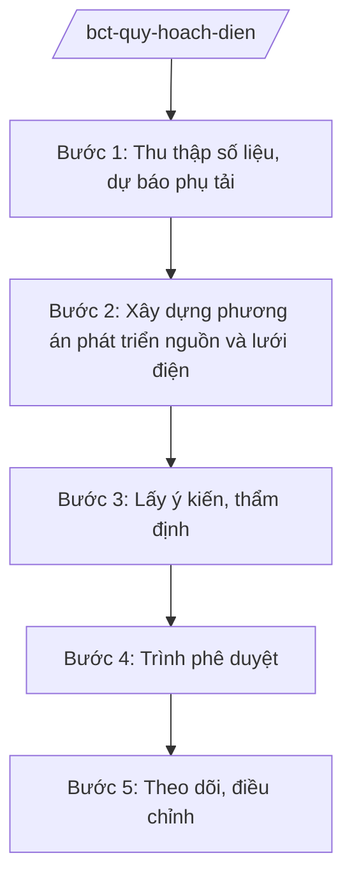

# Skill: Quy hoạch phát triển điện lực quốc gia

## 2. Khi nào dùng

- Khi lập Quy hoạch phát triển điện lực quốc gia thời kỳ mới (Quy hoạch điện).
- Khi điều chỉnh, bổ sung quy hoạch: cập nhật nguồn điện, lưới điện truyền tải.
- Khi thẩm định, trình Thủ tướng Chính phủ phê duyệt quy hoạch/điều chỉnh quy hoạch.
- Khi theo dõi, đánh giá thực hiện quy hoạch; rà soát danh mục dự án nguồn, lưới điện.

## 3. Đầu vào (Input)

| Trường | Mô tả | Bắt buộc |
|--------|-------|----------|
| `thoi_ky` | Thời kỳ quy hoạch (vd: 2026–2035, tầm nhìn 2050) | Có |
| `loai_viec` | lập mới / điều chỉnh / theo dõi thực hiện | Có |
| `so_lieu_dau_vao` | Nhu cầu phụ tải, nguồn điện hiện có, lưới điện | Có |
| `de_xuat_dia_phuong` | Đề xuất dự án của địa phương, chủ đầu tư | Không |

## 4. Quy trình

**Bước 1. Thu thập số liệu, dự báo phụ tải**
- Làm gì: Thu thập số liệu kinh tế vĩ mô, phụ tải điện các vùng; dự báo nhu cầu điện theo kịch bản tăng trưởng.
- Dùng input: `so_lieu_dau_vao`, `thoi_ky`.
- Vai trò: Chuyên viên Vụ Điện lực và Năng lượng tái tạo tổng hợp; AI hỗ trợ chuẩn hóa số liệu, vẽ biểu đồ dự báo — ⏱ 30 ngày.
- Lưu ý nghiệp vụ: Số liệu phải thống nhất với Tổng cục Thống kê và đơn vị quản lý lưới điện truyền tải quốc gia; dự báo theo nhiều kịch bản (thấp/trung bình/cao).
- → Kết quả bước: Báo cáo dự báo nhu cầu điện.

**Bước 2. Xây dựng phương án phát triển nguồn và lưới điện**
- Làm gì: Đề xuất cơ cấu nguồn điện (than, khí, thủy điện, điện gió, điện mặt trời, nhập khẩu...); quy hoạch lưới điện truyền tải 500/220/110kV; tính toán cân bằng cung cầu theo vùng.
- Dùng input: `so_lieu_dau_vao`, `de_xuat_dia_phuong`.
- Vai trò: Đơn vị tư vấn lập quy hoạch phối hợp Vụ; AI hỗ trợ so sánh phương án, lập bảng danh mục dự án — ⏱ 60 ngày.
- Lưu ý nghiệp vụ: Bảo đảm an ninh năng lượng, tỷ lệ dự phòng hợp lý; ưu tiên năng lượng tái tạo theo định hướng; lưới điện đồng bộ với nguồn.
- → Kết quả bước: Dự thảo quy hoạch (báo cáo thuyết minh + bản đồ + danh mục dự án).

**Bước 3. Lấy ý kiến, thẩm định**
- Làm gì: Lấy ý kiến bộ, ngành, địa phương, đơn vị quản lý lưới điện truyền tải quốc gia, chủ đầu tư; Hội đồng thẩm định quy hoạch thẩm định theo pháp luật về quy hoạch.
- Dùng input: Dự thảo quy hoạch.
- Vai trò: Vụ trưởng Vụ Điện lực và Năng lượng tái tạo chủ trì; AI hỗ trợ tổng hợp ý kiến, đối chiếu với quy hoạch ngành liên quan — ⏱ 30 ngày.
- Lưu ý nghiệp vụ: Quy hoạch điện phải phù hợp quy hoạch tổng thể quốc gia, quy hoạch vùng; ý kiến địa phương về danh mục dự án phải được xem xét.
- → Kết quả bước: Báo cáo thẩm định quy hoạch.

**Bước 4. Trình phê duyệt**
- Làm gì: Hoàn thiện hồ sơ trình Thủ tướng Chính phủ phê duyệt (tờ trình Bộ trưởng, dự thảo quyết định phê duyệt, báo cáo thẩm định).
- Dùng input: Hồ sơ quy hoạch hoàn chỉnh.
- Vai trò: Thứ trưởng phụ trách ký tờ trình; Bộ trưởng trình Thủ tướng; AI hỗ trợ kiểm tra tính đầy đủ hồ sơ — ⏱ 15 ngày.
- Lưu ý nghiệp vụ: Quy hoạch phát triển điện lực quốc gia do Thủ tướng Chính phủ phê duyệt.
- → Kết quả bước: Quyết định phê duyệt quy hoạch của Thủ tướng Chính phủ.

**Bước 5. Theo dõi, điều chỉnh**
- Làm gì: Theo dõi tiến độ dự án nguồn, lưới điện; hằng năm rà soát, đề xuất điều chỉnh, bổ sung danh mục khi cần.
- Dùng input: `loai_viec` (theo dõi/điều chỉnh).
- Vai trò: Chuyên viên theo dõi; AI hỗ trợ lập bảng tiến độ, cảnh báo dự án chậm — ⏱ định kỳ hằng năm.
- Lưu ý nghiệp vụ: Điều chỉnh quy hoạch tuân thủ trình tự như lập mới (rút gọn khi pháp luật cho phép).
- → Kết quả bước: Báo cáo thực hiện quy hoạch; quyết định điều chỉnh (nếu có).

## Luồng quy trình (Workflow)

## 5. Đầu ra (Output)

- Báo cáo dự báo nhu cầu điện.
- Dự thảo Quy hoạch phát triển điện lực quốc gia.
- Quyết định phê duyệt của Thủ tướng Chính phủ.
- Báo cáo theo dõi thực hiện hằng năm.

### Cấu trúc output chuẩn (thể thức NĐ 30/2020/NĐ-CP)

**Khung thể thức chung (NĐ 30/2020/NĐ-CP):** mọi văn bản trong output đều trình bày đầy đủ: Quốc hiệu "CỘNG HÒA XÃ HỘI CHỦ NGHĨA VIỆT NAM", Tiêu ngữ "Độc lập – Tự do – Hạnh phúc"; tên cơ quan ban hành; số, ký hiệu văn bản; địa danh, ngày tháng năm ban hành; tên loại văn bản; nội dung theo các mục dưới đây; nơi nhận (kết thúc "- Lưu: VT, [mã đơn vị]."); khối chữ ký (chức danh, họ tên người ký; ký hiệu "KT."/"TL." khi ký thay).

**Quyết định phê duyệt Quy hoạch phát triển điện lực quốc gia gồm:**
1. Quan điểm, mục tiêu phát triển (bảo đảm an ninh năng lượng, cơ cấu nguồn hợp lý).
2. Dự báo nhu cầu điện theo kịch bản.
3. Định hướng phát triển nguồn điện (công suất theo loại nguồn, theo vùng).
4. Định hướng phát triển lưới điện truyền tải.
5. Danh mục dự án nguồn điện, lưới điện quan trọng.
6. Giải pháp, tổ chức thực hiện (vốn, cơ chế, phân công).
## 6. Checklist nghiệm thu

- [ ] Dự báo phụ tải có cơ sở số liệu, nhiều kịch bản.
- [ ] Cơ cấu nguồn bảo đảm an ninh năng lượng, tỷ lệ dự phòng.
- [ ] Lưới điện đồng bộ với phát triển nguồn.
- [ ] Phù hợp quy hoạch tổng thể quốc gia và quy hoạch liên quan.
- [ ] Đã lấy ý kiến bộ, ngành, địa phương; có báo cáo thẩm định.
- [ ] Đúng thẩm quyền phê duyệt (Thủ tướng Chính phủ).
- [ ] Danh mục dự án rõ chủ đầu tư, tiến độ, quy mô.

## 7. Ví dụ mô phỏng

*Dữ liệu dưới đây là giả lập 100% phục vụ minh họa.*

**Input mẫu:** thoi_ky = "2026–2035, tầm nhìn 2050"; loai_viec = "điều chỉnh"; so_lieu_dau_vao = "Phụ tải đỉnh năm 2025: 55.000 MW (giả lập); tăng trưởng bình quân 8%/năm (giả lập)"; de_xuat_dia_phuong = "UBND tỉnh A đề xuất bổ sung 2 dự án điện gió ngoài khơi (giả lập)".

**Output mẫu (trích Quyết định điều chỉnh Quy hoạch):**

1. **Quan điểm, mục tiêu:** bảo đảm cung ứng đủ điện cho tăng trưởng 8%/năm (giả lập); tỷ lệ năng lượng tái tạo đạt 30% năm 2035 (giả lập).
2. **Dự báo nhu cầu:** kịch bản cơ sở 120.000 MW năm 2035 (giả lập).
3. **Phát triển nguồn:** bổ sung 3.000 MW điện gió ngoài khơi (giả lập), trong đó 2 dự án tại vùng biển giả lập.
4. **Lưới điện:** bổ sung 2 trạm 500kV và 300 km đường dây 500kV (giả lập).
5. **Danh mục dự án:** bảng 10 dự án (tên giả lập, công suất, tiến độ vận hành, chủ đầu tư giả lập).
6. **Tổ chức thực hiện:** Bộ Công Thương theo dõi; Tập đoàn Điện lực AA (giả lập) đầu tư lưới điện; UBND tỉnh A phối hợp giải phóng mặt bằng.

## 8. Human gate (người kiểm duyệt)

- Chuyên viên lập → Vụ trưởng Vụ Điện lực và Năng lượng tái tạo duyệt.
- Hội đồng thẩm định quy hoạch thẩm định.
- Thứ trưởng ký tờ trình → Bộ trưởng trình → Thủ tướng Chính phủ phê duyệt.

## 9. Giới hạn (guardrails)

- AI không quyết định cơ cấu nguồn điện, danh mục dự án thay Bộ; không tự ký/phát hành.
- Không bịa số liệu phụ tải, công suất; mọi số liệu phải có nguồn rõ ràng.
- Không viện dẫn văn bản hết hiệu lực.

## 10. Căn cứ & lưu ý

- NĐ 40/2025/NĐ-CP ngày 26/02/2025 — chức năng, nhiệm vụ, quyền hạn của Bộ Công Thương (quản lý nhà nước về điện lực).
- NQ 176/2025/QH15 — cơ cấu tổ chức của Chính phủ.
- Pháp luật về quy hoạch (trình tự lập, thẩm định, phê duyệt quy hoạch ngành quốc gia).
- NĐ 30/2020/NĐ-CP — thể thức văn bản hành chính.
- Lưu ý: Quy hoạch phát triển điện lực quốc gia do Thủ tướng Chính phủ phê duyệt.
