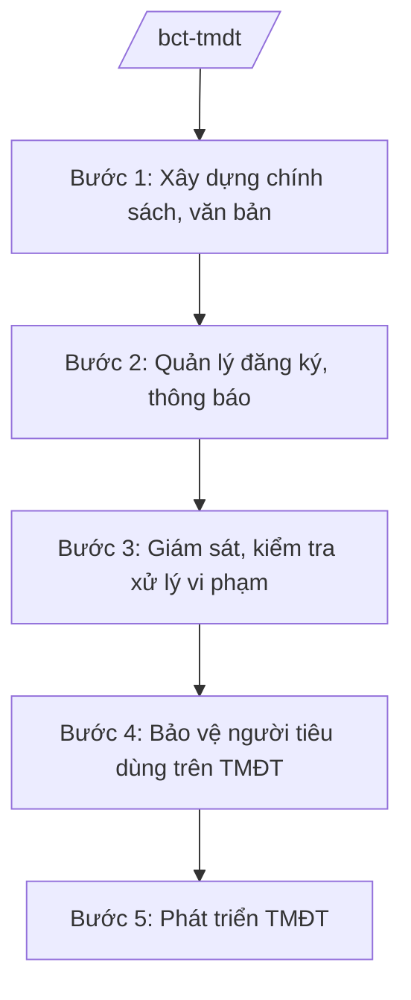

# Skill: Quản lý thương mại điện tử

## 2. Khi nào dùng

- Khi xây dựng chính sách, văn bản QPPL về thương mại điện tử.
- Khi quản lý website, ứng dụng, sàn giao dịch TMĐT: thông báo, đăng ký với Bộ Công Thương.
- Khi kiểm tra, xử lý vi phạm trên TMĐT: hàng giả, hàng cấm, gian lận, bảo vệ người tiêu dùng.
- Khi phát triển TMĐT xuyên biên giới, hỗ trợ doanh nghiệp chuyển đổi số trong thương mại.

## 3. Đầu vào (Input)

| Trường | Mô tả | Bắt buộc |
|--------|-------|----------|
| `loai_viec` | chính sách / quản lý sàn / kiểm tra xử lý / phát triển | Có |
| `doi_tuong` | Sàn TMĐT / website bán hàng / gian hàng vi phạm | Không |
| `noi_dung` | Nội dung chính sách hoặc hành vi vi phạm | Không |

## 4. Quy trình

**Bước 1. Xây dựng chính sách, văn bản**
- Làm gì: Nghiên cứu thực tiễn TMĐT; soạn thảo văn bản QPPL (nghị định, thông tư) về quản lý TMĐT; lấy ý kiến, thẩm định, trình ban hành.
- Dùng input: `loai_viec` (chính sách), `noi_dung`.
- Vai trò: Chuyên viên Cục Thương mại điện tử và Kinh tế số dự thảo; AI hỗ trợ soạn thảo, tổng hợp ý kiến — ⏱ 30 ngày.
- Lưu ý nghiệp vụ: Chính sách phải theo kịp công nghệ mới (livestream bán hàng, sàn xuyên biên giới); phối hợp Bộ Thông tin và Truyền thông (nay thuộc Bộ KH&CN), Ngân hàng Nhà nước.
- → Kết quả bước: Văn bản QPPL về TMĐT được ban hành.

**Bước 2. Quản lý đăng ký, thông báo**
- Làm gì: Tiếp nhận hồ sơ thông báo website bán hàng, đăng ký sàn giao dịch TMĐT, ứng dụng trên Cổng thông tin quản lý hoạt động TMĐT; xác nhận, công bố.
- Dùng input: `doi_tuong`.
- Vai trò: Chuyên viên Cục xử lý hồ sơ; AI hỗ trợ kiểm tra tính đầy đủ hồ sơ — ⏱ 5 ngày/hồ sơ.
- Lưu ý nghiệp vụ: Hồ sơ trực tuyến; từ chối phải nêu rõ lý do, hướng dẫn hoàn thiện.
- → Kết quả bước: Xác nhận thông báo/đăng ký cho tổ chức, cá nhân.

**Bước 3. Giám sát, kiểm tra xử lý vi phạm**
- Làm gì: Giám sát hoạt động của sàn TMĐT; phối hợp lực lượng QLTT kiểm tra, xử lý gian hàng bán hàng giả, hàng cấm; yêu cầu sàn gỡ bỏ gian hàng vi phạm, cung cấp thông tin người bán.
- Dùng input: `doi_tuong`, `noi_dung`.
- Vai trò: Cục trưởng Cục TMĐT và Kinh tế số chỉ đạo; AI hỗ trợ rà soát dấu hiệu vi phạm, soạn quyết định — ⏱ theo vụ việc.
- Lưu ý nghiệp vụ: Sàn TMĐT có trách nhiệm phối hợp, gỡ bỏ hàng hóa vi phạm; bảo vệ thông tin người tiêu dùng.
- → Kết quả bước: Vụ việc vi phạm được xử lý; sàn chấp hành.

**Bước 4. Bảo vệ người tiêu dùng trên TMĐT**
- Làm gì: Tiếp nhận, xử lý khiếu nại của người tiêu dùng mua hàng online; hướng dẫn giải quyết tranh chấp; công bố danh sách website cảnh báo.
- Dùng input: `noi_dung` (khiếu nại).
- Vai trò: Chuyên viên xử lý; AI hỗ trợ phân loại khiếu nại, soạn văn bản trả lời — ⏱ 7 ngày/vụ.
- Lưu ý nghiệp vụ: Phối hợp Ủy ban Cạnh tranh Quốc gia về bảo vệ quyền lợi người tiêu dùng.
- → Kết quả bước: Khiếu nại được giải quyết; website vi phạm bị cảnh báo.

**Bước 5. Phát triển TMĐT**
- Làm gì: Xây dựng chương trình phát triển TMĐT quốc gia; hỗ trợ DN, hợp tác xã, hộ kinh doanh lên sàn; phát triển TMĐT xuyên biên giới, tại nông thôn.
- Dùng input: `loai_viec` (phát triển).
- Vai trò: Lãnh đạo Cục chỉ đạo; AI hỗ trợ lập kế hoạch, đánh giá — ⏱ theo chương trình.
- Lưu ý nghiệp vụ: Ưu tiên hỗ trợ DN nhỏ, vùng sâu vùng xa; gắn với Chương trình chuyển đổi số quốc gia.
- → Kết quả bước: Chương trình phát triển TMĐT được triển khai.

## Luồng quy trình (Workflow)

## 5. Đầu ra (Output)

- Văn bản QPPL về TMĐT.
- Xác nhận thông báo/đăng ký website, sàn TMĐT.
- Kết quả kiểm tra, xử lý vi phạm.
- Chương trình phát triển TMĐT quốc gia.

### Cấu trúc output chuẩn (thể thức NĐ 30/2020/NĐ-CP)

**Khung thể thức chung (NĐ 30/2020/NĐ-CP):** mọi văn bản trong output đều trình bày đầy đủ: Quốc hiệu "CỘNG HÒA XÃ HỘI CHỦ NGHĨA VIỆT NAM", Tiêu ngữ "Độc lập – Tự do – Hạnh phúc"; tên cơ quan ban hành; số, ký hiệu văn bản; địa danh, ngày tháng năm ban hành; tên loại văn bản; nội dung theo các mục dưới đây; nơi nhận (kết thúc "- Lưu: VT, [mã đơn vị]."); khối chữ ký (chức danh, họ tên người ký; ký hiệu "KT."/"TL." khi ký thay).

**Kế hoạch kiểm tra TMĐT đợt cao điểm gồm:**
1. Mục đích, yêu cầu.
2. Đối tượng, nội dung kiểm tra (gian hàng, hàng hóa).
3. Lực lượng, phương thức phối hợp (QLTT, Công an, Thuế).
4. Xử lý vi phạm, yêu cầu sàn gỡ bỏ.
5. Báo cáo kết quả.
## 6. Checklist nghiệm thu

- [ ] Văn bản QPPL đúng thẩm quyền, theo kịp thực tiễn công nghệ.
- [ ] Hồ sơ đăng ký/thông báo xử lý đúng hạn.
- [ ] Sàn TMĐT phối hợp gỡ bỏ gian hàng vi phạm kịp thời.
- [ ] Khiếu nại người tiêu dùng được giải quyết đúng hạn.
- [ ] Chương trình phát triển có mục tiêu, chỉ tiêu cụ thể.

## 7. Ví dụ mô phỏng

*Dữ liệu dưới đây là giả lập 100% phục vụ minh họa.*

**Input mẫu:** loai_viec = "kiểm tra xử lý"; doi_tuong = "Sàn TMĐT AA và 200 gian hàng (giả lập)"; noi_dung = "Bán mỹ phẩm giả mạo nhãn hiệu".

**Output mẫu (trích Kế hoạch kiểm tra):**

1. **Mục đích:** xử lý dứt điểm gian hàng bán mỹ phẩm giả trên sàn AA (giả lập).
2. **Đối tượng:** 200 gian hàng có dấu hiệu vi phạm (giả lập).
3. **Lực lượng:** Đoàn kiểm tra liên ngành (QLTT, Công an) phối hợp Ban quản trị sàn AA (giả lập).
4. **Xử lý:** sàn gỡ 200 gian hàng trong 24 giờ (giả lập); xử phạt 50 vụ, tiền phạt 2 tỷ đồng (giả lập).
5. **Báo cáo:** Cục TMĐT và Kinh tế số báo cáo Bộ trưởng trong 10 ngày (giả lập).

## 8. Human gate (người kiểm duyệt)

- Chuyên viên → Cục trưởng Cục Thương mại điện tử và Kinh tế số duyệt.
- Thứ trưởng phụ trách → Bộ trưởng quyết định chính sách, đợt cao điểm toàn quốc.

## 9. Giới hạn (guardrails)

- AI không ra quyết định xử phạt thay người có thẩm quyền.
- Không bịa số liệu vi phạm; không tiết lộ thông tin điều tra.
- Không can thiệp kỹ thuật vào hệ thống của sàn TMĐT.

## 10. Căn cứ & lưu ý

- NĐ 40/2025/NĐ-CP ngày 26/02/2025 — chức năng, nhiệm vụ, quyền hạn của Bộ Công Thương (thương mại điện tử).
- NQ 176/2025/QH15 — cơ cấu tổ chức của Chính phủ.
- Pháp luật về thương mại điện tử; pháp luật về bảo vệ quyền lợi người tiêu dùng.
- NĐ 30/2020/NĐ-CP — thể thức văn bản hành chính.
