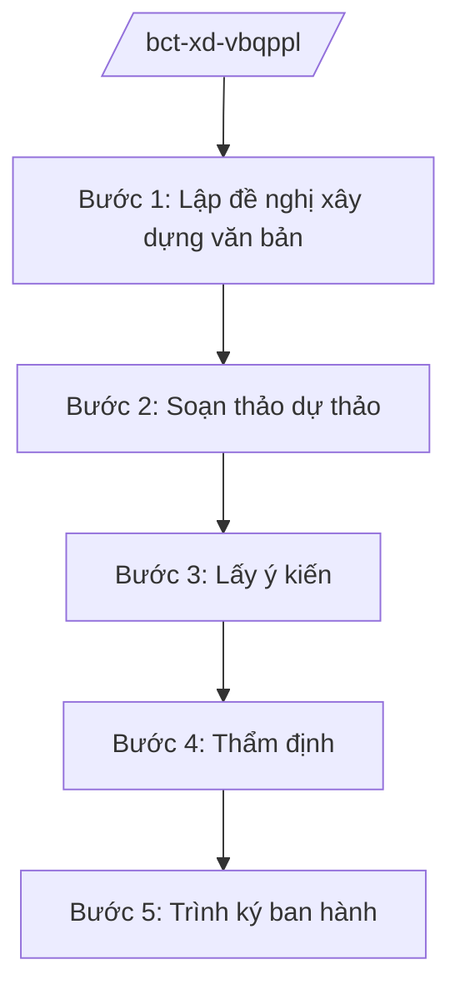

# Skill: Xây dựng VBQPPL lĩnh vực công thương

## 2. Khi nào dùng

- Khi Bộ Công Thương lập đề nghị xây dựng nghị định, thông tư thuộc lĩnh vực công nghiệp, thương mại, năng lượng.
- Khi Vụ Pháp chế thẩm định dự thảo VBQPPL do các vụ, cục thuộc Bộ chủ trì soạn thảo.
- Khi lấy ý kiến bộ, ngành, địa phương, đối tượng chịu tác động về dự thảo.
- Khi hoàn thiện hồ sơ trình Bộ trưởng ký ban hành (thông tư) hoặc trình Chính phủ (nghị định).

## 3. Đầu vào (Input)

| Trường | Mô tả | Bắt buộc |
|--------|-------|----------|
| `loai_van_ban` | Nghị định / Thông tư / Thông tư liên tịch | Có |
| `ten_van_ban` | Tên gọi dự thảo | Có |
| `don_vi_chu_tri` | Vụ/cục chủ trì soạn thảo | Có |
| `can_cu_phap_ly` | Văn bản làm căn cứ ban hành | Có |
| `noi_dung_chinh` | Các chính sách, nội dung cốt lõi dự kiến | Có |
| `doi_tuong_tac_dong` | Tổ chức, cá nhân chịu tác động | Không |

## 4. Quy trình

**Bước 1. Lập đề nghị xây dựng văn bản**
- Làm gì: Đơn vị chủ trì lập đề nghị xây dựng văn bản: sự cần thiết, phạm vi điều chỉnh, đối tượng áp dụng, nội dung chính, dự kiến nguồn lực; đánh giá tác động thủ tục hành chính.
- Dùng input: `loai_van_ban`, `ten_van_ban`, `noi_dung_chinh`, `doi_tuong_tac_dong`.
- Vai trò: Chuyên viên vụ/cục chủ trì dự thảo; AI hỗ trợ lập dàn ý đề nghị, tra cứu văn bản liên quan — ⏱ 10 ngày.
- Lưu ý nghiệp vụ: Đề nghị xây dựng nghị định phải được Chính phủ chấp thuận đưa vào chương trình; thông tư do Bộ trưởng quyết định đưa vào kế hoạch.
- → Kết quả bước: Đề nghị xây dựng văn bản được phê duyệt.

**Bước 2. Soạn thảo dự thảo**
- Làm gì: Ban soạn thảo/Tổ biên tập soạn thảo dự thảo; xây dựng tờ trình, báo cáo đánh giá tác động, bản tổng hợp tiếp thu.
- Dùng input: `noi_dung_chinh`, `can_cu_phap_ly`.
- Vai trò: Vụ trưởng đơn vị chủ trì chỉ đạo; AI hỗ trợ soạn khung điều khoản, rà soát kỹ thuật trình bày văn bản — ⏱ 20 ngày.
- Lưu ý nghiệp vụ: Ngôn ngữ chính xác, thống nhất thuật ngữ ngành công thương; không quy định vượt thẩm quyền của nghị định/thông tư.
- → Kết quả bước: Dự thảo lần 1 + tờ trình + báo cáo đánh giá tác động.

**Bước 3. Lấy ý kiến**
- Làm gì: Gửi lấy ý kiến các bộ, ngành, địa phương, hiệp hội, doanh nghiệp; đăng tải công khai trên Cổng thông tin điện tử của Bộ và Chính phủ; tổ chức hội thảo (nếu cần).
- Dùng input: `doi_tuong_tac_dong`.
- Vai trò: Chuyên viên tổng hợp ý kiến; AI hỗ trợ phân loại ý kiến, lập bảng tổng hợp tiếp thu/giải trình — ⏱ 15 ngày.
- Lưu ý nghiệp vụ: Thời gian lấy ý kiến công khai tối thiểu theo quy định; mọi ý kiến phải được tiếp thu hoặc giải trình bằng văn bản.
- → Kết quả bước: Bảng tổng hợp ý kiến + dự thảo hoàn thiện.

**Bước 4. Thẩm định**
- Làm gì: Vụ Pháp chế thẩm định: sự cần thiết, đối tượng/phạm vi, tính hợp hiến/hợp pháp/thống nhất, kỹ thuật soạn thảo; có ý kiến thẩm định bằng văn bản.
- Dùng input: Toàn bộ hồ sơ dự thảo.
- Vai trò: Vụ trưởng Vụ Pháp chế ký báo cáo thẩm định; AI hỗ trợ đối chiếu văn bản liên quan, rà lỗi kỹ thuật — ⏱ 10 ngày.
- Lưu ý nghiệp vụ: Dự thảo không đạt thẩm định phải chỉnh sửa, thẩm định lại; ý kiến thẩm định là bắt buộc trong hồ sơ trình.
- → Kết quả bước: Báo cáo thẩm định của Vụ Pháp chế.

**Bước 5. Trình ký ban hành**
- Làm gì: Hoàn thiện hồ sơ trình: tờ trình Bộ trưởng, dự thảo, báo cáo thẩm định, bảng tiếp thu ý kiến; thông tư do Bộ trưởng ký; nghị định trình Chính phủ xem xét, thông qua.
- Dùng input: Toàn bộ hồ sơ.
- Vai trò: Thứ trưởng phụ trách ký tờ trình; Bộ trưởng ký ban hành thông tư; AI hỗ trợ kiểm tra lần cuối thể thức, hồ sơ — ⏱ 7 ngày.
- Lưu ý nghiệp vụ: Hồ sơ trình Chính phủ qua Văn phòng Chính phủ, có ý kiến thẩm định của Bộ Tư pháp đối với dự thảo nghị định.
- → Kết quả bước: Văn bản được ký ban hành (hoặc hồ sơ trình Chính phủ).

## Luồng quy trình (Workflow)

## 5. Đầu ra (Output)

- Đề nghị xây dựng văn bản được phê duyệt.
- Dự thảo VBQPPL + tờ trình + báo cáo đánh giá tác động + bảng tổng hợp ý kiến.
- Báo cáo thẩm định của Vụ Pháp chế.
- Văn bản QPPL được ban hành / hồ sơ trình Chính phủ.

### Cấu trúc output chuẩn

**Khung thể thức chung (NĐ 30/2020/NĐ-CP):** mọi văn bản trong output đều trình bày đầy đủ: Quốc hiệu "CỘNG HÒA XÃ HỘI CHỦ NGHĨA VIỆT NAM", Tiêu ngữ "Độc lập – Tự do – Hạnh phúc"; tên cơ quan ban hành; số, ký hiệu văn bản; địa danh, ngày tháng năm ban hành; tên loại văn bản; nội dung theo các mục dưới đây; nơi nhận (kết thúc "- Lưu: VT, [mã đơn vị]."); khối chữ ký (chức danh, họ tên người ký; ký hiệu "KT."/"TL." khi ký thay).

**Hồ sơ trình ban hành văn bản QPPL gồm:**
1. Tờ trình (nêu sự cần thiết, căn cứ, nội dung chính, ý kiến khác nhau).
2. Dự thảo văn bản (đúng thể thức NĐ 30/2020/NĐ-CP).
3. Báo cáo đánh giá tác động.
4. Bảng tổng hợp, tiếp thu, giải trình ý kiến.
5. Báo cáo thẩm định của Vụ Pháp chế (và của Bộ Tư pháp đối với nghị định).

*Thể thức văn bản tuân thủ NĐ 30/2020/NĐ-CP.*

*Thể thức văn bản tuân thủ NĐ 30/2020/NĐ-CP.*
## 6. Checklist nghiệm thu

- [ ] Đúng loại văn bản theo thẩm quyền (thông tư không quy định nội dung thuộc thẩm quyền nghị định).
- [ ] Có đầy đủ hồ sơ: tờ trình, dự thảo, đánh giá tác động, tổng hợp ý kiến, thẩm định.
- [ ] Ý kiến góp ý đã được tiếp thu hoặc giải trình đầy đủ.
- [ ] Không trái Hiến pháp, luật và văn bản cấp trên; thống nhất với hệ thống pháp luật.
- [ ] Đúng thể thức NĐ 30/2020/NĐ-CP.
- [ ] Đã qua thẩm định Vụ Pháp chế (và Bộ Tư pháp nếu là nghị định).
- [ ] Có chữ ký đúng thẩm quyền (Bộ trưởng ký thông tư).

## 7. Ví dụ mô phỏng

*Dữ liệu dưới đây là giả lập 100% phục vụ minh họa.*

**Input mẫu:** loai_van_ban = Thông tư; ten_van_ban = "Thông tư quy định về an toàn đập, hồ chứa thủy điện"; don_vi_chu_tri = "Cục Kỹ thuật an toàn và Môi trường công nghiệp – Bộ Công Thương"; can_cu_phap_ly = "NĐ 40/2025/NĐ-CP; pháp luật về điện lực"; noi_dung_chinh = "Quy định trách nhiệm chủ đập, kiểm định an toàn định kỳ, phương án ứng phó sự cố"; doi_tuong_tac_dong = "Chủ đầu tư, đơn vị vận hành nhà máy thủy điện".

**Output mẫu (trích hồ sơ trình):**

1. **Tờ trình Bộ trưởng** (số 1234/TTr-BCT): nêu sự cần thiết (một số hồ chứa chưa có quy chuẩn kiểm định thống nhất), căn cứ NĐ 40/2025/NĐ-CP, nội dung chính gồm 4 chương 20 điều, ý kiến các bộ đã tiếp thu 18/20 ý kiến, 02 ý kiến giải trình.
2. **Dự thảo Thông tư** (đúng thể thức NĐ 30/2020/NĐ-CP): Chương I Quy định chung; Chương II Kiểm định an toàn đập; Chương III Phương án ứng phó sự cố; Chương IV Tổ chức thực hiện.
3. **Báo cáo đánh giá tác động:** chi phí tuân thủ ước tính của doanh nghiệp, lợi ích giảm rủi ro sự cố.
4. **Bảng tổng hợp ý kiến:** 20 ý kiến của 12 cơ quan, đã tiếp thu/giải trình đầy đủ.
5. **Báo cáo thẩm định Vụ Pháp chế:** đạt, đủ điều kiện trình Bộ trưởng ký.

## 8. Human gate (người kiểm duyệt)

- Chuyên viên soạn → Vụ trưởng đơn vị chủ trì duyệt dự thảo.
- Vụ Pháp chế thẩm định độc lập.
- Thứ trưởng phụ trách ký tờ trình → Bộ trưởng ký ban hành thông tư (hoặc trình Chính phủ đối với nghị định).

## 9. Giới hạn (guardrails)

- AI không quyết định nội dung chính sách thay Bộ; không tự ký/phát hành văn bản.
- Không bịa số hiệu, căn cứ pháp lý; không viện dẫn văn bản hết hiệu lực.
- Không soạn thảo nội dung vượt thẩm quyền của loại văn bản.
- Mọi ý kiến góp ý phải được con người quyết định tiếp thu hay giải trình.

## 10. Căn cứ & lưu ý

- NĐ 40/2025/NĐ-CP ngày 26/02/2025 — chức năng, nhiệm vụ, quyền hạn của Bộ Công Thương.
- NQ 176/2025/QH15 — cơ cấu tổ chức của Chính phủ (14 Bộ + 3 cơ quan ngang Bộ).
- Pháp luật về ban hành văn bản quy phạm pháp luật (quy trình lập đề nghị, soạn thảo, thẩm định, ban hành).
- NĐ 30/2020/NĐ-CP — thể thức văn bản hành chính.
- Lưu ý: dự thảo nghị định phải qua thẩm định của Bộ Tư pháp trước khi trình Chính phủ.
