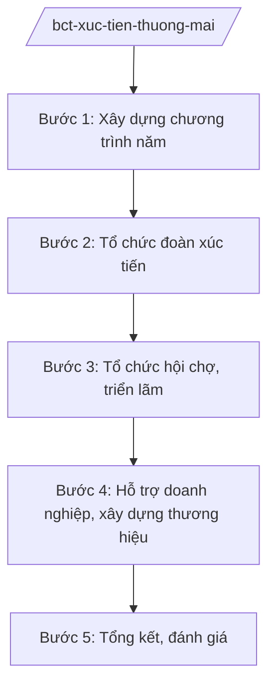

# Skill: Xúc tiến thương mại quốc gia

## 2. Khi nào dùng

- Khi xây dựng Chương trình xúc tiến thương mại quốc gia hằng năm.
- Khi tổ chức đoàn xúc tiến thương mại ở nước ngoài, đón đoàn mua hàng nước ngoài vào Việt Nam.
- Khi tổ chức hội chợ, triển lãm thương mại quốc tế tại Việt Nam.
- Khi hỗ trợ doanh nghiệp xây dựng thương hiệu, mở rộng thị trường xuất khẩu.

## 3. Đầu vào (Input)

| Trường | Mô tả | Bắt buộc |
|--------|-------|----------|
| `loai_viec` | chương trình năm / đoàn ra / đoàn vào / hội chợ / hỗ trợ DN | Có |
| `thi_truong_muc_tieu` | Nước/khu vực thị trường trọng điểm | Không |
| `nganh_hang` | Ngành hàng ưu tiên xúc tiến | Không |
| `doi_tac_phoi_hop` | Thương vụ, hiệp hội, địa phương phối hợp | Không |

## 4. Quy trình

**Bước 1. Xây dựng chương trình năm**
- Làm gì: Tổng hợp đề xuất của Thương vụ Việt Nam ở nước ngoài, hiệp hội, địa phương; xây dựng Chương trình xúc tiến thương mại quốc gia: đoàn ra, đoàn vào, hội chợ, hoạt động hỗ trợ.
- Dùng input: `loai_viec`, `thi_truong_muc_tieu`, `nganh_hang`.
- Vai trò: Chuyên viên Cục Xúc tiến thương mại dự thảo; AI hỗ trợ phân tích thị trường, gợi ý ưu tiên — ⏱ 20 ngày.
- Lưu ý nghiệp vụ: Ưu tiên thị trường FTA mới có hiệu lực, thị trường tiềm năng; cân đối ngân sách.
- → Kết quả bước: Chương trình xúc tiến thương mại quốc gia được phê duyệt.

**Bước 2. Tổ chức đoàn xúc tiến**
- Làm gì: Tổ chức đoàn doanh nghiệp đi xúc tiến ở nước ngoài (khảo sát thị trường, giao thương B2B); đón đoàn nhà mua hàng nước ngoài vào Việt Nam.
- Dùng input: `thi_truong_muc_tieu`, `doi_tac_phoi_hop`.
- Vai trò: Cục trưởng Cục Xúc tiến thương mại chỉ đạo; Thương vụ tại nước ngoài phối hợp; AI hỗ trợ lập danh sách DN, lịch giao thương — ⏱ 30 ngày/đoàn.
- Lưu ý nghiệp vụ: Tuyển chọn doanh nghiệp có năng lực xuất khẩu; phối hợp Bộ Ngoại giao về lễ tân ngoại giao.
- → Kết quả bước: Đoàn xúc tiến hoàn thành; biên bản ghi nhớ, hợp đồng ký kết.

**Bước 3. Tổ chức hội chợ, triển lãm**
- Làm gì: Tổ chức hội chợ, triển lãm thương mại quốc tế tại Việt Nam; gian hàng quốc gia tại hội chợ nước ngoài.
- Dùng input: `loai_viec` (hội chợ), `nganh_hang`.
- Vai trò: Đơn vị sự nghiệp thuộc Bộ/Cục tổ chức; AI hỗ trợ lập kế hoạch gian hàng, truyền thông — ⏱ 60 ngày.
- Lưu ý nghiệp vụ: Bảo đảm chất lượng gian hàng quốc gia; hỗ trợ DN vừa và nhỏ tham gia.
- → Kết quả bước: Hội chợ diễn ra thành công; báo cáo kết quả giao dịch.

**Bước 4. Hỗ trợ doanh nghiệp, xây dựng thương hiệu**
- Làm gì: Hỗ trợ DN xây dựng thương hiệu, tham gia sàn TMĐT xuyên biên giới; phổ biến thông tin thị trường, cảnh báo rào cản.
- Dùng input: `nganh_hang`, `thi_truong_muc_tieu`.
- Vai trò: Chuyên viên Cục; AI hỗ trợ biên soạn bản tin thị trường, cẩm nang xuất khẩu — ⏱ thường xuyên.
- Lưu ý nghiệp vụ: Phối hợp Cục Phòng vệ thương mại cảnh báo sớm vụ kiện; Thương vụ cung cấp thông tin thị trường.
- → Kết quả bước: Doanh nghiệp được hỗ trợ mở rộng thị trường.

**Bước 5. Tổng kết, đánh giá**
- Làm gì: Đánh giá kết quả chương trình năm: kim ngạch xúc tiến, hợp đồng ký kết, hiệu quả chi ngân sách.
- Dùng input: `loai_viec`.
- Vai trò: Chuyên viên tổng hợp; AI hỗ trợ lập bảng đánh giá — ⏱ 10 ngày.
- Lưu ý nghiệp vụ: Đánh giá thực chất, làm cơ sở xây dựng chương trình năm sau.
- → Kết quả bước: Báo cáo tổng kết chương trình năm.

## Luồng quy trình (Workflow)

## 5. Đầu ra (Output)

- Chương trình xúc tiến thương mại quốc gia hằng năm.
- Đoàn xúc tiến, hội chợ, triển lãm được tổ chức.
- Tài liệu hỗ trợ doanh nghiệp (bản tin thị trường, cẩm nang).
- Báo cáo tổng kết năm.

### Cấu trúc output chuẩn (thể thức NĐ 30/2020/NĐ-CP)

**Khung thể thức chung (NĐ 30/2020/NĐ-CP):** mọi văn bản trong output đều trình bày đầy đủ: Quốc hiệu "CỘNG HÒA XÃ HỘI CHỦ NGHĨA VIỆT NAM", Tiêu ngữ "Độc lập – Tự do – Hạnh phúc"; tên cơ quan ban hành; số, ký hiệu văn bản; địa danh, ngày tháng năm ban hành; tên loại văn bản; nội dung theo các mục dưới đây; nơi nhận (kết thúc "- Lưu: VT, [mã đơn vị]."); khối chữ ký (chức danh, họ tên người ký; ký hiệu "KT."/"TL." khi ký thay).

**Chương trình xúc tiến thương mại quốc gia gồm:**
1. Mục tiêu, định hướng năm.
2. Danh mục đoàn xúc tiến ra nước ngoài (thị trường, thời gian, ngành hàng).
3. Danh mục đón đoàn vào, hội chợ trong nước.
4. Hoạt động hỗ trợ doanh nghiệp, xây dựng thương hiệu.
5. Kinh phí thực hiện.
6. Tổ chức thực hiện, chế độ báo cáo.

> **Checklist thể thức văn bản theo NĐ 30/2020/NĐ-CP** — đối chiếu trước khi trình ký:
> 1. Quốc hiệu và Tiêu ngữ.
> 2. Tên cơ quan, tổ chức ban hành văn bản.
> 3. Số, ký hiệu của văn bản.
> 4. Địa danh và thời gian ban hành văn bản.
> 5. Tên loại và trích yếu nội dung văn bản.
> 6. Nội dung văn bản.
> 7. Chức vụ, họ tên và chữ ký của người có thẩm quyền.
> 8. Dấu, chữ ký số của cơ quan, tổ chức.
> 9. Nơi nhận (kèm Phụ lục nếu có).

## 6. Checklist nghiệm thu

- [ ] Chương trình được phê duyệt đúng thẩm quyền, kịp thời.
- [ ] Ưu tiên đúng thị trường, ngành hàng trọng điểm.
- [ ] Doanh nghiệp tham gia được tuyển chọn minh bạch.
- [ ] Kinh phí sử dụng đúng quy định, có quyết toán.
- [ ] Có đánh giá kết quả cụ thể (hợp đồng, kim ngạch).
- [ ] Phối hợp tốt với Thương vụ, hiệp hội, địa phương.

## 7. Ví dụ mô phỏng

*Dữ liệu dưới đây là giả lập 100% phục vụ minh họa.*

**Input mẫu:** loai_viec = "chương trình năm"; thi_truong_muc_tieu = "Khu vực Trung Đông, châu Phi (giả lập)"; nganh_hang = "Nông sản, thực phẩm chế biến"; doi_tac_phoi_hop = "Thương vụ Việt Nam tại Nước CC (giả lập)".

**Output mẫu (trích Chương trình năm 2027 — giả lập):**

1. **Mục tiêu:** tăng kim ngạch xuất khẩu nông sản sang Trung Đông 20% (giả lập).
2. **Đoàn ra:** 3 đoàn (tháng 3, 6, 9/2027 — giả lập) do Cục Xúc tiến thương mại tổ chức.
3. **Đoàn vào:** đón 2 đoàn nhà mua hàng vào hội chợ thực phẩm tại TP giả lập.
4. **Hỗ trợ DN:** cẩm nang tiêu chuẩn Halal; gian hàng dùng chung cho 50 DN nhỏ (giả lập).
5. **Kinh phí:** 50 tỷ đồng từ ngân sách (giả lập).
6. **Tổ chức thực hiện:** Cục Xúc tiến thương mại chủ trì; Thương vụ tại Nước CC phối hợp.

## 8. Human gate (người kiểm duyệt)

- Chuyên viên → Cục trưởng Cục Xúc tiến thương mại duyệt chương trình.
- Thứ trưởng phụ trách → Bộ trưởng phê duyệt chương trình quốc gia.
- Đoàn ra nước ngoài có quyết định cử đoàn theo quy định.

## 9. Giới hạn (guardrails)

- AI không quyết định thị trường, danh sách doanh nghiệp thay cơ quan có thẩm quyền.
- Không bịa số liệu kim ngạch, kết quả xúc tiến.
- Không cam kết chính sách ưu đãi vượt thẩm quyền.

## 10. Căn cứ & lưu ý

- NĐ 40/2025/NĐ-CP ngày 26/02/2025 — chức năng, nhiệm vụ, quyền hạn của Bộ Công Thương (xúc tiến thương mại).
- NQ 176/2025/QH15 — cơ cấu tổ chức của Chính phủ.
- Pháp luật về thương mại; quy định về quản lý, sử dụng kinh phí xúc tiến thương mại.
- NĐ 30/2020/NĐ-CP — thể thức văn bản hành chính.
