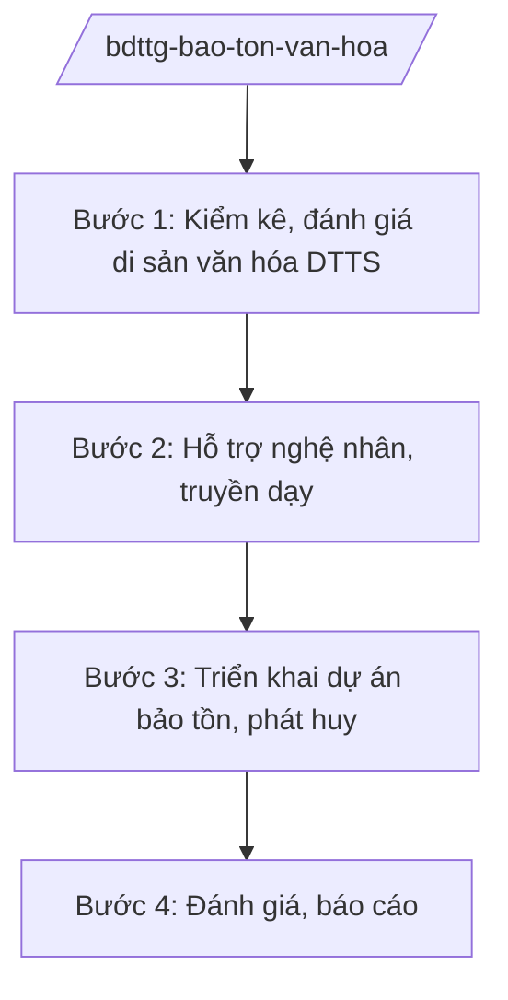

# Skill: Bảo tồn văn hóa dân tộc thiểu số

## 2. Khi nào dùng

Khi xây dựng chính sách bảo tồn văn hóa DTTS, kiểm kê di sản văn hóa phi vật thể, hỗ trợ nghệ nhân,
phát triển làng văn hóa, du lịch cộng đồng gắn với bảo tồn.

## 3. Đầu vào (Input)

| Trường | Mô tả | Bắt buộc |
|--------|-------|----------|
| `danh_muc_di_san` | Danh mục di sản văn hóa DTTS cần kiểm kê/bảo tồn (lễ hội, nghề thủ công, dân ca...) | Có |
| `danh_sach_nghe_nhan` | Danh sách nghệ nhân dân gian đề nghị hỗ trợ, phong tặng | Không |
| `de_xuat_du_an` | Đề xuất dự án bảo tồn (làng văn hóa, bảo tàng, số hóa di sản) | Không |
| `bao_cao_dia_phuong` | Báo cáo công tác bảo tồn văn hóa DTTS của địa phương | Không |

## 4. Quy trình

**Bước 1. Kiểm kê, đánh giá di sản văn hóa DTTS**

- Làm gì: Tổ chức kiểm kê di sản văn hóa vật thể, phi vật thể của các DTTS; đánh giá nguy cơ mai một; lập danh mục ưu tiên bảo tồn.
- Dùng input: `danh_muc_di_san`, `bao_cao_dia_phuong`.
- Vai trò: Chuyên viên đơn vị văn hóa dân tộc phối hợp địa phương kiểm kê (AI hỗ trợ xây dựng cơ sở dữ liệu di sản, bản đồ phân bố ⏱ 3 giờ (ước tính)); Vụ trưởng (ông Hoàng Văn EE) duyệt danh mục.
- Lưu ý nghiệp vụ: Kiểm kê phải có sự tham gia của cộng đồng, nghệ nhân; tôn trọng tính nguyên bản, không sân khấu hóa quá mức.
- → Kết quả bước: Danh mục di sản văn hóa DTTS ưu tiên bảo tồn.

**Bước 2. Hỗ trợ nghệ nhân, truyền dạy**

- Làm gì: Rà soát, đề nghị phong tặng nghệ nhân nhân dân/nghệ nhân ưu tú; hỗ trợ kinh phí truyền dạy; tổ chức lớp truyền dạy trong cộng đồng.
- Dùng input: `danh_sach_nghe_nhan`.
- Vai trò: Đơn vị văn hóa dân tộc thẩm định hồ sơ (AI hỗ trợ quản lý hồ sơ nghệ nhân ⏱ 2 giờ (ước tính)); Bộ trưởng (ông Lê Văn CC) trình Chủ tịch nước phong tặng theo quy định.
- Lưu ý nghiệp vụ: Tiêu chí phong tặng công khai, minh bạch; ưu tiên nghệ nhân cao tuổi, có nguy cơ thất truyền.
- → Kết quả bước: Tờ trình phong tặng + kế hoạch hỗ trợ truyền dạy.

**Bước 3. Triển khai dự án bảo tồn, phát huy**

- Làm gì: Phê duyệt, triển khai dự án (làng văn hóa du lịch cộng đồng, số hóa di sản, lễ hội); lồng ghép phát triển du lịch bền vững.
- Dùng input: `de_xuat_du_an`.
- Vai trò: Đơn vị văn hóa dân tộc quản lý dự án (AI hỗ trợ theo dõi tiến độ, tổng hợp báo cáo ⏱ 2 giờ (ước tính)); Thứ trưởng (bà Phạm Thị DD) phê duyệt dự án.
- Lưu ý nghiệp vụ: Bảo tồn gắn với sinh kế cộng đồng; chống thương mại hóa làm biến dạng di sản.
- → Kết quả bước: Dự án bảo tồn được triển khai + báo cáo tiến độ.

**Bước 4. Đánh giá, báo cáo**

- Làm gì: Đánh giá hiệu quả bảo tồn (số di sản được bảo tồn, nghệ nhân được hỗ trợ, thu nhập từ du lịch văn hóa); báo cáo.
- Dùng input: `bao_cao_dia_phuong`.
- Vai trò: Đơn vị văn hóa dân tộc tổng hợp (AI hỗ trợ phân tích chỉ số ⏱ 2 giờ (ước tính)).
- Lưu ý nghiệp vụ: Đánh giá cả hiệu quả bảo tồn và sinh kế cộng đồng; không chạy theo số lượng dự án.
- → Kết quả bước: Báo cáo công tác bảo tồn văn hóa DTTS.

## Luồng quy trình (Workflow)

## 5. Đầu ra (Output)

- Danh mục di sản văn hóa DTTS ưu tiên bảo tồn
- Tờ trình phong tặng nghệ nhân + kế hoạch hỗ trợ truyền dạy
- Dự án bảo tồn, phát huy văn hóa DTTS
- Báo cáo công tác bảo tồn văn hóa DTTS

### Cấu trúc output chuẩn (Kế hoạch bảo tồn văn hóa DTTS)

1. Quốc hiệu "CỘNG HÒA XÃ HỘI CHỦ NGHĨA VIỆT NAM", Tiêu ngữ "Độc lập – Tự do – Hạnh phúc"; tên Bộ; số, ký hiệu; địa danh, ngày tháng
2. Tên kế hoạch
3. Căn cứ, thực trạng (nguy cơ mai một)
4. Mục tiêu (số di sản, nghệ nhân, làng văn hóa)
5. Nội dung (kiểm kê, truyền dạy, số hóa, du lịch cộng đồng)
6. Kinh phí, nguồn lực
7. Phân công trách nhiệm
8. Chữ ký (ghi rõ chức danh, họ tên người ký; ký hiệu "KT."/"TL." khi ký thay) người có thẩm quyền (theo NĐ 30/2020/NĐ-CP)
9. Nơi nhận (kết thúc "- Lưu: VT, [mã đơn vị].").

> **Checklist thể thức văn bản theo NĐ 30/2020/NĐ-CP** — đối chiếu trước khi trình ký:
> 1. Quốc hiệu và Tiêu ngữ.
> 2. Tên cơ quan, tổ chức ban hành văn bản.
> 3. Số, ký hiệu của văn bản.
> 4. Địa danh và thời gian ban hành văn bản.
> 5. Tên loại và trích yếu nội dung văn bản.
> 6. Nội dung văn bản.
> 7. Chức vụ, họ tên và chữ ký của người có thẩm quyền.
> 8. Dấu, chữ ký số của cơ quan, tổ chức.
> 9. Nơi nhận (kèm Phụ lục nếu có).

## 6. Checklist nghiệm thu

- [ ] Kiểm kê có sự tham gia cộng đồng, nghệ nhân
- [ ] Tiêu chí phong tặng nghệ nhân công khai, minh bạch
- [ ] Bảo tồn gắn sinh kế, không thương mại hóa biến dạng di sản
- [ ] Có số hóa, lưu trữ di sản lâu dài
- [ ] Thể thức đúng NĐ 30/2020/NĐ-CP; đã qua human gate

## 7. Ví dụ mô phỏng

*Dữ liệu dưới đây là giả lập 100% phục vụ minh họa.*

**Input mẫu:**

| Trường | Giá trị |
|--------|---------|
| danh_muc_di_san | 50 lễ hội, 30 nghề thủ công, 20 loại hình dân ca của 10 DTTS có nguy cơ mai một |
| danh_sach_nghe_nhan | 20 nghệ nhân dân gian dân tộc AA (giả lập) đề nghị hỗ trợ truyền dạy |

**Output mẫu (trích Kế hoạch):**

> **BỘ DÂN TỘC VÀ TÔN GIÁO**
> Số: 1234/QĐ-BDTTG
>
> **QUYẾT ĐỊNH**
> **Ban hành Kế hoạch bảo tồn, phát huy văn hóa các dân tộc thiểu số năm 2026**
>
> Điều 1. Mục tiêu: kiểm kê 100 di sản, hỗ trợ 20 nghệ nhân truyền dạy, số hóa 50 di sản...
> Điều 2. Ưu tiên lễ hội, nghề thủ công có nguy cơ mai một cao...

## 8. Human gate

- Vụ trưởng đơn vị văn hóa dân tộc (ông Hoàng Văn EE): duyệt danh mục di sản, kế hoạch
- Thứ trưởng phụ trách (bà Phạm Thị DD): phê duyệt dự án bảo tồn
- Bộ trưởng (ông Lê Văn CC): trình phong tặng nghệ nhân; ký báo cáo

## 9. Giới hạn

- AI không tự quyết định phong tặng nghệ nhân, phê duyệt dự án
- Không bịa danh mục di sản, thông tin nghệ nhân
- Tôn trọng bản sắc văn hóa từng dân tộc; không áp đặt, không sân khấu hóa biến dạng
- Không viện dẫn văn bản hết hiệu lực

## 10. Căn cứ & lưu ý

- Nghị định 41/2025/NĐ-CP ngày 26/02/2025 của Chính phủ — chức năng, nhiệm vụ, quyền hạn và cơ cấu tổ chức của Bộ Dân tộc và Tôn giáo
- Nghị quyết 176/2025/QH15 — cơ cấu tổ chức của Chính phủ
- Nghị định 303/2025/NĐ-CP — khung chung về chức năng, nhiệm vụ của bộ, cơ quan ngang bộ
- Nghị định 30/2020/NĐ-CP — công tác văn thư (thể thức văn bản)
- Lưu ý: phối hợp Bộ Văn hóa, Thể thao và Du lịch về di sản văn hóa nói chung; Bộ Dân tộc và Tôn giáo phụ trách văn hóa các DTTS
