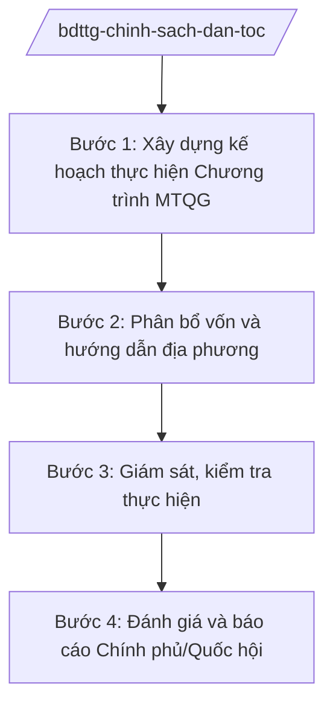

# Skill: Chính sách dân tộc (chương trình MTQG)

## 2. Khi nào dùng

Khi xây dựng chính sách dân tộc, lập kế hoạch và tổ chức thực hiện Chương trình mục tiêu quốc gia
phát triển KT-XH vùng đồng bào DTTS và miền núi: phân bổ vốn, giám sát, đánh giá, báo cáo
Chính phủ/Quốc hội.

## 3. Đầu vào (Input)

| Trường | Mô tả | Bắt buộc |
|--------|-------|----------|
| `chuong_trinh` | Tên chương trình/dự án thành phần thuộc Chương trình MTQG | Có |
| `de_xuat_dia_phuong` | Đề xuất, nhu cầu của các tỉnh vùng DTTS, miền núi | Có |
| `von_phan_bo` | Tổng vốn chương trình (vốn đầu tư, vốn sự nghiệp) theo kế hoạch | Có |
| `tieu_chi_phan_bo` | Tiêu chí phân bổ vốn (dân số DTTS, tỷ lệ hộ nghèo, địa bàn đặc biệt khó khăn) | Có |
| `bao_cao_giai_ngan` | Báo cáo tiến độ, giải ngân của địa phương | Không |

## 4. Quy trình

**Bước 1. Xây dựng kế hoạch thực hiện Chương trình MTQG**

- Làm gì: Tổng hợp đề xuất địa phương; xây dựng kế hoạch năm (mục tiêu, nhiệm vụ, dự án); xác định tiêu chí phân bổ vốn.
- Dùng input: `chuong_trinh`, `de_xuat_dia_phuong`, `tieu_chi_phan_bo`.
- Vai trò: Chuyên viên đơn vị quản lý chương trình tổng hợp (AI hỗ trợ lập bảng tổng hợp nhu cầu 50+ tỉnh, đối chiếu tiêu chí — 4 giờ); Vụ trưởng (ông Hoàng Văn EE) duyệt kế hoạch.
- Lưu ý nghiệp vụ: Ưu tiên xã đặc biệt khó khăn, hộ nghèo DTTS; không dàn trải, không trùng lặp với chương trình khác.
- → Kết quả bước: Kế hoạch thực hiện Chương trình MTQG năm.

**Bước 2. Phân bổ vốn và hướng dẫn địa phương**

- Làm gì: Tính toán phân bổ vốn theo tiêu chí; trình cấp có thẩm quyền phê duyệt; ban hành văn bản hướng dẫn địa phương triển khai.
- Dùng input: `von_phan_bo`, `tieu_chi_phan_bo`.
- Vai trò: Đơn vị quản lý chương trình lập phương án phân bổ (AI hỗ trợ tính toán phân bổ theo công thức tiêu chí — 2 giờ); Thứ trưởng (bà Phạm Thị DD) trình; Bộ trưởng (ông Lê Văn CC)/Thủ tướng phê duyệt theo phân cấp.
- Lưu ý nghiệp vụ: Phân bổ công khai, minh bạch; phối hợp Bộ Tài chính, Bộ Kế hoạch và Đầu tư (nay thuộc Bộ Tài chính).
- → Kết quả bước: Quyết định phân bổ vốn + văn bản hướng dẫn.

**Bước 3. Giám sát, kiểm tra thực hiện**

- Làm gì: Theo dõi tiến độ, giải ngân; kiểm tra thực địa; xử lý vướng mắc; chống thất thoát, lãng phí.
- Dùng input: `bao_cao_giai_ngan`.
- Vai trò: Đơn vị quản lý chương trình giám sát (AI hỗ trợ đối chiếu tiến độ/giải ngân các tỉnh, cảnh báo địa phương chậm — 3 giờ); đoàn kiểm tra liên ngành khi cần.
- Lưu ý nghiệp vụ: Kiểm tra thực chất tại cơ sở, không chỉ trên báo cáo; xử lý nghiêm vi phạm trong quản lý vốn.
- → Kết quả bước: Báo cáo giám sát + kiến nghị xử lý.

**Bước 4. Đánh giá và báo cáo Chính phủ/Quốc hội**

- Làm gì: Đánh giá giữa kỳ, cuối kỳ chương trình (mục tiêu giảm nghèo, hạ tầng, sinh kế); báo cáo Chính phủ, Quốc hội.
- Dùng input: Báo cáo giám sát, số liệu điều tra.
- Vai trò: Đơn vị quản lý chương trình tổng hợp đánh giá (AI hỗ trợ phân tích chỉ số đầu ra theo tỉnh — 4 giờ); Bộ trưởng (ông Lê Văn CC) ký báo cáo.
- Lưu ý nghiệp vụ: Đánh giá độc lập, khách quan; số liệu có kiểm chứng thực địa.
- → Kết quả bước: Báo cáo đánh giá + báo cáo trình Chính phủ/Quốc hội.

## Luồng quy trình (Workflow)

## 5. Đầu ra (Output)

- Kế hoạch thực hiện Chương trình MTQG năm
- Quyết định phân bổ vốn
- Văn bản hướng dẫn địa phương
- Báo cáo giám sát, kiểm tra
- Báo cáo đánh giá giữa kỳ/cuối kỳ, báo cáo trình Chính phủ/Quốc hội

### Cấu trúc output chuẩn (Quyết định phân bổ vốn)

1. Quốc hiệu "CỘNG HÒA XÃ HỘI CHỦ NGHĨA VIỆT NAM", Tiêu ngữ "Độc lập – Tự do – Hạnh phúc"; tên cơ quan phê duyệt; số, ký hiệu; địa danh, ngày tháng
2. Tên quyết định
3. Căn cứ pháp lý (NQ của Quốc hội về Chương trình MTQG; NĐ 41/2025/NĐ-CP)
4. Điều 1: Tổng vốn phân bổ, nguyên tắc, tiêu chí
5. Điều 2: Mức phân bổ chi tiết theo tỉnh (phụ lục)
6. Điều 3: Trách nhiệm của Bộ, địa phương
7. Điều 4: Hiệu lực, thi hành
8. Chữ ký (ghi rõ chức danh, họ tên người ký; ký hiệu "KT."/"TL." khi ký thay) người có thẩm quyền (theo NĐ 30/2020/NĐ-CP)
9. Nơi nhận (kết thúc "- Lưu: VT, [mã đơn vị].").
## 6. Checklist nghiệm thu

- [ ] Kế hoạch bám sát mục tiêu Chương trình MTQG, không trùng lặp chương trình khác
- [ ] Tiêu chí phân bổ rõ ràng, ưu tiên đúng đối tượng khó khăn nhất
- [ ] Phân bổ công khai, minh bạch
- [ ] Có giám sát thực địa, không chỉ trên báo cáo
- [ ] Đánh giá độc lập, số liệu kiểm chứng được
- [ ] Thể thức đúng NĐ 30/2020/NĐ-CP; đã qua human gate

## 7. Ví dụ mô phỏng

*Dữ liệu dưới đây là giả lập 100% phục vụ minh họa.*

**Input mẫu:**

| Trường | Giá trị |
|--------|---------|
| chuong_trinh | Chương trình MTQG phát triển KT-XH vùng đồng bào DTTS và miền núi |
| de_xuat_dia_phuong | 30 tỉnh đề xuất 500 dự án hạ tầng, sinh kế |
| von_phan_bo | 10.000 tỷ đồng vốn đầu tư năm 2026 |
| tieu_chi_phan_bo | 50% theo dân số DTTS, 30% theo tỷ lệ hộ nghèo, 20% theo số xã ĐBKK |

**Output mẫu (trích Quyết định):**

> **BỘ DÂN TỘC VÀ TÔN GIÁO**
> Số: 1234/QĐ-BDTTG
>
> **QUYẾT ĐỊNH**
> **Phân bổ vốn đầu tư thực hiện Chương trình mục tiêu quốc gia phát triển**
> **kinh tế - xã hội vùng đồng bào dân tộc thiểu số và miền núi năm 2026**
>
> Điều 1. Phân bổ 10.000 tỷ đồng theo tiêu chí: 50% dân số DTTS, 30% tỷ lệ hộ nghèo, 20% số xã đặc biệt khó khăn...
> Điều 2. Danh mục phân bổ chi tiết theo tỉnh tại phụ lục kèm theo...

## 8. Human gate

- Vụ trưởng đơn vị quản lý chương trình (ông Hoàng Văn EE): duyệt kế hoạch, ký văn bản hướng dẫn
- Thứ trưởng phụ trách (bà Phạm Thị DD): trình phương án phân bổ vốn
- Bộ trưởng (ông Lê Văn CC): ký báo cáo trình Chính phủ/Quốc hội; phê duyệt phân bổ theo phân cấp
- Thủ tướng Chính phủ: phê duyệt phân bổ vốn thuộc thẩm quyền

## 9. Giới hạn

- AI không tự quyết định phân bổ vốn, không phê duyệt dự án
- Không bịa số liệu vốn, tiến độ giải ngân, kết quả giảm nghèo
- Không can thiệp vào đấu thầu, lựa chọn nhà thầu của địa phương
- Không viện dẫn văn bản hết hiệu lực

## 10. Căn cứ & lưu ý

- Nghị định 41/2025/NĐ-CP ngày 26/02/2025 của Chính phủ — chức năng, nhiệm vụ, quyền hạn và cơ cấu tổ chức của Bộ Dân tộc và Tôn giáo
- Nghị quyết 176/2025/QH15 — cơ cấu tổ chức của Chính phủ
- Nghị định 303/2025/NĐ-CP — khung chung về chức năng, nhiệm vụ của bộ, cơ quan ngang bộ
- Nghị định 30/2020/NĐ-CP — công tác văn thư (thể thức văn bản)
- Lưu ý: Chương trình MTQG do Quốc hội quyết định chủ trương đầu tư; Bộ Dân tộc và Tôn giáo là cơ quan chủ trì quản lý chương trình, phối hợp Bộ Tài chính và các bộ liên quan
