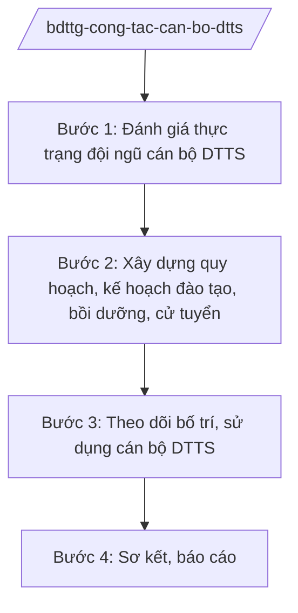

# Skill: Công tác cán bộ người DTTS

## 2. Khi nào dùng

Khi xây dựng quy hoạch, kế hoạch đào tạo, bồi dưỡng cán bộ người DTTS; thực hiện chính sách cử tuyển;
theo dõi tỷ lệ cán bộ DTTS trong cơ quan nhà nước các cấp.

## 3. Đầu vào (Input)

| Trường | Mô tả | Bắt buộc |
|--------|-------|----------|
| `so_lieu_can_bo` | Số liệu cán bộ, công chức người DTTS (theo cấp, theo dân tộc, theo tỉnh) | Có |
| `chi_tieu` | Chỉ tiêu tỷ lệ cán bộ DTTS (theo nghị quyết, kết luận của Đảng) | Có |
| `ke_hoach_dao_tao` | Kế hoạch đào tạo, bồi dưỡng, cử tuyển năm | Có |
| `bao_cao_dia_phuong` | Báo cáo công tác cán bộ DTTS của địa phương | Không |

## 4. Quy trình

**Bước 1. Đánh giá thực trạng đội ngũ cán bộ DTTS**

- Làm gì: Tổng hợp số liệu cán bộ DTTS toàn quốc; so sánh với chỉ tiêu; xác định khâu yếu (quy hoạch, đào tạo, bố trí).
- Dùng input: `so_lieu_can_bo`, `chi_tieu`.
- Vai trò: Chuyên viên đơn vị cán bộ dân tộc phân tích (AI hỗ trợ lập bảng so sánh tỷ lệ cán bộ DTTS theo tỉnh, theo cấp ⏱ 3 giờ (ước tính)); Vụ trưởng (ông Hoàng Văn EE) duyệt báo cáo.
- Lưu ý nghiệp vụ: Số liệu chính xác, tách theo dân tộc, cấp, giới tính; đánh giá thực chất, không hình thức.
- → Kết quả bước: Báo cáo thực trạng đội ngũ cán bộ DTTS.

**Bước 2. Xây dựng quy hoạch, kế hoạch đào tạo, bồi dưỡng, cử tuyển**

- Làm gì: Lập quy hoạch cán bộ DTTS; kế hoạch đào tạo, bồi dưỡng (lý luận chính trị, quản lý nhà nước); chỉ tiêu cử tuyển học sinh DTTS vào đại học, trường nội trú.
- Dùng input: `ke_hoach_dao_tao`, báo cáo thực trạng.
- Vai trò: Đơn vị cán bộ dân tộc chủ trì, phối hợp Ban Tổ chức Trung ương, Bộ Nội vụ, Bộ Giáo dục và Đào tạo (AI hỗ trợ lập kế hoạch chỉ tiêu theo tỉnh ⏱ 3 giờ (ước tính)); Thứ trưởng (bà Phạm Thị DD) cho ý kiến.
- Lưu ý nghiệp vụ: Cử tuyển đúng đối tượng, công khai; đào tạo gắn với bố trí sử dụng sau đào tạo.
- → Kết quả bước: Quy hoạch, kế hoạch đào tạo, bồi dưỡng, cử tuyển cán bộ DTTS.

**Bước 3. Theo dõi bố trí, sử dụng cán bộ DTTS**

- Làm gì: Theo dõi việc bố trí cán bộ DTTS sau đào tạo; đôn đốc địa phương bảo đảm tỷ lệ; phát hiện, bồi dưỡng cán bộ trẻ, cán bộ nữ DTTS.
- Dùng input: `bao_cao_dia_phuong`.
- Vai trò: Đơn vị cán bộ dân tộc theo dõi (AI hỗ trợ đối chiếu danh sách đào tạo/bố trí, cảnh báo trường hợp chưa bố trí ⏱ 2 giờ (ước tính)).
- Lưu ý nghiệp vụ: Chống hình thức trong bố trí (có tên không có việc); quan tâm cán bộ nữ, cán bộ trẻ.
- → Kết quả bước: Báo cáo theo dõi bố trí, sử dụng cán bộ DTTS.

**Bước 4. Sơ kết, báo cáo**

- Làm gì: Sơ kết, tổng kết công tác cán bộ DTTS; báo cáo cấp có thẩm quyền.
- Dùng input: Báo cáo các bước trên.
- Vai trò: Đơn vị cán bộ dân tộc tổng hợp (AI hỗ trợ soạn báo cáo ⏱ 2 giờ (ước tính)); Bộ trưởng (ông Lê Văn CC) ký báo cáo.
- Lưu ý nghiệp vụ: Đánh giá thực chất tỷ lệ cán bộ DTTS so với chỉ tiêu; nêu rõ khâu yếu để có giải pháp.
- → Kết quả bước: Báo cáo công tác cán bộ DTTS.

## Luồng quy trình (Workflow)

## 5. Đầu ra (Output)

- Báo cáo thực trạng đội ngũ cán bộ DTTS
- Quy hoạch, kế hoạch đào tạo, bồi dưỡng, cử tuyển
- Báo cáo theo dõi bố trí, sử dụng
- Báo cáo sơ kết, tổng kết

### Cấu trúc output chuẩn (Kế hoạch đào tạo, bồi dưỡng cán bộ DTTS)

1. Quốc hiệu "CỘNG HÒA XÃ HỘI CHỦ NGHĨA VIỆT NAM", Tiêu ngữ "Độc lập – Tự do – Hạnh phúc"; tên Bộ; số, ký hiệu; địa danh, ngày tháng
2. Tên kế hoạch
3. Căn cứ, thực trạng
4. Mục tiêu, chỉ tiêu (số lượng, tỷ lệ)
5. Nội dung (đào tạo, bồi dưỡng, cử tuyển)
6. Kinh phí
7. Phân công trách nhiệm (Bộ, địa phương, cơ sở đào tạo)
8. Chữ ký (ghi rõ chức danh, họ tên người ký; ký hiệu "KT."/"TL." khi ký thay) người có thẩm quyền (theo NĐ 30/2020/NĐ-CP)
9. Nơi nhận (kết thúc "- Lưu: VT, [mã đơn vị].").

> **Checklist thể thức văn bản theo NĐ 30/2020/NĐ-CP** — đối chiếu trước khi trình ký:
> 1. Quốc hiệu và Tiêu ngữ.
> 2. Tên cơ quan, tổ chức ban hành văn bản.
> 3. Số, ký hiệu của văn bản.
> 4. Địa danh và thời gian ban hành văn bản.
> 5. Tên loại và trích yếu nội dung văn bản.
> 6. Nội dung văn bản.
> 7. Chức vụ, họ tên và chữ ký của người có thẩm quyền.
> 8. Dấu, chữ ký số của cơ quan, tổ chức.
> 9. Nơi nhận (kèm Phụ lục nếu có).

## 6. Checklist nghiệm thu

- [ ] Số liệu tách theo dân tộc, cấp, giới tính; đánh giá thực chất
- [ ] Cử tuyển đúng đối tượng, công khai
- [ ] Đào tạo gắn với bố trí sử dụng sau đào tạo
- [ ] Quan tâm cán bộ nữ, cán bộ trẻ DTTS
- [ ] Thể thức đúng NĐ 30/2020/NĐ-CP; đã qua human gate

## 7. Ví dụ mô phỏng

*Dữ liệu dưới đây là giả lập 100% phục vụ minh họa.*

**Input mẫu:**

| Trường | Giá trị |
|--------|---------|
| so_lieu_can_bo | 50.000 cán bộ, công chức người DTTS toàn quốc, chiếm 8% (chỉ tiêu 10%) |
| chi_tieu | Đến 2030 đạt 10% cán bộ, công chức là người DTTS |
| ke_hoach_dao_tao | Năm 2026: đào tạo 5.000 lượt, cử tuyển 2.000 học sinh DTTS |

**Output mẫu (trích Kế hoạch):**

> **BỘ DÂN TỘC VÀ TÔN GIÁO**
> Số: 1234/QĐ-BDTTG
>
> **QUYẾT ĐỊNH**
> **Ban hành Kế hoạch đào tạo, bồi dưỡng cán bộ người dân tộc thiểu số năm 2026**
>
> Điều 1. Mục tiêu: đào tạo, bồi dưỡng 5.000 lượt cán bộ DTTS; cử tuyển 2.000 học sinh...
> Điều 2. Ưu tiên cán bộ nữ, cán bộ trẻ, vùng đặc biệt khó khăn...

## 8. Human gate

- Vụ trưởng đơn vị cán bộ dân tộc (ông Hoàng Văn EE): duyệt báo cáo, kế hoạch
- Thứ trưởng phụ trách (bà Phạm Thị DD): cho ý kiến quy hoạch, kế hoạch
- Bộ trưởng (ông Lê Văn CC): ký báo cáo cấp có thẩm quyền

## 9. Giới hạn

- AI không tự quyết định quy hoạch, bổ nhiệm cán bộ cụ thể
- Không bịa số liệu cán bộ, chỉ tiêu cử tuyển
- Không can thiệp công tác nhân sự thuộc thẩm quyền của Đảng, của địa phương
- Bảo mật thông tin cán bộ
- Không viện dẫn văn bản hết hiệu lực

## 10. Căn cứ & lưu ý

- Nghị định 41/2025/NĐ-CP ngày 26/02/2025 của Chính phủ — chức năng, nhiệm vụ, quyền hạn và cơ cấu tổ chức của Bộ Dân tộc và Tôn giáo
- Nghị quyết 176/2025/QH15 — cơ cấu tổ chức của Chính phủ
- Nghị định 303/2025/NĐ-CP — khung chung về chức năng, nhiệm vụ của bộ, cơ quan ngang bộ
- Nghị định 30/2020/NĐ-CP — công tác văn thư (thể thức văn bản)
- Lưu ý: công tác cán bộ thuộc thẩm quyền của Đảng; Bộ Dân tộc và Tôn giáo tham mưu chính sách, theo dõi, phối hợp với Ban Tổ chức Trung ương, Bộ Nội vụ
