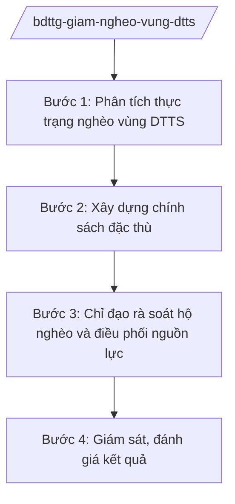

# Skill: Giảm nghèo vùng đồng bào DTTS

## 2. Khi nào dùng

Khi xây dựng chính sách giảm nghèo đặc thù vùng đồng bào DTTS, chỉ đạo rà soát hộ nghèo/hộ cận nghèo
vùng DTTS, điều phối nguồn lực, giám sát kết quả giảm nghèo. Không dùng cho giảm nghèo cấp tỉnh/xã
(skill `giam-ngheo-tinh`, `giam-ngheo`).

## 3. Đầu vào (Input)

| Trường | Mô tả | Bắt buộc |
|--------|-------|----------|
| `so_lieu_ngheo` | Số liệu hộ nghèo, cận nghèo vùng DTTS theo tỉnh (tỷ lệ, số hộ) | Có |
| `chinh_sach_dac_thu` | Đề xuất chính sách đặc thù (hỗ trợ sinh kế, đất sản xuất, nhà ở...) | Có |
| `ke_hoach_nam` | Kế hoạch giảm nghèo vùng DTTS năm | Có |
| `bao_cao_dia_phuong` | Báo cáo rà soát hộ nghèo, kết quả giảm nghèo của địa phương | Không |

## 4. Quy trình

**Bước 1. Phân tích thực trạng nghèo vùng DTTS**

- Làm gì: Tổng hợp số liệu hộ nghèo DTTS toàn quốc; phân tích nguyên nhân (thiếu đất sản xuất, thiếu việc làm, hạ tầng); xác định địa bàn trọng điểm.
- Dùng input: `so_lieu_ngheo`, `bao_cao_dia_phuong`.
- Vai trò: Chuyên viên đơn vị phụ trách phân tích (AI hỗ trợ vẽ bản đồ nghèo theo huyện, so sánh tỷ lệ nghèo DTTS/Kinh — 3 giờ); Vụ trưởng (ông Hoàng Văn EE) duyệt báo cáo.
- Lưu ý nghiệp vụ: Số liệu rà soát theo chuẩn nghèo đa chiều; tách riêng hộ nghèo DTTS để có chính sách đặc thù.
- → Kết quả bước: Báo cáo thực trạng nghèo vùng DTTS.

**Bước 2. Xây dựng chính sách đặc thù**

- Làm gì: Đề xuất chính sách hỗ trợ đặc thù (đất sản xuất, chuyển đổi nghề, tín dụng ưu đãi, đào tạo nghề cho lao động DTTS); lấy ý kiến; trình cấp có thẩm quyền.
- Dùng input: `chinh_sach_dac_thu`, báo cáo thực trạng.
- Vai trò: Đơn vị phụ trách soạn thảo, phối hợp Bộ Nội vụ (LĐ-TB&XH), Bộ Tài chính (AI hỗ trợ đánh giá tác động ngân sách — 3 giờ); Thứ trưởng (bà Phạm Thị DD) cho ý kiến.
- Lưu ý nghiệp vụ: Chính sách phải phù hợp phong tục, tập quán từng dân tộc; tránh hỗ trợ dàn trải, ỷ lại.
- → Kết quả bước: Dự thảo chính sách giảm nghèo vùng DTTS.

**Bước 3. Chỉ đạo rà soát hộ nghèo và điều phối nguồn lực**

- Làm gì: Ban hành hướng dẫn rà soát hộ nghèo DTTS; điều phối lồng ghép nguồn vốn (Chương trình MTQG, vốn tín dụng chính sách); kiểm tra thực hiện.
- Dùng input: `ke_hoach_nam`.
- Vai trò: Đơn vị phụ trách chỉ đạo (AI hỗ trợ tổng hợp tiến độ rà soát, giải ngân theo tỉnh — 2 giờ).
- Lưu ý nghiệp vụ: Rà soát công khai, dân chủ ở thôn, bản; chống chạy chọt, khai man hộ nghèo.
- → Kết quả bước: Văn bản hướng dẫn + báo cáo điều phối nguồn lực.

**Bước 4. Giám sát, đánh giá kết quả**

- Làm gì: Theo dõi tỷ lệ giảm nghèo DTTS; đánh giá hiệu quả mô hình sinh kế; báo cáo Chính phủ.
- Dùng input: `bao_cao_dia_phuong`, số liệu giám sát.
- Vai trò: Đơn vị phụ trách tổng hợp (AI hỗ trợ đối chiếu chỉ tiêu/kết quả — 2 giờ); Bộ trưởng (ông Lê Văn CC) ký báo cáo.
- Lưu ý nghiệp vụ: Đánh giá dựa trên số liệu rà soát chính thức; phân tích nguyên nhân hộ tái nghèo để điều chỉnh chính sách.
- → Kết quả bước: Báo cáo kết quả giảm nghèo vùng DTTS.

## Luồng quy trình (Workflow)

## 5. Đầu ra (Output)

- Báo cáo thực trạng nghèo vùng DTTS
- Dự thảo chính sách giảm nghèo đặc thù
- Văn bản hướng dẫn rà soát hộ nghèo DTTS
- Báo cáo kết quả giảm nghèo vùng DTTS

### Cấu trúc output chuẩn (Báo cáo kết quả giảm nghèo vùng DTTS)

1. Quốc hiệu "CỘNG HÒA XÃ HỘI CHỦ NGHĨA VIỆT NAM", Tiêu ngữ "Độc lập – Tự do – Hạnh phúc"; tên Bộ; số, ký hiệu; địa danh, ngày tháng
2. Tên báo cáo, kỳ báo cáo
3. Thực trạng hộ nghèo DTTS (số liệu theo vùng, dân tộc)
4. Kết quả thực hiện chính sách, chương trình
5. Mô hình sinh kế hiệu quả, nhân rộng
6. Tồn tại, nguyên nhân
7. Kiến nghị chính sách
8. Chữ ký (ghi rõ chức danh, họ tên người ký; ký hiệu "KT."/"TL." khi ký thay) người có thẩm quyền (theo NĐ 30/2020/NĐ-CP)
9. Nơi nhận (kết thúc "- Lưu: VT, [mã đơn vị].").

> **Checklist thể thức văn bản theo NĐ 30/2020/NĐ-CP** — đối chiếu trước khi trình ký:
> 1. Quốc hiệu và Tiêu ngữ.
> 2. Tên cơ quan, tổ chức ban hành văn bản.
> 3. Số, ký hiệu của văn bản.
> 4. Địa danh và thời gian ban hành văn bản.
> 5. Tên loại và trích yếu nội dung văn bản.
> 6. Nội dung văn bản.
> 7. Chức vụ, họ tên và chữ ký của người có thẩm quyền.
> 8. Dấu, chữ ký số của cơ quan, tổ chức.
> 9. Nơi nhận (kèm Phụ lục nếu có).

## 6. Checklist nghiệm thu

- [ ] Số liệu tách riêng hộ nghèo DTTS, theo chuẩn nghèo đa chiều
- [ ] Chính sách đặc thù phù hợp phong tục từng dân tộc, không dàn trải
- [ ] Rà soát hộ nghèo công khai, dân chủ ở thôn, bản
- [ ] Có giám sát chống trục lợi chính sách
- [ ] Thể thức đúng NĐ 30/2020/NĐ-CP; đã qua human gate

## 7. Ví dụ mô phỏng

*Dữ liệu dưới đây là giả lập 100% phục vụ minh họa.*

**Input mẫu:**

| Trường | Giá trị |
|--------|---------|
| so_lieu_ngheo | Tỷ lệ hộ nghèo DTTS toàn quốc 15%, gấp 5 lần bình quân chung; 500.000 hộ nghèo DTTS |
| chinh_sach_dac_thu | Hỗ trợ 1 ha đất sản xuất/hộ thiếu đất; tín dụng ưu đãi 50 triệu đồng/hộ; đào tạo nghề miễn phí |
| ke_hoach_nam | Giảm 3 điểm % tỷ lệ hộ nghèo DTTS năm 2026 |

**Output mẫu (trích Báo cáo):**

> **BỘ DÂN TỘC VÀ TÔN GIÁO**
> Số: 1234/BC-BDTTG
>
> **BÁO CÁO**
> **Kết quả thực hiện chính sách giảm nghèo vùng đồng bào dân tộc thiểu số năm 2025**
>
> 1. Tỷ lệ hộ nghèo DTTS giảm từ 18% xuống 15%...
> 2. 100.000 hộ được hỗ trợ đất sản xuất, 200.000 lượt lao động được đào tạo nghề...
> 3. Kiến nghị: tiếp tục ưu tiên vốn Chương trình MTQG cho 20 tỉnh nghèo nhất...

## 8. Human gate

- Vụ trưởng đơn vị phụ trách (ông Hoàng Văn EE): duyệt báo cáo, ký văn bản hướng dẫn
- Thứ trưởng phụ trách (bà Phạm Thị DD): cho ý kiến dự thảo chính sách
- Bộ trưởng (ông Lê Văn CC): ký báo cáo trình Chính phủ

## 9. Giới hạn

- AI không tự ban hành chính sách, không phê duyệt danh sách hộ nghèo
- Không bịa số liệu hộ nghèo, kết quả giảm nghèo
- Không đề xuất chính sách phân biệt đối xử giữa các dân tộc
- Bảo mật thông tin hộ gia đình
- Không viện dẫn văn bản hết hiệu lực

## 10. Căn cứ & lưu ý

- Nghị định 41/2025/NĐ-CP ngày 26/02/2025 của Chính phủ — chức năng, nhiệm vụ, quyền hạn và cơ cấu tổ chức của Bộ Dân tộc và Tôn giáo
- Nghị quyết 176/2025/QH15 — cơ cấu tổ chức của Chính phủ
- Nghị định 303/2025/NĐ-CP — khung chung về chức năng, nhiệm vụ của bộ, cơ quan ngang bộ
- Nghị định 30/2020/NĐ-CP — công tác văn thư (thể thức văn bản)
- Lưu ý: phối hợp Bộ Nội vụ về lĩnh vực LĐ-TB&XH, giảm nghèo chung; Bộ Dân tộc và Tôn giáo phụ trách chính sách đặc thù vùng DTTS
