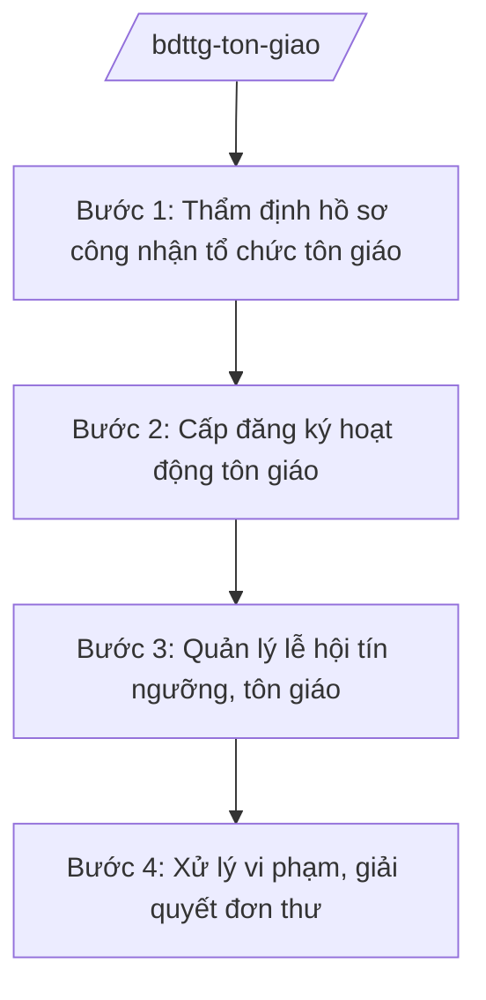

# Skill: Quản lý nhà nước về tín ngưỡng, tôn giáo

## 2. Khi nào dùng

Khi giải quyết thủ tục công nhận tổ chức tôn giáo, cấp đăng ký hoạt động tôn giáo thuộc thẩm quyền
Bộ, quản lý lễ hội tín ngưỡng, tôn giáo, xử lý vi phạm trong hoạt động tín ngưỡng, tôn giáo.
Không dùng cho quản lý tín ngưỡng, tôn giáo ở cơ sở (skill `quan-ly-ton-giao-coso`).

## 3. Đầu vào (Input)

| Trường | Mô tả | Bắt buộc |
|--------|-------|----------|
| `ho_so_cong_nhan` | Hồ sơ đề nghị công nhận tổ chức tôn giáo | Có |
| `ho_so_dang_ky` | Hồ sơ đăng ký hoạt động tôn giáo (sinh hoạt, hội nghị, lễ hội) | Không |
| `bao_cao_dia_phuong` | Báo cáo tình hình tín ngưỡng, tôn giáo của địa phương | Không |
| `don_thu` | Đơn thư khiếu nại, tố cáo liên quan tôn giáo | Không |

## 4. Quy trình

**Bước 1. Thẩm định hồ sơ công nhận tổ chức tôn giáo**

- Làm gì: Kiểm tra điều kiện công nhận (thời gian hoạt động, số lượng tín đồ, cơ cấu tổ chức, tôn chỉ); thẩm định thực tế; lấy ý kiến địa phương.
- Dùng input: `ho_so_cong_nhan`.
- Vai trò: Chuyên viên Ban Tôn giáo Chính phủ thẩm định (AI hỗ trợ đối chiếu điều kiện pháp lý theo checklist — 3 giờ); Trưởng ban Ban Tôn giáo Chính phủ (bà Vũ Thị FF) ký tờ trình.
- Lưu ý nghiệp vụ: Tôn trọng quyền tự do tín ngưỡng, tôn giáo; thẩm định khách quan, không phân biệt đối xử giữa các tôn giáo.
- → Kết quả bước: Tờ trình công nhận/không công nhận có lý do.

**Bước 2. Cấp đăng ký hoạt động tôn giáo**

- Làm gì: Xử lý đăng ký sinh hoạt tôn giáo tập trung, tổ chức hội nghị, lễ hội tôn giáo thuộc thẩm quyền Bộ; cấp văn bản chấp thuận hoặc từ chối có lý do.
- Dùng input: `ho_so_dang_ky`.
- Vai trò: Ban Tôn giáo Chính phủ xử lý (AI hỗ trợ theo dõi thời hạn giải quyết, nhắc quá hạn — 1 giờ).
- Lưu ý nghiệp vụ: Giải quyết đúng thời hạn pháp luật; từ chối phải nêu rõ lý do, căn cứ.
- → Kết quả bước: Văn bản chấp thuận/từ chối đăng ký hoạt động.

**Bước 3. Quản lý lễ hội tín ngưỡng, tôn giáo**

- Làm gì: Hướng dẫn quản lý lễ hội; kiểm tra việc tổ chức lễ hội lớn; xử lý biến tướng, thương mại hóa lễ hội.
- Dùng input: `bao_cao_dia_phuong`, kế hoạch lễ hội.
- Vai trò: Ban Tôn giáo Chính phủ phối hợp địa phương (AI hỗ trợ tổng hợp danh mục lễ hội lớn toàn quốc — 2 giờ).
- Lưu ý nghiệp vụ: Bảo tồn giá trị văn hóa truyền thống của lễ hội; ngăn chặn mê tín dị đoan, trục lợi.
- → Kết quả bước: Văn bản hướng dẫn + báo cáo kiểm tra lễ hội.

**Bước 4. Xử lý vi phạm, giải quyết đơn thư**

- Làm gì: Thanh tra, kiểm tra hoạt động tôn giáo; xử lý vi phạm (hoạt động trái phép, lợi dụng tôn giáo); giải quyết khiếu nại, tố cáo.
- Dùng input: `don_thu`, kết quả thanh kiểm tra.
- Vai trò: Ban Tôn giáo Chính phủ chủ trì, phối hợp địa phương (AI hỗ trợ phân loại đơn thư, theo dõi hạn xử lý — 2 giờ); Thứ trưởng/Bộ trưởng chỉ đạo vụ việc phức tạp.
- Lưu ý nghiệp vụ: Xử lý đúng pháp luật, thận trọng, tránh để phức tạp thành điểm nóng; không đàn áp tôn giáo hợp pháp.
- → Kết quả bước: Kết luận thanh tra / quyết định xử lý / văn bản giải quyết đơn thư.

## Luồng quy trình (Workflow)

## 5. Đầu ra (Output)

- Quyết định công nhận tổ chức tôn giáo / văn bản từ chối có lý do
- Văn bản chấp thuận đăng ký hoạt động tôn giáo
- Văn bản hướng dẫn quản lý lễ hội
- Kết luận thanh tra, quyết định xử lý vi phạm

### Cấu trúc output chuẩn (Quyết định công nhận tổ chức tôn giáo)

1. Quốc hiệu "CỘNG HÒA XÃ HỘI CHỦ NGHĨA VIỆT NAM", Tiêu ngữ "Độc lập – Tự do – Hạnh phúc"; tên Bộ; số, ký hiệu; địa danh, ngày tháng
2. Tên quyết định
3. Căn cứ pháp lý (Luật Tín ngưỡng, tôn giáo; NĐ 41/2025/NĐ-CP)
4. Xét đề nghị của Trưởng ban Ban Tôn giáo Chính phủ
5. Điều 1: Công nhận tổ chức tôn giáo (tên, tôn chỉ, phạm vi hoạt động)
6. Điều 2: Quyền, nghĩa vụ của tổ chức được công nhận
7. Điều 3: Hiệu lực, thi hành
8. Chữ ký (ghi rõ chức danh, họ tên người ký; ký hiệu "KT."/"TL." khi ký thay) Bộ trưởng, dấu (theo NĐ 30/2020/NĐ-CP)
9. Nơi nhận (kết thúc "- Lưu: VT, [mã đơn vị].").
## 6. Checklist nghiệm thu

- [ ] Thẩm định đủ điều kiện pháp lý, khách quan, không phân biệt đối xử
- [ ] Giải quyết đúng thời hạn; từ chối có lý do, căn cứ rõ ràng
- [ ] Tôn trọng quyền tự do tín ngưỡng, tôn giáo
- [ ] Xử lý vi phạm đúng pháp luật, thận trọng, không để thành điểm nóng
- [ ] Thể thức đúng NĐ 30/2020/NĐ-CP; đã qua human gate

## 7. Ví dụ mô phỏng

*Dữ liệu dưới đây là giả lập 100% phục vụ minh họa.*

**Input mẫu:**

| Trường | Giá trị |
|--------|---------|
| ho_so_cong_nhan | Hồ sơ Hội thánh AA (giả lập): hoạt động ổn định 10 năm, 5.000 tín đồ tại 8 tỉnh, có tôn chỉ, điều lệ |
| ho_so_dang_ky | Đăng ký tổ chức lễ hội tôn giáo thường niên tại tỉnh A, dự kiến 10.000 người tham dự |

**Output mẫu (trích Quyết định):**

> **BỘ DÂN TỘC VÀ TÔN GIÁO**
> Số: 1234/QĐ-BDTTG
>
> **QUYẾT ĐỊNH**
> **Công nhận tổ chức tôn giáo**
>
> **BỘ TRƯỞNG BỘ DÂN TỘC VÀ TÔN GIÁO**
>
> Căn cứ Luật Tín ngưỡng, tôn giáo;
> Căn cứ Nghị định số 41/2025/NĐ-CP ngày 26/02/2025 của Chính phủ...;
> Xét đề nghị của Trưởng ban Ban Tôn giáo Chính phủ,
>
> **QUYẾT ĐỊNH:**
>
> Điều 1. Công nhận Hội thánh AA là tổ chức tôn giáo, hoạt động theo tôn chỉ, mục đích đã đăng ký...

## 8. Human gate

- Trưởng ban Ban Tôn giáo Chính phủ (bà Vũ Thị FF): ký tờ trình công nhận, văn bản chấp thuận đăng ký
- Thứ trưởng phụ trách (bà Phạm Thị DD): chỉ đạo xử lý vụ việc phức tạp
- Bộ trưởng (ông Lê Văn CC): ký quyết định công nhận tổ chức tôn giáo

## 9. Giới hạn

- AI không tự công nhận/từ chối tổ chức tôn giáo, không cấp phép hoạt động
- Không bịa hồ sơ, số lượng tín đồ, kết quả thẩm định
- Tôn trọng quyền tự do tín ngưỡng, tôn giáo; không đề xuất biện pháp đàn áp tôn giáo hợp pháp
- Bảo mật thông tin cá nhân, tổ chức trong hồ sơ
- Không viện dẫn văn bản hết hiệu lực

## 10. Căn cứ & lưu ý

- Nghị định 41/2025/NĐ-CP ngày 26/02/2025 của Chính phủ — chức năng, nhiệm vụ, quyền hạn và cơ cấu tổ chức của Bộ Dân tộc và Tôn giáo
- Nghị quyết 176/2025/QH15 — cơ cấu tổ chức của Chính phủ
- Nghị định 303/2025/NĐ-CP — khung chung về chức năng, nhiệm vụ của bộ, cơ quan ngang bộ
- Nghị định 30/2020/NĐ-CP — công tác văn thư (thể thức văn bản)
- Lưu ý: dẫn chiếu Luật Tín ngưỡng, tôn giáo (chỉ dẫn tên luật); phân định với quản lý tín ngưỡng, tôn giáo ở cơ sở (UBND xã)
