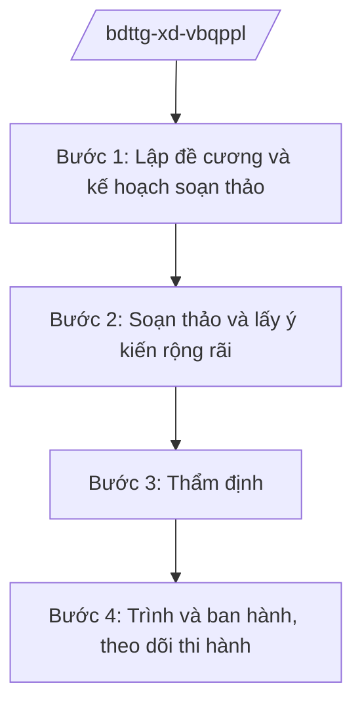

# Skill: Xây dựng VBQPPL lĩnh vực dân tộc, tôn giáo

## 2. Khi nào dùng

Khi Bộ Dân tộc và Tôn giáo được giao chủ trì soạn thảo văn bản QPPL: dự án luật/pháp lệnh, dự thảo
nghị định trình Chính phủ, dự thảo thông tư của Bộ trưởng về công tác dân tộc, tín ngưỡng, tôn giáo.

## 3. Đầu vào (Input)

| Trường | Mô tả | Bắt buộc |
|--------|-------|----------|
| `loai_van_ban` | Luật / pháp lệnh / nghị định / thông tư | Có |
| `ten_van_ban` | Tên dự thảo văn bản | Có |
| `can_cu_chu_truong` | Văn bản giao nhiệm vụ (chương trình xây dựng luật, pháp lệnh; chỉ đạo của Chính phủ) | Có |
| `don_vi_chu_tri` | Vụ/Cục chủ trì soạn thảo | Có |
| `de_cuong` | Đề cương chi tiết dự thảo | Có |
| `y_kien_phoi_hop` | Ý kiến bộ/ngành, địa phương, tổ chức tôn giáo, đồng bào DTTS | Không |

## 4. Quy trình

**Bước 1. Lập đề cương và kế hoạch soạn thảo**

- Làm gì: Đơn vị chủ trì lập đề cương chi tiết, xác định phạm vi điều chỉnh, bố cục, tiến độ soạn thảo.
- Dùng input: `loai_van_ban`, `ten_van_ban`, `can_cu_chu_truong`, `don_vi_chu_tri`.
- Vai trò: Chuyên viên đơn vị chủ trì soạn đề cương (AI hỗ trợ tra cứu văn bản liên quan về dân tộc, tôn giáo — 2 giờ); Vụ trưởng đơn vị chủ trì (ông Hoàng Văn EE) duyệt.
- Lưu ý nghiệp vụ: Bám sát chủ trương của Đảng, chính sách của Nhà nước về dân tộc, tôn giáo; tôn trọng quyền tự do tín ngưỡng, tôn giáo.
- → Kết quả bước: Đề cương chi tiết + kế hoạch soạn thảo được duyệt.

**Bước 2. Soạn thảo và lấy ý kiến rộng rãi**

- Làm gì: Soạn dự thảo; lấy ý kiến các bộ/ngành, địa phương có đông đồng bào DTTS, tổ chức tôn giáo, chuyên gia, đồng bào; đăng tải lấy ý kiến công khai.
- Dùng input: `de_cuong`, `y_kien_phoi_hop`.
- Vai trò: Tổ soạn thảo thực hiện (AI hỗ trợ tổng hợp ý kiến, lập bảng tiếp thu/giải trình — 4 giờ); Vụ trưởng ký văn bản lấy ý kiến.
- Lưu ý nghiệp vụ: Lấy ý kiến phải thực chất, đến được đồng bào vùng sâu, vùng xa; tôn trọng ý kiến của tổ chức tôn giáo.
- → Kết quả bước: Dự thảo hoàn thiện lần 2 kèm bảng tổng hợp ý kiến.

**Bước 3. Thẩm định**

- Làm gì: Đơn vị pháp chế của Bộ thẩm định dự thảo thông tư; Bộ Tư pháp thẩm định dự thảo luật, nghị định.
- Dùng input: Dự thảo lần 2, bảng tổng hợp ý kiến.
- Vai trò: Đơn vị pháp chế thẩm định (AI hỗ trợ rà soát tính thống nhất, phát hiện chồng chéo — 3 giờ); Thứ trưởng phụ trách (bà Phạm Thị DD) chỉ đạo hoàn thiện.
- Lưu ý nghiệp vụ: Bảo đảm phù hợp Hiến pháp, pháp luật về quyền con người, quyền tự do tín ngưỡng, tôn giáo.
- → Kết quả bước: Báo cáo thẩm định + dự thảo hoàn thiện.

**Bước 4. Trình và ban hành, theo dõi thi hành**

- Làm gì: Hoàn thiện hồ sơ trình; Bộ trưởng ký trình Chính phủ (luật, nghị định) hoặc ký ban hành (thông tư); gửi văn bản, theo dõi thi hành, tổng hợp vướng mắc.
- Dùng input: Toàn bộ hồ sơ các bước trước.
- Vai trò: Đơn vị chủ trì hoàn thiện hồ sơ (AI hỗ trợ kiểm tra thành phần hồ sơ — 1 giờ); Bộ trưởng (ông Lê Văn CC) ký trình/ký ban hành.
- Lưu ý nghiệp vụ: Thể thức đúng NĐ 30/2020/NĐ-CP.
- → Kết quả bước: Văn bản QPPL được ban hành + báo cáo theo dõi thi hành.

## Luồng quy trình (Workflow)

## 5. Đầu ra (Output)

- Dự thảo văn bản QPPL (đúng thể thức NĐ 30/2020/NĐ-CP)
- Tờ trình
- Bảng tổng hợp ý kiến và giải trình tiếp thu
- Báo cáo thẩm định

### Cấu trúc output chuẩn (Tờ trình dự thảo văn bản)

1. Quốc hiệu "CỘNG HÒA XÃ HỘI CHỦ NGHĨA VIỆT NAM", Tiêu ngữ "Độc lập – Tự do – Hạnh phúc"; tên Bộ; số, ký hiệu; địa danh, ngày tháng
2. Tên tờ trình
3. Kính gửi cơ quan có thẩm quyền
4. Sự cần thiết ban hành
5. Mục đích, quan điểm xây dựng
6. Quá trình xây dựng (lấy ý kiến, thẩm định)
7. Bố cục, nội dung cơ bản
8. Kiến nghị xem xét, quyết định
9. Chữ ký (ghi rõ chức danh, họ tên người ký; ký hiệu "KT."/"TL." khi ký thay) người có thẩm quyền (theo NĐ 30/2020/NĐ-CP)
10. Nơi nhận (kết thúc "- Lưu: VT, [mã đơn vị].").
## 6. Checklist nghiệm thu

- [ ] Đúng thẩm quyền ban hành, đúng trình tự, thủ tục
- [ ] Đã lấy ý kiến thực chất các đối tượng chịu tác động (đồng bào DTTS, tổ chức tôn giáo)
- [ ] Đã có báo cáo thẩm định
- [ ] Phù hợp chủ trương của Đảng, chính sách dân tộc, tôn giáo của Nhà nước
- [ ] Thể thức đúng NĐ 30/2020/NĐ-CP
- [ ] Không bịa căn cứ pháp lý; không viện dẫn văn bản hết hiệu lực
- [ ] Đã qua human gate

## 7. Ví dụ mô phỏng

*Dữ liệu dưới đây là giả lập 100% phục vụ minh họa.*

**Input mẫu:**

| Trường | Giá trị |
|--------|---------|
| loai_van_ban | Thông tư |
| ten_van_ban | Thông tư hướng dẫn thực hiện chính sách hỗ trợ đất ở cho đồng bào DTTS |
| can_cu_chu_truong | Chương trình xây dựng văn bản QPPL năm 2026 của Bộ Dân tộc và Tôn giáo |
| don_vi_chu_tri | Vụ Chính sách dân tộc |
| y_kien_phoi_hop | Ý kiến 15 tỉnh vùng DTTS, Ủy ban Dân tộc các tỉnh |

**Output mẫu (trích Tờ trình):**

> **BỘ DÂN TỘC VÀ TÔN GIÁO**
> Số: 1234/TTr-BDTTG
>
> **TỜ TRÌNH**
> **Về việc ban hành Thông tư hướng dẫn thực hiện chính sách hỗ trợ đất ở**
> **cho đồng bào dân tộc thiểu số**
>
> Kính gửi: Bộ trưởng Bộ Dân tộc và Tôn giáo
>
> 1. Sự cần thiết: nhiều hộ đồng bào DTTS còn thiếu đất ở...
> 2. Quá trình xây dựng: lấy ý kiến 15 tỉnh, đăng Cổng TTĐT 60 ngày...
> 3. Kiến nghị Bộ trưởng xem xét, ký ban hành.

## 8. Human gate

- Vụ trưởng đơn vị chủ trì (ông Hoàng Văn EE): duyệt đề cương, ký văn bản lấy ý kiến
- Thủ trưởng đơn vị pháp chế của Bộ: ký báo cáo thẩm định (thông tư)
- Thứ trưởng phụ trách (bà Phạm Thị DD): chỉ đạo hoàn thiện dự thảo
- Bộ trưởng (ông Lê Văn CC): ký trình Chính phủ / ký ban hành thông tư

## 9. Giới hạn

- AI không thay cơ quan thẩm định; không tự ký trình, ký ban hành
- Không bịa số hiệu văn bản, ý kiến góp ý
- Tôn trọng quyền tự do tín ngưỡng, tôn giáo; không soạn nội dung phân biệt đối xử
- Không viện dẫn văn bản hết hiệu lực

## 10. Căn cứ & lưu ý

- Nghị định 41/2025/NĐ-CP ngày 26/02/2025 của Chính phủ — chức năng, nhiệm vụ, quyền hạn và cơ cấu tổ chức của Bộ Dân tộc và Tôn giáo
- Nghị quyết 176/2025/QH15 — cơ cấu tổ chức của Chính phủ
- Nghị định 303/2025/NĐ-CP — khung chung về chức năng, nhiệm vụ của bộ, cơ quan ngang bộ
- Nghị định 30/2020/NĐ-CP — công tác văn thư (thể thức văn bản)
- Lưu ý: thẩm định dự thảo luật, nghị định do Bộ Tư pháp thực hiện theo quy định
