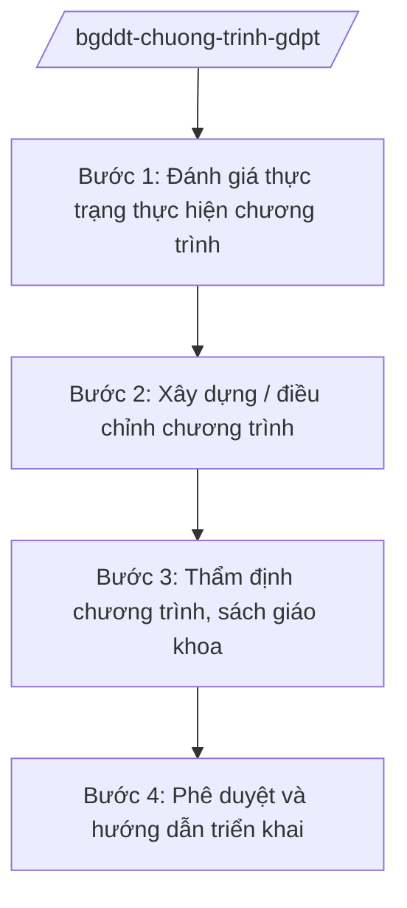

# Skill: Chương trình GDPT, sách giáo khoa

## 2. Khi nào dùng

Khi Vụ Giáo dục Tiểu học / Vụ Giáo dục Trung học — Bộ GD&ĐT thực hiện: xây dựng, điều chỉnh
chương trình giáo dục phổ thông (GDPT); tổ chức thẩm định, phê duyệt sách giáo khoa;
hướng dẫn địa phương, nhà trường triển khai chương trình, lựa chọn sách giáo khoa.

## 3. Đầu vào (Input)

| Trường | Mô tả | Bắt buộc |
|--------|-------|----------|
| `noi_dung` | Xây dựng/điều chỉnh chương trình hoặc thẩm định SGK | Có |
| `cap_hoc` | Tiểu học / THCS / THPT | Có |
| `mon_hoc` | Môn học cụ thể (nếu điều chỉnh theo môn) | Không |
| `ban_thao_ct` | Bản thảo chương trình cần thẩm định | Không |
| `ban_thao_sgk` | Bản mẫu sách giáo khoa cần thẩm định | Không |

## 4. Quy trình

**Bước 1. Đánh giá thực trạng thực hiện chương trình**
- Làm gì: Tổng hợp kết quả thực hiện chương trình GDPT tại các địa phương: kết quả học tập, khó khăn của giáo viên, ý kiến nhà trường.
- Dùng input: `cap_hoc`, `mon_hoc`.
- Vai trò: Chuyên viên Vụ — AI hỗ trợ tổng hợp báo cáo địa phương thành bảng phân tích (2 giờ).
- Lưu ý nghiệp vụ: Số liệu phải đại diện các vùng miền; lắng nghe ý kiến giáo viên trực tiếp giảng dạy.
- → Kết quả bước: Báo cáo đánh giá thực trạng.

**Bước 2. Xây dựng / điều chỉnh chương trình**
- Làm gì: Soạn thảo nội dung điều chỉnh: mục tiêu, yêu cầu cần đạt, nội dung, phương pháp, đánh giá theo từng môn, lớp.
- Dùng input: `noi_dung`, `ban_thao_ct`.
- Vai trò: Ban phát triển chương trình (chuyên gia, nhà khoa học) — AI hỗ trợ soạn khung chương trình, rà soát tính liên thông giữa các cấp học (3–4 giờ).
- Lưu ý nghiệp vụ: Bảo đảm tính vừa sức, liên thông tiểu học–THCS–THPT; không quá tải cho học sinh.
- → Kết quả bước: Dự thảo chương trình điều chỉnh.

**Bước 3. Thẩm định chương trình, sách giáo khoa**
- Làm gì: Tổ chức hội đồng quốc gia thẩm định chương trình; hội đồng thẩm định SGK theo từng môn, lớp; bỏ phiếu kín.
- Dùng input: `ban_thao_ct`, `ban_thao_sgk`.
- Vai trò: Hội đồng thẩm định quốc gia — AI hỗ trợ tổng hợp phiếu đánh giá, lập biên bản (1–2 giờ).
- Lưu ý nghiệp vụ: Thành viên hội đồng độc lập, không liên quan đến tác giả SGK; kết quả bỏ phiếu được ghi nhận trung thực.
- → Kết quả bước: Biên bản thẩm định (đạt / cần chỉnh sửa).

**Bước 4. Phê duyệt và hướng dẫn triển khai**
- Làm gì: Trình Bộ trưởng phê duyệt chương trình/SGK; ban hành văn bản hướng dẫn địa phương lựa chọn SGK, tập huấn giáo viên.
- Dùng input: Kết quả thẩm định.
- Vai trò: Vụ trưởng → Thứ trưởng → Bộ trưởng phê duyệt — AI hỗ trợ soạn quyết định phê duyệt, văn bản hướng dẫn (1 giờ).
- Lưu ý nghiệp vụ: Công khai danh mục SGK được phê duyệt; hướng dẫn rõ quy trình lựa chọn SGK tại địa phương.
- → Kết quả bước: Quyết định phê duyệt + văn bản hướng dẫn triển khai.

## Luồng quy trình (Workflow)

## 5. Đầu ra (Output)

- Quyết định phê duyệt chương trình GDPT / sách giáo khoa.
- Văn bản hướng dẫn địa phương triển khai, lựa chọn SGK.
- Báo cáo đánh giá thực trạng.

### Cấu trúc output chuẩn (thể thức NĐ 30/2020/NĐ-CP)

**Quyết định phê duyệt SGK** gồm: (1) Quốc hiệu "CỘNG HÒA XÃ HỘI CHỦ NGHĨA VIỆT NAM", Tiêu ngữ "Độc lập – Tự do – Hạnh phúc" (BỘ GD&ĐT); (2) căn cứ;
(3) điều khoản phê duyệt: tên SGK, tác giả, nhà xuất bản, lớp, môn;
(4) trách nhiệm tổ chức thực hiện; (5) hiệu lực; (6) chữ ký (ghi rõ chức danh, họ tên người ký; ký hiệu "KT; (7) nơi nhận (kết thúc "- Lưu: VT, [mã đơn vị].")."/"TL." khi ký thay) Bộ trưởng.

**Văn bản hướng dẫn** gồm: (1) mục đích, yêu cầu; (2) nội dung hướng dẫn theo từng khâu
(lựa chọn, tập huấn, kiểm tra); (3) trách nhiệm của Sở GD&ĐT, nhà trường; (4) báo cáo.
## 6. Checklist nghiệm thu

- [ ] Đánh giá thực trạng có số liệu đại diện các vùng miền
- [ ] Chương trình bảo đảm liên thông, vừa sức học sinh
- [ ] Hội đồng thẩm định độc lập, bỏ phiếu kín
- [ ] Danh mục SGK phê duyệt được công khai
- [ ] Văn bản hướng dẫn rõ trách nhiệm địa phương, nhà trường
- [ ] Thể thức đúng NĐ 30/2020/NĐ-CP
- [ ] Không bịa số liệu, tên SGK, tác giả

## 7. Ví dụ mô phỏng

*Dữ liệu dưới đây là giả lập 100% phục vụ minh họa.*

**Input mẫu:** noi_dung = "Thẩm định sách giáo khoa môn Toán lớp 6"; cap_hoc = "THCS";
ban_thao_sgk = "Bản mẫu SGK Toán 6 của Nhà xuất bản Giáo dục AA (tên giả lập)".

**Output mẫu (trích quyết định):**

> **BỘ GIÁO DỤC VÀ ĐÀO TẠO**
>
> **QUYẾT ĐỊNH**
> **Về việc phê duyệt sách giáo khoa môn Toán lớp 6 sử dụng trong cơ sở giáo dục phổ thông**
>
> **BỘ TRƯỞNG BỘ GIÁO DỤC VÀ ĐÀO TẠO**
>
> Điều 1. Phê duyệt sách giáo khoa môn Toán lớp 6 của Nhà xuất bản Giáo dục AA
> (tổng chủ biên: ông Nguyễn Văn AA — tên giả lập) được sử dụng trong cơ sở giáo dục
> phổ thông từ năm học 2026–2027.
> Điều 2. Các Sở Giáo dục và Đào tạo tổ chức cho cơ sở giáo dục lựa chọn sách giáo khoa
> theo quy định...
> Điều 3. Quyết định có hiệu lực kể từ ngày ký...

## 8. Human gate

- Vụ trưởng Vụ Giáo dục Tiểu học/Trung học duyệt báo cáo và dự thảo.
- Hội đồng quốc gia thẩm định độc lập, bỏ phiếu kín.
- Thứ trưởng phụ trách cho ý kiến; Bộ trưởng ký quyết định phê duyệt.

## 9. Giới hạn

- AI không đánh giá chất lượng SGK thay hội đồng thẩm định; không tự ký phê duyệt.
- AI không bịa tên SGK, tác giả, kết quả thẩm định.
- AI không viện dẫn văn bản hết hiệu lực.

## 10. Căn cứ & lưu ý

- Nghị quyết 176/2025/QH15 của Quốc hội — cơ cấu tổ chức của Chính phủ.
- Nghị định 37/2025/NĐ-CP ngày 26/02/2025 — chức năng, nhiệm vụ, quyền hạn của Bộ GD&ĐT (quản lý chương trình GDPT, SGK).
- Nghị định 142/2025/NĐ-CP, Nghị định 143/2025/NĐ-CP ngày 12/6/2025 — phân định thẩm quyền, phân quyền, phân cấp lĩnh vực Bộ GD&ĐT.
- Nghị định 30/2020/NĐ-CP — thể thức văn bản hành chính.
- Lưu ý: tên Luật Giáo dục chỉ nêu tên, không ghi số hiệu.
