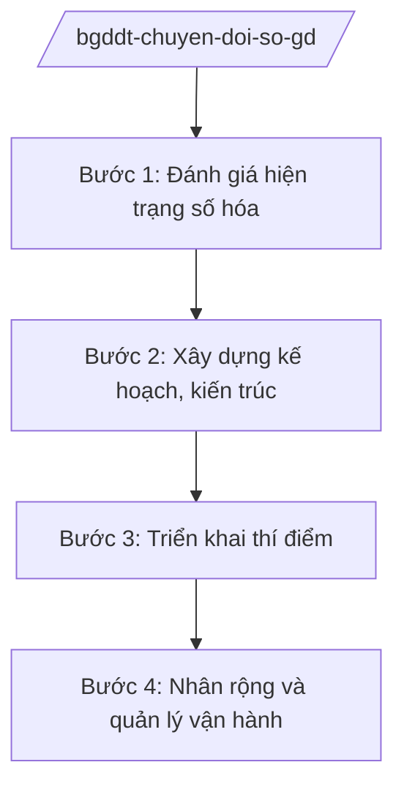

# Skill: Chuyển đổi số giáo dục

## 2. Khi nào dùng

Khi Cục Chuyển đổi số / đơn vị phụ trách CNTT — Bộ GD&ĐT thực hiện: xây dựng cơ sở dữ liệu
ngành giáo dục; phát triển học liệu số, kho học liệu mở; quản lý dạy học trực tuyến;
triển khai hồ sơ số, chữ ký số trong ngành; hướng dẫn địa phương chuyển đổi số giáo dục.

## 3. Đầu vào (Input)

| Trường | Mô tả | Bắt buộc |
|--------|-------|----------|
| `noi_dung` | CSDL ngành / học liệu số / dạy học trực tuyến / hồ sơ số | Có |
| `muc_tieu` | Mục tiêu cụ thể (tỷ lệ trường học số hóa, kho học liệu...) | Có |
| `hien_trang` | Hiện trạng hạ tầng, nhân lực CNTT ngành giáo dục | Có |
| `don_vi_phoi_hop` | Bộ, ngành, địa phương, doanh nghiệp công nghệ phối hợp | Không |

## 4. Quy trình

**Bước 1. Đánh giá hiện trạng số hóa**
- Làm gì: Khảo sát hạ tầng CNTT, hệ thống quản lý trường học, tỷ lệ giáo viên ứng dụng CNTT tại các địa phương.
- Dùng input: `hien_trang`.
- Vai trò: Chuyên viên đơn vị CNTT — AI hỗ trợ thiết kế phiếu khảo sát, tổng hợp kết quả (⏱ 2 giờ).
- Lưu ý nghiệp vụ: Đánh giá trung thực, phân biệt rõ vùng có điều kiện và vùng khó khăn để có giải pháp phù hợp.
- → Kết quả bước: Báo cáo hiện trạng chuyển đổi số giáo dục.

**Bước 2. Xây dựng kế hoạch, kiến trúc**
- Làm gì: Lập kế hoạch chuyển đổi số ngành: CSDL dùng chung, kho học liệu số, nền tảng dạy học trực tuyến; thiết kế kiến trúc hệ thống.
- Dùng input: `noi_dung`, `muc_tieu`, `don_vi_phoi_hop`.
- Vai trò: Đơn vị CNTT chủ trì — AI hỗ trợ soạn kế hoạch, vẽ sơ đồ kiến trúc (⏱ 2–3 giờ).
- Lưu ý nghiệp vụ: Kiến trúc phải bảo đảm liên thông với CSDL quốc gia, an toàn thông tin, bảo vệ dữ liệu cá nhân của học sinh.
- → Kết quả bước: Kế hoạch chuyển đổi số giáo dục + thiết kế kiến trúc.

**Bước 3. Triển khai thí điểm**
- Làm gì: Chọn địa phương, trường thí điểm; tập huấn giáo viên; vận hành thử hệ thống; đánh giá, điều chỉnh.
- Dùng input: Kế hoạch.
- Vai trò: Đơn vị CNTT + Sở GD&ĐT thí điểm — AI hỗ trợ soạn tài liệu tập huấn, bảng đánh giá thí điểm (⏱ 1–2 giờ).
- Lưu ý nghiệp vụ: Thí điểm phải bao gồm cả vùng khó khăn để kiểm chứng tính khả thi.
- → Kết quả bước: Báo cáo đánh giá thí điểm.

**Bước 4. Nhân rộng và quản lý vận hành**
- Làm gì: Ban hành văn bản hướng dẫn nhân rộng; quản lý vận hành hệ thống; giám sát an toàn thông tin; sơ kết, tổng kết.
- Dùng input: Kết quả thí điểm.
- Vai trò: Đơn vị CNTT — AI hỗ trợ soạn văn bản hướng dẫn, dashboard theo dõi chỉ tiêu (⏱ 1 giờ).
- Lưu ý nghiệp vụ: Có phương án dự phòng, sao lưu dữ liệu; xử lý sự cố an toàn thông tin kịp thời.
- → Kết quả bước: Hệ thống vận hành toàn quốc; báo cáo sơ kết, tổng kết.

## Luồng quy trình (Workflow)

## 5. Đầu ra (Output)

- Kế hoạch chuyển đổi số ngành giáo dục.
- Văn bản hướng dẫn địa phương triển khai.
- Báo cáo đánh giá thí điểm, sơ kết, tổng kết.

### Cấu trúc output chuẩn

**Khung thể thức chung (NĐ 30/2020/NĐ-CP):** mọi văn bản trong output đều trình bày đầy đủ: Quốc hiệu "CỘNG HÒA XÃ HỘI CHỦ NGHĨA VIỆT NAM", Tiêu ngữ "Độc lập – Tự do – Hạnh phúc"; tên cơ quan ban hành; số, ký hiệu văn bản; địa danh, ngày tháng năm ban hành; tên loại văn bản; nội dung theo các mục dưới đây; nơi nhận (kết thúc "- Lưu: VT, [mã đơn vị]."); khối chữ ký (chức danh, họ tên người ký; ký hiệu "KT."/"TL." khi ký thay).

**Kế hoạch chuyển đổi số** gồm: (1) Quyết định phê duyệt (thể thức NĐ 30/2020);
(2) mục tiêu (tỷ lệ số hóa, kho học liệu, nền tảng); (3) nhiệm vụ theo nhóm
(CSDL, học liệu số, dạy học trực tuyến, hồ sơ số, an toàn thông tin);
(4) lộ trình; (5) nguồn lực; (6) tổ chức thực hiện.

*Thể thức văn bản tuân thủ NĐ 30/2020/NĐ-CP.*

*Thể thức văn bản tuân thủ NĐ 30/2020/NĐ-CP.*

> **Checklist thể thức văn bản theo NĐ 30/2020/NĐ-CP** — đối chiếu trước khi trình ký:
> 1. Quốc hiệu và Tiêu ngữ.
> 2. Tên cơ quan, tổ chức ban hành văn bản.
> 3. Số, ký hiệu của văn bản.
> 4. Địa danh và thời gian ban hành văn bản.
> 5. Tên loại và trích yếu nội dung văn bản.
> 6. Nội dung văn bản.
> 7. Chức vụ, họ tên và chữ ký của người có thẩm quyền.
> 8. Dấu, chữ ký số của cơ quan, tổ chức.
> 9. Nơi nhận (kèm Phụ lục nếu có).

## 6. Checklist nghiệm thu

- [ ] Đánh giá hiện trạng trung thực, bao gồm vùng khó khăn
- [ ] Kiến trúc liên thông CSDL quốc gia, bảo đảm an toàn thông tin
- [ ] Bảo vệ dữ liệu cá nhân của học sinh, giáo viên
- [ ] Thí điểm có đánh giá trước khi nhân rộng
- [ ] Thể thức đúng NĐ 30/2020/NĐ-CP
- [ ] Không bịa số liệu hạ tầng, tỷ lệ số hóa

## 7. Ví dụ mô phỏng

*Dữ liệu dưới đây là giả lập 100% phục vụ minh họa.*

**Input mẫu:** noi_dung = "Xây dựng kho học liệu số dùng chung toàn quốc";
muc_tieu = "100.000 bài giảng số, 5.000 sách điện tử (số liệu giả lập)".

**Output mẫu (trích kế hoạch):**

> **KẾ HOẠCH**
> **Chuyển đổi số ngành giáo dục giai đoạn 2026–2030**
> *(Dự thảo)*
>
> **I. MỤC TIÊU:** Đến năm 2030, hoàn thành cơ sở dữ liệu ngành giáo dục; kho học liệu số
> dùng chung đạt 100.000 bài giảng, 5.000 sách điện tử (số liệu giả lập); 100% cơ sở giáo dục
> sử dụng hồ sơ số...
> **II. NHIỆM VỤ:**
> 1. Xây dựng, hoàn thiện cơ sở dữ liệu ngành, kết nối CSDL quốc gia...
> 2. Phát triển kho học liệu số mở, ưu tiên vùng khó khăn...
> 3. Triển khai nền tảng dạy học trực tuyến thống nhất...
> 4. Bảo đảm an toàn thông tin, bảo vệ dữ liệu cá nhân...
> **III. TỔ CHỨC THỰC HIỆN:** Đơn vị CNTT — Bộ GD&ĐT chủ trì, phối hợp Sở GD&ĐT các tỉnh...
>
> *Thủ trưởng đơn vị CNTT: ông Hoàng Văn EE (tên giả lập).*

## 8. Human gate

- Thủ trưởng đơn vị CNTT duyệt báo cáo hiện trạng, kế hoạch.
- Thứ trưởng phụ trách cho ý kiến; Bộ trưởng phê duyệt kế hoạch chuyển đổi số ngành.

## 9. Giới hạn

- AI không quyết định kiến trúc hệ thống, lựa chọn nhà thầu thay người có thẩm quyền; không tự ký.
- AI không bịa số liệu hạ tầng, tỷ lệ số hóa.
- AI không viện dẫn văn bản hết hiệu lực; tuân thủ quy định bảo vệ dữ liệu cá nhân.

## 10. Căn cứ & lưu ý

- Nghị quyết 176/2025/QH15 của Quốc hội — cơ cấu tổ chức của Chính phủ.
- Nghị định 37/2025/NĐ-CP ngày 26/02/2025 — chức năng, nhiệm vụ, quyền hạn của Bộ GD&ĐT.
- Nghị định 142/2025/NĐ-CP, Nghị định 143/2025/NĐ-CP ngày 12/6/2025 — phân định thẩm quyền, phân quyền, phân cấp lĩnh vực Bộ GD&ĐT.
- Nghị định 30/2020/NĐ-CP — thể thức văn bản hành chính.
