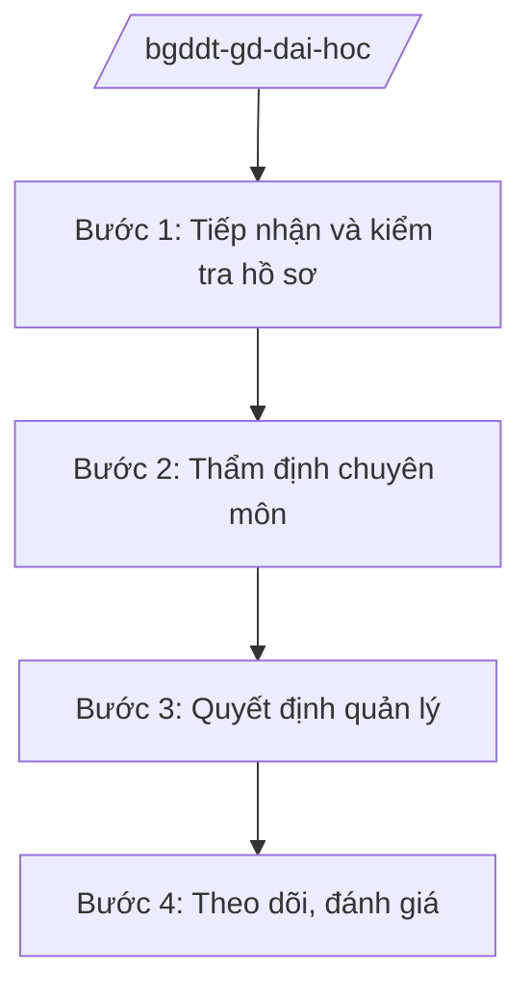

# Skill: Giáo dục đại học (tự chủ, kiểm định)

## 2. Khi nào dùng

Khi Vụ Giáo dục Đại học — Bộ GD&ĐT thực hiện: quản lý, hướng dẫn thực hiện tự chủ đại học;
kiểm định chất lượng cơ sở giáo dục đại học; cho phép mở ngành, đình chỉ tuyển sinh;
quản lý đào tạo trình độ thạc sĩ, tiến sĩ; hướng dẫn địa phương về phát triển đại học.

## 3. Đầu vào (Input)

| Trường | Mô tả | Bắt buộc |
|--------|-------|----------|
| `noi_dung` | Tự chủ / kiểm định / mở ngành / chính sách đào tạo | Có |
| `co_so_gd` | Tên cơ sở giáo dục đại học liên quan | Có |
| `ho_so` | Đề án tự chủ / hồ sơ kiểm định / hồ sơ mở ngành | Có |
| `nganh_dao_tao` | Ngành đào tạo đề nghị mở (nếu có) | Không |

## 4. Quy trình

**Bước 1. Tiếp nhận và kiểm tra hồ sơ**
- Làm gì: Kiểm tra hồ sơ đề án tự chủ, hồ sơ kiểm định, hồ sơ mở ngành: điều kiện đội ngũ, cơ sở vật chất, chương trình đào tạo.
- Dùng input: `noi_dung`, `co_so_gd`, `ho_so`, `nganh_dao_tao`.
- Vai trò: Chuyên viên Vụ Giáo dục Đại học — AI hỗ trợ lập bảng kiểm điều kiện theo quy định (1–2 giờ).
- Lưu ý nghiệp vụ: Điều kiện mở ngành về đội ngũ giảng viên cơ hữu phải được kiểm tra thực chất, không hình thức.
- → Kết quả bước: Hồ sơ đạt / yêu cầu bổ sung.

**Bước 2. Thẩm định chuyên môn**
- Làm gì: Tổ chức hội đồng thẩm định đề án tự chủ, chương trình đào tạo ngành mới; hoặc tổ chức đánh giá ngoài kiểm định chất lượng.
- Dùng input: `ho_so`.
- Vai trò: Hội đồng thẩm định / tổ chức kiểm định — AI hỗ trợ tổng hợp ý kiến, lập biên bản (2 giờ).
- Lưu ý nghiệp vụ: Thành viên hội đồng độc lập với cơ sở được thẩm định; tiêu chí kiểm định công khai.
- → Kết quả bước: Biên bản thẩm định / kết quả kiểm định.

**Bước 3. Quyết định quản lý**
- Làm gì: Soạn quyết định: công nhận đạt kiểm định / cho phép mở ngành / phê duyệt đề án tự chủ; hoặc quyết định đình chỉ tuyển sinh khi không đạt điều kiện.
- Dùng input: Kết quả thẩm định.
- Vai trò: Vụ trưởng Vụ Giáo dục Đại học — AI hỗ trợ soạn quyết định đúng mẫu (1 giờ).
- Lưu ý nghiệp vụ: Quyết định đình chỉ tuyển sinh phải nêu rõ căn cứ, thời hạn khắc phục, quyền khiếu nại.
- → Kết quả bước: Quyết định quản lý được ban hành.

**Bước 4. Theo dõi, đánh giá**
- Làm gì: Giám sát việc thực hiện tự chủ, duy trì điều kiện bảo đảm chất lượng; tổng hợp báo cáo toàn quốc.
- Dùng input: Báo cáo của cơ sở giáo dục đại học.
- Vai trò: Vụ Giáo dục Đại học — AI hỗ trợ tổng hợp báo cáo (1 giờ).
- Lưu ý nghiệp vụ: Hậu kiểm định kỳ, xử lý nghiêm cơ sở không duy trì điều kiện.
- → Kết quả bước: Báo cáo giám sát; văn bản chấn chỉnh (nếu có).

## Luồng quy trình (Workflow)

## 5. Đầu ra (Output)

- Quyết định công nhận đạt kiểm định chất lượng / cho phép mở ngành / phê duyệt đề án tự chủ.
- Quyết định đình chỉ tuyển sinh (nếu vi phạm điều kiện).
- Báo cáo giám sát giáo dục đại học.

### Cấu trúc output chuẩn (thể thức NĐ 30/2020/NĐ-CP)

**Quyết định quản lý** gồm: (1) Quốc hiệu "CỘNG HÒA XÃ HỘI CHỦ NGHĨA VIỆT NAM", Tiêu ngữ "Độc lập – Tự do – Hạnh phúc" (BỘ GD&ĐT); (2) căn cứ;
(3) nội dung quyết định (cho phép / công nhận / đình chỉ, ghi rõ đối tượng, ngành, thời hạn);
(4) trách nhiệm thực hiện; (5) hiệu lực; (6) chữ ký (ghi rõ chức danh, họ tên người ký; ký hiệu "KT; (7) nơi nhận (kết thúc "- Lưu: VT, [mã đơn vị].")."/"TL." khi ký thay) người có thẩm quyền.

> **Checklist thể thức văn bản theo NĐ 30/2020/NĐ-CP** — đối chiếu trước khi trình ký:
> 1. Quốc hiệu và Tiêu ngữ.
> 2. Tên cơ quan, tổ chức ban hành văn bản.
> 3. Số, ký hiệu của văn bản.
> 4. Địa danh và thời gian ban hành văn bản.
> 5. Tên loại và trích yếu nội dung văn bản.
> 6. Nội dung văn bản.
> 7. Chức vụ, họ tên và chữ ký của người có thẩm quyền.
> 8. Dấu, chữ ký số của cơ quan, tổ chức.
> 9. Nơi nhận (kèm Phụ lục nếu có).

## 6. Checklist nghiệm thu

- [ ] Hồ sơ được kiểm tra thực chất điều kiện đội ngũ, cơ sở vật chất
- [ ] Hội đồng thẩm định độc lập, có biên bản
- [ ] Quyết định ghi rõ căn cứ, đối tượng, thời hạn
- [ ] Bảo đảm quyền khiếu nại của cơ sở
- [ ] Thể thức đúng NĐ 30/2020/NĐ-CP
- [ ] Không bịa thông tin cơ sở đào tạo, kết quả kiểm định

## 7. Ví dụ mô phỏng

*Dữ liệu dưới đây là giả lập 100% phục vụ minh họa.*

**Input mẫu:** noi_dung = "Cho phép mở ngành đào tạo"; co_so_gd = "Trường Đại học AA (giả lập)";
nganh_dao_tao = "Trí tuệ nhân tạo, trình độ đại học".

**Output mẫu (trích quyết định):**

> **BỘ GIÁO DỤC VÀ ĐÀO TẠO**
>
> **QUYẾT ĐỊNH**
> **Về việc cho phép Trường Đại học AA mở ngành đào tạo trình độ đại học**
>
> **BỘ TRƯỞNG BỘ GIÁO DỤC VÀ ĐÀO TẠO**
>
> Điều 1. Cho phép Trường Đại học AA mở ngành đào tạo Trí tuệ nhân tạo trình độ đại học,
> mã ngành 7480107 (mã giả lập), chỉ tiêu tuyển sinh năm đầu 100 sinh viên.
> Điều 2. Trường Đại học AA chịu trách nhiệm bảo đảm các điều kiện về đội ngũ giảng viên,
> cơ sở vật chất, chương trình đào tạo theo hồ sơ đã thẩm định...
> Điều 3. Quyết định có hiệu lực kể từ ngày ký...

## 8. Human gate

- Vụ trưởng Vụ Giáo dục Đại học duyệt hồ sơ, trình Lãnh đạo Bộ.
- Hội đồng thẩm định độc lập về chuyên môn.
- Thứ trưởng phụ trách cho ý kiến; Bộ trưởng ký quyết định.

## 9. Giới hạn

- AI không đánh giá chất lượng đào tạo thay hội đồng; không tự ký quyết định.
- AI không bịa thông tin cơ sở đào tạo, kết quả kiểm định, chỉ tiêu tuyển sinh.
- AI không viện dẫn văn bản hết hiệu lực.

## 10. Căn cứ & lưu ý

- Nghị quyết 176/2025/QH15 của Quốc hội — cơ cấu tổ chức của Chính phủ.
- Nghị định 37/2025/NĐ-CP ngày 26/02/2025 — chức năng, nhiệm vụ, quyền hạn của Bộ GD&ĐT (quản lý nhà nước về giáo dục đại học).
- Nghị định 142/2025/NĐ-CP, Nghị định 143/2025/NĐ-CP ngày 12/6/2025 — phân định thẩm quyền, phân quyền, phân cấp lĩnh vực Bộ GD&ĐT.
- Nghị định 30/2020/NĐ-CP — thể thức văn bản hành chính.
- Lưu ý: tên Luật Giáo dục đại học chỉ nêu tên, không ghi số hiệu.
