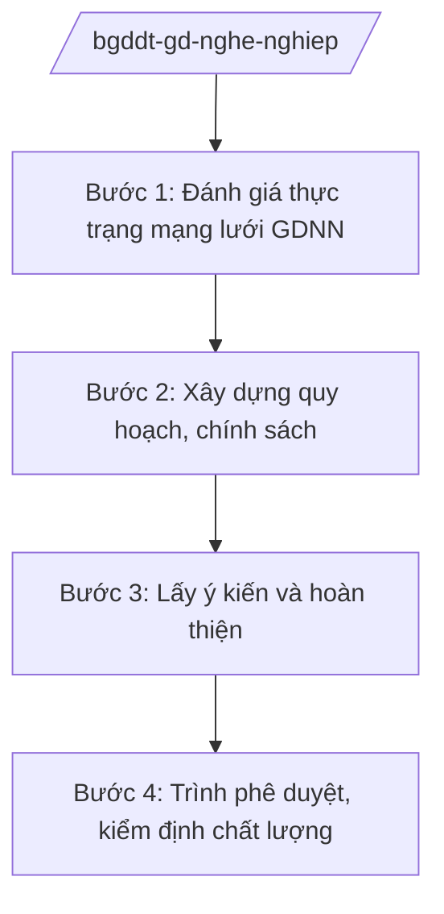

# Skill: Giáo dục nghề nghiệp

## 2. Khi nào dùng

Khi Cục Giáo dục nghề nghiệp — Bộ GD&ĐT thực hiện: quy hoạch mạng lưới cơ sở giáo dục nghề
nghiệp; xây dựng chính sách đào tạo nghề, phát triển kỹ năng nghề; quản lý chất lượng đào tạo
nghề; gắn kết đào tạo nghề với doanh nghiệp, thị trường lao động.

> Lưu ý tổ chức: từ năm 2025, lĩnh vực giáo dục nghề nghiệp chuyển về Bộ GD&ĐT quản lý
> (theo Nghị định 37/2025/NĐ-CP).

## 3. Đầu vào (Input)

| Trường | Mô tả | Bắt buộc |
|--------|-------|----------|
| `noi_dung` | Quy hoạch mạng lưới / chính sách / kiểm định chất lượng GDNN | Có |
| `co_so_gdnn` | Cơ sở giáo dục nghề nghiệp liên quan (nếu có) | Không |
| `so_lieu_hien_trang` | Số liệu mạng lưới, tuyển sinh, việc làm sau đào tạo | Có |
| `nhu_cau_nhan_luc` | Dự báo nhu cầu nhân lực theo ngành, vùng | Không |

## 4. Quy trình

**Bước 1. Đánh giá thực trạng mạng lưới GDNN**
- Làm gì: Tổng hợp số liệu trường cao đẳng, trung cấp, trung tâm GDNN: quy mô tuyển sinh, tỷ lệ có việc làm, ngành nghề đào tạo.
- Dùng input: `so_lieu_hien_trang`, `nhu_cau_nhan_luc`.
- Vai trò: Chuyên viên Cục Giáo dục nghề nghiệp — AI hỗ trợ tổng hợp số liệu, phân tích cung–cầu nhân lực (⏱ 2 giờ).
- Lưu ý nghiệp vụ: Đối chiếu ngành đào tạo với nhu cầu thị trường lao động, tránh đào tạo tràn lan ngành thừa nhân lực.
- → Kết quả bước: Báo cáo thực trạng mạng lưới GDNN.

**Bước 2. Xây dựng quy hoạch, chính sách**
- Làm gì: Lập quy hoạch mạng lưới cơ sở GDNN; xây dựng chính sách: hỗ trợ học nghề, đào tạo theo đặt hàng doanh nghiệp, kỹ năng nghề quốc gia.
- Dùng input: `noi_dung`, báo cáo thực trạng.
- Vai trò: Cục Giáo dục nghề nghiệp chủ trì — AI hỗ trợ soạn dự thảo quy hoạch, chính sách (⏱ 2–3 giờ).
- Lưu ý nghiệp vụ: Quy hoạch phải gắn với quy hoạch phát triển kinh tế–xã hội, quy hoạch vùng.
- → Kết quả bước: Dự thảo quy hoạch/chính sách GDNN.

**Bước 3. Lấy ý kiến và hoàn thiện**
- Làm gì: Lấy ý kiến bộ, ngành, địa phương, doanh nghiệp, cơ sở GDNN; tổng hợp tiếp thu.
- Dùng input: Dự thảo.
- Vai trò: Cục Giáo dục nghề nghiệp — AI hỗ trợ tổng hợp ý kiến (⏱ 1 giờ).
- Lưu ý nghiệp vụ: Đặc biệt lấy ý kiến doanh nghiệp sử dụng lao động qua nghề.
- → Kết quả bước: Dự thảo hoàn chỉnh.

**Bước 4. Trình phê duyệt, kiểm định chất lượng**
- Làm gì: Trình cấp có thẩm quyền phê duyệt quy hoạch/chính sách; tổ chức kiểm định chất lượng cơ sở GDNN; công nhận, xếp hạng.
- Dùng input: Toàn bộ hồ sơ.
- Vai trò: Cục trưởng → Thứ trưởng → Bộ trưởng — AI hỗ trợ soạn tờ trình, quyết định (⏱ 1 giờ).
- Lưu ý nghiệp vụ: Kiểm định phải thực chất; công khai kết quả để người học, doanh nghiệp biết.
- → Kết quả bước: Quy hoạch/chính sách được phê duyệt; kết quả kiểm định.

## Luồng quy trình (Workflow)

## 5. Đầu ra (Output)

- Quy hoạch mạng lưới cơ sở giáo dục nghề nghiệp (dự thảo trình phê duyệt).
- Chính sách đào tạo nghề, phát triển kỹ năng nghề.
- Kết quả kiểm định chất lượng cơ sở GDNN.

### Cấu trúc output chuẩn

**Khung thể thức chung (NĐ 30/2020/NĐ-CP):** mọi văn bản trong output đều trình bày đầy đủ: Quốc hiệu "CỘNG HÒA XÃ HỘI CHỦ NGHĨA VIỆT NAM", Tiêu ngữ "Độc lập – Tự do – Hạnh phúc"; tên cơ quan ban hành; số, ký hiệu văn bản; địa danh, ngày tháng năm ban hành; tên loại văn bản; nội dung theo các mục dưới đây; nơi nhận (kết thúc "- Lưu: VT, [mã đơn vị]."); khối chữ ký (chức danh, họ tên người ký; ký hiệu "KT."/"TL." khi ký thay).

**Quy hoạch mạng lưới** gồm: (1) Quyết định phê duyệt (thể thức NĐ 30/2020); (2) quan điểm, mục tiêu;
(3) phương án sắp xếp mạng lưới theo vùng, ngành; (4) lộ trình; (5) nguồn lực; (6) tổ chức thực hiện.

**Chính sách đào tạo nghề** gồm: (1) tên chính sách; (2) đối tượng, điều kiện hưởng;
(3) mức hỗ trợ; (4) trình tự thực hiện; (5) trách nhiệm các bên.

*Thể thức văn bản tuân thủ NĐ 30/2020/NĐ-CP.*

*Thể thức văn bản tuân thủ NĐ 30/2020/NĐ-CP.*

> **Checklist thể thức văn bản theo NĐ 30/2020/NĐ-CP** — đối chiếu trước khi trình ký:
> 1. Quốc hiệu và Tiêu ngữ.
> 2. Tên cơ quan, tổ chức ban hành văn bản.
> 3. Số, ký hiệu của văn bản.
> 4. Địa danh và thời gian ban hành văn bản.
> 5. Tên loại và trích yếu nội dung văn bản.
> 6. Nội dung văn bản.
> 7. Chức vụ, họ tên và chữ ký của người có thẩm quyền.
> 8. Dấu, chữ ký số của cơ quan, tổ chức.
> 9. Nơi nhận (kèm Phụ lục nếu có).

## 6. Checklist nghiệm thu

- [ ] Số liệu mạng lưới đầy đủ, cập nhật
- [ ] Ngành đào tạo đối chiếu với nhu cầu thị trường lao động
- [ ] Đã lấy ý kiến doanh nghiệp sử dụng lao động
- [ ] Kiểm định chất lượng thực chất, công khai kết quả
- [ ] Thể thức đúng NĐ 30/2020/NĐ-CP
- [ ] Không bịa số liệu tuyển sinh, việc làm

## 7. Ví dụ mô phỏng

*Dữ liệu dưới đây là giả lập 100% phục vụ minh họa.*

**Input mẫu:** noi_dung = "Chính sách hỗ trợ đào tạo nghề cho lao động nông thôn";
so_lieu_hien_trang = "Năm 2025: 500.000 lao động nông thôn được đào tạo nghề, tỷ lệ có việc làm
sau đào tạo 80% (số liệu giả lập)".

**Output mẫu (trích chính sách):**

> **CHÍNH SÁCH HỖ TRỢ ĐÀO TẠO NGHỀ CHO LAO ĐỘNG NÔNG THÔN**
> *(Dự thảo)*
>
> 1. Đối tượng: lao động nông thôn trong độ tuổi lao động có nhu cầu học nghề...
> 2. Mức hỗ trợ: hỗ trợ chi phí đào tạo tối đa 5 triệu đồng/người/khóa (mức giả lập minh họa);
> hỗ trợ tiền ăn, đi lại theo quy định...
> 3. Trình tự: người học đăng ký tại cơ sở GDNN → cơ sở lập danh sách → Sở GD&ĐT tổng hợp →
> ngân sách hỗ trợ theo phân cấp...
> 4. Trách nhiệm: Cục Giáo dục nghề nghiệp hướng dẫn, kiểm tra; địa phương tổ chức thực hiện...
>
> *Cục trưởng Cục Giáo dục nghề nghiệp: bà Vũ Thị FF (tên giả lập).*

## 8. Human gate

- Cục trưởng Cục Giáo dục nghề nghiệp duyệt báo cáo và dự thảo.
- Thứ trưởng phụ trách cho ý kiến; Bộ trưởng ký trình/quyết định.

## 9. Giới hạn

- AI không quyết định chính sách, quy hoạch thay Lãnh đạo Bộ; không tự ký.
- AI không bịa số liệu tuyển sinh, việc làm sau đào tạo.
- AI không viện dẫn văn bản hết hiệu lực.

## 10. Căn cứ & lưu ý

- Nghị quyết 176/2025/QH15 của Quốc hội — cơ cấu tổ chức của Chính phủ.
- Nghị định 37/2025/NĐ-CP ngày 26/02/2025 — chức năng, nhiệm vụ, quyền hạn của Bộ GD&ĐT; giáo dục nghề nghiệp chuyển về Bộ GD&ĐT quản lý.
- Nghị định 142/2025/NĐ-CP, Nghị định 143/2025/NĐ-CP ngày 12/6/2025 — phân định thẩm quyền, phân quyền, phân cấp lĩnh vực Bộ GD&ĐT.
- Nghị định 30/2020/NĐ-CP — thể thức văn bản hành chính.
- Lưu ý: tên Luật Giáo dục nghề nghiệp chỉ nêu tên, không ghi số hiệu.
