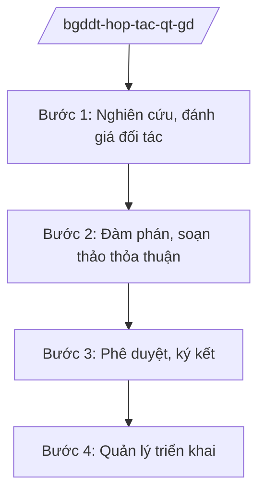

# Skill: Hợp tác quốc tế về giáo dục, du học

## 2. Khi nào dùng

Khi Vụ Hợp tác quốc tế — Bộ GD&ĐT thực hiện: đàm phán, ký kết thỏa thuận hợp tác giáo dục
với nước ngoài; quản lý chương trình liên kết đào tạo với nước ngoài; quản lý lưu học sinh
Việt Nam ở nước ngoài và người nước ngoài học tập tại Việt Nam; quản lý chuyên gia, tình
nguyện viên nước ngoài trong giáo dục.

## 3. Đầu vào (Input)

| Trường | Mô tả | Bắt buộc |
|--------|-------|----------|
| `noi_dung` | Thỏa thuận hợp tác / liên kết đào tạo / quản lý lưu học sinh / học bổng | Có |
| `doi_tac` | Tên đối tác nước ngoài (bộ, trường, tổ chức) | Có |
| `pham_vi` | Nội dung, quy mô, thời hạn hợp tác | Có |
| `ho_so` | Dự thảo thỏa thuận / hồ sơ liên kết đào tạo | Không |

## 4. Quy trình

**Bước 1. Nghiên cứu, đánh giá đối tác**
- Làm gì: Tìm hiểu năng lực, uy tín của đối tác nước ngoài; đánh giá tính phù hợp với nhu cầu phát triển giáo dục trong nước.
- Dùng input: `doi_tac`, `pham_vi`.
- Vai trò: Chuyên viên Vụ Hợp tác quốc tế — AI hỗ trợ tổng hợp thông tin đối tác, lập bảng đánh giá (⏱ 1–2 giờ).
- Lưu ý nghiệp vụ: Kiểm tra kỹ tư cách pháp lý của đối tác; không hợp tác với tổ chức có dấu hiệu lừa đảo giáo dục.
- → Kết quả bước: Báo cáo đánh giá đối tác.

**Bước 2. Đàm phán, soạn thảo thỏa thuận**
- Làm gì: Đàm phán nội dung hợp tác; soạn thảo thỏa thuận/hiệp định (song ngữ); lấy ý kiến Bộ Ngoại giao, Bộ Tư pháp khi cần.
- Dùng input: `noi_dung`, `ho_so`.
- Vai trò: Vụ Hợp tác quốc tế chủ trì — AI hỗ trợ soạn thảo song ngữ, rà soát điều khoản (⏱ 2–3 giờ).
- Lưu ý nghiệp vụ: Điều khoản về tài chính, sở hữu trí tuệ, giải quyết tranh chấp phải rõ ràng.
- → Kết quả bước: Dự thảo thỏa thuận hoàn chỉnh.

**Bước 3. Phê duyệt, ký kết**
- Làm gì: Trình cấp có thẩm quyền phê duyệt chủ trương; tổ chức ký kết; thông báo, lưu trữ.
- Dùng input: Dự thảo thỏa thuận.
- Vai trò: Vụ trưởng → Thứ trưởng → Bộ trưởng ký (hoặc trình Thủ tướng đối với điều ước quốc tế) — AI hỗ trợ chuẩn bị hồ sơ ký (⏱ 1 giờ).
- Lưu ý nghiệp vụ: Điều ước quốc tế phải tuân thủ trình tự ký kết theo quy định về điều ước quốc tế.
- → Kết quả bước: Thỏa thuận được ký kết.

**Bước 4. Quản lý triển khai**
- Làm gì: Cấp phép, giám sát chương trình liên kết đào tạo; quản lý học bổng, lưu học sinh; đánh giá hiệu quả hợp tác định kỳ.
- Dùng input: Thỏa thuận đã ký, báo cáo các đơn vị.
- Vai trò: Vụ Hợp tác quốc tế — AI hỗ trợ theo dõi tiến độ, tổng hợp báo cáo (⏱ 1 giờ).
- Lưu ý nghiệp vụ: Kiểm tra thực chất chất lượng liên kết đào tạo; xử lý vi phạm tuyển sinh, thu phí.
- → Kết quả bước: Báo cáo quản lý hợp tác quốc tế về giáo dục.

## Luồng quy trình (Workflow)

## 5. Đầu ra (Output)

- Thỏa thuận/hiệp định hợp tác giáo dục (song ngữ).
- Quyết định phê duyệt liên kết đào tạo với nước ngoài.
- Báo cáo quản lý lưu học sinh, học bổng.

### Cấu trúc output chuẩn (thể thức NĐ 30/2020/NĐ-CP)

**Thỏa thuận hợp tác** gồm: (1) tên các bên; (2) mục đích; (3) nội dung hợp tác;
(4) quyền, nghĩa vụ các bên; (5) tài chính; (6) thời hạn, gia hạn, chấm dứt;
(7) giải quyết tranh chấp; (8) chữ ký (ghi rõ chức danh, họ tên người ký; ký hiệu "KT."/"TL." khi ký thay); (9) nơi nhận (kết thúc "- Lưu: VT, [mã đơn vị].").

**Quyết định phê duyệt liên kết đào tạo** gồm: (1) Quốc hiệu "CỘNG HÒA XÃ HỘI CHỦ NGHĨA VIỆT NAM", Tiêu ngữ "Độc lập – Tự do – Hạnh phúc"; (2) căn cứ;
(3) tên chương trình, đối tác, chỉ tiêu, địa điểm; (4) điều kiện duy trì;
(5) trách nhiệm; (6) chữ ký.

> **Checklist thể thức văn bản theo NĐ 30/2020/NĐ-CP** — đối chiếu trước khi trình ký:
> 1. Quốc hiệu và Tiêu ngữ.
> 2. Tên cơ quan, tổ chức ban hành văn bản.
> 3. Số, ký hiệu của văn bản.
> 4. Địa danh và thời gian ban hành văn bản.
> 5. Tên loại và trích yếu nội dung văn bản.
> 6. Nội dung văn bản.
> 7. Chức vụ, họ tên và chữ ký của người có thẩm quyền.
> 8. Dấu, chữ ký số của cơ quan, tổ chức.
> 9. Nơi nhận (kèm Phụ lục nếu có).

## 6. Checklist nghiệm thu

- [ ] Đối tác được đánh giá uy tín, tư cách pháp lý rõ ràng
- [ ] Điều khoản tài chính, tranh chấp rõ ràng
- [ ] Đúng trình tự ký kết (đặc biệt với điều ước quốc tế)
- [ ] Liên kết đào tạo được kiểm tra thực chất
- [ ] Thể thức đúng NĐ 30/2020/NĐ-CP
- [ ] Không bịa thông tin đối tác, học bổng

## 7. Ví dụ mô phỏng

*Dữ liệu dưới đây là giả lập 100% phục vụ minh họa.*

**Input mẫu:** noi_dung = "Thỏa thuận hợp tác đào tạo với Bộ Giáo dục nước BB";
doi_tac = "Bộ Giáo dục nước BB (tên giả lập)"; pham_vi = "Trao đổi 100 sinh viên/năm,
hợp tác nghiên cứu (số liệu giả lập)".

**Output mẫu (trích thỏa thuận):**

> **THỎA THUẬN HỢP TÁC GIÁO DỤC**
> **giữa Bộ Giáo dục và Đào tạo nước Cộng hòa xã hội chủ nghĩa Việt Nam**
> **và Bộ Giáo dục nước BB**
>
> Điều 1. Mục đích: thúc đẩy hợp tác giáo dục, trao đổi sinh viên, nghiên cứu khoa học...
> Điều 2. Nội dung: hằng năm mỗi bên tiếp nhận 100 sinh viên của bên kia theo diện học bổng
> (số liệu giả lập); hợp tác nghiên cứu chung trong lĩnh vực khoa học giáo dục...
> Điều 3. Tài chính: mỗi bên chi trả chi phí cho lưu học sinh của bên kia theo quy định...
> Điều 4. Thời hạn: 5 năm, tự động gia hạn nếu không bên nào phản đối bằng văn bản...

## 8. Human gate

- Vụ trưởng Vụ Hợp tác quốc tế duyệt báo cáo đối tác, dự thảo thỏa thuận.
- Thứ trưởng phụ trách cho ý kiến; Bộ trưởng ký thỏa thuận (hoặc trình Thủ tướng đối với điều ước quốc tế).

## 9. Giới hạn

- AI không đàm phán, không cam kết quốc tế thay người có thẩm quyền; không tự ký.
- AI không bịa thông tin đối tác, điều khoản thỏa thuận.
- AI không viện dẫn văn bản hết hiệu lực.

## 10. Căn cứ & lưu ý

- Nghị quyết 176/2025/QH15 của Quốc hội — cơ cấu tổ chức của Chính phủ.
- Nghị định 37/2025/NĐ-CP ngày 26/02/2025 — chức năng, nhiệm vụ, quyền hạn của Bộ GD&ĐT (hợp tác quốc tế về giáo dục).
- Nghị định 142/2025/NĐ-CP, Nghị định 143/2025/NĐ-CP ngày 12/6/2025 — phân định thẩm quyền, phân quyền, phân cấp lĩnh vực Bộ GD&ĐT.
- Nghị định 30/2020/NĐ-CP — thể thức văn bản hành chính.
- Lưu ý: tên Luật Giáo dục, Luật Điều ước quốc tế chỉ nêu tên, không ghi số hiệu.
