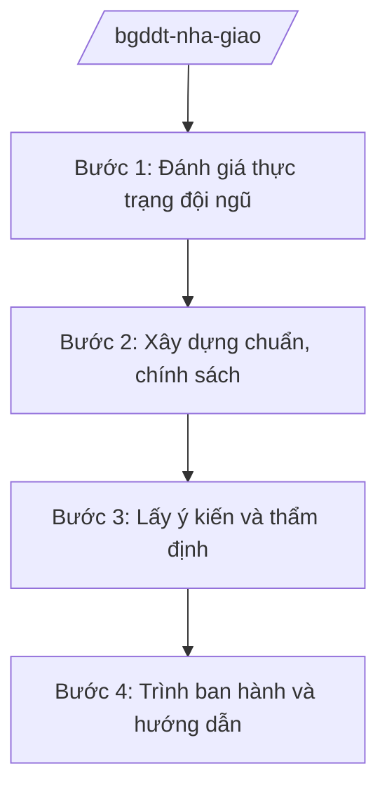

# Skill: Chế độ, chính sách nhà giáo (cấp bộ)

## 2. Khi nào dùng

Khi Cục Nhà giáo và Cán bộ quản lý giáo dục — Bộ GD&ĐT thực hiện: xây dựng chuẩn nghề nghiệp
nhà giáo; chính sách đào tạo, bồi dưỡng nhà giáo; chế độ tiền lương, phụ cấp, đãi ngộ;
quy hoạch phát triển đội ngũ nhà giáo toàn quốc.

## 3. Đầu vào (Input)

| Trường | Mô tả | Bắt buộc |
|--------|-------|----------|
| `noi_dung` | Chuẩn nghề nghiệp / đào tạo bồi dưỡng / chính sách đãi ngộ | Có |
| `doi_tuong` | Giáo viên mầm non/phổ thông/GDNN/đại học; cán bộ quản lý | Có |
| `so_lieu_doi_ngu` | Số liệu đội ngũ nhà giáo toàn quốc (số lượng, trình độ, độ tuổi) | Có |
| `de_xuat_chinh_sach` | Nội dung chính sách đề xuất (nếu xây dựng chính sách mới) | Không |

## 4. Quy trình

**Bước 1. Đánh giá thực trạng đội ngũ**
- Làm gì: Tổng hợp số liệu đội ngũ nhà giáo: thừa/thiếu theo môn, cấp học, vùng miền; trình độ đạt chuẩn; độ tuổi.
- Dùng input: `so_lieu_doi_ngu`, `doi_tuong`.
- Vai trò: Chuyên viên Cục Nhà giáo — AI hỗ trợ tổng hợp số liệu, phân tích thừa/thiếu (2 giờ).
- Lưu ý nghiệp vụ: Số liệu từ báo cáo của Sở GD&ĐT, phải đối chiếu tính nhất quán.
- → Kết quả bước: Báo cáo thực trạng đội ngũ nhà giáo.

**Bước 2. Xây dựng chuẩn, chính sách**
- Làm gì: Soạn chuẩn nghề nghiệp nhà giáo theo cấp học; hoặc dự thảo chính sách (phụ cấp, đào tạo bồi dưỡng, thu hút).
- Dùng input: `noi_dung`, `de_xuat_chinh_sach`.
- Vai trò: Cục Nhà giáo chủ trì — AI hỗ trợ soạn dự thảo, đối chiếu với chuẩn hiện hành (2–3 giờ).
- Lưu ý nghiệp vụ: Chính sách tiền lương, phụ cấp phải phối hợp chặt chẽ với Bộ Nội vụ, Bộ Tài chính.
- → Kết quả bước: Dự thảo chuẩn/chính sách.

**Bước 3. Lấy ý kiến và thẩm định**
- Làm gì: Lấy ý kiến bộ, ngành liên quan, Sở GD&ĐT, cơ sở giáo dục, tổ chức công đoàn giáo dục; thẩm định.
- Dùng input: Dự thảo.
- Vai trò: Cục Nhà giáo — AI hỗ trợ tổng hợp ý kiến (1–2 giờ).
- Lưu ý nghiệp vụ: Lắng nghe ý kiến trực tiếp của nhà giáo, công đoàn ngành giáo dục.
- → Kết quả bước: Dự thảo hoàn chỉnh.

**Bước 4. Trình ban hành và hướng dẫn**
- Làm gì: Trình Bộ trưởng ban hành (thông tư) hoặc trình Chính phủ (nghị định về chính sách); hướng dẫn địa phương triển khai; theo dõi thực hiện.
- Dùng input: Toàn bộ hồ sơ.
- Vai trò: Cục trưởng → Thứ trưởng → Bộ trưởng — AI hỗ trợ soạn văn bản hướng dẫn (1 giờ).
- Lưu ý nghiệp vụ: Hướng dẫn rõ lộ trình áp dụng để địa phương, nhà trường chủ động.
- → Kết quả bước: Văn bản chính sách được ban hành + hướng dẫn triển khai.

## Luồng quy trình (Workflow)

## 5. Đầu ra (Output)

- Chuẩn nghề nghiệp nhà giáo (theo cấp học).
- Chính sách đào tạo, bồi dưỡng, đãi ngộ nhà giáo.
- Văn bản hướng dẫn địa phương thực hiện.

### Cấu trúc output chuẩn

**Khung thể thức chung (NĐ 30/2020/NĐ-CP):** mọi văn bản trong output đều trình bày đầy đủ: Quốc hiệu "CỘNG HÒA XÃ HỘI CHỦ NGHĨA VIỆT NAM", Tiêu ngữ "Độc lập – Tự do – Hạnh phúc"; tên cơ quan ban hành; số, ký hiệu văn bản; địa danh, ngày tháng năm ban hành; tên loại văn bản; nội dung theo các mục dưới đây; nơi nhận (kết thúc "- Lưu: VT, [mã đơn vị]."); khối chữ ký (chức danh, họ tên người ký; ký hiệu "KT."/"TL." khi ký thay).

**Chuẩn nghề nghiệp nhà giáo** gồm: (1) Quyết định ban hành (thể thức NĐ 30/2020);
(2) tiêu chuẩn theo các lĩnh vực (phẩm chất, năng lực chuyên môn, năng lực sư phạm...);
(3) minh chứng đánh giá theo từng mức; (4) tổ chức thực hiện.

**Chính sách đãi ngộ** gồm: (1) tên chính sách; (2) đối tượng, điều kiện;
(3) mức hưởng; (4) trình tự thực hiện; (5) nguồn kinh phí; (6) tổ chức thực hiện.

*Thể thức văn bản tuân thủ NĐ 30/2020/NĐ-CP.*

*Thể thức văn bản tuân thủ NĐ 30/2020/NĐ-CP.*
## 6. Checklist nghiệm thu

- [ ] Số liệu đội ngũ đầy đủ, có đối chiếu
- [ ] Đã phối hợp Bộ Nội vụ, Bộ Tài chính (chính sách lương, phụ cấp)
- [ ] Đã lấy ý kiến nhà giáo, công đoàn giáo dục
- [ ] Lộ trình áp dụng rõ ràng, khả thi
- [ ] Thể thức đúng NĐ 30/2020/NĐ-CP
- [ ] Không bịa số liệu đội ngũ, mức hưởng

## 7. Ví dụ mô phỏng

*Dữ liệu dưới đây là giả lập 100% phục vụ minh họa.*

**Input mẫu:** noi_dung = "Chính sách hỗ trợ giáo viên vùng khó khăn"; doi_tuong = "Giáo viên
phổ thông công tác tại vùng đặc biệt khó khăn"; so_lieu_doi_ngu = "15.000 giáo viên vùng
khó khăn (số liệu giả lập)".

**Output mẫu (trích chính sách):**

> **CHÍNH SÁCH HỖ TRỢ GIÁO VIÊN VÙNG KHÓ KHĂN**
> *(Dự thảo)*
>
> 1. Đối tượng: giáo viên phổ thông công tác tại vùng đặc biệt khó khăn, có thời gian
> công tác từ đủ 12 tháng trở lên...
> 2. Mức hỗ trợ: trợ cấp thu hút 70% lương cơ sở/tháng trong 5 năm đầu (mức giả lập minh họa);
> hỗ trợ nhà ở công vụ, chi phí đào tạo nâng chuẩn...
> 3. Trình tự: nhà trường lập danh sách → Phòng VH-XH/Sở GD&ĐT thẩm định → chi trả theo
> phân cấp ngân sách...
> 4. Tổ chức thực hiện: Cục Nhà giáo và Cán bộ quản lý giáo dục hướng dẫn, kiểm tra...
>
> *Cục trưởng: bà Vũ Thị FF (tên giả lập).*

## 8. Human gate

- Cục trưởng Cục Nhà giáo và Cán bộ quản lý giáo dục duyệt báo cáo, dự thảo.
- Thứ trưởng phụ trách cho ý kiến; Bộ trưởng ký ban hành/trình Chính phủ.

## 9. Giới hạn

- AI không quyết định mức hưởng chính sách thay cấp có thẩm quyền; không tự ký.
- AI không bịa số liệu đội ngũ, mức lương, phụ cấp.
- AI không viện dẫn văn bản hết hiệu lực.

## 10. Căn cứ & lưu ý

- Nghị quyết 176/2025/QH15 của Quốc hội — cơ cấu tổ chức của Chính phủ.
- Nghị định 37/2025/NĐ-CP ngày 26/02/2025 — chức năng, nhiệm vụ, quyền hạn của Bộ GD&ĐT (quản lý nhà nước về nhà giáo).
- Nghị định 142/2025/NĐ-CP, Nghị định 143/2025/NĐ-CP ngày 12/6/2025 — phân định thẩm quyền, phân quyền, phân cấp lĩnh vực Bộ GD&ĐT.
- Nghị định 30/2020/NĐ-CP — thể thức văn bản hành chính.
- Lưu ý: tên Luật Giáo dục, Luật Nhà giáo (nếu có) chỉ nêu tên, không ghi số hiệu.
