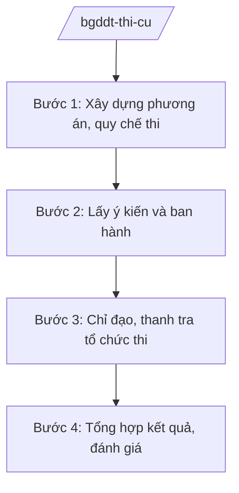

# Skill: Thi, kiểm tra, đánh giá (kỳ thi quốc gia)

## 2. Khi nào dùng

Khi Cục Quản lý chất lượng — Bộ GD&ĐT thực hiện: xây dựng phương án tổ chức kỳ thi tốt nghiệp
THPT hằng năm; ban hành quy chế thi; chỉ đạo, thanh tra công tác tổ chức thi tại các địa phương;
tổ chức các kỳ thi quốc gia khác (thi học sinh giỏi, đánh giá diện rộng).

## 3. Đầu vào (Input)

| Trường | Mô tả | Bắt buộc |
|--------|-------|----------|
| `ten_ky_thi` | Tên kỳ thi (tốt nghiệp THPT / học sinh giỏi quốc gia...) | Có |
| `nam_to_chuc` | Năm tổ chức | Có |
| `phuong_an` | Phương thức tổ chức (môn thi, hình thức, lịch thi) | Có |
| `so_luong_du_kien` | Số thí sinh, điểm thi dự kiến toàn quốc | Không |

## 4. Quy trình

**Bước 1. Xây dựng phương án, quy chế thi**
- Làm gì: Soạn phương án tổ chức kỳ thi: môn thi, hình thức, lịch thi, phân công trách nhiệm Bộ – địa phương; dự thảo quy chế thi.
- Dùng input: `ten_ky_thi`, `nam_to_chuc`, `phuong_an`.
- Vai trò: Cục Quản lý chất lượng chủ trì — AI hỗ trợ soạn dự thảo quy chế, rà soát tính chặt chẽ (⏱ 2–3 giờ).
- Lưu ý nghiệp vụ: Quy chế phải quy định rõ để ngăn ngừa gian lận; phân định rõ trách nhiệm Bộ và địa phương.
- → Kết quả bước: Dự thảo phương án, quy chế thi.

**Bước 2. Lấy ý kiến và ban hành**
- Làm gì: Lấy ý kiến Sở GD&ĐT, cơ sở giáo dục; hoàn thiện; trình Bộ trưởng ban hành quy chế, hướng dẫn tổ chức thi.
- Dùng input: Dự thảo quy chế.
- Vai trò: Cục trưởng → Thứ trưởng → Bộ trưởng — AI hỗ trợ tổng hợp ý kiến, soạn văn bản hướng dẫn (⏱ 1–2 giờ).
- Lưu ý nghiệp vụ: Ban hành sớm để địa phương có thời gian chuẩn bị; hướng dẫn phải chi tiết đến khâu in sao đề thi, coi thi, chấm thi.
- → Kết quả bước: Quy chế thi + văn bản hướng dẫn được ban hành.

**Bước 3. Chỉ đạo, thanh tra tổ chức thi**
- Làm gì: Thành lập ban chỉ đạo thi cấp quốc gia; cử đoàn thanh tra, kiểm tra công tác tổ chức thi tại địa phương; xử lý sự cố.
- Dùng input: `so_luong_du_kien`, báo cáo địa phương.
- Vai trò: Ban Chỉ đạo thi cấp quốc gia — AI hỗ trợ lập kế hoạch thanh tra, tổng hợp báo cáo nhanh (⏱ 1 giờ).
- Lưu ý nghiệp vụ: Bảo mật đề thi tuyệt đối; xử lý nghiêm vi phạm quy chế.
- → Kết quả bước: Kỳ thi diễn ra an toàn, nghiêm túc.

**Bước 4. Tổng hợp kết quả, đánh giá**
- Làm gì: Tổng hợp kết quả thi toàn quốc; phân tích phổ điểm; đánh giá công tác tổ chức; báo cáo Lãnh đạo Bộ, Chính phủ.
- Dùng input: Kết quả thi các địa phương.
- Vai trò: Cục Quản lý chất lượng — AI hỗ trợ tổng hợp số liệu, phân tích phổ điểm (⏱ 2 giờ).
- Lưu ý nghiệp vụ: Số liệu chính xác tuyệt đối; phân tích trung thực, chỉ rõ địa phương có bất thường.
- → Kết quả bước: Báo cáo tổng kết kỳ thi.

## Luồng quy trình (Workflow)

## 5. Đầu ra (Output)

- Quy chế thi + văn bản hướng dẫn tổ chức kỳ thi.
- Quyết định thành lập Ban Chỉ đạo thi cấp quốc gia.
- Báo cáo tổng kết kỳ thi (kết quả, phổ điểm, đánh giá).

### Cấu trúc output chuẩn (thể thức NĐ 30/2020/NĐ-CP)

**Quy chế thi** gồm: (1) Quốc hiệu "CỘNG HÒA XÃ HỘI CHỦ NGHĨA VIỆT NAM", Tiêu ngữ "Độc lập – Tự do – Hạnh phúc" (BỘ GD&ĐT); (2) quy định chung;
(3) chuẩn bị tổ chức thi; (4) đăng ký dự thi; (5) in sao, vận chuyển đề thi;
(6) coi thi; (7) chấm thi; (8) phúc khảo; (9) xét công nhận tốt nghiệp;
(10) thanh tra, khen thưởng, xử lý vi phạm; (11) điều khoản thi hành; (12) nơi nhận (kết thúc "- Lưu: VT, [mã đơn vị].").

> **Checklist thể thức văn bản theo NĐ 30/2020/NĐ-CP** — đối chiếu trước khi trình ký:
> 1. Quốc hiệu và Tiêu ngữ.
> 2. Tên cơ quan, tổ chức ban hành văn bản.
> 3. Số, ký hiệu của văn bản.
> 4. Địa danh và thời gian ban hành văn bản.
> 5. Tên loại và trích yếu nội dung văn bản.
> 6. Nội dung văn bản.
> 7. Chức vụ, họ tên và chữ ký của người có thẩm quyền.
> 8. Dấu, chữ ký số của cơ quan, tổ chức.
> 9. Nơi nhận (kèm Phụ lục nếu có).

## 6. Checklist nghiệm thu

- [ ] Quy chế quy định rõ trách nhiệm Bộ – địa phương
- [ ] Có phương án bảo mật đề thi, chống gian lận
- [ ] Ban hành sớm, hướng dẫn chi tiết đến cơ sở
- [ ] Thanh tra, kiểm tra được tổ chức thực chất
- [ ] Số liệu kết quả chính xác tuyệt đối
- [ ] Thể thức đúng NĐ 30/2020/NĐ-CP

## 7. Ví dụ mô phỏng

*Dữ liệu dưới đây là giả lập 100% phục vụ minh họa.*

**Input mẫu:** ten_ky_thi = "Kỳ thi tốt nghiệp trung học phổ thông"; nam_to_chuc = "2026";
phuong_an = "4 môn thi: Toán, Ngữ văn bắt buộc + 2 môn tự chọn".

**Output mẫu (trích quy chế):**

> **BỘ GIÁO DỤC VÀ ĐÀO TẠO**
>
> **QUY CHẾ**
> **Thi tốt nghiệp trung học phổ thông**
> *(Ban hành kèm theo Thông tư số 12/2026/TT-BGDĐT — số hiệu giả lập)*
>
> **Điều 1. Phạm vi điều chỉnh:** Quy chế này quy định về thi tốt nghiệp THPT, bao gồm:
> đăng ký dự thi; in sao, vận chuyển đề thi; coi thi; chấm thi; phúc khảo; xét công nhận
> tốt nghiệp; thanh tra, xử lý vi phạm...
> **Điều 2. Môn thi:** Thí sinh dự thi 4 môn, gồm 2 môn bắt buộc là Toán, Ngữ văn và
> 2 môn tự chọn trong số các môn học ở lớp 12...
>
> *Cục trưởng Cục Quản lý chất lượng: ông Hoàng Văn EE (tên giả lập).*

## 8. Human gate

- Cục trưởng Cục Quản lý chất lượng duyệt dự thảo quy chế.
- Thứ trưởng phụ trách cho ý kiến; Bộ trưởng ký ban hành quy chế, quyết định thành lập Ban Chỉ đạo.

## 9. Giới hạn

- AI không quyết định phương án thi, nội dung đề thi thay Lãnh đạo Bộ; không tự ký ban hành.
- AI không bịa số liệu kết quả thi, phổ điểm.
- AI không viện dẫn văn bản hết hiệu lực.

## 10. Căn cứ & lưu ý

- Nghị quyết 176/2025/QH15 của Quốc hội — cơ cấu tổ chức của Chính phủ.
- Nghị định 37/2025/NĐ-CP ngày 26/02/2025 — chức năng, nhiệm vụ, quyền hạn của Bộ GD&ĐT (quản lý nhà nước về thi, kiểm tra, đánh giá).
- Nghị định 142/2025/NĐ-CP, Nghị định 143/2025/NĐ-CP ngày 12/6/2025 — phân định thẩm quyền, phân quyền, phân cấp lĩnh vực Bộ GD&ĐT.
- Nghị định 30/2020/NĐ-CP — thể thức văn bản hành chính.
- Lưu ý: tên Luật Giáo dục chỉ nêu tên, không ghi số hiệu.
