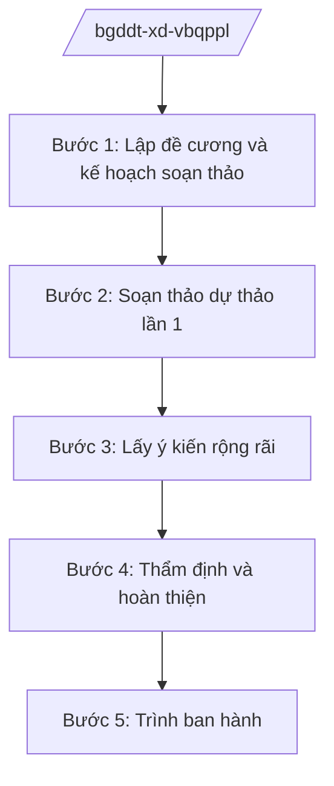

# Skill: Xây dựng VBQPPL lĩnh vực giáo dục

## 2. Khi nào dùng

Khi Vụ/Cục thuộc Bộ Giáo dục và Đào tạo (GD&ĐT) được giao chủ trì soạn thảo: thông tư của
Bộ trưởng; hoặc dự thảo luật, nghị định, quyết định của Thủ tướng thuộc lĩnh vực giáo dục
và đào tạo (kể cả giáo dục nghề nghiệp) để trình cấp có thẩm quyền ban hành.

## 3. Đầu vào (Input)

| Trường | Mô tả | Bắt buộc |
|--------|-------|----------|
| `ten_van_ban` | Tên dự thảo văn bản | Có |
| `loai_van_ban` | Thông tư / Nghị định / Luật / Quyết định của Thủ tướng | Có |
| `don_vi_chu_tri` | Vụ/Cục được giao chủ trì soạn thảo | Có |
| `co_so_chinh_sach` | Chủ trương, yêu cầu đổi mới giáo dục đặt ra | Có |
| `pham_vi_dieu_chinh` | Đối tượng, phạm vi điều chỉnh của dự thảo | Có |
| `tien_do` | Mốc thời gian phải trình ban hành | Không |

## 4. Quy trình

**Bước 1. Lập đề cương và kế hoạch soạn thảo**
- Làm gì: Xác định bố cục dự thảo, thành lập tổ biên tập, lập tiến độ; đánh giá tác động sơ bộ đối với nhà trường, nhà giáo, người học.
- Dùng input: `ten_van_ban`, `loai_van_ban`, `don_vi_chu_tri`, `co_so_chinh_sach`, `tien_do`.
- Vai trò: Vụ trưởng Vụ chủ trì (ông Hoàng Văn EE) — AI hỗ trợ dựng đề cương, lập bảng tiến độ (⏱ 30 phút).
- Lưu ý nghiệp vụ: Xác định đúng thẩm quyền ban hành; rà soát không trùng lặp với văn bản hiện hành của Bộ.
- → Kết quả bước: Đề cương chi tiết + quyết định thành lập tổ biên tập.

**Bước 2. Soạn thảo dự thảo lần 1**
- Làm gì: Viết toàn văn dự thảo; bảo đảm phù hợp với chương trình giáo dục, điều kiện thực tế nhà trường.
- Dùng input: `pham_vi_dieu_chinh`, `co_so_chinh_sach`.
- Vai trò: Tổ biên tập (chuyên viên Vụ) — AI hỗ trợ soạn khung điều khoản, phát hiện chồng chéo (⏱ 2–4 giờ).
- Lưu ý nghiệp vụ: Quy định phải khả thi với điều kiện cơ sở vật chất, đội ngũ hiện có; không tạo gánh nặng hành chính cho nhà trường.
- → Kết quả bước: Dự thảo lần 1 kèm thuyết minh tóm tắt.

**Bước 3. Lấy ý kiến rộng rãi**
- Làm gì: Lấy ý kiến các bộ, ngành, địa phương, cơ sở giáo dục, chuyên gia, nhà giáo; đăng tải lấy ý kiến theo quy định.
- Dùng input: Dự thảo lần 1.
- Vai trò: Vụ chủ trì — AI hỗ trợ tổng hợp ý kiến thành bảng tiếp thu/giải trình (⏱ 1–2 giờ).
- Lưu ý nghiệp vụ: Đặc biệt lấy ý kiến Sở GD&ĐT các tỉnh và cơ sở giáo dục trực tiếp chịu tác động.
- → Kết quả bước: Bảng tổng hợp, giải trình tiếp thu ý kiến.

**Bước 4. Thẩm định và hoàn thiện**
- Làm gì: Trình Vụ Pháp chế thẩm định nội bộ; dự thảo nghị định/luật gửi Bộ Tư pháp thẩm định; tiếp thu hoàn thiện.
- Dùng input: Dự thảo sau tiếp thu, bảng giải trình.
- Vai trò: Vụ Pháp chế, Vụ chủ trì — AI hỗ trợ rà soát kỹ thuật, thể thức (⏱ 1 giờ).
- Lưu ý nghiệp vụ: Không trình ký khi còn ý kiến thẩm định chưa giải trình đầy đủ.
- → Kết quả bước: Dự thảo hoàn chỉnh + báo cáo thẩm định.

**Bước 5. Trình ban hành**
- Làm gì: Lập tờ trình, trình Lãnh đạo Bộ ký ban hành (thông tư) hoặc trình Chính phủ/Quốc hội.
- Dùng input: Toàn bộ hồ sơ các bước trên.
- Vai trò: Vụ trưởng → Thứ trưởng (bà Phạm Thị DD) → Bộ trưởng (ông Lê Văn CC) ký — AI hỗ trợ soạn tờ trình, kiểm tra thành phần hồ sơ (⏱ 1 giờ).
- Lưu ý nghiệp vụ: Hồ sơ trình đủ: tờ trình, dự thảo, báo cáo thẩm định, bảng tiếp thu, thuyết minh.
- → Kết quả bước: Văn bản được ký ban hành hoặc trình cấp trên.

## Luồng quy trình (Workflow)

## 5. Đầu ra (Output)

- Tờ trình ban hành/trình văn bản.
- Dự thảo văn bản QPPL hoàn chỉnh (thể thức NĐ 30/2020/NĐ-CP).
- Báo cáo thẩm định, bảng tổng hợp tiếp thu ý kiến.

### Cấu trúc output chuẩn

**Tờ trình** gồm: (1) Quốc hiệu "CỘNG HÒA XÃ HỘI CHỦ NGHĨA VIỆT NAM", Tiêu ngữ "Độc lập – Tự do – Hạnh phúc"; (2) tên loại "TỜ TRÌNH" và trích yếu;
(3) sự cần thiết ban hành; (4) mục đích, quan điểm; (5) nội dung cơ bản;
(6) dự kiến tác động đến nhà trường, nhà giáo, người học; (7) kiến nghị; (8) nơi nhận (kết thúc "- Lưu: VT, [mã đơn vị]."). Ký tên Bộ trưởng.

**Dự thảo văn bản** gồm: (1) Quốc hiệu "CỘNG HÒA XÃ HỘI CHỦ NGHĨA VIỆT NAM", Tiêu ngữ "Độc lập – Tự do – Hạnh phúc"; (2) căn cứ ban hành; (3) các chương, điều, khoản;
(4) điều khoản thi hành; (5) chữ ký (ghi rõ chức danh, họ tên người ký; ký hiệu "KT."/"TL." khi ký thay) người có thẩm quyền.
## 6. Checklist nghiệm thu

- [ ] Xác định đúng loại văn bản và thẩm quyền ban hành
- [ ] Đề cương được Vụ trưởng phê duyệt
- [ ] Đã lấy ý kiến Sở GD&ĐT, cơ sở giáo dục chịu tác động
- [ ] Có báo cáo thẩm định đầy đủ
- [ ] Quy định khả thi, không tạo gánh nặng cho nhà trường
- [ ] Thể thức đúng NĐ 30/2020/NĐ-CP
- [ ] Hồ sơ trình đầy đủ thành phần

## 7. Ví dụ mô phỏng

*Dữ liệu dưới đây là giả lập 100% phục vụ minh họa.*

**Input mẫu:** ten_van_ban = "Thông tư quy định đánh giá học sinh trung học phổ thông";
loai_van_ban = "Thông tư"; don_vi_chu_tri = "Vụ Giáo dục Trung học – Bộ GD&ĐT";
co_so_chinh_sach = "Yêu cầu đổi mới kiểm tra, đánh giá theo chương trình GDPT".

**Output mẫu (trích Tờ trình):**

> **BỘ GIÁO DỤC VÀ ĐÀO TẠO**
>
> **TỜ TRÌNH**
> **Về việc ban hành Thông tư quy định đánh giá học sinh trung học phổ thông**
>
> Kính gửi: Bộ trưởng Bộ Giáo dục và Đào tạo
>
> 1. Sự cần thiết ban hành: quy định hiện hành về đánh giá học sinh chưa đồng bộ với
> chương trình GDPT mới, gây lúng túng cho giáo viên trong tổ chức kiểm tra, đánh giá...
> 2. Mục đích, quan điểm: đánh giá vì sự tiến bộ của người học, giảm áp lực thi cử...
> 3. Nội dung cơ bản: gồm 4 chương, 15 điều, quy định nguyên tắc, hình thức, thang điểm
> đánh giá thường xuyên và định kỳ...
> 4. Dự kiến tác động: giáo viên có căn cứ thống nhất; học sinh giảm áp lực điểm số...
> 5. Kiến nghị: trình Bộ trưởng xem xét, ký ban hành Thông tư.

## 8. Human gate

- Vụ trưởng Vụ chủ trì duyệt đề cương và dự thảo từng lần.
- Vụ Pháp chế thẩm định trước khi trình Lãnh đạo Bộ.
- Thứ trưởng phụ trách cho ý kiến; Bộ trưởng ký ban hành (thông tư) hoặc ký tờ trình Chính phủ/Quốc hội.

## 9. Giới hạn

- AI không quyết định nội dung chính sách giáo dục thay Lãnh đạo Bộ; không tự ký/phát hành.
- AI không bịa căn cứ pháp lý, số hiệu văn bản; không viện dẫn văn bản hết hiệu lực.
- AI không soạn thảo nội dung vượt thẩm quyền của Bộ.

## 10. Căn cứ & lưu ý

- Nghị quyết 176/2025/QH15 của Quốc hội — cơ cấu tổ chức của Chính phủ.
- Nghị định 37/2025/NĐ-CP ngày 26/02/2025 của Chính phủ — chức năng, nhiệm vụ, quyền hạn và cơ cấu tổ chức của Bộ Giáo dục và Đào tạo (giáo dục nghề nghiệp chuyển về Bộ GD&ĐT quản lý).
- Nghị định 142/2025/NĐ-CP, Nghị định 143/2025/NĐ-CP ngày 12/6/2025 — phân định thẩm quyền, phân quyền, phân cấp trong lĩnh vực quản lý nhà nước của Bộ GD&ĐT.
- Nghị định 303/2025/NĐ-CP — khung chung về tổ chức bộ máy.
- Nghị định 30/2020/NĐ-CP — công tác văn thư (thể thức văn bản hành chính).
- Lưu ý: tên các luật (Luật Giáo dục, Luật Giáo dục đại học, Luật Giáo dục nghề nghiệp...) chỉ nêu tên, không ghi số hiệu.
