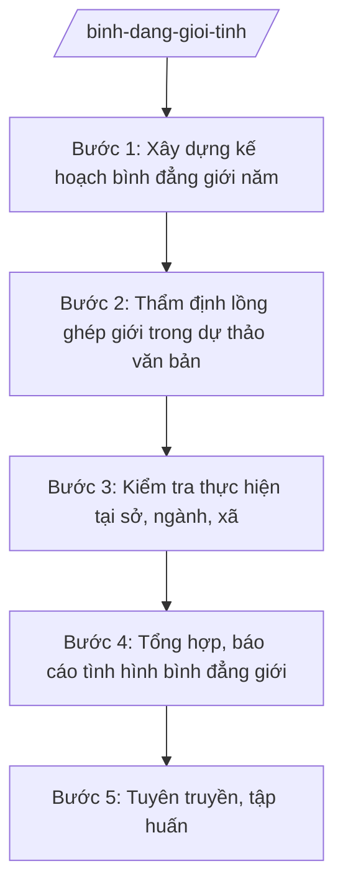

# Skill: Bình đẳng giới cấp tỉnh

## 2. Khi nào dùng
- Xây dựng kế hoạch bình đẳng giới, vì sự tiến bộ của phụ nữ hằng năm của tỉnh.
- Thẩm định lồng ghép vấn đề bình đẳng giới trong dự thảo văn bản QPPL của tỉnh.
- Kiểm tra việc thực hiện chính sách bình đẳng giới tại sở, ngành, cấp xã.
- Tổng hợp, báo cáo tình hình bình đẳng giới toàn tỉnh.
- Tổ chức tuyên truyền, tập huấn về bình đẳng giới, phòng ngừa bạo lực trên cơ sở giới.

## 3. Đầu vào (Input)
| Trường | Mô tả | Bắt buộc |
|--------|-------|----------|
| `nam_ke_hoach` | Năm kế hoạch | Có |
| `so_lieu_gioi` | Số liệu về bình đẳng giới (tỷ lệ nữ lãnh đạo, chênh lệch thu nhập, bạo lực giới...) | Có |
| `du_thao_vb` | Dự thảo văn bản QPPL cần thẩm định lồng ghép giới | Không |
| `bao_cao_don_vi` | Báo cáo bình đẳng giới của sở, ngành, cấp xã | Có |
| `van_ban_chi_dao` | Văn bản chỉ đạo của Trung ương, UBND tỉnh | Không |

## 4. Quy trình

**Bước 1. Xây dựng kế hoạch bình đẳng giới năm**
- Làm gì: Phân tích số liệu giới; soạn kế hoạch năm (mục tiêu: tỷ lệ nữ tham gia lãnh đạo, giảm bạo lực giới; nhiệm vụ: tuyên truyền, tập huấn, kiểm tra; kinh phí).
- Dùng input: `nam_ke_hoach`, `so_lieu_gioi`, `van_ban_chi_dao`.
- Vai trò: Chuyên viên Phòng Bình đẳng giới (Sở Nội vụ tỉnh A) soạn; AI hỗ trợ phân tích số liệu, soạn dự thảo ⏱ ~3–5 ngày làm việc (ước tính).
- Lưu ý nghiệp vụ: Mục tiêu phải đo lường được (tỷ lệ %, số vụ); gắn với chiến lược quốc gia về bình đẳng giới.
- → Kết quả bước: Dự thảo kế hoạch bình đẳng giới năm của tỉnh.

**Bước 2. Thẩm định lồng ghép giới trong dự thảo văn bản**
- Làm gì: Rà soát dự thảo văn bản QPPL của tỉnh: đánh giá tác động khác biệt đến nam/nữ, đề xuất điều chỉnh điều khoản chưa đảm bảo bình đẳng giới; lập báo cáo thẩm định lồng ghép giới.
- Dùng input: `du_thao_vb`.
- Vai trò: Chuyên viên Phòng Bình đẳng giới thẩm định; AI hỗ trợ rà soát ngôn từ, đối chiếu checklist lồng ghép giới ⏱ ~1–2 ngày làm việc/dự thảo (ước tính).
- Lưu ý nghiệp vụ: Tập trung văn bản về lao động, y tế, giáo dục, an sinh — nơi dễ phát sinh bất bình đẳng; kiến nghị phải cụ thể từng điều khoản.
- → Kết quả bước: Báo cáo thẩm định lồng ghép giới.

**Bước 3. Kiểm tra thực hiện tại sở, ngành, xã**
- Làm gì: Kiểm tra việc thực hiện chính sách bình đẳng giới (tỷ lệ nữ trong quy hoạch cán bộ, chế độ thai sản, phòng ngừa bạo lực giới tại cơ sở); kết luận, kiến nghị.
- Dùng input: `bao_cao_don_vi`.
- Vai trò: Đoàn kiểm tra Sở Nội vụ thực hiện; AI hỗ trợ soạn đề cương, tổng hợp kết quả ⏱ ~1–2 ngày/đơn vị (ước tính).
- Lưu ý nghiệp vụ: Kiểm tra thực chất, không hình thức; chú ý cơ sở có phản ánh về bạo lực giới, phân biệt đối xử.
- → Kết quả bước: Biên bản, kết luận kiểm tra.

**Bước 4. Tổng hợp, báo cáo tình hình bình đẳng giới**
- Làm gì: Tổng hợp số liệu, kết quả kiểm tra; soạn báo cáo định kỳ gửi UBND tỉnh, Bộ Nội vụ.
- Dùng input: `bao_cao_don_vi`, `so_lieu_gioi`, kết quả kiểm tra tại Bước 3.
- Vai trò: Chuyên viên tổng hợp; AI hỗ trợ đối chiếu số liệu, soạn báo cáo ⏱ ~2–3 ngày làm việc (ước tính).
- Lưu ý nghiệp vụ: Số liệu phải so sánh được với năm trước; nêu rõ tồn tại, nguyên nhân, kiến nghị.
- → Kết quả bước: Báo cáo tình hình bình đẳng giới định kỳ.

**Bước 5. Tuyên truyền, tập huấn**
- Làm gì: Tổ chức chiến dịch truyền thông (tháng hành động vì bình đẳng giới); tập huấn lồng ghép giới cho cán bộ sở, xã.
- Dùng input: `nam_ke_hoach`.
- Vai trò: Phòng Bình đẳng giới chủ trì, phối hợp Hội Liên hiệp Phụ nữ tỉnh; AI hỗ trợ soạn tài liệu truyền thông, tập huấn ⏱ ~3–5 ngày làm việc/đợt (ước tính).
- Lưu ý nghiệp vụ: Nội dung phù hợp từng nhóm đối tượng (cán bộ, người dân, thanh niên); phối hợp chặt với Hội Phụ nữ các cấp.
- → Kết quả bước: Kế hoạch truyền thông + tài liệu tập huấn.

## Luồng quy trình (Workflow)

## 5. Đầu ra (Output)

**Danh sách sản phẩm:**
1. Kế hoạch bình đẳng giới, vì sự tiến bộ của phụ nữ năm (trình Chủ tịch UBND tỉnh phê duyệt).
2. Báo cáo thẩm định lồng ghép giới trong dự thảo văn bản.
3. Biên bản, kết luận kiểm tra.
4. Báo cáo tình hình bình đẳng giới định kỳ.
5. Tài liệu tuyên truyền, tập huấn.

**Cấu trúc output chuẩn** (Kế hoạch — thể thức văn bản hành chính theo NĐ 30/2020/NĐ-CP):
1. Quốc hiệu "CỘNG HÒA XÃ HỘI CHỦ NGHĨA VIỆT NAM", Tiêu ngữ "Độc lập – Tự do – Hạnh phúc".
2. Tên cơ quan: ỦY BAN NHÂN DÂN TỈNH A; số, ký hiệu; địa danh, ngày tháng năm.
3. Tên loại và trích yếu: "KẾ HOẠCH Bình đẳng giới, vì sự tiến bộ của phụ nữ năm ... tỉnh A".
4. Căn cứ ban hành.
5. Nội dung: mục tiêu (chỉ tiêu đo lường được); nhiệm vụ (tuyên truyền, lồng ghép giới, kiểm tra, hỗ trợ nạn nhân bạo lực giới); kinh phí; phân công trách nhiệm; tổ chức thực hiện.
6. Nơi nhận; chữ ký người có thẩm quyền.

## 6. Checklist nghiệm thu

- [ ] Kế hoạch có mục tiêu đo lường được, gắn chiến lược quốc gia về bình đẳng giới
- [ ] 100% dự thảo văn bản thuộc diện phải lồng ghép giới được thẩm định, có báo cáo
- [ ] Kiểm tra thực chất, kết luận rõ, kiến nghị cụ thể
- [ ] Báo cáo số liệu so sánh được với kỳ trước, nêu tồn tại và kiến nghị
- [ ] Truyền thông, tập huấn phù hợp đối tượng, phối hợp Hội Phụ nữ
- [ ] Đủ thành phần thể thức văn bản hành chính theo NĐ 30/2020/NĐ-CP
- [ ] Căn cứ pháp lý đúng, còn hiệu lực, không bịa số hiệu văn bản
- [ ] Đã qua human gate: Trưởng phòng kiểm tra → Giám đốc Sở → Chủ tịch UBND tỉnh (với kế hoạch)
- [ ] Dữ liệu ví dụ (nếu có) 100% hư cấu theo quy ước

## 7. Ví dụ mô phỏng

*Dữ liệu dưới đây là giả lập 100% phục vụ minh họa.*

**Input mẫu:**
- `nam_ke_hoach`: 2026
- `so_lieu_gioi`: tỷ lệ nữ tham gia cấp ủy 18%, nữ đại biểu HĐND tỉnh 28% (số liệu giả lập)
- `du_thao_vb`: dự thảo Nghị quyết HĐND tỉnh về chính sách hỗ trợ đào tạo nghề (giả lập)
- `bao_cao_don_vi`: 12 sở, 20 xã đã gửi báo cáo (giả lập)
- `van_ban_chi_dao`: không có văn bản mới

**Output mẫu (trích Kế hoạch):**

CỘNG HÒA XÃ HỘI CHỦ NGHĨA VIỆT NAM
Độc lập – Tự do – Hạnh phúc

ỦY BAN NHÂN DÂN TỈNH A
Số: 1237/QĐ-UBND
Tỉnh A, ngày 28 tháng 01 năm 2026

**KẾ HOẠCH**
**Bình đẳng giới, vì sự tiến bộ của phụ nữ năm 2026 tỉnh A**

**I. Mục tiêu:** nâng tỷ lệ nữ tham gia cấp ủy lên 20%; 100% nạn nhân bạo lực giới được hỗ trợ kịp thời (số liệu giả lập).

**II. Nhiệm vụ:**
1. Thẩm định lồng ghép giới 100% dự thảo văn bản thuộc diện.
2. Kiểm tra 06 sở, 06 xã về thực hiện bình đẳng giới.
3. Tổ chức Tháng hành động vì bình đẳng giới; tập huấn 200 cán bộ (số liệu giả lập).
4. Duy trì địa chỉ tin cậy hỗ trợ nạn nhân bạo lực giới tại 20/20 xã.

**III. Kinh phí:** ngân sách tỉnh.

**IV. Tổ chức thực hiện:** Sở Nội vụ chủ trì; Hội Liên hiệp Phụ nữ tỉnh, UBND cấp xã phối hợp.

*Nơi nhận:* ... **CHỦ TỊCH** (ký tên, đóng dấu — phần ký do người có thẩm quyền thực hiện)

## 8. Human gate (người kiểm duyệt)

- Chuyên viên Phòng Bình đẳng giới soạn thảo → Trưởng phòng kiểm tra → Phó Giám đốc Sở (ông Đỗ Văn U) cho ý kiến → Giám đốc Sở Nội vụ (ông Hoàng Văn S) ký văn bản thuộc thẩm quyền Sở.
- Kế hoạch năm: Giám đốc Sở trình → Chủ tịch UBND tỉnh (ông Phạm Văn P) phê duyệt.
- Báo cáo thẩm định lồng ghép giới gửi kèm hồ sơ dự thảo văn bản trình cấp có thẩm quyền.

## 9. Giới hạn (guardrails)

- AI KHÔNG quyết định chính sách, KHÔNG thay cơ quan thẩm định kết luận về lồng ghép giới.
- AI KHÔNG tự ký, đóng dấu, phát hành văn bản hành chính.
- KHÔNG bịa số liệu giới, kết quả kiểm tra, số hiệu văn bản, căn cứ pháp lý.
- KHÔNG dùng văn bản đã hết hiệu lực; phân định rõ cấp tỉnh (chính sách, thẩm định, kiểm tra) với cấp xã (triển khai cơ sở) — xem skill `binh-dang-gioi`.
- KHÔNG tư vấn vượt thẩm quyền của Sở Nội vụ.

## 10. Căn cứ & lưu ý

- Thông tư 10/2025/TT-BNV ngày 19/6/2025; sửa đổi, bổ sung bởi TT 06/2026/TT-BNV: chức năng, nhiệm vụ của Sở Nội vụ (lĩnh vực bình đẳng giới ở địa phương).
- Nghị định 150/2025/NĐ-CP; Nghị định 370/2025/NĐ-CP: tổ chức Sở Nội vụ.
- Nghị định 30/2020/NĐ-CP: thể thức văn bản hành chính.
- Lưu ý: lồng ghép giới là yêu cầu bắt buộc khi xây dựng văn bản QPPL có tác động khác biệt đến nam/nữ; cấp xã trực tiếp triển khai công tác bình đẳng giới ở cơ sở (xem skill `binh-dang-gioi`).
