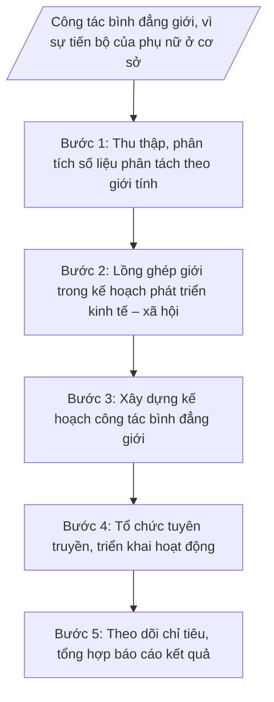

# Skill: Bình đẳng giới, vì sự tiến bộ phụ nữ

## 2. Khi nào dùng

- Lập kế hoạch công tác bình đẳng giới, vì sự tiến bộ của phụ nữ hằng năm của xã.
- Tổ chức tuyên truyền, phổ biến pháp luật về bình đẳng giới, phòng ngừa bạo lực trên cơ sở giới.
- Lồng ghép vấn đề bình đẳng giới trong xây dựng kế hoạch phát triển kinh tế – xã hội của xã.
- Theo dõi, đánh giá các chỉ tiêu bình đẳng giới; phối hợp Hội Liên hiệp Phụ nữ xã triển khai hoạt động.
- Lập báo cáo định kỳ (6 tháng, năm) kết quả công tác bình đẳng giới gửi cấp trên.

## 3. Đầu vào (Input)

| Trường | Mô tả | Bắt buộc |
|--------|-------|----------|
| `nam_ke_hoach` | Năm lập kế hoạch / kỳ báo cáo | Có |
| `so_lieu_gioi` | Số liệu phân tách theo giới tính: dân số, lao động, cán bộ, đảng viên, hộ nghèo, trẻ em... trên địa bàn | Có |
| `chi_tieu_binh_dang_gioi` | Các chỉ tiêu bình đẳng giới cần theo dõi (tỷ lệ nữ tham gia cấp ủy, HĐND; tỷ lệ lao động nữ qua đào tạo; tỷ lệ nữ hộ nghèo được hỗ trợ...) | Có |
| `ke_hoach_ktxh_xa` | Kế hoạch phát triển kinh tế – xã hội của xã trong năm (để lồng ghép nội dung bình đẳng giới) | Có |
| `hoat_dong_phu_nu` | Kế hoạch, chương trình hoạt động của Hội Liên hiệp Phụ nữ xã trong năm | Không |
| `so_lieu_ky_truoc` | Kết quả thực hiện chỉ tiêu bình đẳng giới kỳ trước để đối chiếu, đánh giá | Không |
| `vu_viec_bao_luc_gioi` | Vụ việc bạo lực trên cơ sở giới, xâm hại phụ nữ, trẻ em gái phát sinh trong kỳ (nếu có) | Không |

## 4. Quy trình

**Bước 1. Thu thập, phân tích số liệu phân tách theo giới tính**

- Làm gì: Thu thập số liệu phân tách theo giới tính từ các nguồn: công an xã (dân số), phòng chuyên môn (lao động, hộ nghèo), Hội Phụ nữ xã, các thôn/tổ dân phố; lập bảng số liệu theo các chỉ tiêu bình đẳng giới; phân tích khoảng cách giới, xác định vấn đề ưu tiên.
- Dùng input: `so_lieu_gioi`, `chi_tieu_binh_dang_gioi`, `so_lieu_ky_truoc`.
- Vai trò: Công chức văn hóa – xã hội phụ trách lĩnh vực bình đẳng giới trực tiếp thu thập, phân tích. AI hỗ trợ: thiết kế bảng số liệu theo chỉ tiêu, tính toán tỷ lệ, so sánh với kỳ trước, gợi ý vấn đề ưu tiên từ khoảng cách giới. ⏱ 1–2 ngày (ước tính) làm việc.
- Lưu ý nghiệp vụ: Số liệu phải có nguồn rõ ràng, thống nhất cách tính giữa các kỳ; không suy diễn nguyên nhân khi chưa có căn cứ; số liệu vụ việc bạo lực trên cơ sở giới chỉ dùng ở dạng tổng hợp, bảo mật thông tin nạn nhân.
- → Kết quả bước: Bảng số liệu phân tách theo giới tính + phân tích khoảng cách giới, vấn đề ưu tiên của xã.

**Bước 2. Lồng ghép giới trong kế hoạch phát triển kinh tế – xã hội**

- Làm gì: Rà soát dự thảo kế hoạch phát triển kinh tế – xã hội của xã; xác định nội dung cần lồng ghép (chỉ tiêu có phân tách giới, hoạt động hỗ trợ phụ nữ, kinh phí cho công tác bình đẳng giới); đề xuất bổ sung bằng văn bản gửi đơn vị chủ trì soạn thảo kế hoạch.
- Dùng input: `ke_hoach_ktxh_xa`, bảng phân tích ở Bước 1.
- Vai trò: Công chức văn hóa – xã hội phụ trách lĩnh vực rà soát, đề xuất lồng ghép. AI hỗ trợ: đối chiếu kế hoạch KT-XH với checklist lồng ghép giới, soạn dự thảo văn bản đề xuất bổ sung nội dung. ⏱ 0,5–1 ngày (ước tính) làm việc.
- Lưu ý nghiệp vụ: Lồng ghép phải cụ thể (chỉ tiêu, hoạt động, kinh phí) chứ không chỉ nêu khẩu hiệu; đề xuất phải gửi kịp thời trước khi kế hoạch KT-XH được thông qua.
- → Kết quả bước: Văn bản đề xuất lồng ghép nội dung bình đẳng giới vào kế hoạch phát triển KT-XH của xã.

**Bước 3. Xây dựng kế hoạch công tác bình đẳng giới**

- Làm gì: Căn cứ kết quả Bước 1–2, dự thảo Kế hoạch công tác bình đẳng giới, vì sự tiến bộ của phụ nữ: mục đích, yêu cầu; chỉ tiêu phấn đấu; nội dung (tuyên truyền pháp luật; hỗ trợ phụ nữ phát triển kinh tế; phòng ngừa, ứng phó bạo lực trên cơ sở giới; nâng cao năng lực cán bộ nữ); phân công thực hiện; kinh phí; phối hợp Hội Liên hiệp Phụ nữ xã; trình lãnh đạo UBND xã phê duyệt.
- Dùng input: Bảng phân tích ở Bước 1, `hoat_dong_phu_nu`, `nam_ke_hoach`.
- Vai trò: Công chức văn hóa – xã hội phụ trách lĩnh vực dự thảo kế hoạch, phối hợp Hội Liên hiệp Phụ nữ xã thống nhất nội dung. AI hỗ trợ: dàn ý kế hoạch theo cấu trúc chuẩn, gợi ý chỉ tiêu phù hợp với thực trạng xã, kiểm tra thể thức văn bản theo NĐ 30/2020/NĐ-CP. ⏱ 0,5–1 ngày (ước tính) làm việc.
- Lưu ý nghiệp vụ: Chỉ tiêu phải đo đếm được, khả thi; nội dung phối hợp với Hội Phụ nữ phải được thống nhất bằng văn bản (tránh chồng chéo); kinh phí phù hợp dự toán được giao.
- → Kết quả bước: Dự thảo Kế hoạch công tác bình đẳng giới, vì sự tiến bộ của phụ nữ (sẵn sàng trình ký).

**Bước 4. Tổ chức tuyên truyền, triển khai hoạt động**

- Làm gì: Tổ chức các hoạt động theo kế hoạch đã phê duyệt: tuyên truyền pháp luật về bình đẳng giới qua đài truyền thanh xã, hội nghị thôn, pa-nô; hưởng ứng Tháng hành động vì bình đẳng giới; phối hợp Hội Phụ nữ xã tổ chức tập huấn, hỗ trợ phụ nữ phát triển kinh tế; nắm tình hình, can thiệp kịp thời vụ việc bạo lực trên cơ sở giới (phối hợp công an xã).
- Dùng input: Kế hoạch đã phê duyệt ở Bước 3, `vu_viec_bao_luc_gioi`.
- Vai trò: Công chức văn hóa – xã hội phụ trách lĩnh vực đầu mối tổ chức, phối hợp Hội Liên hiệp Phụ nữ xã và các thôn triển khai. AI hỗ trợ: soạn nội dung tuyên truyền, bài phát thanh, kế hoạch chi tiết từng hoạt động; lập bảng theo dõi tiến độ. ⏱ ~triển khai xuyên suốt năm theo kế hoạch (ước tính).
- Lưu ý nghiệp vụ: Nội dung tuyên truyền phải phù hợp phong tục, tập quán địa phương; vụ việc bạo lực trên cơ sở giới phải xử lý kịp thời, bảo mật thông tin nạn nhân, phối hợp chặt chẽ với công an xã; mọi hoạt động đều phải có biên bản, hình ảnh, danh sách người tham gia làm căn cứ báo cáo.
- → Kết quả bước: Hồ sơ triển khai hoạt động (biên bản, danh sách, hình ảnh, số liệu người tham gia từng hoạt động).

**Bước 5. Theo dõi chỉ tiêu, tổng hợp báo cáo kết quả**

- Làm gì: Cập nhật kết quả thực hiện từng chỉ tiêu bình đẳng giới; đối chiếu với chỉ tiêu kế hoạch và kỳ trước; dự thảo Báo cáo kết quả công tác bình đẳng giới, vì sự tiến bộ của phụ nữ (định kỳ 6 tháng, năm); trình Trưởng phòng kiểm tra, lãnh đạo UBND xã ký ban hành; gửi cấp trên, lưu hồ sơ.
- Dùng input: Hồ sơ triển khai ở Bước 4, `chi_tieu_binh_dang_gioi`, `so_lieu_ky_truoc`, `nam_ke_hoach`.
- Vai trò: Công chức văn hóa – xã hội phụ trách lĩnh vực cập nhật chỉ tiêu, dự thảo báo cáo. AI hỗ trợ: bảng đối chiếu chỉ tiêu (kế hoạch/thực hiện/kỳ trước), dàn ý báo cáo theo cấu trúc chuẩn, rà soát thể thức NĐ 30/2020/NĐ-CP. ⏱ 1–2 ngày (ước tính) làm việc.
- Lưu ý nghiệp vụ: Số liệu báo cáo phải khớp với hồ sơ triển khai ở Bước 4; chỉ tiêu chưa đạt phải nêu rõ nguyên nhân và giải pháp; không tô hồng kết quả.
- → Kết quả bước: Báo cáo kết quả công tác bình đẳng giới, vì sự tiến bộ của phụ nữ (bản dự thảo đã qua kiểm tra, sẵn sàng trình ký).

## Luồng quy trình (Workflow)

## 5. Đầu ra (Output)

**Sản phẩm:**
1. Kế hoạch công tác bình đẳng giới, vì sự tiến bộ của phụ nữ (sản phẩm chính 1).
2. Báo cáo kết quả công tác bình đẳng giới, vì sự tiến bộ của phụ nữ (sản phẩm chính 2).
3. Bảng số liệu phân tách theo giới tính và đối chiếu chỉ tiêu (phụ lục).
4. Hồ sơ triển khai hoạt động tuyên truyền, tập huấn (phụ lục).

**Cấu trúc output chuẩn — Kế hoạch công tác bình đẳng giới (thể thức theo NĐ 30/2020/NĐ-CP):**
1. Quốc hiệu "CỘNG HÒA XÃ HỘI CHỦ NGHĨA VIỆT NAM" – Tiêu ngữ "Độc lập – Tự do – Hạnh phúc".
2. Tên cơ quan ban hành: ỦY BAN NHÂN DÂN XÃ A.
3. Số, ký hiệu văn bản (Số: .../KH-UBND).
4. Địa danh, ngày, tháng, năm ban hành.
5. Tên loại và trích yếu nội dung: KẾ HOẠCH / Công tác bình đẳng giới, vì sự tiến bộ của phụ nữ xã A năm ...
6. Nội dung kế hoạch:
   - I. Mục đích, yêu cầu.
   - II. Chỉ tiêu phấn đấu.
   - III. Nội dung thực hiện (tuyên truyền, phổ biến pháp luật; hỗ trợ phụ nữ phát triển kinh tế; phòng ngừa, ứng phó bạo lực trên cơ sở giới; công tác cán bộ nữ).
   - IV. Tổ chức thực hiện (Phòng Văn hóa – Xã hội chủ trì; Hội Liên hiệp Phụ nữ xã và các đơn vị phối hợp).
   - V. Kinh phí thực hiện.
7. Nơi nhận.
8. Chữ ký: TM. ỦY BAN NHÂN DÂN / KT. CHỦ TỊCH / PHÓ CHỦ TỊCH (hoặc CHỦ TỊCH) / (ký tên, đóng dấu) — bà Trần Thị B / ông Nguyễn Văn A.

**Cấu trúc output chuẩn — Báo cáo kết quả công tác bình đẳng giới:**
1. Quốc hiệu "CỘNG HÒA XÃ HỘI CHỦ NGHĨA VIỆT NAM" – Tiêu ngữ "Độc lập – Tự do – Hạnh phúc".
2. Tên cơ quan ban hành: ỦY BAN NHÂN DÂN XÃ A.
3. Số, ký hiệu văn bản (Số: .../BC-UBND).
4. Địa danh, ngày, tháng, năm ban hành.
5. Tên loại và trích yếu nội dung: BÁO CÁO / Kết quả công tác bình đẳng giới, vì sự tiến bộ của phụ nữ xã A năm ...
6. Nội dung báo cáo:
   - I. Tình hình chung (số liệu phân tách theo giới tính nổi bật).
   - II. Kết quả thực hiện (tuyên truyền; lồng ghép giới; kết quả từng chỉ tiêu; phối hợp Hội Phụ nữ; xử lý vụ việc bạo lực trên cơ sở giới nếu có).
   - III. Đánh giá chung (ưu điểm, tồn tại, nguyên nhân).
   - IV. Nhiệm vụ thời gian tới.
   - V. Kiến nghị, đề xuất.
7. Nơi nhận.
8. Chữ ký: TM. ỦY BAN NHÂN DÂN / CHỦ TỊCH / (ký tên, đóng dấu) — ông Nguyễn Văn A.

## 6. Checklist nghiệm thu

- [ ] Kế hoạch và báo cáo có đủ thành phần theo cấu trúc chuẩn mục 4, đúng thể thức NĐ 30/2020/NĐ-CP.
- [ ] Số, ký hiệu văn bản đúng định dạng .../KH-UBND và .../BC-UBND, đánh số liên tục.
- [ ] Bảng số liệu phân tách theo giới tính có nguồn rõ ràng, cách tính thống nhất giữa các kỳ.
- [ ] Chỉ tiêu trong kế hoạch đo đếm được, khả thi, gắn với thực trạng đã phân tích ở Bước 1.
- [ ] Nội dung lồng ghép giới trong kế hoạch KT-XH cụ thể (chỉ tiêu, hoạt động, kinh phí), có văn bản đề xuất.
- [ ] Nội dung phối hợp với Hội Liên hiệp Phụ nữ xã được thống nhất, phân công rõ ràng, không chồng chéo.
- [ ] Số liệu báo cáo khớp với hồ sơ triển khai hoạt động; chỉ tiêu chưa đạt nêu rõ nguyên nhân, giải pháp.
- [ ] Thông tin vụ việc bạo lực trên cơ sở giới (nếu có) chỉ ở dạng tổng hợp, bảo mật thông tin nạn nhân.
- [ ] Không có số liệu, căn cứ pháp lý, số hiệu văn bản nào bị bịa đặt.
- [ ] Cả hai văn bản đã qua đủ 3 nấc human gate trước khi ban hành; hồ sơ lưu đầy đủ.

## 7. Ví dụ mô phỏng

*Dữ liệu dưới đây là giả lập 100% phục vụ minh họa.*

**Input mẫu:**
- nam_ke_hoach: 2026.
- so_lieu_gioi: Dân số 10.000 người (nữ 51%); lao động nữ qua đào tạo 40%; cán bộ nữ cấp xã 30%; hộ nghèo do phụ nữ làm chủ hộ: 25 hộ.
- chi_tieu_binh_dang_gioi: Tỷ lệ nữ tham gia cấp ủy đạt 25%; tỷ lệ lao động nữ qua đào tạo đạt 45%; 100% vụ việc bạo lực trên cơ sở giới được can thiệp kịp thời.
- ke_hoach_ktxh_xa: Kế hoạch phát triển KT-XH xã A năm 2026 (dự thảo).
- hoat_dong_phu_nu: Hội LHPN xã A: 04 buổi tập huấn nghề may, 02 đợt tuyên truyền phòng chống bạo lực gia đình.
- so_lieu_ky_truoc: Năm 2025: tỷ lệ lao động nữ qua đào tạo 38%; 02 vụ việc bạo lực gia đình đã được hòa giải thành.
- vu_viec_bao_luc_gioi: Không phát sinh vụ việc mới trong 6 tháng đầu năm 2026.

**Output mẫu (Kế hoạch — trích cấu trúc chuẩn):**

> CỘNG HÒA XÃ HỘI CHỦ NGHĨA VIỆT NAM
> Độc lập – Tự do – Hạnh phúc
>
> ỦY BAN NHÂN DÂN XÃ A
> Số: 46/KH-UBND
>
> Xã A, ngày 15 tháng 01 năm 2026
>
> **KẾ HOẠCH**
> **Công tác bình đẳng giới, vì sự tiến bộ của phụ nữ xã A năm 2026**
>
> **I. Mục đích, yêu cầu**
>
> Nâng cao nhận thức về bình đẳng giới; thu hẹp khoảng cách giới trong lao động, cán bộ; phòng ngừa bạo lực trên cơ sở giới. Triển khai đồng bộ, thiết thực, phối hợp chặt chẽ với Hội Liên hiệp Phụ nữ xã.
>
> **II. Chỉ tiêu phấn đấu**
>
> - Tỷ lệ nữ tham gia cấp ủy đạt 25%; tỷ lệ cán bộ nữ cấp xã đạt 35%.
> - Tỷ lệ lao động nữ qua đào tạo đạt 45%.
> - 100% vụ việc bạo lực trên cơ sở giới được phát hiện, can thiệp kịp thời.
>
> **III. Nội dung thực hiện**
>
> 1. Tuyên truyền, phổ biến pháp luật về bình đẳng giới: 04 tin, bài trên đài truyền thanh xã; 01 hội nghị tập huấn tại các thôn.
> 2. Hỗ trợ phụ nữ phát triển kinh tế: phối hợp Hội Phụ nữ xã tổ chức 04 lớp tập huấn nghề may cho 80 hội viên.
> 3. Phòng ngừa, ứng phó bạo lực trên cơ sở giới: duy trì đường dây tiếp nhận thông tin (ĐT: 0900 000 001); phối hợp Công an xã can thiệp kịp thời.
> 4. Công tác cán bộ nữ: rà soát, đề xuất quy hoạch cán bộ nữ.
>
> **IV. Tổ chức thực hiện**
>
> - Phòng Văn hóa – Xã hội chủ trì, phối hợp Hội Liên hiệp Phụ nữ xã, các thôn tổ chức thực hiện.
> - Trưởng các thôn tuyên truyền, vận động người dân tham gia.
>
> **V. Kinh phí thực hiện**
>
> 15 triệu đồng từ dự toán chi sự nghiệp của xã năm 2026.
>
> ***Nơi nhận:***
> - Sở Nội vụ tỉnh A;
> - Hội LHPN tỉnh A (báo cáo);
> - TT Đảng ủy, HĐND xã;
> - Chủ tịch, các Phó Chủ tịch UBND xã;
> - Hội LHPN xã A;
> - Lưu: VT, VH-XH.
>
> TM. ỦY BAN NHÂN DÂN
> KT. CHỦ TỊCH
> PHÓ CHỦ TỊCH
>
> Trần Thị B

## 8. Human gate

1. **Công chức văn hóa – xã hội phụ trách lĩnh vực bình đẳng giới**: soạn thảo kế hoạch, báo cáo; chịu trách nhiệm về số liệu và nội dung (Bước 1–5).
2. **Trưởng phòng Văn hóa – Xã hội (ông Vũ Văn E)**: kiểm tra kế hoạch, báo cáo; yêu cầu chỉnh sửa nếu chưa đạt (trước khi trình lãnh đạo UBND xã).
3. **Phó Chủ tịch UBND xã (bà Trần Thị B)**: xem xét, cho ý kiến (nếu được phân công phụ trách lĩnh vực).
4. **Chủ tịch UBND xã (ông Nguyễn Văn A)**: ký duyệt, ban hành kế hoạch và báo cáo. Văn bản chỉ có hiệu lực sau khi Chủ tịch ký.

## 9. Giới hạn

- AI KHÔNG ra quyết định hành chính thay người có thẩm quyền (không quyết định phê duyệt kế hoạch, không quyết định can thiệp, xử lý vụ việc cụ thể).
- AI không tự ký, không tự phát hành văn bản dưới danh nghĩa UBND xã hay bất kỳ cá nhân nào.
- AI không bịa số liệu phân tách theo giới tính, kết quả chỉ tiêu; không bịa căn cứ pháp lý, số hiệu văn bản.
- AI không tiết lộ thông tin cá nhân của nạn nhân bạo lực trên cơ sở giới; chỉ dùng số liệu tổng hợp.
- AI không sử dụng văn bản pháp luật đã hết hiệu lực để làm căn cứ.

## 10. Căn cứ & lưu ý

- TT 10/2025/TT-BNV ngày 19/6/2025 của Bộ Nội vụ: hướng dẫn lĩnh vực nội vụ của phòng chuyên môn thuộc UBND cấp xã (sửa đổi, bổ sung bởi TT 06/2026/TT-BNV ngày 29/4/2026, hiệu lực 15/6/2026).
- NĐ 129/2025/NĐ-CP ngày 11/6/2025 của Chính phủ: phân định thẩm quyền chính quyền địa phương 2 cấp trong lĩnh vực quản lý nhà nước của Bộ Nội vụ.
- NĐ 150/2025/NĐ-CP ngày 12/6/2025 của Chính phủ: tổ chức Phòng Văn hóa – Xã hội thuộc UBND cấp xã (hiệu lực 16/6/2025); sửa đổi bởi NĐ 370/2025/NĐ-CP (hiệu lực 01/01/2026).
- NĐ 30/2020/NĐ-CP của Chính phủ: thể thức, kỹ thuật trình bày văn bản hành chính (áp dụng cho kế hoạch, báo cáo).
- Lưu ý: công tác bình đẳng giới ở cấp xã thực hiện lồng ghép trong kế hoạch phát triển KT-XH và phối hợp chặt chẽ với Hội Liên hiệp Phụ nữ xã; mọi số liệu cá nhân liên quan đến vụ việc bạo lực trên cơ sở giới phải được bảo mật.
