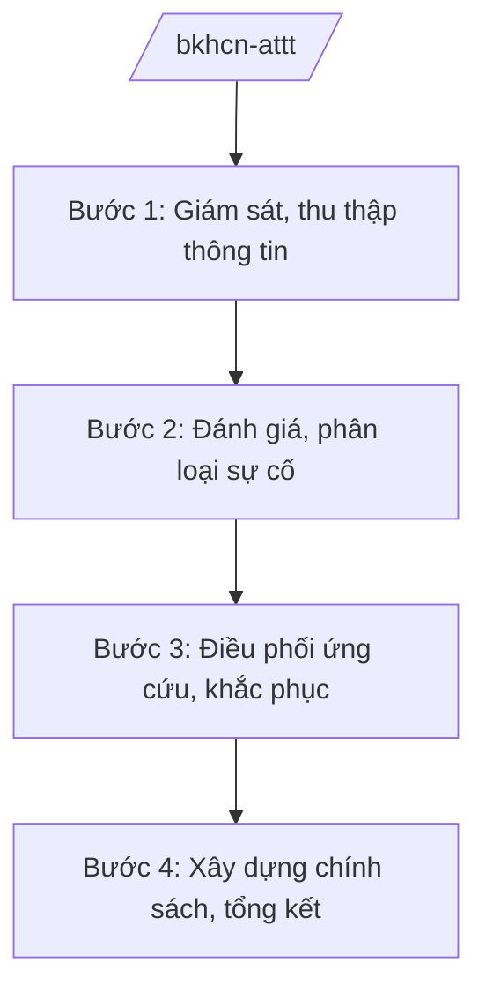

# Skill: An toàn thông tin mạng (cấp bộ)

## 2. Khi nào dùng

Khi Bộ Khoa học và Công nghệ thực hiện quản lý nhà nước về an toàn thông tin mạng: xây dựng
chiến lược, chương trình; giám sát, cảnh báo, ứng cứu sự cố an toàn thông tin; quản lý sản phẩm,
dịch vụ an toàn thông tin mạng.

## 3. Đầu vào (Input)

| Trường | Mô tả | Bắt buộc |
|--------|-------|----------|
| `nhiem_vu` | Nhiệm vụ: chiến lược / giám sát / ứng cứu sự cố / quản lý sản phẩm | Có |
| `doi_tuong` | Hệ thống thông tin, tổ chức liên quan | Có |
| `thong_tin_su_co` | Thông tin sự cố (nếu nhiệm vụ là ứng cứu) | Không |
| `muc_tieu` | Mục tiêu chương trình/chiến lược | Không |

## 4. Quy trình

**Bước 1. Giám sát, thu thập thông tin**

- Làm gì: Giám sát không gian mạng; thu thập, phân tích nguy cơ, lỗ hổng, mã độc;
  tiếp nhận báo cáo sự cố từ tổ chức, doanh nghiệp.
- Dùng input: `doi_tuong`.
- Vai trò: Cục An toàn thông tin (Bộ KH&CN) chủ trì; AI hỗ trợ tổng hợp báo cáo giám sát, phân loại mức độ ⏱ ~2–3 ngày làm việc (ước tính).
- Lưu ý nghiệp vụ: Thông tin sự cố có thể nhạy cảm — tuân thủ quy định bảo mật; phối hợp
  Bộ Công an đối với sự cố nghiêm trọng, có yếu tố tội phạm mạng.
- → Kết quả bước: Báo cáo giám sát, cảnh báo.

**Bước 2. Đánh giá, phân loại sự cố**

- Làm gì: Đánh giá mức độ nghiêm trọng; phân loại, định cấp sự cố; đề xuất phương án ứng cứu.
- Dùng input: `thong_tin_su_co`, báo cáo giám sát.
- Vai trò: Chuyên viên Cục An toàn thông tin đánh giá; AI hỗ trợ tổng hợp, dự thảo phương án ⏱ ~3–5 ngày làm việc (ước tính).
- Lưu ý nghiệp vụ: AI chỉ hỗ trợ tổng hợp — quyết định phân loại, điều phối ứng cứu do
  người có thẩm quyền quyết định.
- → Kết quả bước: Phân loại sự cố + phương án ứng cứu.

**Bước 3. Điều phối ứng cứu, khắc phục**

- Làm gì: Điều phối các đơn vị ứng cứu; hướng dẫn tổ chức bị ảnh hưởng khắc phục;
  theo dõi đến khi xử lý xong.
- Dùng input: Phương án ứng cứu.
- Vai trò: Cục An toàn thông tin điều phối; AI hỗ trợ lập nhật ký ứng cứu, báo cáo tiến độ (⏱ 1–2 giờ).
- Lưu ý nghiệp vụ: Bảo đảm thông tin liên lạc thông suốt; báo cáo cấp trên kịp thời với sự cố
  nghiêm trọng.
- → Kết quả bước: Sự cố được xử lý; báo cáo tổng kết ứng cứu.

**Bước 4. Xây dựng chính sách, tổng kết**

- Làm gì: Xây dựng chiến lược, chương trình an toàn thông tin; ban hành cảnh báo, hướng dẫn;
  sơ kết, rút kinh nghiệm.
- Dùng input: `muc_tieu`, kết quả các bước trên.
- Vai trò: Cục trưởng kiểm tra; Thứ trưởng duyệt; AI hỗ trợ dự thảo văn bản (⏱ 2 giờ).
- Lưu ý nghiệp vụ: Văn bản cảnh báo phải chính xác, kịp thời, không gây hoang mang;
  chiến lược ATTT gắn với chuyển đổi số quốc gia.
- → Kết quả bước: Văn bản chính sách/cảnh báo được ban hành.

## Luồng quy trình (Workflow)

## 5. Đầu ra (Output)

- Báo cáo giám sát, cảnh báo an toàn thông tin.
- Phương án, báo cáo ứng cứu sự cố.
- Chiến lược/chương trình, văn bản cảnh báo (đúng thể thức NĐ 30/2020/NĐ-CP).

### Cấu trúc output chuẩn (văn bản cảnh báo)

1. Quốc hiệu "CỘNG HÒA XÃ HỘI CHỦ NGHĨA VIỆT NAM", Tiêu ngữ "Độc lập – Tự do – Hạnh phúc"; số, ký hiệu: …/BKHCN-ATTT.
2. Căn cứ (NĐ 55/2025/NĐ-CP...).
3. Nội dung: nguy cơ/lỗ hổng phát hiện; mức độ ảnh hưởng; khuyến nghị biện pháp phòng ngừa,
   khắc phục; đầu mối liên hệ.
4. Nơi nhận (kết thúc "- Lưu: VT, [mã đơn vị]."); chữ ký (ghi rõ chức danh, họ tên người ký; ký hiệu "KT."/"TL." khi ký thay) người có thẩm quyền.

> **Checklist thể thức văn bản theo NĐ 30/2020/NĐ-CP** — đối chiếu trước khi trình ký:
> 1. Quốc hiệu và Tiêu ngữ.
> 2. Tên cơ quan, tổ chức ban hành văn bản.
> 3. Số, ký hiệu của văn bản.
> 4. Địa danh và thời gian ban hành văn bản.
> 5. Tên loại và trích yếu nội dung văn bản.
> 6. Nội dung văn bản.
> 7. Chức vụ, họ tên và chữ ký của người có thẩm quyền.
> 8. Dấu, chữ ký số của cơ quan, tổ chức.
> 9. Nơi nhận (kèm Phụ lục nếu có).

## 6. Checklist nghiệm thu

- [ ] Thông tin sự cố được xác minh, phân loại đúng mức độ.
- [ ] Phương án ứng cứu cụ thể, có đầu mối, thời hạn.
- [ ] Phối hợp Bộ Công an với sự cố nghiêm trọng.
- [ ] Bảo mật thông tin nhạy cảm đúng quy định.
- [ ] Văn bản cảnh báo/hướng dẫn rõ ràng, khả thi.
- [ ] Đúng thể thức NĐ 30/2020/NĐ-CP.
- [ ] Đã qua human gate đầy đủ.

## 7. Ví dụ mô phỏng

*Dữ liệu dưới đây là giả lập 100% phục vụ minh họa.*

**Input mẫu:** `nhiem_vu` = cảnh báo; `doi_tuong` = hệ thống thông tin của các bộ, cơ quan ngang bộ;
`thong_tin_su_co` = phát hiện chiến dịch mã độc giả lập nhắm vào máy chủ thư điện tử công vụ
(thông tin giả lập).

**Output mẫu (trích cấu trúc chuẩn):**

> **BỘ KHOA HỌC VÀ CÔNG NGHỆ**
> **CỤC AN TOÀN THÔNG TIN**
> **CỘNG HÒA XÃ HỘI CHỦ NGHĨA VIỆT NAM**
> **Độc lập – Tự do – Hạnh phúc**
>
> Số: 1234/BKHCN-ATTT *(số hiệu giả lập)*
>
> **CẢNH BÁO**
> **Về chiến dịch tấn công mã độc vào hệ thống thư điện tử công vụ**
>
> *Căn cứ Nghị định số 55/2025/NĐ-CP ngày 02/3/2025 của Chính phủ...*
>
> Cục An toàn thông tin phát hiện chiến dịch mã độc *(tình huống giả lập)*... Khuyến nghị:
> 1. Rà soát, cập nhật bản vá... 2. Tăng cường giám sát... Đầu mối liên hệ: ...

## 8. Human gate

1. Cục trưởng Cục An toàn thông tin: duyệt phân loại sự cố, phương án ứng cứu.
2. Thứ trưởng phụ trách: duyệt với sự cố nghiêm trọng, văn bản chính sách.
3. Bộ trưởng: ban hành chiến lược, chương trình.

## 9. Giới hạn

- AI không quyết định phân loại sự cố, điều phối ứng cứu thay người có thẩm quyền.
- AI không bịa thông tin sự cố, lỗ hổng, mã độc.
- AI không tự ký, ban hành văn bản; không tiết lộ thông tin nhạy cảm.
- AI không viện dẫn văn bản hết hiệu lực.

## 10. Căn cứ & lưu ý

- Nghị định số 55/2025/NĐ-CP ngày 02/3/2025 của Chính phủ quy định chức năng, nhiệm vụ,
  quyền hạn và cơ cấu tổ chức của Bộ Khoa học và Công nghệ (hiệu lực từ 01/3/2025).
- Pháp luật về an toàn thông tin mạng.
- Nghị định số 30/2020/NĐ-CP về công tác văn thư (thể thức văn bản).
- Lưu ý phối hợp Bộ Công an đối với sự cố có yếu tố tội phạm mạng.
