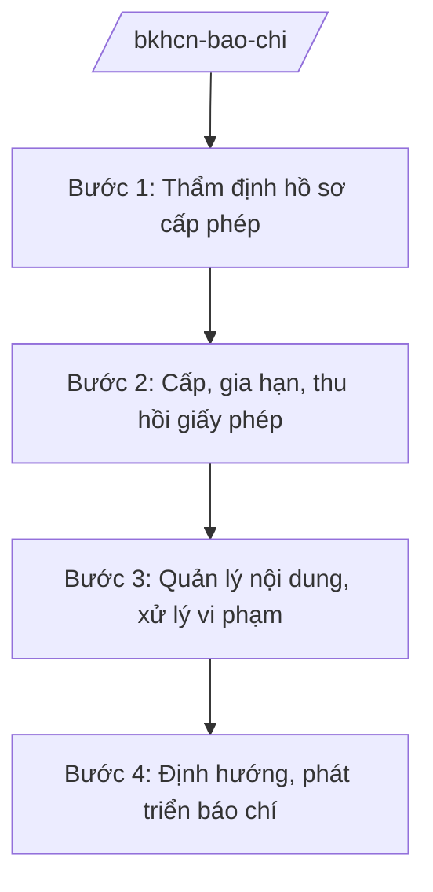

# Skill: Quản lý báo chí, xuất bản, thông tin điện tử

## 2. Khi nào dùng

Khi Bộ Khoa học và Công nghệ thực hiện quản lý nhà nước về báo chí, xuất bản, thông tin điện tử:
cấp phép hoạt động báo chí, xuất bản; quản lý nội dung thông tin trên mạng; xử lý vi phạm;
định hướng thông tin, tuyên truyền.

## 3. Đầu vào (Input)

| Trường | Mô tả | Bắt buộc |
|--------|-------|----------|
| `nhiem_vu` | Nhiệm vụ: cấp phép / quản lý nội dung / xử lý vi phạm / định hướng | Có |
| `co_quan_bao_chi` | Cơ quan báo chí, nhà xuất bản, trang thông tin điện tử liên quan | Không |
| `ho_so_cap_phep` | Hồ sơ đề nghị cấp phép (nếu có) | Không |
| `noi_dung_vi_pham` | Nội dung vi phạm cần xử lý (nếu có) | Không |

## 4. Quy trình

**Bước 1. Thẩm định hồ sơ cấp phép**

- Làm gì: Tiếp nhận, thẩm định hồ sơ đề nghị cấp giấy phép hoạt động báo chí, xuất bản,
  thiết lập trang thông tin điện tử tổng hợp, mạng xã hội.
- Dùng input: `co_quan_bao_chi`, `ho_so_cap_phep`.
- Vai trò: Cục Báo chí / Cục Xuất bản, In và Phát hành (Bộ KH&CN) thẩm định; AI hỗ trợ kiểm tra tính đầy đủ hồ sơ ⏱ ~1–2 ngày làm việc (ước tính).
- Lưu ý nghiệp vụ: AI chỉ hỗ trợ kiểm tra hồ sơ — quyết định cấp phép do người có thẩm quyền
  quyết định.
- → Kết quả bước: Kết quả thẩm định hồ sơ.

**Bước 2. Cấp, gia hạn, thu hồi giấy phép**

- Làm gì: Cấp mới, gia hạn, sửa đổi, thu hồi giấy phép theo quy định.
- Dùng input: Kết quả thẩm định.
- Vai trò: Cục trưởng ký (theo phân cấp); AI hỗ trợ dự thảo giấy phép, theo dõi thời hạn (⏱ 30 phút).
- Lưu ý nghiệp vụ: Đúng thời hạn; công khai.
- → Kết quả bước: Giấy phép được cấp/gia hạn/thu hồi.

**Bước 3. Quản lý nội dung, xử lý vi phạm**

- Làm gì: Theo dõi nội dung thông tin báo chí, mạng xã hội; phát hiện, xử lý vi phạm
  (tin sai sự thật, nội dung cấm); định hướng thông tin.
- Dùng input: `noi_dung_vi_pham`.
- Vai trò: Cục chuyên ngành thực hiện; AI hỗ trợ tổng hợp vụ việc, dự thảo văn bản xử lý (⏱ 2 giờ).
- Lưu ý nghiệp vụ: Xử lý vi phạm đúng trình tự, có căn cứ; bảo đảm quyền tự do báo chí theo
  quy định pháp luật.
- → Kết quả bước: Quyết định xử lý vi phạm; văn bản định hướng thông tin.

**Bước 4. Định hướng, phát triển báo chí**

- Làm gì: Xây dựng quy hoạch, kế hoạch phát triển báo chí; định hướng tuyên truyền nhiệm vụ
  chính trị; hỗ trợ chuyển đổi số báo chí.
- Dùng input: `nhiem_vu`.
- Vai trò: Cục Báo chí chủ trì; AI hỗ trợ dự thảo văn bản định hướng (⏱ 2 giờ).
- Lưu ý nghiệp vụ: Định hướng thông tin phải kịp thời, đúng chủ trương; hỗ trợ báo chí
  chuyển đổi số nhưng không can thiệp nội dung tác nghiệp báo chí.
- → Kết quả bước: Văn bản quy hoạch, định hướng được ban hành.

## Luồng quy trình (Workflow)

## 5. Đầu ra (Output)

- Giấy phép hoạt động báo chí, xuất bản, thông tin điện tử.
- Quyết định xử lý vi phạm.
- Văn bản quy hoạch, định hướng phát triển báo chí (đúng thể thức NĐ 30/2020/NĐ-CP).

### Cấu trúc output chuẩn (giấy phép hoạt động báo chí)

1. Quốc hiệu "CỘNG HÒA XÃ HỘI CHỦ NGHĨA VIỆT NAM", Tiêu ngữ "Độc lập – Tự do – Hạnh phúc"; số giấy phép.
2. Căn cứ (pháp luật về báo chí; NĐ 55/2025/NĐ-CP...).
3. Nội dung: tên cơ quan báo chí; loại hình; tôn chỉ, mục đích; phạm vi; thời hạn.
4. Nghĩa vụ của cơ quan báo chí.
5. Hiệu lực; chữ ký (ghi rõ chức danh, họ tên người ký; ký hiệu "KT."/"TL." khi ký thay) người có thẩm quyền; con dấu.
6. Nơi nhận (kết thúc "- Lưu: VT, [mã đơn vị].").

> **Chuẩn tài liệu đầu ra** (thứ tự ưu tiên):
> 1. Chuẩn riêng của ngành/cơ quan chủ quản — mẫu, biểu mẫu, quy chuẩn tại văn bản quy phạm chuyên ngành (xem mục "Căn cứ & lưu ý").
> 2. Tài liệu không có quy chuẩn riêng — thể thức NĐ 30/2020/NĐ-CP: Quốc hiệu và Tiêu ngữ; tên cơ quan ban hành; số, ký hiệu; địa danh và thời gian; tên loại và trích yếu; nội dung; chức vụ, họ tên, chữ ký người có thẩm quyền; dấu, chữ ký số; nơi nhận (kèm Phụ lục nếu có).

## 6. Checklist nghiệm thu

- [ ] Hồ sơ cấp phép được thẩm định đúng điều kiện, đúng thời hạn.
- [ ] Xử lý vi phạm đúng trình tự, có căn cứ pháp lý.
- [ ] Định hướng thông tin rõ ràng, kịp thời.
- [ ] Không để AI quyết định thay người có thẩm quyền.
- [ ] Đúng thể thức NĐ 30/2020/NĐ-CP.
- [ ] Đã qua human gate đầy đủ.

## 7. Ví dụ mô phỏng

*Dữ liệu dưới đây là giả lập 100% phục vụ minh họa.*

**Input mẫu:** `nhiem_vu` = cấp phép; `co_quan_bao_chi` = Tạp chí Khoa học AA (tên giả lập);
`ho_so_cap_phep` = hồ sơ đề nghị cấp giấy phép hoạt động tạp chí in và tạp chí điện tử (giả lập).

**Output mẫu (trích cấu trúc chuẩn):**

> **BỘ KHOA HỌC VÀ CÔNG NGHỆ**
> **CỤC BÁO CHÍ**
> **CỘNG HÒA XÃ HỘI CHỦ NGHĨA VIỆT NAM**
> **Độc lập – Tự do – Hạnh phúc**
>
> Số: 1234/GP-BC *(số hiệu giả lập)*
>
> **GIẤY PHÉP HOẠT ĐỘNG BÁO CHÍ**
>
> *Căn cứ pháp luật về báo chí;*
> *Căn cứ Nghị định số 55/2025/NĐ-CP ngày 02/3/2025 của Chính phủ...;*
>
> **Cấp cho:** Tạp chí Khoa học AA *(tên giả lập)*
> **Loại hình:** tạp chí in, tạp chí điện tử. **Tôn chỉ, mục đích:** ...

## 8. Human gate

1. Chuyên viên cục: thẩm định hồ sơ, theo dõi nội dung.
2. Cục trưởng: ký giấy phép (theo phân cấp), quyết định xử lý.
3. Thứ trưởng phụ trách: duyệt trường hợp phức tạp, văn bản định hướng.
4. Bộ trưởng: ban hành văn bản quy hoạch, chính sách.

## 9. Giới hạn

- AI không quyết định cấp/từ chối giấy phép, xử lý vi phạm thay người có thẩm quyền.
- AI không bịa nội dung vi phạm, kết quả thẩm định.
- AI không tự ký, ban hành văn bản.
- AI không viện dẫn văn bản hết hiệu lực.

## 10. Căn cứ & lưu ý

- Nghị định số 55/2025/NĐ-CP ngày 02/3/2025 của Chính phủ quy định chức năng, nhiệm vụ,
  quyền hạn và cơ cấu tổ chức của Bộ Khoa học và Công nghệ (hiệu lực từ 01/3/2025).
- Pháp luật về báo chí, xuất bản, an toàn thông tin mạng.
- Nghị định số 30/2020/NĐ-CP về công tác văn thư (thể thức văn bản).
