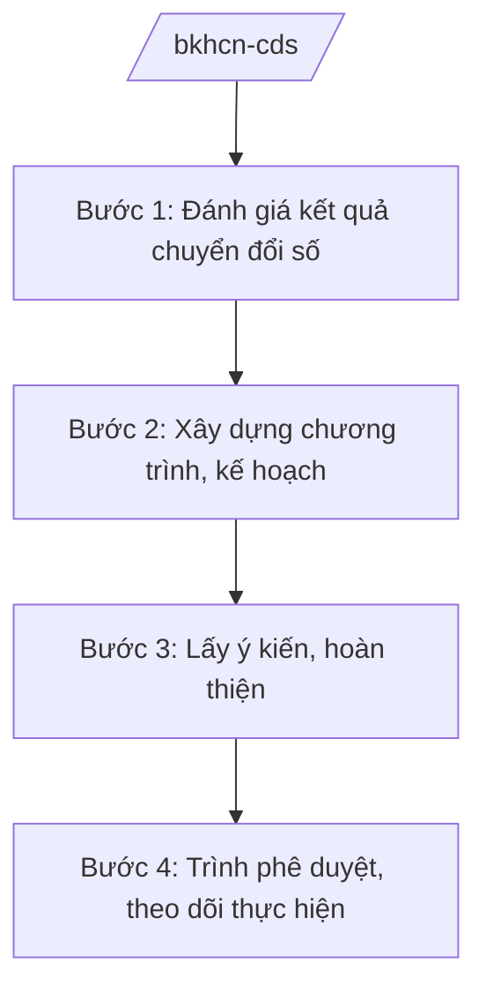

# Skill: Chuyển đổi số quốc gia

## 2. Khi nào dùng

Khi Bộ Khoa học và Công nghệ thực hiện vai trò cơ quan thường trực Ủy ban Quốc gia về chuyển đổi số:
xây dựng chương trình, kế hoạch chuyển đổi số quốc gia; theo dõi bộ chỉ số; hướng dẫn bộ/ngành,
địa phương; tổng hợp báo cáo Thủ tướng.

## 3. Đầu vào (Input)

| Trường | Mô tả | Bắt buộc |
|--------|-------|----------|
| `nhiem_vu` | Nhiệm vụ: chương trình / kế hoạch năm / đánh giá chỉ số / hướng dẫn | Có |
| `tru_cot` | Trụ cột: chính phủ số / kinh tế số / xã hội số | Có |
| `muc_tieu` | Mục tiêu, chỉ tiêu cụ thể | Có |
| `don_vi_phoi_hop` | Bộ/ngành, địa phương phối hợp | Không |

## 4. Quy trình

**Bước 1. Đánh giá kết quả chuyển đổi số**

- Làm gì: Tổng hợp báo cáo chuyển đổi số của bộ/ngành, địa phương; đánh giá bộ chỉ số
  (DTI và các chỉ số thành phần).
- Dùng input: `tru_cot`.
- Vai trò: Cục Chuyển đổi số quốc gia (Bộ KH&CN) chủ trì; AI hỗ trợ tổng hợp số liệu, lập bảng xếp hạng, biểu đồ ⏱ ~3–5 ngày làm việc (ước tính).
- Lưu ý nghiệp vụ: Số liệu từ báo cáo chính thức; phương pháp đánh giá thống nhất, công khai.
- → Kết quả bước: Báo cáo đánh giá chuyển đổi số quốc gia.

**Bước 2. Xây dựng chương trình, kế hoạch**

- Làm gì: Đề xuất mục tiêu, nhiệm vụ trọng tâm năm/giai đoạn; phân công đầu mối;
  cơ chế chính sách thúc đẩy.
- Dùng input: `muc_tieu`, báo cáo đánh giá.
- Vai trò: Chuyên viên cục soạn thảo; AI hỗ trợ dự thảo, đối chiếu mục tiêu các năm (⏱ 2–3 giờ).
- Lưu ý nghiệp vụ: Mục tiêu cụ thể, đo lường được; gắn với 3 trụ cột.
- → Kết quả bước: Dự thảo chương trình/kế hoạch chuyển đổi số.

**Bước 3. Lấy ý kiến, hoàn thiện**

- Làm gì: Lấy ý kiến bộ/ngành, địa phương, hiệp hội, doanh nghiệp công nghệ số.
- Dùng input: Dự thảo.
- Vai trò: Cục Chuyển đổi số quốc gia tổng hợp; AI hỗ trợ bảng tiếp thu ý kiến (⏱ 2 giờ).
- Lưu ý nghiệp vụ: Lấy ý kiến các địa phương điểm về chính quyền số.
- → Kết quả bước: Dự thảo hoàn chỉnh.

**Bước 4. Trình phê duyệt, theo dõi thực hiện**

- Làm gì: Trình Thủ tướng (Chủ tịch Ủy ban Quốc gia về chuyển đổi số) phê duyệt; ban hành
  văn bản hướng dẫn; theo dõi, đôn đốc; sơ kết, tổng kết.
- Dùng input: Toàn bộ hồ sơ.
- Vai trò: Cục trưởng kiểm tra; Thứ trưởng duyệt; AI hỗ trợ checklist, dự thảo văn bản đôn đốc ⏱ ~2–3 ngày làm việc (ước tính).
- Lưu ý nghiệp vụ: Công khai kết quả đánh giá; kịp thời tháo gỡ khó khăn của bộ/ngành, địa phương.
- → Kết quả bước: Văn bản phê duyệt + kế hoạch theo dõi.

## Luồng quy trình (Workflow)

## 5. Đầu ra (Output)

- Chương trình/kế hoạch chuyển đổi số quốc gia (đúng thể thức NĐ 30/2020/NĐ-CP).
- Báo cáo đánh giá chuyển đổi số; bảng xếp hạng chỉ số.
- Văn bản hướng dẫn, đôn đốc.

### Cấu trúc output chuẩn (quyết định phê duyệt chương trình)

1. Quốc hiệu "CỘNG HÒA XÃ HỘI CHỦ NGHĨA VIỆT NAM", Tiêu ngữ "Độc lập – Tự do – Hạnh phúc"; số, ký hiệu: …/QĐ-TTg.
2. Căn cứ pháp lý (NĐ 55/2025/NĐ-CP...).
3. Điều 1: Phê duyệt chương trình (mục tiêu, nhiệm vụ trọng tâm theo 3 trụ cột, phân kỳ).
4. Điều 2: Tổ chức thực hiện (Ủy ban Quốc gia về chuyển đổi số; Bộ KH&CN thường trực;
   trách nhiệm bộ/ngành, địa phương).
5. Điều 3: Hiệu lực; chế độ báo cáo, đánh giá.
6. Nơi nhận (kết thúc "- Lưu: VT, [mã đơn vị]."); chữ ký (ghi rõ chức danh, họ tên người ký; ký hiệu "KT."/"TL." khi ký thay) người có thẩm quyền.

> **Checklist thể thức văn bản theo NĐ 30/2020/NĐ-CP** — đối chiếu trước khi trình ký:
> 1. Quốc hiệu và Tiêu ngữ.
> 2. Tên cơ quan, tổ chức ban hành văn bản.
> 3. Số, ký hiệu của văn bản.
> 4. Địa danh và thời gian ban hành văn bản.
> 5. Tên loại và trích yếu nội dung văn bản.
> 6. Nội dung văn bản.
> 7. Chức vụ, họ tên và chữ ký của người có thẩm quyền.
> 8. Dấu, chữ ký số của cơ quan, tổ chức.
> 9. Nơi nhận (kèm Phụ lục nếu có).

## 6. Checklist nghiệm thu

- [ ] Số liệu đánh giá từ nguồn chính thức, phương pháp công khai.
- [ ] Mục tiêu cụ thể, đo lường được theo từng trụ cột.
- [ ] Nhiệm vụ có đầu mối, thời hạn rõ ràng.
- [ ] Đã lấy ý kiến bộ/ngành, địa phương.
- [ ] Đúng thẩm quyền phê duyệt; đúng thể thức NĐ 30/2020/NĐ-CP.
- [ ] Có cơ chế theo dõi, đôn đốc, đánh giá định kỳ.
- [ ] Đã qua human gate đầy đủ.

## 7. Ví dụ mô phỏng

*Dữ liệu dưới đây là giả lập 100% phục vụ minh họa.*

**Input mẫu:** `nhiem_vu` = kế hoạch năm; `tru_cot` = chính phủ số; `muc_tieu` = 100% TTHC đủ điều
kiện cung cấp trực tuyến toàn trình (mục tiêu giả lập).

**Output mẫu (trích cấu trúc chuẩn):**

> **THỦ TƯỚNG CHÍNH PHỦ**
> **CỘNG HÒA XÃ HỘI CHỦ NGHĨA VIỆT NAM**
> **Độc lập – Tự do – Hạnh phúc**
>
> Số: 1234/QĐ-TTg *(số hiệu giả lập)*
>
> **QUYẾT ĐỊNH**
> **Phê duyệt Kế hoạch chuyển đổi số quốc gia năm 2026**
>
> *Căn cứ Nghị định số 55/2025/NĐ-CP ngày 02/3/2025 của Chính phủ...;*
> *Theo đề nghị của Bộ trưởng Bộ Khoa học và Công nghệ,*
>
> **Điều 1.** Phê duyệt Kế hoạch... với mục tiêu 100% thủ tục hành chính đủ điều kiện
> được cung cấp trực tuyến toàn trình *(mục tiêu giả lập)*...

## 8. Human gate

1. Cục trưởng Cục Chuyển đổi số quốc gia: duyệt nội dung chuyên môn.
2. Thứ trưởng phụ trách: duyệt trước khi trình.
3. Bộ trưởng Bộ KH&CN: ký tờ trình.
4. Thủ tướng Chính phủ (Chủ tịch Ủy ban Quốc gia về chuyển đổi số): phê duyệt.

## 9. Giới hạn

- AI không quyết định mục tiêu, nhiệm vụ chuyển đổi số thay cơ quan có thẩm quyền.
- AI không bịa số liệu, xếp hạng chỉ số.
- AI không tự ký, ban hành văn bản.
- AI không viện dẫn văn bản hết hiệu lực.

## 10. Căn cứ & lưu ý

- Nghị định số 55/2025/NĐ-CP ngày 02/3/2025 của Chính phủ quy định chức năng, nhiệm vụ,
  quyền hạn và cơ cấu tổ chức của Bộ Khoa học và Công nghệ (hiệu lực từ 01/3/2025).
- Nghị quyết số 176/2025/QH15 về cơ cấu tổ chức của Chính phủ.
- Nghị định số 30/2020/NĐ-CP về công tác văn thư (thể thức văn bản).
- Lưu ý: Bộ KH&CN là cơ quan thường trực Ủy ban Quốc gia về chuyển đổi số.
