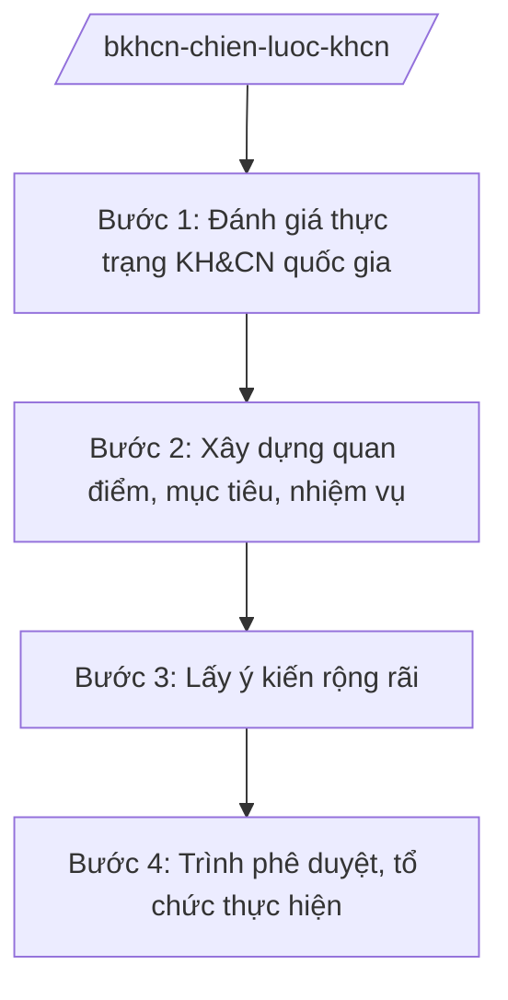

# Skill: Chiến lược KH&CN, đổi mới sáng tạo quốc gia

## 2. Khi nào dùng

Khi Bộ Khoa học và Công nghệ xây dựng chiến lược, kế hoạch phát triển khoa học, công nghệ
và đổi mới sáng tạo mang tầm quốc gia; định hướng ưu tiên nghiên cứu; chính sách thu hút,
trọng dụng nhân tài KH&CN.

## 3. Đầu vào (Input)

| Trường | Mô tả | Bắt buộc |
|--------|-------|----------|
| `ten_chien_luoc` | Tên chiến lược/kế hoạch | Có |
| `giai_doan` | Giai đoạn thực hiện | Có |
| `muc_tieu` | Mục tiêu tổng quát và cụ thể | Có |
| `linh_vuc_uu_tien` | Lĩnh vực KH&CN ưu tiên | Có |
| `nguon_luc` | Nguồn lực (ngân sách, nhân lực, hạ tầng) | Có |

## 4. Quy trình

**Bước 1. Đánh giá thực trạng KH&CN quốc gia**

- Làm gì: Tổng hợp chỉ số KH&CN (đầu tư, nhân lực, công bố, sáng chế, doanh nghiệp KHCN);
  đánh giá kết quả chiến lược giai đoạn trước.
- Dùng input: `giai_doan`, `linh_vuc_uu_tien`.
- Vai trò: Vụ Kế hoạch – Tài chính / Cục Thông tin KH&CN quốc gia chủ trì; AI hỗ trợ tổng hợp số liệu, lập bảng chỉ số ⏱ ~5–7 ngày làm việc (ước tính).
- Lưu ý nghiệp vụ: Số liệu từ nguồn chính thức; so sánh với khu vực và thế giới có cơ sở.
- → Kết quả bước: Báo cáo đánh giá thực trạng.

**Bước 2. Xây dựng quan điểm, mục tiêu, nhiệm vụ**

- Làm gì: Đề xuất quan điểm, mục tiêu, các nhiệm vụ, giải pháp đột phá; cơ chế chính sách mới.
- Dùng input: `muc_tieu`, `nguon_luc`, báo cáo thực trạng.
- Vai trò: Chuyên viên vụ chủ trì soạn thảo; AI hỗ trợ dự thảo, đối chiếu chiến lược các nước (⏱ 2–3 giờ).
- Lưu ý nghiệp vụ: Gắn với mục tiêu phát triển kinh tế – xã hội; đột phá về thể chế, nhân lực, hạ tầng.
- → Kết quả bước: Dự thảo chiến lược.

**Bước 3. Lấy ý kiến rộng rãi**

- Làm gì: Lấy ý kiến bộ/ngành, địa phương, viện nghiên cứu, trường đại học, doanh nghiệp,
  nhà khoa học; hội thảo khoa học.
- Dùng input: Dự thảo chiến lược.
- Vai trò: Đơn vị chủ trì tổng hợp; AI hỗ trợ phân loại ý kiến, bảng tiếp thu (⏱ 2–3 giờ).
- Lưu ý nghiệp vụ: Trân trọng ý kiến nhà khoa học, doanh nghiệp công nghệ.
- → Kết quả bước: Dự thảo hoàn chỉnh + báo cáo tiếp thu.

**Bước 4. Trình phê duyệt, tổ chức thực hiện**

- Làm gì: Trình Thủ tướng/Chính phủ phê duyệt; ban hành kế hoạch thực hiện; giao nhiệm vụ;
  theo dõi, sơ kết, tổng kết.
- Dùng input: Toàn bộ hồ sơ.
- Vai trò: Vụ trưởng kiểm tra; Thứ trưởng duyệt; AI hỗ trợ checklist hồ sơ (⏱ 1–2 giờ).
- Lưu ý nghiệp vụ: Công bố công khai; định kỳ đánh giá chỉ số.
- → Kết quả bước: Quyết định phê duyệt + kế hoạch tổ chức thực hiện.

## Luồng quy trình (Workflow)

## 5. Đầu ra (Output)

- Chiến lược phát triển KH&CN, đổi mới sáng tạo (đúng thể thức NĐ 30/2020/NĐ-CP).
- Báo cáo đánh giá thực trạng; báo cáo tiếp thu ý kiến.
- Kế hoạch tổ chức thực hiện.

### Cấu trúc output chuẩn (quyết định phê duyệt chiến lược)

1. Quốc hiệu "CỘNG HÒA XÃ HỘI CHỦ NGHĨA VIỆT NAM", Tiêu ngữ "Độc lập – Tự do – Hạnh phúc"; số, ký hiệu: …/QĐ-TTg.
2. Căn cứ pháp lý (pháp luật về KH&CN; NĐ 55/2025/NĐ-CP...).
3. Điều 1: Phê duyệt chiến lược (quan điểm, mục tiêu, nhiệm vụ, giải pháp, phân kỳ).
4. Điều 2: Tổ chức thực hiện (Bộ KH&CN chủ trì; trách nhiệm bộ/ngành, địa phương).
5. Điều 3: Hiệu lực; chế độ báo cáo, sơ kết, tổng kết.
6. Nơi nhận (kết thúc "- Lưu: VT, [mã đơn vị]."); chữ ký (ghi rõ chức danh, họ tên người ký; ký hiệu "KT."/"TL." khi ký thay) người có thẩm quyền.

> **Checklist thể thức văn bản theo NĐ 30/2020/NĐ-CP** — đối chiếu trước khi trình ký:
> 1. Quốc hiệu và Tiêu ngữ.
> 2. Tên cơ quan, tổ chức ban hành văn bản.
> 3. Số, ký hiệu của văn bản.
> 4. Địa danh và thời gian ban hành văn bản.
> 5. Tên loại và trích yếu nội dung văn bản.
> 6. Nội dung văn bản.
> 7. Chức vụ, họ tên và chữ ký của người có thẩm quyền.
> 8. Dấu, chữ ký số của cơ quan, tổ chức.
> 9. Nơi nhận (kèm Phụ lục nếu có).

## 6. Checklist nghiệm thu

- [ ] Số liệu thực trạng có nguồn chính thức.
- [ ] Mục tiêu cụ thể, có chỉ số đo lường.
- [ ] Nhiệm vụ, giải pháp đột phá, khả thi, có đầu mối.
- [ ] Đã lấy ý kiến rộng rãi (nhà khoa học, doanh nghiệp, địa phương).
- [ ] Đúng thẩm quyền phê duyệt; đúng thể thức NĐ 30/2020/NĐ-CP.
- [ ] Có cơ chế theo dõi, đánh giá chỉ số định kỳ.
- [ ] Đã qua human gate đầy đủ.

## 7. Ví dụ mô phỏng

*Dữ liệu dưới đây là giả lập 100% phục vụ minh họa.*

**Input mẫu:** `ten_chien_luoc` = "Chiến lược phát triển khoa học, công nghệ và đổi mới sáng tạo
đến năm 2035"; `giai_doan` = 2026–2035; `muc_tieu` = thuộc nhóm 40 quốc gia dẫn đầu về đổi mới
sáng tạo (mục tiêu giả lập); `linh_vuc_uu_tien` = trí tuệ nhân tạo, công nghệ sinh học, năng lượng mới.

**Output mẫu (trích cấu trúc chuẩn):**

> **THỦ TƯỚNG CHÍNH PHỦ**
> **CỘNG HÒA XÃ HỘI CHỦ NGHĨA VIỆT NAM**
> **Độc lập – Tự do – Hạnh phúc**
>
> Số: 1234/QĐ-TTg *(số hiệu giả lập)*
>
> **QUYẾT ĐỊNH**
> **Phê duyệt Chiến lược phát triển khoa học, công nghệ và đổi mới sáng tạo đến năm 2035**
>
> *Căn cứ pháp luật về khoa học và công nghệ;*
> *Căn cứ Nghị định số 55/2025/NĐ-CP ngày 02/3/2025 của Chính phủ...;*
> *Theo đề nghị của Bộ trưởng Bộ Khoa học và Công nghệ,*
>
> **Điều 1.** Phê duyệt Chiến lược... với mục tiêu đến năm 2035 thuộc nhóm 40 quốc gia dẫn đầu
> về đổi mới sáng tạo *(mục tiêu giả lập)*...

## 8. Human gate

1. Vụ trưởng đơn vị chủ trì: duyệt nội dung chuyên môn.
2. Thứ trưởng phụ trách: duyệt trước khi trình.
3. Bộ trưởng Bộ KH&CN: ký tờ trình Chính phủ.
4. Thủ tướng/Chính phủ: phê duyệt chiến lược quốc gia.

## 9. Giới hạn

- AI không quyết định quan điểm, mục tiêu, nhiệm vụ chiến lược thay cơ quan có thẩm quyền.
- AI không bịa số liệu, chỉ số KH&CN.
- AI không tự ký, ban hành văn bản.
- AI không viện dẫn văn bản hết hiệu lực.

## 10. Căn cứ & lưu ý

- Nghị định số 55/2025/NĐ-CP ngày 02/3/2025 của Chính phủ quy định chức năng, nhiệm vụ,
  quyền hạn và cơ cấu tổ chức của Bộ Khoa học và Công nghệ (hiệu lực từ 01/3/2025).
- Nghị quyết số 176/2025/QH15 về cơ cấu tổ chức của Chính phủ.
- Pháp luật về khoa học và công nghệ.
- Nghị định số 30/2020/NĐ-CP về công tác văn thư (thể thức văn bản).
