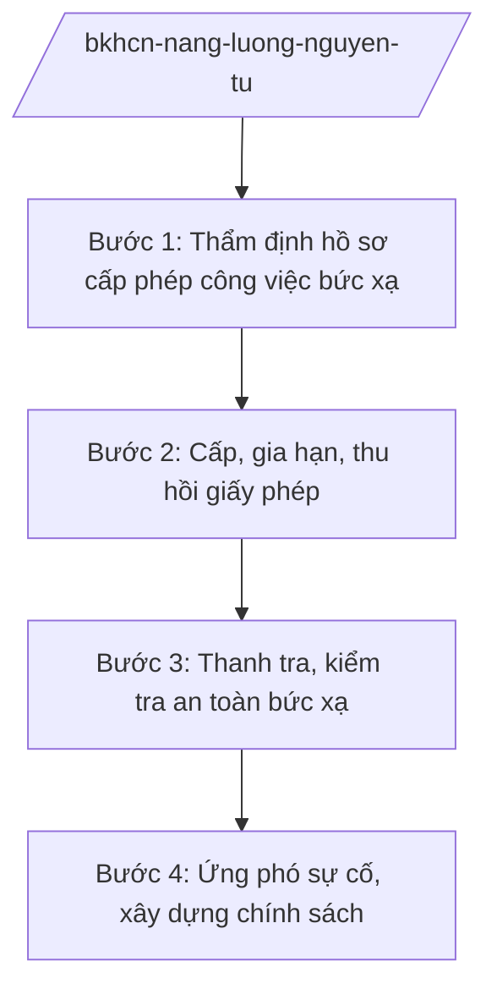

# Skill: Năng lượng nguyên tử (an toàn bức xạ)

## 2. Khi nào dùng

Khi Bộ Khoa học và Công nghệ thực hiện quản lý nhà nước về năng lượng nguyên tử: bảo đảm
an toàn bức xạ, an toàn hạt nhân; cấp phép tiến hành công việc bức xạ; quản lý nguồn phóng xạ,
chất thải phóng xạ; ứng phó sự cố bức xạ, hạt nhân.

## 3. Đầu vào (Input)

| Trường | Mô tả | Bắt buộc |
|--------|-------|----------|
| `nhiem_vu` | Nhiệm vụ: cấp phép / thanh tra / ứng phó sự cố / chính sách | Có |
| `co_so` | Cơ sở tiến hành công việc bức xạ (y tế, công nghiệp, nghiên cứu) | Không |
| `ho_so_cap_phep` | Hồ sơ đề nghị cấp phép (nếu có) | Không |
| `thong_tin_su_co` | Thông tin sự cố bức xạ (nếu có) | Không |

## 4. Quy trình

**Bước 1. Thẩm định hồ sơ cấp phép công việc bức xạ**

- Làm gì: Tiếp nhận, thẩm định hồ sơ đề nghị cấp giấy phép tiến hành công việc bức xạ
  (sử dụng nguồn phóng xạ, thiết bị bức xạ).
- Dùng input: `co_so`, `ho_so_cap_phep`.
- Vai trò: Cục An toàn bức xạ và hạt nhân (Bộ KH&CN) thẩm định; AI hỗ trợ kiểm tra tính đầy đủ hồ sơ, đối chiếu điều kiện an toàn ⏱ ~2–3 ngày làm việc (ước tính).
- Lưu ý nghiệp vụ: AI chỉ hỗ trợ kiểm tra hồ sơ — quyết định cấp phép do người có thẩm quyền
  quyết định; yêu cầu an toàn phải tuyệt đối tuân thủ.
- → Kết quả bước: Kết quả thẩm định hồ sơ.

**Bước 2. Cấp, gia hạn, thu hồi giấy phép**

- Làm gì: Cấp mới, gia hạn, sửa đổi, bổ sung, thu hồi giấy phép tiến hành công việc bức xạ.
- Dùng input: Kết quả thẩm định.
- Vai trò: Cục trưởng Cục An toàn bức xạ và hạt nhân ký (theo phân cấp); AI hỗ trợ dự thảo giấy phép, theo dõi thời hạn ⏱ ~2–3 ngày làm việc (ước tính).
- Lưu ý nghiệp vụ: Giấy phép có thời hạn; kiểm soát chặt nguồn phóng xạ có hoạt độ cao.
- → Kết quả bước: Giấy phép được cấp/gia hạn/thu hồi.

**Bước 3. Thanh tra, kiểm tra an toàn bức xạ**

- Làm gì: Thanh tra, kiểm tra việc chấp hành quy định an toàn bức xạ tại các cơ sở;
  xử lý vi phạm.
- Dùng input: `co_so`.
- Vai trò: Đoàn thanh tra của Cục thực hiện; AI hỗ trợ tổng hợp biên bản, báo cáo (⏱ 2 giờ).
- Lưu ý nghiệp vụ: Vi phạm an toàn bức xạ xử lý nghiêm; đình chỉ hoạt động khi mất an toàn.
- → Kết quả bước: Biên bản thanh tra; quyết định xử lý vi phạm (nếu có).

**Bước 4. Ứng phó sự cố, xây dựng chính sách**

- Làm gì: Xây dựng kế hoạch ứng phó sự cố bức xạ, hạt nhân; diễn tập; điều phối ứng phó
  khi xảy ra sự cố; xây dựng chính sách phát triển ứng dụng năng lượng nguyên tử vì mục đích hòa bình.
- Dùng input: `thong_tin_su_co` (nếu có).
- Vai trò: Cục An toàn bức xạ và hạt nhân chủ trì; AI hỗ trợ dự thảo kế hoạch, báo cáo (⏱ 2 giờ).
- Lưu ý nghiệp vụ: Phối hợp Bộ Quốc phòng, Bộ Công an, địa phương trong ứng phó sự cố;
  tuân thủ điều ước quốc tế về an toàn hạt nhân.
- → Kết quả bước: Kế hoạch ứng phó được phê duyệt; báo cáo xử lý sự cố.

## Luồng quy trình (Workflow)

*Ghi chú: các bước là luồng công việc độc lập, lựa chọn theo loại việc (`loai_viec`); không nhất thiết thực hiện nối tiếp.*

## 5. Đầu ra (Output)

- Giấy phép tiến hành công việc bức xạ.
- Biên bản thanh tra; quyết định xử lý vi phạm.
- Kế hoạch ứng phó sự cố bức xạ, hạt nhân (đúng thể thức NĐ 30/2020/NĐ-CP).

### Cấu trúc output chuẩn (giấy phép tiến hành công việc bức xạ)

1. Quốc hiệu "CỘNG HÒA XÃ HỘI CHỦ NGHĨA VIỆT NAM", Tiêu ngữ "Độc lập – Tự do – Hạnh phúc"; số giấy phép.
2. Căn cứ (pháp luật về năng lượng nguyên tử; NĐ 55/2025/NĐ-CP...).
3. Nội dung: tên cơ sở; công việc bức xạ được phép; nguồn phóng xạ/thiết bị; điều kiện an toàn;
   thời hạn; nghĩa vụ của cơ sở.
4. Hiệu lực; chữ ký (ghi rõ chức danh, họ tên người ký; ký hiệu "KT."/"TL." khi ký thay) người có thẩm quyền; con dấu.
5. Nơi nhận (kết thúc "- Lưu: VT, [mã đơn vị].").

> **Chuẩn tài liệu đầu ra** (thứ tự ưu tiên):
> 1. Chuẩn riêng của ngành/cơ quan chủ quản — mẫu, biểu mẫu, quy chuẩn tại văn bản quy phạm chuyên ngành (xem mục "Căn cứ & lưu ý").
> 2. Tài liệu không có quy chuẩn riêng — thể thức NĐ 30/2020/NĐ-CP: Quốc hiệu và Tiêu ngữ; tên cơ quan ban hành; số, ký hiệu; địa danh và thời gian; tên loại và trích yếu; nội dung; chức vụ, họ tên, chữ ký người có thẩm quyền; dấu, chữ ký số; nơi nhận (kèm Phụ lục nếu có).

## 6. Checklist nghiệm thu

- [ ] Hồ sơ cấp phép được thẩm định đúng điều kiện an toàn, đúng thời hạn.
- [ ] Kiểm soát chặt nguồn phóng xạ hoạt độ cao.
- [ ] Thanh tra, xử lý vi phạm nghiêm, đúng trình tự.
- [ ] Kế hoạch ứng phó sự cố cụ thể, có diễn tập.
- [ ] Không để AI quyết định thay người có thẩm quyền.
- [ ] Đúng thể thức NĐ 30/2020/NĐ-CP.
- [ ] Đã qua human gate đầy đủ.

## 7. Ví dụ mô phỏng

*Dữ liệu dưới đây là giả lập 100% phục vụ minh họa.*

**Input mẫu:** `nhiem_vu` = cấp phép; `co_so` = Bệnh viện AA (tên giả lập) đề nghị sử dụng
thiết bị X-quang chẩn đoán; `ho_so_cap_phep` = hồ sơ giả lập đầy đủ.

**Output mẫu (trích cấu trúc chuẩn):**

> **BỘ KHOA HỌC VÀ CÔNG NGHỆ**
> **CỤC AN TOÀN BỨC XẠ VÀ HẠT NHÂN**
> **CỘNG HÒA XÃ HỘI CHỦ NGHĨA VIỆT NAM**
> **Độc lập – Tự do – Hạnh phúc**
>
> Số: 1234/GP-ATBX *(số hiệu giả lập)*
>
> **GIẤY PHÉP TIẾN HÀNH CÔNG VIỆC BỨC XẠ**
>
> *Căn cứ pháp luật về năng lượng nguyên tử;*
> *Căn cứ Nghị định số 55/2025/NĐ-CP ngày 02/3/2025 của Chính phủ...;*
>
> **Cấp cho:** Bệnh viện AA *(tên giả lập)*
> **Công việc được phép:** sử dụng thiết bị X-quang chẩn đoán *(giả lập)*...

## 8. Human gate

1. Chuyên viên Cục An toàn bức xạ và hạt nhân: thẩm định hồ sơ.
2. Cục trưởng: ký giấy phép (theo phân cấp), quyết định xử lý.
3. Thứ trưởng phụ trách: duyệt trường hợp phức tạp, kế hoạch ứng phó.
4. Bộ trưởng: ban hành chính sách.

## 9. Giới hạn

- AI không quyết định cấp phép, đánh giá an toàn bức xạ thay người có thẩm quyền.
- AI không bịa thông số kỹ thuật, kết quả thẩm định an toàn.
- AI không tự ký, ban hành văn bản.
- AI không viện dẫn văn bản hết hiệu lực.

## 10. Căn cứ & lưu ý

- Nghị định số 55/2025/NĐ-CP ngày 02/3/2025 của Chính phủ quy định chức năng, nhiệm vụ,
  quyền hạn và cơ cấu tổ chức của Bộ Khoa học và Công nghệ (hiệu lực từ 01/3/2025).
- Pháp luật về năng lượng nguyên tử.
- Điều ước quốc tế về an toàn hạt nhân mà Việt Nam là thành viên — chỉ dẫn tên, không bịa số hiệu.
- Nghị định số 30/2020/NĐ-CP về công tác văn thư (thể thức văn bản).
