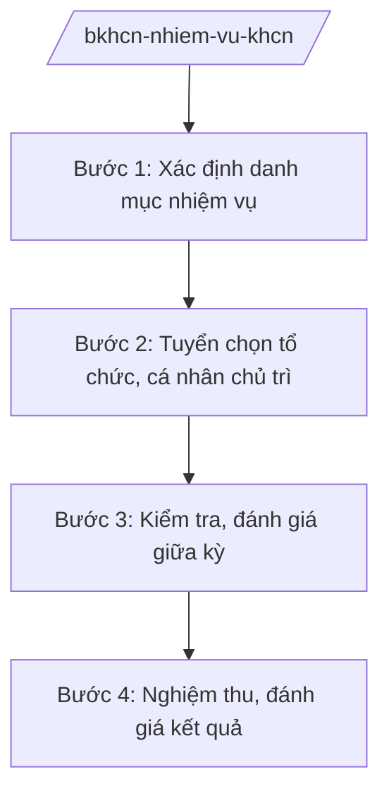

# Skill: Nhiệm vụ KH&CN cấp quốc gia

## 2. Khi nào dùng

Khi Bộ Khoa học và Công nghệ quản lý các nhiệm vụ KH&CN cấp quốc gia: xác định danh mục,
tuyển chọn tổ chức, cá nhân chủ trì; kiểm tra, nghiệm thu, đánh giá kết quả; quản lý kinh phí.

## 3. Đầu vào (Input)

| Trường | Mô tả | Bắt buộc |
|--------|-------|----------|
| `ten_nhiem_vu` | Tên nhiệm vụ KH&CN | Có |
| `cap_quan_ly` | Cấp quản lý: quốc gia / bộ / tỉnh (skill này tập trung cấp quốc gia) | Có |
| `linh_vuc` | Lĩnh vực nghiên cứu | Có |
| `to_chuc_chu_tri` | Tổ chức, cá nhân đề xuất chủ trì | Không |
| `kinh_phi_du_kien` | Kinh phí dự kiến từ ngân sách | Có |
| `thoi_gian` | Thời gian thực hiện | Có |

## 4. Quy trình

**Bước 1. Xác định danh mục nhiệm vụ**

- Làm gì: Đề xuất, tổng hợp nhu cầu; hội đồng tư vấn xác định danh mục nhiệm vụ KH&CN
  cấp quốc gia; Bộ trưởng phê duyệt danh mục.
- Dùng input: `linh_vuc`, `ten_nhiem_vu`.
- Vai trò: Vụ Khoa học và Công nghệ các ngành kinh tế – kỹ thuật (hoặc vụ chuyên ngành) chủ trì; AI hỗ trợ tổng hợp đề xuất, dự thảo danh mục ⏱ ~2 giờ (ước tính).
- Lưu ý nghiệp vụ: Nhiệm vụ phải phục vụ mục tiêu chiến lược, có tính cấp thiết, khả thi.
- → Kết quả bước: Danh mục nhiệm vụ được phê duyệt.

**Bước 2. Tuyển chọn tổ chức, cá nhân chủ trì**

- Làm gì: Thông báo tuyển chọn; nhận hồ sơ; hội đồng tuyển chọn đánh giá; phê duyệt kết quả.
- Dùng input: `to_chuc_chu_tri`, danh mục đã phê duyệt.
- Vai trò: Đơn vị quản lý nhiệm vụ tổ chức; AI hỗ trợ tổng hợp hồ sơ, lập biên bản hội đồng (2–3 giờ).
- Lưu ý nghiệp vụ: Tuyển chọn công khai, minh bạch; hội đồng độc lập, khách quan.
- → Kết quả bước: Quyết định phê duyệt tổ chức, cá nhân chủ trì + hợp đồng thực hiện.

**Bước 3. Kiểm tra, đánh giá giữa kỳ**

- Làm gì: Kiểm tra tiến độ, nội dung, kinh phí; đánh giá giữa kỳ; điều chỉnh khi cần.
- Dùng input: Báo cáo tiến độ của chủ nhiệm nhiệm vụ.
- Vai trò: Chuyên viên quản lý theo dõi; AI hỗ trợ tổng hợp báo cáo kiểm tra (1–2 giờ).
- Lưu ý nghiệp vụ: Kịp thời phát hiện chậm tiến độ, sai phạm trong sử dụng kinh phí.
- → Kết quả bước: Báo cáo kiểm tra giữa kỳ; quyết định điều chỉnh (nếu có).

**Bước 4. Nghiệm thu, đánh giá kết quả**

- Làm gì: Tổ chức hội đồng nghiệm thu cấp quốc gia; đánh giá, xếp loại; công nhận kết quả;
  thanh lý hợp đồng.
- Dùng input: Báo cáo tổng kết, sản phẩm nhiệm vụ.
- Vai trò: Hội đồng nghiệm thu đánh giá; AI hỗ trợ tổng hợp hồ sơ nghiệm thu, dự thảo ⏱ ~3–5 ngày làm việc (ước tính).
  biên bản (2–3 giờ).
- Lưu ý nghiệp vụ: Sản phẩm phải đối chiếu với thuyết minh, hợp đồng đã ký; xử lý vi phạm
  (thu hồi kinh phí) nếu không đạt.
- → Kết quả bước: Biên bản nghiệm thu; quyết định công nhận kết quả.

## Luồng quy trình (Workflow)

## 5. Đầu ra (Output)

- Danh mục nhiệm vụ; quyết định tuyển chọn; hợp đồng thực hiện.
- Báo cáo kiểm tra giữa kỳ; biên bản nghiệm thu; quyết định công nhận kết quả.

### Cấu trúc output chuẩn (thể thức NĐ 30/2020/NĐ-CP) (quyết định công nhận kết quả nhiệm vụ)

1. Quốc hiệu "CỘNG HÒA XÃ HỘI CHỦ NGHĨA VIỆT NAM", Tiêu ngữ "Độc lập – Tự do – Hạnh phúc"; số, ký hiệu: …/QĐ-BKHCN.
2. Căn cứ (NĐ 55/2025/NĐ-CP; quy định quản lý nhiệm vụ KH&CN...).
3. Điều 1: Công nhận kết quả thực hiện nhiệm vụ (tên, chủ nhiệm, tổ chức chủ trì, xếp loại).
4. Điều 2: Giao quyền sở hữu, sử dụng kết quả; trách nhiệm ứng dụng.
5. Điều 3: Hiệu lực; trách nhiệm thi hành.
6. Nơi nhận (kết thúc "- Lưu: VT, [mã đơn vị]."); chữ ký (ghi rõ chức danh, họ tên người ký; ký hiệu "KT."/"TL." khi ký thay) người có thẩm quyền.
## 6. Checklist nghiệm thu

- [ ] Danh mục nhiệm vụ được phê duyệt đúng thẩm quyền.
- [ ] Tuyển chọn công khai, minh bạch, đúng trình tự.
- [ ] Hợp đồng đầy đủ: nội dung, kinh phí, tiến độ, sản phẩm.
- [ ] Kiểm tra giữa kỳ kịp thời, có báo cáo.
- [ ] Nghiệm thu đúng hội đồng, đúng tiêu chí; sản phẩm đối chiếu thuyết minh.
- [ ] Xử lý vi phạm (nếu có) đúng quy định.
- [ ] Đúng thể thức NĐ 30/2020/NĐ-CP.
- [ ] Đã qua human gate đầy đủ.

## 7. Ví dụ mô phỏng

*Dữ liệu dưới đây là giả lập 100% phục vụ minh họa.*

**Input mẫu:** `ten_nhiem_vu` = "Nghiên cứu ứng dụng trí tuệ nhân tạo trong dự báo thiên tai"
(tên giả lập); `cap_quan_ly` = quốc gia; `kinh_phi_du_kien` = 10 tỷ đồng (giả lập);
`thoi_gian` = 36 tháng.

**Output mẫu (trích cấu trúc chuẩn):**

> **BỘ KHOA HỌC VÀ CÔNG NGHỆ**
> **CỘNG HÒA XÃ HỘI CHỦ NGHĨA VIỆT NAM**
> **Độc lập – Tự do – Hạnh phúc**
>
> Số: 1234/QĐ-BKHCN *(số hiệu giả lập)*
>
> **QUYẾT ĐỊNH**
> **Công nhận kết quả thực hiện nhiệm vụ khoa học và công nghệ cấp quốc gia**
>
> *Căn cứ Nghị định số 55/2025/NĐ-CP ngày 02/3/2025 của Chính phủ...;*
> *Căn cứ kết quả nghiệm thu của Hội đồng...;*
> *Theo đề nghị của Vụ trưởng...*
>
> **Điều 1.** Công nhận kết quả thực hiện nhiệm vụ "Nghiên cứu ứng dụng trí tuệ nhân tạo
> trong dự báo thiên tai" *(tên giả lập)*, xếp loại: Đạt...

## 8. Human gate

1. Vụ trưởng vụ chuyên ngành: duyệt danh mục, hồ sơ tuyển chọn.
2. Hội đồng tư vấn/tuyển chọn/nghiệm thu: đánh giá độc lập.
3. Thứ trưởng phụ trách: duyệt kết quả tuyển chọn, nghiệm thu.
4. Bộ trưởng Bộ KH&CN: phê duyệt danh mục, ký quyết định công nhận.

## 9. Giới hạn

- AI không quyết định tuyển chọn, đánh giá, xếp loại thay hội đồng và người có thẩm quyền.
- AI không bịa kết quả nghiên cứu, số liệu nghiệm thu.
- AI không tự ký, ban hành văn bản.
- AI không viện dẫn văn bản hết hiệu lực.

## 10. Căn cứ & lưu ý

- Nghị định số 55/2025/NĐ-CP ngày 02/3/2025 của Chính phủ quy định chức năng, nhiệm vụ,
  quyền hạn và cơ cấu tổ chức của Bộ Khoa học và Công nghệ (hiệu lực từ 01/3/2025).
- Pháp luật về khoa học và công nghệ (quản lý nhiệm vụ KH&CN các cấp).
- Nghị định số 30/2020/NĐ-CP về công tác văn thư (thể thức văn bản).
