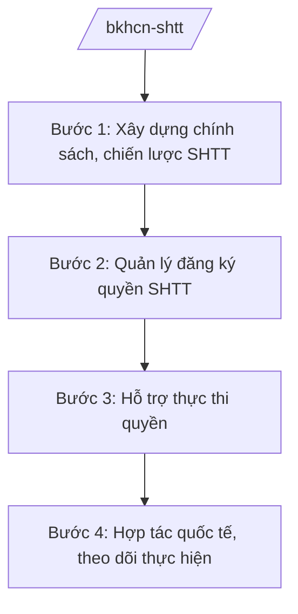

# Skill: Sở hữu trí tuệ

## 2. Khi nào dùng

Khi Bộ Khoa học và Công nghệ thực hiện quản lý nhà nước về sở hữu trí tuệ: xây dựng chính sách;
quản lý hệ thống đăng ký quyền SHTT (sáng chế, kiểu dáng công nghiệp, nhãn hiệu, chỉ dẫn địa lý);
hỗ trợ thực thi quyền; hợp tác quốc tế về SHTT.

## 3. Đầu vào (Input)

| Trường | Mô tả | Bắt buộc |
|--------|-------|----------|
| `nhiem_vu` | Nhiệm vụ: chính sách / đăng ký / thực thi / hợp tác quốc tế | Có |
| `doi_tuong_sh` | Đối tượng SHTT: sáng chế / nhãn hiệu / KDCN / chỉ dẫn địa lý / quyền tác giả liên quan | Có |
| `ho_so` | Hồ sơ đăng ký hoặc hồ sơ vụ việc (nếu có) | Không |
| `muc_tieu` | Mục tiêu chính sách/chương trình | Không |

## 4. Quy trình

**Bước 1. Xây dựng chính sách, chiến lược SHTT**

- Làm gì: Xây dựng chiến lược SHTT quốc gia; chính sách hỗ trợ đăng ký, khai thác tài sản trí tuệ.
- Dùng input: `nhiem_vu`, `muc_tieu`.
- Vai trò: Cục Sở hữu trí tuệ (Bộ KH&CN) chủ trì; AI hỗ trợ dự thảo chính sách, tổng hợp ⏱ ~5–7 ngày làm việc (ước tính).
  kinh nghiệm quốc tế (2–3 giờ).
- Lưu ý nghiệp vụ: Phù hợp cam kết quốc tế (WTO/TRIPS, các FTA thế hệ mới).
- → Kết quả bước: Dự thảo chiến lược/chính sách SHTT.

**Bước 2. Quản lý đăng ký quyền SHTT**

- Làm gì: Tiếp nhận, thẩm định đơn đăng ký sáng chế, nhãn hiệu, kiểu dáng công nghiệp,
  chỉ dẫn địa lý; cấp văn bằng bảo hộ.
- Dùng input: `ho_so`, `doi_tuong_sh`.
- Vai trò: Thẩm định viên Cục Sở hữu trí tuệ thực hiện; AI hỗ trợ kiểm tra tính đầy đủ hồ sơ, ⏱ ~1–2 ngày làm việc (ước tính).
  tra cứu trùng lặp sơ bộ (1–2 giờ/đơn).
- Lưu ý nghiệp vụ: AI chỉ hỗ trợ tra cứu, tổng hợp — quyết định cấp/từ chối do thẩm định viên
  và người có thẩm quyền quyết định theo quy định pháp luật SHTT.
- → Kết quả bước: Quyết định cấp/từ chối văn bằng bảo hộ.

**Bước 3. Hỗ trợ thực thi quyền**

- Làm gì: Hướng dẫn xử lý xâm phạm quyền SHTT; phối hợp cơ quan thực thi (quản lý thị trường,
  hải quan, công an); tuyên truyền, nâng cao nhận thức.
- Dùng input: Hồ sơ vụ việc xâm phạm (nếu có).
- Vai trò: Cục Sở hữu trí tuệ phối hợp; AI hỗ trợ tổng hợp vụ việc, dự thảo văn bản hướng dẫn (2 giờ).
- Lưu ý nghiệp vụ: Không thay thế cơ quan xử lý vi phạm; chỉ hướng dẫn, phối hợp.
- → Kết quả bước: Văn bản hướng dẫn, báo cáo phối hợp xử lý.

**Bước 4. Hợp tác quốc tế, theo dõi thực hiện**

- Làm gì: Tham gia điều ước quốc tế về SHTT (WIPO); hợp tác song phương; theo dõi chỉ số
  đăng ký, xếp hạng đổi mới sáng tạo.
- Dùng input: Kết quả các bước trên.
- Vai trò: Cục Sở hữu trí tuệ chủ trì; AI hỗ trợ tổng hợp báo cáo định kỳ (2 giờ).
- Lưu ý nghiệp vụ: Điều ước quốc tế về SHTT phải qua trình tự ký kết, phê duyệt theo quy định
  pháp luật về điều ước quốc tế; số liệu chỉ số có nguồn chính thức.
- → Kết quả bước: Báo cáo SHTT định kỳ; văn bản hợp tác quốc tế.

## Luồng quy trình (Workflow)

## 5. Đầu ra (Output)

- Chiến lược/chính sách SHTT (đúng thể thức NĐ 30/2020/NĐ-CP).
- Quyết định cấp/từ chối văn bằng bảo hộ.
- Văn bản hướng dẫn thực thi; báo cáo SHTT định kỳ.

### Cấu trúc output chuẩn (quyết định cấp văn bằng)

1. Quốc hiệu "CỘNG HÒA XÃ HỘI CHỦ NGHĨA VIỆT NAM", Tiêu ngữ "Độc lập – Tự do – Hạnh phúc"; số, ký hiệu: …/QĐ-SHTT.
2. Căn cứ (pháp luật SHTT; NĐ 55/2025/NĐ-CP...).
3. Điều 1: Cấp văn bằng bảo hộ (loại, số đơn, chủ văn bằng, phạm vi).
4. Điều 2: Hiệu lực văn bằng; nghĩa vụ của chủ văn bằng.
5. Nơi nhận (kết thúc "- Lưu: VT, [mã đơn vị]."); chữ ký (ghi rõ chức danh, họ tên người ký; ký hiệu "KT."/"TL." khi ký thay) người có thẩm quyền.

> **Chuẩn tài liệu đầu ra** (thứ tự ưu tiên):
> 1. Chuẩn riêng của ngành/cơ quan chủ quản — mẫu, biểu mẫu, quy chuẩn tại văn bản quy phạm chuyên ngành (xem mục "Căn cứ & lưu ý").
> 2. Tài liệu không có quy chuẩn riêng — thể thức NĐ 30/2020/NĐ-CP: Quốc hiệu và Tiêu ngữ; tên cơ quan ban hành; số, ký hiệu; địa danh và thời gian; tên loại và trích yếu; nội dung; chức vụ, họ tên, chữ ký người có thẩm quyền; dấu, chữ ký số; nơi nhận (kèm Phụ lục nếu có).

## 6. Checklist nghiệm thu

- [ ] Chính sách phù hợp cam kết quốc tế.
- [ ] Hồ sơ đăng ký được thẩm định đúng trình tự, đúng thời hạn.
- [ ] Quyết định cấp/từ chối có căn cứ pháp lý rõ ràng.
- [ ] Không để AI quyết định thay thẩm định viên.
- [ ] Đúng thể thức NĐ 30/2020/NĐ-CP.
- [ ] Đã qua human gate đầy đủ.

## 7. Ví dụ mô phỏng

*Dữ liệu dưới đây là giả lập 100% phục vụ minh họa.*

**Input mẫu:** `nhiem_vu` = đăng ký; `doi_tuong_sh` = nhãn hiệu; `ho_so` = đơn đăng ký nhãn hiệu
giả lập của doanh nghiệp (tên giả lập: "Công ty TNHH Công nghệ AA").

**Output mẫu (trích cấu trúc chuẩn):**

> **BỘ KHOA HỌC VÀ CÔNG NGHỆ**
> **CỤC SỞ HỮU TRÍ TUỆ**
> **CỘNG HÒA XÃ HỘI CHỦ NGHĨA VIỆT NAM**
> **Độc lập – Tự do – Hạnh phúc**
>
> Số: 1234/QĐ-SHTT *(số hiệu giả lập)*
>
> **QUYẾT ĐỊNH**
> **Về việc cấp Giấy chứng nhận đăng ký nhãn hiệu**
>
> *Căn cứ pháp luật về sở hữu trí tuệ;*
> *Căn cứ Nghị định số 55/2025/NĐ-CP ngày 02/3/2025 của Chính phủ...;*
>
> **Điều 1.** Cấp Giấy chứng nhận đăng ký nhãn hiệu số ... cho Công ty TNHH Công nghệ AA
> *(tên giả lập)*...

## 8. Human gate

1. Thẩm định viên: thẩm định nội dung đơn đăng ký.
2. Cục trưởng Cục Sở hữu trí tuệ: ký quyết định cấp/từ chối văn bằng.
3. Thứ trưởng phụ trách: duyệt chính sách, chiến lược trước khi trình.
4. Bộ trưởng: ký tờ trình Chính phủ (chiến lược quốc gia).

## 9. Giới hạn

- AI không quyết định cấp/từ chối văn bằng bảo hộ thay thẩm định viên và người có thẩm quyền.
- AI không bịa kết quả tra cứu, đánh giá khả năng bảo hộ.
- AI không tự ký, ban hành văn bản.
- AI không viện dẫn văn bản hết hiệu lực.

## 10. Căn cứ & lưu ý

- Nghị định số 55/2025/NĐ-CP ngày 02/3/2025 của Chính phủ quy định chức năng, nhiệm vụ,
  quyền hạn và cơ cấu tổ chức của Bộ Khoa học và Công nghệ (hiệu lực từ 01/3/2025).
- Pháp luật về sở hữu trí tuệ.
- Cam kết quốc tế về SHTT (WTO/TRIPS, các FTA) — chỉ dẫn tên điều ước, không bịa số hiệu.
- Nghị định số 30/2020/NĐ-CP về công tác văn thư (thể thức văn bản).
